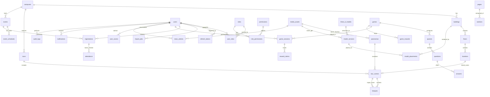

# 06. KIỂM TOÁN CƠ SỞ DỮ LIỆU (POSTGRESQL & PRISMA ORM)

Kiểm toán toàn bộ hiện trạng Database, cấu hình hạ tầng dữ liệu, rà soát 8 nhóm thực thể logic (Section 10) và đề xuất lược đồ quan hệ + ERD chuẩn (Section 19E).

---

## 1. Kiểm Tra Hiện Trạng Database (Section 10 Checklist)

| Hạng mục kiểm tra | Kết quả | Bằng chứng quan sát thực tế |
|---|---|---|
| PostgreSQL đã cấu hình? | **CHỈ CÓ TEMPLATE DOCKER** | `docker-compose.yml:4-21` khai báo image `postgres:16-alpine`, container `fpt_virtual_campus_db`, DB `virtual_campus_360`, user `fpt_admin`. |
| Ứng dụng có kết nối DB thành công? | **KHÔNG** | Chưa có driver `pg`/`prisma` trong workspace; không có file `.env` (chỉ có `.env.example`); Docker daemon hiện không chạy. |
| Prisma schema có tồn tại? | **KHÔNG (`S0`)** | Không có thư mục `prisma/`, không có file `schema.prisma` ở root hay `apps/*`. |
| Migrations đã được tạo? | **KHÔNG (`S0`)** | Không có bất kỳ file migration SQL nào. |
| Migrations đã được áp dụng (applied)? | **KHÔNG (`S0`)** | Chưa có schema hoặc database vận hành. |
| Foreign keys đã cài đặt đúng? | **CHƯA CÓ** | Chưa có bảng dữ liệu nào. |
| Unique constraints đã cài đặt? | **CHƯA CÓ** | Chưa có bảng dữ liệu nào. |
| Indexes đã phù hợp? | **CHƯA CÓ** | Chưa có bảng dữ liệu nào. |
| Relationships đúng chuẩn? | **CHƯA CÓ** | Chưa có bảng dữ liệu nào. |
| Seed data có sẵn? | **KHÔNG (`S0`)** | Không có `prisma/seed.ts`; toàn bộ dữ liệu mẫu đang bị nhúng cứng trong TSX của `apps/web`. |
| Backup đã cấu hình? | **KHÔNG (`S0`)** | `docker-compose.yml` mới khai báo volume cục bộ `postgres_data`; chưa có cron `pg_dump`, WAL archiving hay managed DB snapshot. |

---

## 2. Đánh Giá 8 Nhóm Thực Thể Đề Xuất & Khoảng Trống Quan Hệ

Đối chiếu danh sách thực thể logic tại Mục 10 của yêu cầu kiểm toán với toàn bộ nghiệp vụ của hệ thống:

1. **USER MANAGEMENT (`users`, `roles`, `permissions`, `user_roles`):**
   - **Thiếu trong danh sách đề xuất:**
     - `role_permissions`: Bảng nối N-N giữa `roles` và `permissions` (nếu thiếu sẽ không gán quyền hạt mịn cho từng vai trò được).
     - `refresh_tokens` (hoặc `user_sessions`): Lưu hash refresh token, hạn dùng, thiết bị, thu hồi phiên khi bị khóa tài khoản hoặc đổi mật khẩu.
     - `password_resets` / trường `must_change_password`, `password_changed_at`, `student_code`, `parent_phone`, `campus_id` trên `users`.
2. **CAMPUS (`campuses`, `buildings`, `floors`, `locations`):**
   - Quan hệ hợp lý: `campuses (1) ─< buildings (1) ─< floors (1) ─< locations`.
   - **Lưu ý bổ sung:** Cần giữ `building_id` hoặc index chuẩn để truy vấn nhanh danh sách phòng theo tòa nhà mà không phải join quá nhiều tầng khi lọc; hỗ trợ cột `slug` duy nhất cho URL `/locations/[slug]` và trạng thái `status` (`active | maintenance | occupied`).
3. **VIRTUAL CAMPUS (`tours`, `panoramas`, `hotspots`, `tour_scenes`, `scene_connections`):**
   - **Điểm dễ trùng lặp / cần làm rõ:** Giữa `panoramas` và `tour_scenes`: một ảnh panorama vật lý nên nằm trong `media_assets` (hoặc `panoramas` chứa metadata kích thước, tile manifest Marzipano, loại chiếu equirectangular 2:1), còn `tour_scenes` chứa cấu hình đặt vào một `tours` cụ thể (góc nhìn ban đầu `initial_yaw`, `initial_pitch`, `initial_fov`, liên kết `location_id`, thứ tự hiển thị). `hotspots` gắn với `tour_scenes` qua tọa độ `(yaw, pitch)`. `scene_connections` có thể được hợp nhất hoặc liên kết trực tiếp từ `hotspots` (loại `type = 'SCENE_LINK'`) để tránh sai lệch dữ liệu 2 nơi khi cập nhật liên kết giữa các cảnh.
4. **3D (`three_d_models`, `model_versions`, `model_placements`):**
   - Thiết kế tốt theo vòng đời sản xuất tài sản: `three_d_models` → nhiều `model_versions` (lưu `file_url`, kích thước, số poly/triangle, cờ `is_active`, trạng thái review trước khi xuất bản) → `model_placements` gắn model vào `campus_id`/`building_id` kèm vector `(pos_x, pos_y, pos_z)`, `(rot_x, rot_y, rot_z)`, `scale`, và dữ liệu `collider_bounds` cho Walk Mode.
5. **EVENTS (`events`, `event_schedules`, `registrations`, `attendance`):**
   - `events (1) ─< event_schedules`: Chia từng khung giờ/workshop trong Open Day.
   - `registrations`: Cần hỗ trợ cả **Khách công khai** (`user_id NULL`, dùng email/SĐT) lẫn **Sinh viên/Phụ huynh đã đăng nhập** (`user_id NOT NULL`), thêm `ticket_code` (`UNIQUE`), `qr_payload_hash`, `selected_schedule_ids`, trạng thái vé.
   - `attendance`: Lưu `checked_in_at`, `checked_in_by` (admin/CTV), `checkpoint_name`.
6. **GAMIFICATION (`games`, `quizzes`, `questions`, `answers`, `game_sessions`, `user_scores`):**
   - **Thiếu thực thể quà tặng/đổi thưởng:** Trong `OpenDayMiniGame.tsx`, có phần **Vòng quay may mắn & Mã quà tặng** (`POLY2025-XXXX`). Do đó cần bổ sung bảng `game_rewards` (kho giải thưởng, tỷ lệ trúng, số lượng còn lại) và `reward_claims` (mã voucher cấp cho phiên chơi, trạng thái đã nhận quà tại quầy hay chưa) để chống gian lận reset vô hạn.
7. **CMS (`pages`, `sections`, `media_assets`, `navigation_items`, `site_settings`):**
   - **Thiếu thực thể Tin tức & FAQ:** Hiện tại danh sách đề xuất chưa có `news_articles` (slug, category, summary, body, featured, published_at, author_id, related_scene_id) và `faqs` (trang `/contact`). Cần bổ sung rõ vào nhóm CMS thay vì nhét bài viết báo chí vào bảng `pages` chung chung.
   - Đồng thời `media_assets` là bảng trung tâm cần liên kết sạch tới `storage_key`, `bucket`, `cdn_url`, `mime_type`, `size_bytes`, `width`, `height`, `checksum_sha256`, `status` (`DRAFT | PUBLISHED | ARCHIVED`).
8. **SYSTEM (`notifications`, `contact_submissions`, `audit_logs`, `import_jobs`):**
   - Đầy đủ cho luồng vận hành. Cần thêm cột `error_report_url` / `summary_json` cho `import_jobs` để admin tải file báo lỗi dòng CSV/Excel không hợp lệ; và `metadata_json`, `ip_address`, `user_agent` cho `audit_logs`.

---

## 3. Sơ Đồ ERD Đề Xuất (Target PostgreSQL Schema — Mermaid)

---

## 4. Khuyến Nghị Ràng Buộc Duy Nhất (Unique) & Đánh Chỉ Mục (Indexing)

Khi triển khai `prisma/schema.prisma`, bắt buộc phải thiết lập ngay từ migration đầu tiên:

1. **Unique Constraints bắt buộc:**
   - `users.username` (MSSV / SĐT / mã nhân sự) và `users.email` (nullable unique).
   - `roles.code`, `permissions.code`, khóa chính ghép `(user_id, role_id)` và `(role_id, permission_id)`.
   - `campuses.code`, `buildings(campus_id, code)`, `buildings.slug`, `locations.slug`, `tours.slug`, `tour_scenes(tour_id, slug)`, `news_articles.slug`, `pages.slug`.
   - `registrations.ticket_code` và cặp `(event_id, email)` hoặc `(event_id, phone_number)` để tránh 1 người spam tạo hàng trăm vé trùng trong cùng sự kiện.
   - `reward_claims.voucher_code`.
2. **Indexes tối ưu truy vấn phổ biến:**
   - `locations(building_id, category, status)` cho bộ lọc `/locations`.
   - `hotspots(scene_id)` cho API tải scene 360° cực nhanh (<50ms).
   - `news_articles(status, category, published_at DESC)` cho trang chủ & `/news`.
   - `user_scores(campus_id, season_key, total_xp DESC)` cho bảng xếp hạng `/leaderboard`.
   - `audit_logs(entity_type, entity_id, created_at DESC)` và `(actor_id, created_at DESC)` cho truy vết bảo mật.
   - `media_assets(status, type, created_at DESC)`.
3. **Bảo mật & Vận hành DB:** Tuyệt đối đổi mật khẩu mẫu đang công khai trong `.env.example` & `docker-compose.yml` (`fpt_poly_secret_2026`) trước khi lên staging/production; bật connection pooling (PgBouncer / Prisma Accelerate / pool config) và tự động `pg_dump` hằng ngày lên Object Storage riêng.
