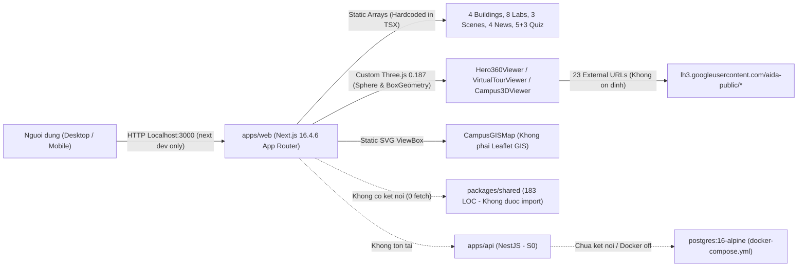
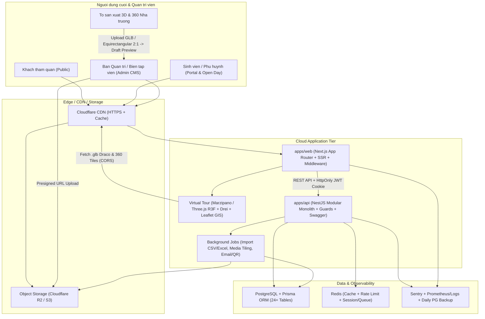

# 14. ĐÁNH GIÁ KIẾN TRÚC HIỆN TẠI VS KIẾN TRÚC MỤC TIÊU

So sánh kiến trúc thực tế đang chạy trong workspace với kiến trúc Hybrid Production đã được chốt ở Mục 3 của đề bài (Section 19F).

---

## 1. Kiến Trúc Thực Tế Hiện Tại (Current Architecture — Local Frontend Prototype)

Toàn bộ hệ thống hiện thu gọn thành một ứng dụng Frontend đơn lẻ phụ thuộc link ảnh Google bên ngoài, không có tầng API, không có tầng Database và không sử dụng các thư viện 3D/360° nâng cao như đã hoạch định:

---

## 2. Kiến Trúc Mục Tiêu Đã Xác Nhận (Target Hybrid Production Architecture)

Hệ thống hướng tới vận hành Hybrid: Web + API + CDN trên Cloud kết hợp quy trình sản xuất & kiểm duyệt tài sản 3D/360° phía Nhà trường trước khi xuất bản:

---

## 3. Các Điểm Khác Biệt Kiến Trúc Trọng Tâm

| Khía cạnh | Thực tế hiện tại | Kiến trúc mục tiêu (Confirmed) | Mức chênh lệch |
|---|---|---|---|
| **Monorepo Active Apps** | Chỉ chạy `apps/web`; `packages/shared` đứng cô lập. | `apps/web` + `apps/api` dùng chung `@fpt-campus/shared`. | Rất lớn (`apps/api` = 0%) |
| **Rendering Strategy** | Hầu hết các trang gắn `"use client"`, build đang gãy tại `globals.css`. | Tận dụng SSR/RSC cho Public SEO + Client Islands cho 3D/360/Interactive. | Lớn |
| **Virtual 360° Engine** | Three.js `SphereGeometry` thuần + ảnh 16:9 gây seam dọc + leak renderer. | Marzipano (multi-resolution tiles) hoặc Three.js sạch + ảnh equirectangular 2:1 chuẩn từ CDN. | Lớn |
| **3D Campus Engine** | Three.js thuần với `BoxGeometry`/`CylinderGeometry` thủ công, `public/models/` rỗng. | React Three Fiber + Drei + mô hình `.glb/.gltf` nén Draco/KTX2 đo đạc thực tế. | Rất lớn |
| **GIS Map** | Sơ đồ `<svg>` tĩnh 1000×650 zoom bằng CSS `scale`. | Bản đồ GIS thật (Leaflet/Mapbox) gắn tọa độ GPS & đồng bộ dữ liệu DB. | Lớn |
| **Backend & Dữ liệu** | 0% Backend, 0% DB, 100% mảng tĩnh trong file `.tsx`. | NestJS Modular Monolith (23 modules) + PostgreSQL + Prisma ORM. | Tuyệt đối (0% → 100%) |
| **Auth & Phân quyền** | `/login` giả lập 600ms; `/portal` & `/admin` mở tự do. | JWT + Refresh Token (`HttpOnly`), bcrypt/argon2, import CSV/Excel, Forced Password Change, NestJS RBAC Guards. | Tuyệt đối (0% → 100%) |
| **Media & Triển khai** | 23 URL tạm `lh3.googleusercontent.com`, chưa có Docker/CI/CDN. | Cloudflare R2/S3 + CDN + quy trình duyệt tài sản nhà trường (Upload → Preview → Publish) + CI/CD & Backup. | Rất lớn |

---

## 4. Rủi Ro Kiến Trúc & Kỹ Thuật Lớn Nhất

1. **Rủi ro "Vỏ đẹp nhưng Ruột rỗng" (Scope vs Reality Illusion):** Giao diện Public & Admin dashboard dễ tạo cảm giác dự án đã xong 60–70%, nhưng thực tế toàn bộ Backend, Database, Auth, Media Pipeline và 11/12 màn quản trị CMS đều ở trạng thái `S0`/`S2` (khối lượng kỹ thuật khó nhất vẫn ở phía trước).
2. **Rủi ro Gãy Toàn Bộ Hình Ảnh Do Link Google:** Phụ thuộc 23 đường dẫn `lh3.googleusercontent.com/aida-public/...` nằm ngoài quyền kiểm soát lưu trữ của FPT Polytechnic.
3. **Rủi ro Tài Nguyên 3D/360° Nặng Gây Treo Mobile:** Nếu đưa ảnh panorama 8K–12K hoặc file `.glb` thô chưa nén Draco/LOD/Tile từ tổ 3D nhà trường lên trực tiếp web mà thiếu bước xử lý + giới hạn kích thước ở `MediaModule`, người dùng điện thoại tầm trung sẽ bị trắng màn hình hoặc văng trình duyệt.
4. **Rủi ro Sai Lệch Tài Liệu Gây Hiểu Nhầm Cho Team Mới:** `README.md` và `docs/` viết như thể hệ thống đã cài R3F, Drei, Marzipano, Leaflet, React Query, Zustand và còn giữ `desktop/`/`mobile/`. Bất kỳ dev nào mới vào đọc tài liệu cũ mà không kiểm tra code sẽ bị định hướng sai hoàn toàn.

---

## 5. Khuyến Nghị Kiến Trúc Thực Tế

1. **Cập nhật lại ngay tài liệu `README.md` và `docs/`** (hoặc coi `PROJECT_STATUS.md` & `docs/project-audit/` là nguồn sự thật mới) để thống nhất stack đang chạy và các hạng mục còn lại.
2. **Dựng xương sống Backend + DB + Auth trước khi làm đẹp thêm UI:** Mọi tính năng mới từ giờ (Open Day, Gamification, CMS, Locations, News) phải được thiết kế theo hợp đồng API của `@fpt-campus/shared`.
3. **Quy chuẩn hóa đầu vào 3D/360° với đội sản xuất phía Nhà trường ngay từ sớm:** Thống nhất định dạng ảnh **Equirectangular 2:1** (tỉ lệ rộng:cao = 2:1, tối thiểu 4096×2048 hoặc 8192×4096 cho Panorama 360°) và **`.glb` có tối ưu Draco + chuẩn trục tọa độ `(0,0,0)` + giới hạn poly/texture** trước khi xây `ThreeDModule` & `Admin CMS Preview`.
4. **Quyết định thực dụng giữa Marzipano vs R3F cho 360°:** Nếu ưu tiên tốc độ ra MVP và mượt trên điện thoại yếu cho ảnh 8K+, **Marzipano** vượt trội rõ rệt nhờ hỗ trợ multi-resolution tile pyramid sẵn; còn cho **3D Campus Explorer**, chuyển sang **React Three Fiber + Drei** (tách route `/campus-3d`) là hoàn toàn hợp lý với hệ sinh thái React 19 (kiểm tra tương thích `@react-three/fiber` v9 cho React 19 trước khi cài!).
