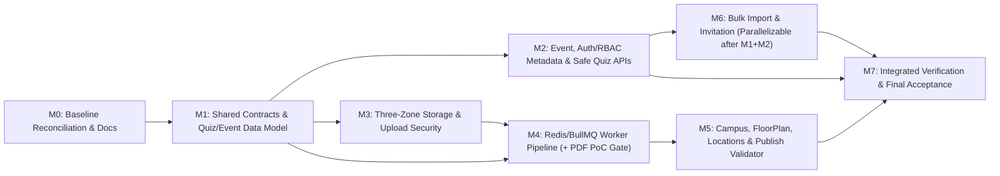

# PHASE 2A-3 — IMPLEMENTATION PLAN (`M0–M7`)

- **Phiên bản:** `v1.0`
- **Baseline:** `main` @ `ff13f14372a92738ee472a2577ceba50225b5021` (`ff13f14`)
- **Phạm vi Quản lý:** Toàn bộ Phase 2A-3 Backend First theo [`PHASE_2A_3_SCOPE_LOCK.md`](./PHASE_2A_3_SCOPE_LOCK.md) và [`PHASE_2A_3_DECISION_REGISTER.md`](./PHASE_2A_3_DECISION_REGISTER.md).

---

## 1. Sơ đồ Phụ thuộc Milestone (`Dependency DAG`)

**Quy tắc điều phối bắt buộc:**
1. **`M0` → `M1` → `M2`/`M3`:** Không mở code mới cho đến khi `M0` được nghiệm thu và `M1` khóa xong `@fpt-campus/shared` + migration Quiz/Event.
2. **Song song hóa có điều kiện cho `M6`:** `M6` (Bulk Import & Invitation) **chỉ** được phép phát triển song song với `M3–M5` sau khi hợp đồng `@fpt-campus/shared` (`M1`) và lookup Event metadata / RBAC foundation (`M2`) đã ổn định; việc tích hợp toàn hệ thống vẫn bắt buộc hội tụ tại `M7`.
3. **PDF Renderer PoC Gate:** Việc chọn và lập trình bộ xử lý PDF đa trang trong `M4`/`M5` **bị chặn (BLOCKED)** cho tới khi hoàn thành **Technical PoC chạy đạt trên cả Windows host VÀ Linux container**. Trong thời gian chờ PDF PoC, phần pipeline ảnh (`PANORAMA_2_1`, `PHOTO_2D`), SVG sanitizer và non-PDF FloorPlan (`PNG`/`JPG`/`WebP`/`SVG`) có thể phát triển bình thường theo hợp đồng.

---

## 2. Chi tiết Kế hoạch Từng Milestone (`M0–M7`)

### Milestone `M0` — Baseline Reconciliation and Documentation *(Current Authorized Task)*
- **Objective:** Xác minh baseline thực tế `main / ff13f14`, đối soát các tài liệu Phase 1 đã lỗi thời mà vẫn bảo toàn lịch sử kiểm toán, chính thức hóa Scope Lock, Decision Register (`D-2A3-01` → `D-2A3-08`) và Implementation Plan `M0–M7`.
- **In-scope work:**
  - Chạy lệnh Git read-only xác minh branch, HEAD, working tree, lịch sử commit `2A-1`/`2A-2`, sự tồn tại thực tế của `apps/api/`, `prisma/`, `docs/`.
  - Cập nhật `PROJECT_STATUS.md`, `README.md`, và bổ sung đối soát `v2A.3` vào `docs/phase-2a/PHASE_2A_IMPLEMENTATION_ROADMAP.md` (giữ nguyên dữ liệu lịch sử).
  - Tạo mới 3 tài liệu chính thức: `PHASE_2A_3_SCOPE_LOCK.md`, `PHASE_2A_3_DECISION_REGISTER.md`, `PHASE_2A_3_IMPLEMENTATION_PLAN.md` (gồm Section F về ranh giới tiên quyết `M1–M7`).
- **Explicit exclusions:** Cấm sửa mã nguồn (`apps/api/`, `apps/web/`, `packages/shared/`), cấm sửa `prisma/`/migrations/seed, cấm sửa API contracts (`PHASE_2A_API_CONTRACT.md`), runtime config (`.env*`, `docker-compose.yml`, `package.json`), cấm cài package, cấm commit/branch/merge/push, cấm chạy migration/thay đổi DB.
- **Dependencies:** Không (bắt đầu ngay trên baseline `ff13f14` sau khi Owner phê duyệt `D-2A3-01` → `D-2A3-08`).
- **Expected artifacts:**
  - [`PROJECT_STATUS.md`](../../PROJECT_STATUS.md) (updated)
  - [`README.md`](../../README.md) (updated)
  - [`docs/phase-2a/PHASE_2A_IMPLEMENTATION_ROADMAP.md`](./PHASE_2A_IMPLEMENTATION_ROADMAP.md) (updated addendum)
  - [`docs/phase-2a/PHASE_2A_3_SCOPE_LOCK.md`](./PHASE_2A_3_SCOPE_LOCK.md) (new)
  - [`docs/phase-2a/PHASE_2A_3_DECISION_REGISTER.md`](./PHASE_2A_3_DECISION_REGISTER.md) (new)
  - [`docs/phase-2a/PHASE_2A_3_IMPLEMENTATION_PLAN.md`](./PHASE_2A_3_IMPLEMENTATION_PLAN.md) (new)
- **Test requirements:** Không chạy sửa đổi hệ thống; kiểm tra `git status --short`, `git diff --stat`, `git diff --name-only`, toàn vẹn liên kết Markdown (`Broken links: 0`), và kiểm tra chéo tính nhất quán `D-2A3-01` → `D-2A3-08`.
- **Acceptance criteria:**
  1. `git branch --show-current === main`, `HEAD === ff13f14372a92738ee472a2577ceba50225b5021`.
  2. Tài liệu Phase 1 cũ (`PROJECT_STATUS.md` lịch sử, `pasted.txt`, `docs/_archive/project-audit/*`) được giữ nguyên và phân loại rõ là tài liệu lịch sử.
  3. Toàn bộ 8 quyết định `D-2A3-01` → `D-2A3-08`, chính sách rate limit Quiz, và PDF renderer deferred PoC được ghi đầy đủ, không thay đổi ý nghĩa.
  4. `git diff --name-only` & `git status --short` chứng minh **chỉ** thay đổi/tạo tài liệu Markdown, 0 thay đổi code/schema/config/frontend, 0 commit/push.
- **Stop conditions / blockers:** Baseline không khớp `main / ff13f14`, working tree không sạch trước khi bắt đầu, hoặc phát hiện mâu thuẫn chưa được Owner phê duyệt.

---

### Milestone `M1` — Shared Contracts and Quiz/Event Data Model
- **Objective:** Hoàn thiện bộ hợp đồng dữ liệu dùng chung `@fpt-campus/shared` cho toàn bộ Phase 2A-3 và thực thi an toàn schema/migration bổ sung khóa ngoại `event_id` vào `OpenDayQuizItem` theo `D-2A3-02` (kèm chuẩn bị schema nonce upload/trạng thái nếu cần cho `M3/M4`).
- **In-scope work:**
  - Thiết kế & mở rộng `packages/shared/src/*`:
    - `campus.ts`: Admin Upsert/Detail DTOs cho Campus, Building, Floor.
    - `location.ts`: LocationType DTO, Admin Location Detail/Summary, LocationMedia link/reorder DTO.
    - `tour.ts`: Admin TourNode (với ràng buộc tài liệu `initialFov 30..100`), TourEdge, Hotspot (`INFO`/`QUIZ_TRIGGER`/`SCENE_LINK`), FloorPlan upload/presign/confirm/alignment-overlay/confirm-alignment DTOs, MediaAsset presign/confirm/status/approve-preview DTOs, Publish request/result DTOs.
    - `events.ts`: Bổ sung `eventId` vào `UpsertOpenDayQuizItemInput`, Admin Event/Session/FAQ/Quiz DTOs, Event metadata lookup summary DTO.
    - `auth.ts`: Cập nhật `UserImportConfirmResultDto` bổ sung `activationToken?: string | null` cho dòng `CREATED` dùng `ADMIN_DIRECT` (`D-2A3-05`), cập nhật reasonCodes (`ROLE_CONFLICT`, `IDENTITY_CONFLICT`, v.v.).
    - `api.ts` / `common.ts`: Bổ sung mọi mã lỗi nghiệp vụ còn thiếu (`UPLOAD_TOKEN_USED`, `UPLOAD_TOKEN_EXPIRED`, `MEDIA_IN_USE`, `PDF_RENDERER_UNAVAILABLE`, v.v.).
  - Thiết kế & chạy Prisma migration 4 bước cho `open_day_quiz_items.event_id` (`D-2A3-02`):
    1. `ADD COLUMN event_id UUID NULL` + temp index.
    2. Deterministic backfill (gán các dòng khớp về `open-day-2026-qtsc`; tuyệt đối không gán bừa nếu không xác định được).
    3. Strict SQL validation block (`RAISE EXCEPTION` abort transaction nếu còn `event_id IS NULL` hoặc trỏ tới event không tồn tại).
    4. `SET NOT NULL` + `ADD CONSTRAINT ... FOREIGN KEY (event_id) REFERENCES open_day_events(id) ON DELETE RESTRICT ON UPDATE CASCADE`.
  - Bổ sung model/bảng/column nếu thiết kế `M3` cần lưu stateful single-use `upload_tokens` / `jti` trong PostgreSQL (hoặc chốt rõ dùng PostgreSQL + Redis atomic trong prerequisite trước `M1`).
  - Cập nhật `prisma/seed.ts` (idempotent) và `prisma/verify-db-integrity.ts`; cập nhật `docs/phase-2a/PHASE_2A_DATABASE_DESIGN.md` đồng bộ `initial_fov` `30..100` (`D-2A3-08`) và `event_id` FK.
- **Explicit exclusions:** Chưa triển khai endpoints NestJS mới ở `apps/api` (vẫn giữ `GET /public/events` trả `quizItems: []` và `POST /public/quiz/verify` trả `404` cho tới `M2`), chưa cài Redis/BullMQ, chưa sửa `apps/web`.
- **Dependencies:** `M0` ACCEPTED + phê duyệt Technical Design Prerequisite của `M1`.
- **Expected artifacts:**
  - Updated `packages/shared/src/*.ts` & compiled `packages/shared/dist/*`.
  - `prisma/schema.prisma`, new migration under `prisma/migrations/*_phase2a3_quiz_event_fk/` (và upload token nonce table nếu chọn DB store), updated `prisma/seed.ts` & `prisma/verify-db-integrity.ts`.
  - Updated `docs/phase-2a/PHASE_2A_DATABASE_DESIGN.md`.
- **Test requirements:**
  - `pnpm typecheck`, `pnpm --filter @fpt-campus/shared build`, `pnpm --filter web build` (xác minh `apps/web` vẫn build sạch không đổi code web).
  - Test migration 4 bước trên DB sạch & DB có dữ liệu mẫu, cộng **negative SQL test** chứng minh migration abort an toàn khi có dòng quiz mồ côi không ánh xạ được event.
  - Test idempotency `pnpm db:seed` 2 lần & `pnpm db:test` pass 100%; test hiện hữu `pnpm --filter api test` vẫn pass 35/35 (`verifyQuiz` vẫn cô lập ở `M1`).
- **Acceptance criteria:**
  1. 100% DTOs Phase 2A-3 export từ `@fpt-campus/shared` compile không lỗi TypeScript.
  2. `open_day_quiz_items.event_id` tồn tại với `NOT NULL` và `ON DELETE RESTRICT` trong PostgreSQL; negative backfill gate test pass.
  3. `apps/web` hoàn toàn không bị chỉnh sửa và build vẫn đạt 29/29 routes.
- **Stop conditions / blockers:** Phát hiện bản ghi Quiz trong DB mục tiêu không xác định được Event chủ quản; hoặc chỉnh sửa DTO trong `@fpt-campus/shared` làm gãy `apps/web` typecheck mà không có adapter tương thích.

---

### Milestone `M2` — Event, Auth/RBAC, and Quiz APIs
- **Objective:** Triển khai `OpenDayModule` cho Admin (Events, Sessions, FAQs, Quiz CRUD gắn `eventId`), mở quyền đọc Event metadata cho `EVENT_OPERATOR` (`D-2A3-07`), và mở khóa an toàn Public Quiz API kèm cơ chế rate-limit riêng chặt chẽ (`D-2A3-02`).
- **In-scope work:**
  - **Thiết kế & phê duyệt thông số trước khi code:** Đặc tả và luận giải ngưỡng `@Throttle` riêng cho `POST /api/v1/public/quiz/verify` (VD: số request/cửa sổ thời gian theo IP, mức burst chống brute-force đáp án trắc nghiệm `selectedIndex`), cập nhật `docs/phase-2a/PHASE_2A_API_CONTRACT.md`.
  - Xây dựng `OpenDayModule` trong `apps/api`:
    - Admin CRUD Events (`GET /admin/events`, `POST/PATCH/DELETE /admin/events`), `GET /admin/events/:id/metadata` hoặc list tối giản cho `EVENT_OPERATOR` (`events:write` + read-only Event metadata access — `D-2A3-07`), giữ nguyên 403 trên `GET /admin/users` & `GET /admin/audit-logs`.
    - Lookup nhẹ công khai/bán nội bộ Buildings/TourNodes phục vụ gán `tourNodeId` cho Session/Quiz của `EVENT_OPERATOR`.
    - Admin CRUD Sessions (`isPublic` preservation), FAQs, và Quiz Items (bắt buộc `eventId`, validate `tourNodeId` nếu có, không lộ internal errors).
  - Cập nhật `PublicService` & `PublicController`:
    - `GET /api/v1/public/events`: trả `quizItems` chỉ khi **cả** `OpenDayEvent` & `OpenDayQuizItem` đều `PUBLISHED && deletedAt === null`; ẩn `correctIndex` và `explanation`; trả `tourNodeSlug: null` nếu `TourNode` liên kết chưa publish/approved (`D-2A3-02`).
    - `POST /api/v1/public/quiz/verify`: gỡ tạm thời `404` cố định, áp dụng `@Throttle(...)` riêng theo ngưỡng đã luận giải; truy vấn lọc 2 lớp (`Event` & `Quiz` `PUBLISHED && deletedAt === null`); chấm in-memory stateless trả `{ results, correctCount, total }` (gồm `isCorrect`, `correctIndex`, `explanation` sau submit); 0 DB write (`OD-08`); trả `404 NOT_FOUND` fail-closed cho mọi case chưa publish/deleted/missing.
- **Explicit exclusions:** Chưa làm Bulk Import Users (`M6`), chưa sửa Auth core flow hiện hữu (`login`/`refresh`/`activate`) ngoài việc bổ sung lookup/RBAC cho Event, chưa mở Admin Studio/Upload, chưa sửa `apps/web`.
- **Dependencies:** `M1` ACCEPTED + Pre-implementation Rate-Limit Design Justification cho Quiz Verify.
- **Expected artifacts:**
  - `apps/api/src/modules/open-day/*` (module, controllers, services, DTOs), updated `public.controller.ts` & `public.service.ts`, updated `app.module.ts`.
  - Updated `docs/phase-2a/PHASE_2A_API_CONTRACT.md` (Section Event/Quiz & rate limit spec).
  - Unit & PostgreSQL Integration test suites cho OpenDay CRUD, `EVENT_OPERATOR` RBAC matrix, Public Quiz isolation, Rate limit throttling (`429`).
- **Test requirements:**
  - `pnpm --filter api typecheck`, `lint`, `build`.
  - Integration tests trên PostgreSQL thật chứng minh:
    - `TOUR_EDITOR` bị `403` trên `/admin/events*`.
    - `EVENT_OPERATOR` đọc được Events metadata & CRUD Sessions/FAQs/Quiz, nhưng vẫn bị `403` trên `GET /admin/users`, `GET /admin/audit-logs`, và `/admin/locations*`.
    - `GET /public/events` không bao giờ chứa `correctIndex`/`explanation`; Quiz gắn `TourNode` `DRAFT` trả `tourNodeSlug: null` (không ẩn Quiz).
    - `POST /public/quiz/verify` trả `404` với Quiz `DRAFT`/deleted hoặc Quiz `PUBLISHED` thuộc Event `DRAFT`/deleted; trả `200` khi cả hai `PUBLISHED`; 0 rows inserted into DB; vượt ngưỡng `@Throttle` riêng trả `429 TOO_MANY_REQUESTS`.
- **Acceptance criteria:**
  1. Toàn bộ tests hiện có + tests mới `OpenDay` & `PublicQuiz` PASS 100%.
  2. Tài liệu API Contract khớp thực tế rate limit và Event/Quiz endpoints.
  3. 0 rò rỉ đáp án trên `GET`, 0 lưu trữ điểm trên DB, 0 suy giảm bảo mật `D-2A2-01`.
- **Stop conditions / blockers:** Chưa có luận giải ngưỡng rate limit Quiz verify được ghi nhận trong tài liệu thiết kế; hoặc phát hiện `PublicService.getEvents` làm thay đổi ngoài ý muốn session/FAQ isolation.

---

### Milestone `M3` — Three-Zone Storage and Upload Security
- **Objective:** Nâng cấp `StorageModule` theo kiến trúc 3 vùng (`Private Source`, `Private Staging`, `Public Output` theo `D-2A3-03`), triển khai hệ thống cấp phát upload session/token single-use tiêu thụ `jti` nguyên tử chống replay và concurrent reuse, cách ly hoàn toàn tệp nhạy cảm khỏi `apps/web/public/`.
- **In-scope work:**
  - Cập nhật `env.schema.ts` & `.env.example` (chỉ cấu hình Backend storage): tách rõ `LOCAL_PRIVATE_MEDIA_ROOT` (VD: `.local-storage/private`, chứa phân vùng `source/` và `staging/` ngoài `apps/web/public/`) và giữ `LOCAL_PUBLIC_MEDIA_ROOT` (`apps/web/public/images`, chỉ dùng cho Zone 3 `Public Output`). Giữ tương thích đường dẫn seed `/images/...`.
  - Mở rộng `StorageAdapter` & `LocalStorageAdapter`: hỗ trợ ghi stream vào Zone 1/Zone 2, đọc an toàn từ mọi vùng, xóa tệp an toàn (cleanup/unpublish/orphan purge), promote/copy nguyên tử từ Zone 2 → Zone 3 (`Public Output`), thu hồi từ Zone 3 khi unapprove/delete, vẫn giữ nguyên lớp bảo vệ path traversal/symlink/null-byte.
  - Xây dựng cơ chế Single-Use Upload Token + Atomic `jti`:
    - Phát hành upload token đã ký (HMAC/JWT) kèm `jti` lưu trạng thái (atomic `UPDATE ... WHERE jti = :jti AND used_at IS NULL AND expires_at > NOW()` hoặc Redis atomic consumption) + ràng buộc chặt `{ sub, targetType, targetId, objectKey, mimeType, maxSizeBytes, exp }`.
    - Endpoint upload cục bộ (`POST/PUT /api/v1/admin/storage/local-upload/:token` hoặc tương đương theo contract): bắt buộc JWT Auth + Permission tương ứng + kiểm tra khớp `sub` + tiêu thụ `jti` nguyên tử + stream byte hard-limit + kiểm tra magic bytes đầu tệp trước khi ghi Zone 1 (`Private Source`).
  - Cơ chế dọn dẹp / idempotent retry khi upload vào Zone 1 thành công nhưng `/confirm` thất bại hoặc bị hủy.
- **Explicit exclusions:** Chưa triển khai Redis/BullMQ worker processing (`M4`), chưa làm Admin CRUD nghiệp vụ Campus/FloorPlan/Locations/Tour (`M5`), chưa bật MinIO/S3 thật (chỉ thiết kế interface `StorageAdapter` sẵn sàng mở rộng `S3StorageAdapter` sau này), chưa chạm `apps/web`.
- **Dependencies:** `M1` ACCEPTED (schema/error codes upload).
- **Expected artifacts:**
  - Updated `apps/api/src/config/env.schema.ts`, `.env.example`, `apps/api/src/modules/storage/*` (interfaces, `LocalStorageAdapter`, `UploadTokenService`, `LocalUploadController`).
  - Migration bổ sung bảng `upload_tokens` (nếu chọn PostgreSQL làm store trạng thái `jti` nguyên tử).
  - Unit + Integration + Concurrency tests cho 3-zone path resolution, traversal prevention, and concurrent single-use upload token consumption.
- **Test requirements:**
  - Test song song (`Promise.all` N requests đồng thời dùng cùng 1 `token`/`jti`): chỉ đúng **1 request** thành công, toàn bộ các request còn lại thất bại `409 CONFLICT` (`UPLOAD_TOKEN_ALREADY_USED`).
  - Negative security tests: replay token sau khi đã dùng (`409`), token hết hạn (`410`/`401`), sai user `sub` (`403`), unauthenticated (`401`), sai role (`403`), giả mạo extension / sai magic bytes (`400`), vượt `maxSizeBytes` (`413`), traversal/symlink bypass (`400`/`403`).
  - Kiểm chứng file viết vào Zone 1/Zone 2 **không** nằm trong `apps/web/public/` (và kiểm chứng Next.js static server không serve được các key đó).
- **Acceptance criteria:**
  1. 0 file thô (`Private Source`) hoặc file chưa duyệt (`Private Staging`) tồn tại trong `apps/web/public/`.
  2. Token replay & concurrent reuse bị chặn 100% ở mức nguyên tử.
  3. Toàn bộ 11 ảnh seed hiện có vẫn đọc/serve bình thường không hồi quy.
- **Stop conditions / blockers:** Cấu hình `env` hoặc mapping path làm vỡ 11 seeded assets hiện tại hoặc còn đường đi nào cho phép ghi file thô vào `apps/web/public/`.

---

### Milestone `M4` — Redis/BullMQ Worker Pipeline *(with PDF PoC Gate)*
- **Objective:** Dựng hạ tầng `Redis 7 + BullMQ` với tiến trình Worker tách biệt (`D-2A3-04`) để xử lý bất đồng bộ tài sản Media (`PANORAMA_2_1`, `PHOTO_2D`) và FloorPlan (`SVG` sanitize + ảnh raster; nhánh PDF mở chỉ sau PoC), đảm bảo retry, idempotency, failure isolation và recovery.
- **In-scope work:**
  - Thêm `redis:7-alpine` vào `docker-compose.yml` (kèm healthcheck), cập nhật `env.schema.ts` & `.env.example` (`REDIS_URL`, worker concurrency/timeout config).
  - Tài liệu hóa chính thức **Worker Reliability Specification** (`retry/backoff`, phân loại transient vs permanent failure, `jobId`/attempt fencing idempotency chống job cũ ghi đè job mới, stale/stuck recovery khi worker crash, DLQ/audit state `FAILED`).
  - Tạo entrypoint tiến trình Worker tách biệt trong `apps/api/` (`MediaPipelineWorker`) và tích hợp BullMQ producer trong API modules.
  - Triển khai `MediaPipelineModule` backend flow (`presign`, `confirm` với idempotency check file Zone 1, `status`, `list`):
    - Kiểm tra magic bytes, pixel bounds (`<= 64MP`), chặn tuyệt đối `.insv`/`.insp`/RAW & panorama cylinder `5.77:1`.
    - `PANORAMA_2_1`: kiểm tra tỷ lệ `2:1 ± 3%`, sinh 3 biến thể (`web_4k`, `web_2k`, `thumb_512`) vào Zone 2 (`Private Staging`), giữ `isPreviewApproved = false`.
    - `PHOTO_2D`: tối ưu/chuẩn hóa WebP + thumbnail vào Zone 2 (`Private Staging`), **bắt buộc giữ `isPreviewApproved = false` (`D-2A3-08`)** chờ duyệt thủ công trước khi promote ra Zone 3 (`Public Output`).
  - Triển khai `FloorPlan` non-PDF processors: SVG XSS sanitizer (allowlist thẻ/thuộc tính an toàn, loại bỏ `<script>`, `on*`, `javascript:`, external entity/href nguy hiểm), `PNG/JPG/WebP` normalize + thumbnail vào Zone 2.
  - **PDF Renderer PoC Gate (BẮT BUỘC TRƯỚC KHI CODE NHÁNH PDF):** Thực hiện Technical Spike/PoC độc lập trên **cả Windows host và Linux container**, đo page count, render 1 trang cụ thể thành WebP `<= 3200px`, giới hạn `<= 64MP`, timeout 15s, không crash thiếu font/native binary. Chỉ khi PoC pass và chốt thư viện PDF mới triển khai processor nhánh PDF của FloorPlan.
- **Explicit exclusions:** Không chạy xử lý nặng sync trên HTTP request thread; không tự chọn hoặc cài PDF renderer dựa trên suy đoán nếu PoC Windows+Linux chưa pass; không tự set `isPreviewApproved = true` cho `PHOTO_2D` (`D-2A3-08`).
- **Dependencies:** `M1` ACCEPTED + `M3` ACCEPTED (Storage 3 vùng). **Nhánh PDF phụ thuộc thêm vào PDF Renderer PoC Gate.**
- **Expected artifacts:**
  - Updated `docker-compose.yml`, `env.schema.ts`, `.env.example`, `apps/api/package.json` (`bullmq`, `ioredis`, `sharp`, SVG sanitizer; PDF package chỉ sau PoC pass).
  - Separate worker bootstrap & BullMQ processor modules + producer service.
  - `MediaPipelineModule` (`presign`, `confirm`, `status`, `list` + internal preview endpoints cho Admin đọc từ Zone 2).
  - Tài liệu `Worker Reliability Spec` & Báo cáo **PDF Renderer PoC (Windows + Linux)**.
- **Test requirements:**
  - Integration tests thật với Redis 7 + BullMQ worker process riêng + PostgreSQL 16:
    - Upload & process `PANORAMA_2_1` → 3 variants WebP tạo tại Zone 2, `0` file ở Zone 3 (`Public Output`), `isPreviewApproved === false`.
    - Upload & process `PHOTO_2D` → output tại Zone 2, `isPreviewApproved === false`, không tự xuất hiện ở Public API/Zone 3.
    - Negative format tests: `.insv`, `.insp`, `5.77:1`, `> 64MP`, magic bytes giả mạo bị từ chối fail-fast (không retry vô hạn).
    - SVG XSS payload (`<script>`, `onload=`, `javascript:`) bị strip sạch ở output Zone 2.
    - Reliability tests: mô phỏng transient failure (retry thành công), permanent failure (`processingStatus = FAILED` + `processingError`), idempotent fencing (job cũ hoàn thành trễ không ghi đè version/job mới), worker restart recovery.
    - Nếu PDF PoC hoàn tất: test render PDF đa trang đúng `sourcePageNumber`, trang ngoài biên bị reject.
- **Acceptance criteria:**
  1. Worker chạy được như tiến trình riêng độc lập với HTTP API server, kết nối Redis 7 trong `docker-compose.yml`.
  2. Mọi output chưa duyệt chỉ nằm ở Zone 2 (`Private Staging`), 0 rò rỉ ra Zone 3 (`Public Output`).
  3. PDF branch chỉ được mở khi báo cáo PoC trên cả Windows & Linux đều PASS.
- **Stop conditions / blockers:** PDF PoC thất bại hoặc thiếu tương thích giữa Windows dev host và Linux container (khiến riêng nhánh PDF giữ trạng thái BLOCKED cho tới khi giải quyết hoặc đổi phương án PDF PoC được nghiệm thu); Redis không khởi động healthy trong Docker.

---

### Milestone `M5` — Campus/FloorPlan/Publish Validation (`CampusGeo`, `Locations`, `FloorPlan`, `TourGraph`)
- **Objective:** Hoàn thiện toàn bộ Business Write APIs cho hạ tầng Tour 360° & Không gian (`Campus`, `Building`, `Floor`, `FloorPlan` versioning + `confirm-alignment`, `Location` + `LocationMedia`, `Media` approval/delete, `TourNode` + `TourEdge` + `Hotspot` + Pre-Publish Graph Validator 7 luật + `Publish` + bảo vệ `initialFov 30..100` và AI placeholder Go-Live block).
- **In-scope work:**
  - **`CampusGeoModule`:** CRUD `Campus`, `Building` (đủ tọa độ Leaflet WGS84 `lat/lng`, `gisX/gisY`, `routeWaypoints`, `EnumMapper` `BuildingCategory`/`MapBuildingIconKey`), `Floor` (`levelIndex`, `requiresFloorPlan`).
  - **`LocationsModule`:** `LocationTypes` lookup/list, `Locations` CRUD (`primaryNodeId` nullable theo `OD-02`, kiểm tra nếu khác null thì node phải thuộc cùng `locationId`), `LocationMedia` CRUD (`isCover`, `sortOrder`, validate `MediaAsset` tồn tại).
  - **`MediaPipelineModule` (Approval & Lifecycle completion):**
    - `POST /admin/media/:id/approve-preview`: duyệt thủ công cho `PANORAMA_2_1` và `PHOTO_2D` (`D-2A3-08`), chỉ chạy khi `processingStatus === READY`, thực hiện promote file từ Zone 2 (`Private Staging`) sang Zone 3 (`Public Output`), ghi `AuditLog`.
    - `DELETE /admin/media/:id` (nếu mở trong contract): nếu soft-delete (`deleted_at`), Service chủ động kiểm tra tham chiếu active trên `TourNode`/`LocationMedia` để trả `409 CONFLICT` (`MEDIA_IN_USE`); thu hồi file khỏi Zone 3 khi không còn sử dụng.
  - **`FloorPlanModule`:**
    - `presign`, `confirm` (tạo version `v+1` giữ nguyên v1..vk), `status`, `alignment-overlay` (trả dữ liệu overlay/node coords cho UI Phase 2B), `confirm-alignment`: chạy trong **1 DB transaction nguyên tử** cập nhật `tour_nodes` (`floor_plan_id`, `floor_norm_x/y`, `needs_realignment = false`), `floors` (`active_floor_plan_id`, `requires_floor_plan = true`), `floor_plan_alignment_snapshots` (`alignment_status = 'CONFIRMED'`), `audit_logs`, thỏa mãn `chk_tour_nodes_floor_coords_consistency`; và khi v2 confirm processing trước đó phải tạo `FloorPlanAlignmentSnapshot(PENDING_REVIEW)` + đánh dấu `needsRealignment = true` cho các node trên tầng đó.
    - Bảo đảm render output `FloorPlan` chỉ khả dụng public khi alignment được xác nhận (`CONFIRMED` & `activeFloorPlanId`).
  - **`TourGraphModule`:**
    - `TourNode` CRUD: validate `initialFov` bắt buộc trong **`[30..100]` (`D-2A3-08`)**, khớp CHECK constraint; kiểm tra `panoramaAssetId` tồn tại & đúng `MediaKind.PANORAMA_2_1`.
    - `DELETE /api/v1/admin/tour/nodes/:id` (`OD-06`): trong **1 DB transaction** thực hiện soft-delete `TourNode` (`deleted_at = NOW()`, `status = ARCHIVED`), gỡ các tham chiếu `Campus.defaultEntryNodeId`, `Building.defaultNodeId`, `Location.primaryNodeId`, xóa cứng toàn bộ `TourEdge` (cả đi và đến) & `Hotspot` liên quan, ghi `AuditLog`.
    - `TourEdge` & `Hotspot` CRUD: hỗ trợ tạo liên kết 2 chiều nguyên tử hoặc 1 chiều có `isOneWayApproved` + lý do; `Hotspot` hỗ trợ `SCENE_LINK` (gắn `edge_id` khớp `chk_hotspots_scene_link_edge_consistency`), `INFO`, `QUIZ_TRIGGER`.
    - **Pre-Publish Graph Validator (7 luật):** `VAL_UNPLACED_NODE` (cho phép node không có `floorPlanId` nếu tầng có `requiresFloorPlan = false && activeFloorPlanId = null` theo `OD-10`), `VAL_MEDIA_NOT_READY`, `VAL_NODE_REALLIGN_PENDING`, `VAL_DEAD_END_NODE` (kèm `isTerminalApproved`), `VAL_ISOLATED_COMPONENT` (BFS/DFS liên thông), `VAL_ONE_WAY_LINK`, `VAL_CROSS_FLOOR_INVALID`.
    - **AI Placeholder Go-Live Block (`D-2A3-08`) & `POST /admin/tour/publish`:** Chặn HTTP `422 UNPROCESSABLE_ENTITY` khi còn bất kỳ `ERROR` nào từ 7 luật validator **và** chặn hành vi đánh dấu/xuất bản Go-Live các `TourNode` còn gắn `MediaAsset` có `requiresReal360ReplacementBeforeGoLive === true` theo đúng quy tắc đã duyệt.
  - Đồng bộ cập nhật `docs/phase-2a/PHASE_2A_API_CONTRACT.md` cho các endpoints hoàn thiện mới.
- **Explicit exclusions:** Không làm Ghost Overlay Canvas UI hoặc Public Drawer UI (`Phase 2B`), không thay 5 ảnh AI placeholder bằng ảnh chụp thực tế (`Phase 2C`), không sửa `apps/web`.
- **Dependencies:** `M1` ACCEPTED + `M3` ACCEPTED + `M4` ACCEPTED (nhánh PDF FloorPlan phụ thuộc thêm PDF PoC Gate).
- **Expected artifacts:**
  - Modules trong `apps/api/src/modules/`: `campus-geo/`, `locations/`, `floor-plans/`, `tour-graph/`, hoàn thiện `media-pipeline/`.
  - Updated `docs/phase-2a/PHASE_2A_API_CONTRACT.md`.
  - Unit + PostgreSQL 16 Integration tests đầy đủ transaction, validator 7 luật, `PHOTO_2D` manual approval, `initialFov 30..100`, AI placeholder guard, RBAC (`EVENT_OPERATOR` nhận `403` trên toàn bộ nhóm Admin CMS không thuộc Events/Users).
- **Test requirements:**
  - Transaction test `FloorPlan` v1 → v2 (`PENDING_REVIEW`, validator `VAL_NODE_REALLIGN_PENDING` chặn publish `422`) → `confirm-alignment` (atomic update 4 bảng, validator clear).
  - Transaction test `DELETE /admin/tour/nodes/:id`: 0 dangling FK, 0 edge/hotspot mồ côi, pointer nullified.
  - Media approval test: upload `PHOTO_2D` xong `PublicService` & Zone 3 chưa có; sau `POST /admin/media/:id/approve-preview` mới promote sang Zone 3 và Public API mới hiển thị.
  - AI placeholder block test: cố gắng Go-Live/publish node dùng AI placeholder hoặc `initialFov = 29` / `101` bị chặn đúng contract (`400`/`422`).
  - Validator 7-rule matrix tests + `OD-10` unplaced node exemption test.
- **Acceptance criteria:**
  1. Toàn bộ 7 luật validator, `FloorPlan` alignment, `DELETE TourNode`, `PHOTO_2D` manual approval, `initialFov 30..100` và AI placeholder block được kiểm chứng PASS trên PostgreSQL thật.
  2. `EVENT_OPERATOR` nhận `403` trên `/admin/campus*`, `/admin/locations*`, `/admin/media*`, `/admin/floor-plans*`, `/admin/tour*`.
  3. Toàn bộ public read endpoints (`M2` / Phase 2A-2) vẫn không rò rỉ dữ liệu `DRAFT`, chưa duyệt hay tệp private.
- **Stop conditions / blockers:** Xảy ra sai lệch CHECK constraint DB khi `confirm-alignment` hoặc tạo edge/hotspot; hoặc nhánh PDF chưa qua PoC Windows/Linux nếu kích hoạt FloorPlan PDF.

---

### Milestone `M6` — Bulk Import and Invitation
- **Objective:** Triển khai quy trình Bulk Import `.xlsx`/`.csv` 5 bước hoàn chỉnh trong `UsersRbacModule`, tuân thủ nghiêm ngặt giới hạn tối đa `100` dòng/batch (`D-2A3-05`), Zero-Artifact RAM processing, precedence bảo vệ danh tính `ADMIN`/`STAFF` & user `ACTIVATED` (`D-2A3-07`), idempotency `EventParticipation`, one-time hash-only token handling (`Cache-Control: no-store`), và `LocalStubInvitationDeliveryAdapter` mặc định + SMTP tùy chọn (`D-2A3-06`).
- **In-scope work:**
  - Tích hợp parser `.xlsx`/`.csv` thuần RAM trong `UsersRbacModule` (kiểm soát kích thước upload RAM, zero disk write, chuẩn hóa email lowercase + VN phone sang E.164 `+84...`, chống CSV formula injection khi xử lý chuỗi).
  - Endpoints `POST /api/v1/admin/users/import/preview` & `POST /api/v1/admin/users/import/confirm`:
    - Bảo vệ RBAC: `@RequireAnyPermission("users:manage", "users:provision_openday")` + chỉ được import `STUDENT`/`PARENT` (bất kỳ attempt cấp role quản trị hoặc tác động `ADMIN`/`STAFF` phải fail).
    - Enforce `rows.length <= 100` (`D-2A3-05`) trên cả preview & confirm.
    - Enforce **6 tầng Precedence (`D-2A3-07`)**: (1) format/intra-batch validation → (2) `IDENTITY_CONFLICT` (`uEmail.id !== uPhone.id` hoặc xung đột định danh với record đã có trên `u`, kể cả user chưa kích hoạt) → (3) `ROLE_CONFLICT` (`ADMIN`/`STAFF` hoặc user có role quản trị → `FAILED`) → (4) bảo vệ user đã `ACTIVATED` (cấm sửa `email`/`phone`/mật khẩu/trạng thái kích hoạt) → (5) idempotent `EventParticipation` theo `@@unique([userId, eventId])`: đã có → `SKIPPED`; chưa có → chèn `INVITED` (`UPDATED`) → (6) tạo user mới (`CREATED`) + `EventParticipation(INVITED)` + `AccountInvitation`.
    - Với `ADMIN_DIRECT` (`D-2A3-05`): sinh 64-byte token ngẫu nhiên, lưu duy nhất SHA-256 `tokenHash` trong `account_invitations`, chỉ trả plaintext `activationToken` **1 lần** trong HTTP JSON response cho dòng `CREATED`, strip sạch khỏi `user_import_batches.row_results_summary_json` & `audit_logs` (`scrubAuditDetails`), set header `Cache-Control: no-store, no-cache, must-revalidate, private`.
    - Với `EMAIL_SMS_INVITATION` (`D-2A3-06`): chạy qua `InvitationDeliveryAdapter` (`LocalStubInvitationDeliveryAdapter` mặc định; thêm optional `SmtpInvitationDeliveryAdapter` chỉ bật khi env cấu hình SMTP đầy đủ), response `activationToken: null`.
  - Cập nhật `docs/phase-2a/PHASE_2A_API_CONTRACT.md` mục Import Preview/Confirm.
- **Explicit exclusions:** Không lưu file Excel gốc, tên file gốc hoặc đường dẫn file gốc vào DB/disk/log/`AuditLog`; không dùng mật khẩu mặc định chung; không tích hợp SMS Brandname hoặc gateway gửi mail production bên thứ ba (`Phase 2C+`); không sửa `apps/web`.
- **Dependencies:** `M1` ACCEPTED (`UserImportConfirmResultDto` cập nhật) + `M2` ACCEPTED (Event existence/metadata access cho `EVENT_OPERATOR`). *(Có thể phát triển song song với `M3–M5` sau khi `M1` & `M2` ổn định).*
- **Expected artifacts:**
  - `apps/api/src/modules/users-rbac/bulk-import.service.ts` (hoặc tương đương), DTOs import, optional SMTP adapter (cấu hình env tùy chọn).
  - Updated `admin-users.controller.ts`, `users-rbac.module.ts`, `env.schema.ts` (optional SMTP vars), `docs/phase-2a/PHASE_2A_API_CONTRACT.md`.
  - Unit + PostgreSQL 16 Integration + Security Negative tests cho 100-row cap, 6-tier precedence, memory-only parsing, token secrecy, and adapter delivery.
- **Test requirements:**
  - Parse `.xlsx` và `.csv` trong RAM -> assert 0 file tạm tạo trên đĩa, `user_import_batches` & `audit_logs` chứa 0 filename, 0 filepath, 0 plaintext `activationToken`.
  - Batch `101` rows -> HTTP `400 VALIDATION_ERROR`.
  - Precedence matrix tests:
    - Trùng email/phone của `ADMIN` hoặc `STAFF` → `FAILED (ROLE_CONFLICT)`, `ADMIN`/`STAFF` không bị đổi dữ liệu và không có `EventParticipation`.
    - Email khớp User A (`STUDENT`) nhưng Phone khớp User B (`STAFF` hoặc `STUDENT` khác) → `FAILED (IDENTITY_CONFLICT)` ngay lập tức.
    - User `STUDENT` đã `ACTIVATED` nhập lại đúng định danh cho Event mới → tạo `EventParticipation(INVITED)` (`UPDATED`), giữ nguyên password/trạng thái kích hoạt, nếu nhập sai email/phone so với định danh đã có → `FAILED (IDENTITY_CONFLICT)`.
    - User chưa kích hoạt (`PENDING_ACTIVATION`) nhập sai số/email xung đột với định danh đang gán → `FAILED (IDENTITY_CONFLICT)` (không ghi đè định danh).
    - Import lặp lại lần 2 cùng user & cùng event → `SKIPPED`, số lượng row `event_participations` không đổi (idempotent).
  - HTTP response header check: `Cache-Control` chứa `no-store`; kiểm tra captured logs/audit DB chứa 0 plaintext `activationToken`.
- **Acceptance criteria:**
  1. Toàn bộ test matrix precedence, batch limit `100`, one-time `ADMIN_DIRECT` token secrecy, `Cache-Control: no-store`, và `LocalStub` PASS 100%.
  2. `EVENT_OPERATOR` import thành công `STUDENT`/`PARENT` vào Event hợp lệ nhưng vẫn bị `403` trên `GET /admin/users` và `GET /admin/audit-logs`.
- **Stop conditions / blockers:** Bất kỳ log, audit record, hay DB JSON column nào ghi nhận được plaintext `activationToken` hoặc tên file Excel gốc; hoặc batch `> 100` dòng vượt qua validation.

---

### Milestone `M7` — Integrated Verification and Final Acceptance
- **Objective:** Kiểm thử tích hợp toàn diện toàn bộ hệ thống Phase 2A-3 (`M1–M6`) trên hạ tầng thật (PostgreSQL 16 + Redis 7 + Worker tiến trình riêng + Local 3-Zone Storage), rà soát an ninh bảo mật, chứng minh `apps/web` không bị thay đổi (`D-2A3-01`), và lập Báo cáo Nghiệm thu Cuối Phase 2A-3.
- **In-scope work:**
  - Chạy toàn bộ pipeline build & static checks: `pnpm -r typecheck`, `pnpm -r lint`, `pnpm -r build` (gồm `@fpt-campus/shared`, `apps/api`, và xác minh `apps/web` 29/29 routes build sạch).
  - Chạy kiểm thử DB sạch từ đầu (`clean reset` / `migrate deploy` → seed idempotent → `pnpm db:test`, bao gồm migration 4 bước `open_day_quiz_items.event_id`).
  - Chạy toàn bộ Jest Unit + Integration + End-to-End API tests trên môi trường tích hợp đủ Postgres 16 + Redis 7 + Worker process riêng.
  - Thực hiện kiểm tra chéo Security & Boundary Suite:
    - Live HTTP check cố gắng truy cập tĩnh tới Zone 1 (`Private Source`) / Zone 2 (`Private Staging`) qua Next.js static server → xác nhận `404` / không tồn tại trong `apps/web/public/`.
    - Concurrency stress test trên single-use upload token `jti` (`M3`), rate-limit Quiz verify (`M2`), worker failure/recovery (`M4`), `FloorPlan` alignment + `TourNode` soft-delete + 7-rule publish validator + AI placeholder guard (`M5`), Bulk Import 100 rows & token secrecy (`M6`).
    - Xác minh `git diff --name-only <baseline_ff13f14>..HEAD` chứng minh `apps/web/` (ngoài dữ liệu public output nếu có thư mục test riêng đã quy định sạch sẽ sau test) không thay đổi mã nguồn ứng dụng web (`D-2A3-01`), không chứa bí mật thật, không còn `Quiz` score DB table/persistence.
  - Đối chiếu toàn bộ tài liệu Phase 2A (`PROJECT_STATUS.md`, `README.md`, `PHASE_2A_API_CONTRACT.md`, `PHASE_2A_DATABASE_DESIGN.md`, `PHASE_2A_SYSTEM_ARCHITECTURE.md`) + kiểm tra 0 broken markdown links + lập Báo cáo Nghiệm thu cuối Phase 2A-3.
- **Explicit exclusions:** Không bắt đầu Phase 2B (`apps/web` API wiring / Admin Studio UI) hay Phase 2C (chụp ảnh 360° thật thay AI placeholders); không push lên remote khi chưa có lệnh Project Owner.
- **Dependencies:** `M1`, `M2`, `M3`, `M4` (bao gồm kết quả PDF PoC nếu mở nhánh PDF, hoặc ghi nhận rõ trạng thái nhánh PDF nếu giữ gated), `M5`, `M6` đều `ACCEPTED`.
- **Expected artifacts:**
  - Clean passing test & live E2E logs trên PostgreSQL 16 + Redis 7 + Separate Worker + API server.
  - Updated reconciled docs & `docs/project-audit/PHASE_2A_3_FINAL_ACCEPTANCE_REPORT.md`.
- **Test requirements:** `0 failed`, `0 skipped security assertions`, `0 relaxed checks` across toàn bộ Unit, Integration, DB integrity, Concurrency, và RBAC/Isolation suites.
- **Acceptance criteria:**
  1. Toàn bộ Acceptance Criteria từ `M0` đến `M6` đạt PASS đồng thời trên một baseline code hợp nhất.
  2. `apps/web` không bị thay đổi mã nguồn ứng dụng; build `apps/web` PASS 29/29 routes với `DATA_SOURCE=mock`.
  3. Storage 3 vùng, Redis/BullMQ separate worker, Public Quiz isolation + rate limit, Bulk Import precedence/secrecy, `TourGraph` validator & AI placeholder Go-Live block đều có bằng chứng chạy thực tế trên DB/Redis thật.
  4. Không có plaintext token hay file Excel xuất hiện trong DB/Storage/Logs/`AuditLog`.
- **Stop conditions / blockers:** Bất kỳ test case bảo mật, cô lập dữ liệu, concurrency token reuse, hoặc kiểm chứng `apps/web` không đổi nào bị FAIL hoặc bị bỏ qua; hoặc phát hiện PDF renderer thiếu kiểm chứng Windows/Linux mà vẫn mở nhánh PDF.

---

## 3. Ranh giới Thực thi Tiếp theo (`Task F` — Exact Technical & Design Prerequisites Before M1–M7)

Bảng dưới đây xác định **chính xác điều kiện tiên quyết về bằng chứng kỹ thuật hoặc tài liệu thiết kế chi tiết phải hoàn thành TRƯỚC KHI bắt đầu lập trình** cho từng Milestone `M1–M7`:

| Milestone | Điều kiện Tiên quyết Kỹ thuật / Thiết kế Bắt buộc Trước khi Bắt đầu (`Pre-Implementation Gate`) |
|---|---|
| **`M1`** *(Shared Contracts & Quiz/Event Model)* | 1. Nghiệm thu xong `M0` (`ACCEPTED`) và có lệnh ủy quyền mở `M1` của Project Owner. 2. Rà soát toàn bộ `packages/shared/src/*.ts` đối chiếu 1-1 với `PHASE_2A_API_CONTRACT.md` để chốt danh sách chính xác từng interface DTO mới (tránh breaking change với `apps/web`). 3. Khảo sát cấu trúc thực tế bảng `open_day_quiz_items` & `open_day_events` trong DB hiện hành + chốt kịch bản SQL 4 bước (bao gồm deterministic backfill rule & negative gate `RAISE EXCEPTION`). 4. Chốt thiết kế nơi lưu trạng thái `jti` single-use upload token (bảng PostgreSQL `upload_tokens` trong migration `M1` hoặc Redis key atomicity trong `M3`) để không phải sửa schema chắp vá ở `M3`. |
| **`M2`** *(Event, Auth/RBAC, Quiz APIs)* | 1. `M1` đã hoàn tất & migration `open_day_quiz_items.event_id NOT NULL` đã deploy sạch. 2. **Bắt buộc:** Viết bản đặc tả & luận giải **ngưỡng route-specific `@Throttle`** cho `POST /api/v1/public/quiz/verify` (số request/phút, chiến lược key theo IP, phân tích tradeoff UX vs brute-force) và cập nhật vào `PHASE_2A_API_CONTRACT.md` trước khi code (`D-2A3-02`). 3. Chốt ma trận quyền chính xác của `EVENT_OPERATOR` cho `GET /admin/events*` và lookup metadata Building/TourNode (chứng minh không vi phạm ranh giới `D-2A2-01` đối với `/admin/users` & `/admin/audit-logs`). |
| **`M3`** *(Three-Zone Storage & Upload Security)* | 1. `M1` đã hoàn tất hợp đồng `Storage` & error codes. 2. Thiết kế sơ đồ đường dẫn 3 vùng trên disk (`LOCAL_PRIVATE_MEDIA_ROOT` cho `source/` & `staging/`, `LOCAL_PUBLIC_MEDIA_ROOT` chỉ cho `Public Output` khớp `/images/...` của 11 seed assets) bảo đảm tách khỏi `apps/web/public/`. 3. Thiết kế vòng đời trạng thái Upload Token (`jti`, payload fields, TTL, atomic claim query/command, mã lỗi `401/403/409/410/413`, và cơ chế idempotent retry/orphan cleanup khi upload xong mà `/confirm` lỗi). |
| **`M4`** *(Redis/BullMQ Worker Pipeline)* | 1. `M1` & `M3` đã hoàn tất. 2. Thiết kế kiến trúc **Worker Process Topology & Reliability Spec**: danh sách queue/job names, concurrency, backoff/retry limit, permanent vs transient errors, fencing/version guard chống ghi đè kết quả cũ, và startup/periodic recovery (`D-2A3-04`). 3. Xác nhận `docker-compose.yml` cấu hình `redis:7-alpine` chạy ổn định trên môi trường Windows + Docker hiện tại. 4. **PoC Gate bắt buộc cho nhánh PDF:** Thực hiện & nộp bằng chứng PoC chạy thành công trên **cả Windows host VÀ Linux container target** cho tác vụ đếm trang + render trang PDF bất kỳ sang WebP `<= 3200px` trong giới hạn `<= 64MP` và timeout `15s`. **Không lập trình bộ xử lý PDF trước khi PoC này được nghiệm thu.** |
| **`M5`** *(Campus/FloorPlan/Publish Validation)* | 1. `M1`, `M3`, `M4` đã hoàn tất (hoặc nhánh PDF giữ blocked tường minh nếu PoC chưa xong). 2. Đặc tả chi tiết SQL/Prisma transaction boundaries cho `POST .../confirm-alignment` (4 bảng + CHECK constraint `chk_tour_nodes_floor_coords_consistency`) và `DELETE /admin/tour/nodes/:id` (`OD-06`). 3. Đặc tả đầy đủ 7 luật Validator (`OD-10` cho `requiresFloorPlan = false`), rule promote Zone 2 → Zone 3 khi `approve-preview` (gồm `PHOTO_2D`), và rule chặn AI placeholder khỏi Go-Live (`D-2A3-08`). |
| **`M6`** *(Bulk Import & Invitation)* | 1. `M1` (`UserImportConfirmResultDto` cập nhật) & `M2` (Event lookup/existence) đã ổn định. 2. Chốt đặc tả **6-Tier Precedence & Error Code Matrix** cho từng trạng thái user (`ADMIN`/`STAFF`, `ACTIVATED`, `PENDING_ACTIVATION`/`EXPIRED`, `IDENTITY_CONFLICT`, existing `EventParticipation`), cấu hình parser `.xlsx`/`.csv` thuần RAM chống Excel formula/ZIP bomb, giới hạn cứng `100` dòng (`D-2A3-05`), header `Cache-Control: no-store`, và interface tùy chọn SMTP (`D-2A3-06`). |
| **`M7`** *(Integrated Verification & Final Acceptance)* | 1. `M1` → `M6` đã hoàn tất và qua review từng milestone. 2. Lập Test Matrix tích hợp cuối cùng trên DB sạch + Redis 7 + Worker process riêng + API live process: kiểm chứng 0 chỉnh sửa trong `apps/web/`, full concurrency/security/isolation checks, zero token leaks, và kiểm tra đồng bộ tài liệu toàn repository. |
