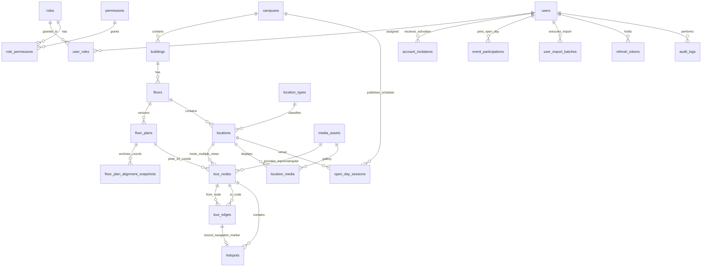

# THIẾT KẾ CƠ SỞ DỮ LIỆU PHASE 2A — FPT POLYTECHNIC VIRTUAL CAMPUS 360°

**Hệ quản trị CSDL:** PostgreSQL 16 (Prisma ORM 6+)  
**Database mặc định (tương thích `docker-compose.yml`):** `virtual_campus_360`  
**Nguyên tắc thiết kế:** Chuẩn hóa 3NF, tách bạch tuyệt đối 3 hệ tọa độ (`GIS Campus`, `Floor Plan 2D [0..1]`, `Panorama Spherical (yaw, pitch, fov)`), tách `Location` (thực thể không gian) khỏi `TourNode` (điểm đứng chụp 360°), hỗ trợ soft-delete (`deleted_at`), phiên bản hóa mặt bằng tầng (`floor_plans.version`) và lưu trữ vết kiểm toán (`audit_logs`).

---

## 1. Sơ đồ quan hệ thực thể (ERD — Mermaid)



### 1.1. Quy tắc Thống nhất Tên Thực thể & Sửa Mâu thuẫn ERD Cũ

| Tài liệu cũ / Mock | Thiết kế Phase 2A chuẩn hóa | Lý do sửa |
| :--- | :--- | :--- |
| `tour_scenes` (`06-database-audit.md`) | **`tour_nodes`** (`TourNode`) | Thống nhất tên thực thể duy nhất giữa DB, API (`/api/v1/public/tour/nodes/:slug`), Shared DTO và Admin UI. |
| `locations \|\|--o\| tour_scenes` (`1–1`) | **`locations \|\|--o{ tour_nodes` (`1–N`)** | Một phòng thực tế (`Location` như Lab A302 hoặc Hành lang T3) có thể có **nhiều góc đứng chụp 360°** (cửa phòng, giữa phòng, góc máy). |
| `media_assets \|\|--o\| tour_nodes` | **`media_assets \|\|--o{ tour_nodes` (`1–N`)** | Cho phép quản lý tập trung vòng đời asset tách biệt với gắn/gỡ node an toàn (mỗi node trỏ tới `panorama_asset_id`). |
| `PARTICIPANT` / `registrations` (`06-database-audit.md`) | **Chuẩn hóa thành `users` thống nhất + `event_participations` + `account_invitations`** | Phản ánh đúng 3 nhóm: `ADMIN`/`STAFF`, người tham gia Open Day (`STUDENT`/`PARENT` — **không mặc định là sinh viên chính thức**; hỗ trợ nhiều kỳ Open Day qua `event_participations`), và Khách tham quan tự do (không cần tài khoản). Cấp phát kép `ADMIN_DIRECT` & `EMAIL_SMS_INVITATION`, Import Excel không lưu file/tên/path gốc. **Student/Parent Portal (`/portal`) vẫn chưa thuộc MVP.** |

---

## 2. Phân tách 3 khái niệm & 3 hệ tọa độ trong Database

Đây là quy tắc bất biến của Phase 2A để tránh mọi lỗi lệch vị trí khi Admin thay đổi ảnh mặt bằng hoặc khi trình duyệt co giãn màn hình:

1. **`Location` (`locations`) ≠ `TourNode` (`tour_nodes`):**
   - `Location` đại diện cho **một thực thể không gian có tên/công năng**: Phòng Lab AI A302, Hành lang Tầng 3, Thang máy Tòa T, Cầu thang bộ Bắc, Khu vệ sinh nam tầng 3, Thư viện.
   - `TourNode` đại diện cho **một vị trí đặt camera 360°**: Một phòng lớn (`Location`) có thể chứa **2–4 `TourNode`** (cửa vào, giữa phòng, khu máy thực hành); một `TourNode` luôn gắn với **01 `FloorPlan`** (để vẽ chấm tròn lên mặt bằng tầng) và trỏ đến **01 `MediaAsset` loại `PANORAMA_2_1`**.
2. **Hệ tọa độ GIS khuôn viên (`buildings.gis_x`, `buildings.gis_y`):**
   - Số thực `[0.0, 100.0]` (%) định vị tòa nhà trên bản đồ SVG QTSC Quận 12 (`CampusGISMap.tsx`), kèm `lat`/`lng` WGS-84 tùy chọn.
3. **Hệ tọa độ Mặt bằng tầng 2D (`locations.floor_norm_x/y`, `tour_nodes.floor_norm_x/y`):**
   - Số thực chuẩn hóa `[0.000000, 1.000000]` tính theo `(pixelX / intrinsicWidth, pixelY / intrinsicHeight)` của `floor_plans.render_width × render_height`.
   - **Bất biến tuyệt đối** với zoom, pan, DPR Retina và màn hình Mobile/Tablet/Desktop.
4. **Hệ tọa độ Cầu 360° (`tour_nodes.initial_yaw/pitch/fov`, `hotspots.yaw/pitch`):**
   - Độ (`°`): `yaw ∈ [-180, 180]`, `pitch ∈ [-90, 90]`, `fov ∈ [30, 100]`, cộng thêm `heading_offset_deg` để quy chiếu hướng Bắc của panorama với la bàn trên `FloorPlan`.

---

## 3. Đặc tả chi tiết từng bảng (Tables, Keys, Constraints & Indexes)

### 3.1. Khối Khuôn viên, Tòa nhà, Tầng & Mặt bằng (`Campus & FloorPlan Domain`)

#### Bảng `campuses`
| Cột | Kiểu dữ liệu | Ràng buộc / Mặc định | Ý nghĩa |
| :--- | :--- | :--- | :--- |
| `id` | `UUID` | `PK, DEFAULT gen_random_uuid()` | Khóa chính |
| `code` | `VARCHAR(32)` | `UNIQUE, NOT NULL` | VD: `'QTSC-Q12'` |
| `name` | `VARCHAR(160)` | `NOT NULL` | VD: `'FPT Polytechnic — CVPM Quang Trung'` |
| `address` | `TEXT` | `NOT NULL` | Địa chỉ khuôn viên |
| `default_entry_node_id` | `UUID` | `NULLABLE, FK -> tour_nodes.id (ON DELETE SET NULL)` | Điểm xuất phát mặc định khi vào `/` và `/campus` |
| `status` | `PublishStatus` | `NOT NULL, DEFAULT 'PUBLISHED'` | `'DRAFT' | 'PUBLISHED' | 'ARCHIVED'` |
| `created_at` / `updated_at` | `TIMESTAMPTZ` | `NOT NULL` | Dấu thời gian |
| `deleted_at` | `TIMESTAMPTZ` | `NULLABLE` | Soft delete |

#### Bảng `buildings` (Quan hệ `N-1` với `campuses`)
| Cột | Kiểu dữ liệu | Ràng buộc / Mặc định | Ý nghĩa |
| :--- | :--- | :--- | :--- |
| `id` | `UUID` | `PK` | Khóa chính |
| `campus_id` | `UUID` | `FK -> campuses.id, NOT NULL` | Khuôn viên chứa tòa nhà |
| `code` | `VARCHAR(32)` | `NOT NULL` | VD: `'INNOVATION'`, `'TOA-T'`, `'TOA-F'`, `'TOA-P'`, `'SPORTS'` |
| `slug` | `VARCHAR(100)` | `NOT NULL` | Slug URL SEO |
| `name` | `VARCHAR(160)` | `NOT NULL` | Tên tòa nhà hiển thị |
| `category` | `VARCHAR(40)` | `NOT NULL` | `'academic' | 'lab' | 'service' | 'sports'` (khớp `CampusGISMap.tsx`) |
| `description` | `TEXT` | `NOT NULL` | Mô tả công năng tòa nhà |
| `gis_x` | `DOUBLE PRECISION` | `NOT NULL, CHECK (gis_x >= 0 AND gis_x <= 100)` | Tọa độ % X trên bản đồ GIS SVG |
| `gis_y` | `DOUBLE PRECISION` | `NOT NULL, CHECK (gis_y >= 0 AND gis_y <= 100)` | Tọa độ % Y trên bản đồ GIS SVG |
| `lat` / `lng` | `DOUBLE PRECISION` | `NULLABLE` | Tọa độ GPS thực tế (tương lai Leaflet/GIS) |
| `cover_media_id` | `UUID` | `NULLABLE, FK -> media_assets.id` | Ảnh đại diện tòa nhà trên GIS card |
| `sort_order` | `INTEGER` | `NOT NULL, DEFAULT 0` | Thứ tự hiển thị |
| `status` | `PublishStatus` | `NOT NULL, DEFAULT 'DRAFT'` | Trạng thái công khai |
| `created_at` / `updated_at` / `deleted_at` | `TIMESTAMPTZ` | Soft delete hỗ trợ | |

- **Unique Constraints:** `UNIQUE (campus_id, code) WHERE deleted_at IS NULL`, `UNIQUE (campus_id, slug) WHERE deleted_at IS NULL`.
- **Indexes:** `idx_buildings_campus_status (campus_id, status) WHERE deleted_at IS NULL`.

#### Bảng `floors` (Quan hệ `N-1` với `buildings`)
| Cột | Kiểu dữ liệu | Ràng buộc / Mặc định | Ý nghĩa |
| :--- | :--- | :--- | :--- |
| `id` | `UUID` | `PK` | Khóa chính |
| `building_id` | `UUID` | `FK -> buildings.id, NOT NULL` | Thuộc tòa nhà |
| `code` | `VARCHAR(24)` | `NOT NULL` | VD: `'B1'`, `'G'`, `'F1'`, `'F2'`, `'F3'` |
| `name` | `VARCHAR(100)` | `NOT NULL` | VD: `'Tầng 3 — Khối Lab CNTT'` |
| `level_index` | `INTEGER` | `NOT NULL` | Số tầng chuẩn để sắp xếp (`-1`, `0`, `1`, `2`, `3`...) |
| `active_floor_plan_id` | `UUID` | `NULLABLE, FK -> floor_plans.id` | Phiên bản mặt bằng đang kích hoạt hiển thị |
| `status` | `PublishStatus` | `NOT NULL, DEFAULT 'DRAFT'` | Trạng thái công khai của tầng |
| `created_at` / `updated_at` / `deleted_at` | `TIMESTAMPTZ` | | |

- **Unique Constraints:** `UNIQUE (building_id, code) WHERE deleted_at IS NULL`, `UNIQUE (building_id, level_index) WHERE deleted_at IS NULL`.

#### Bảng `floor_plans` (Quan hệ `N-1` với `floors` — lưu lịch sử phiên bản khi Admin thay mặt bằng)
| Cột | Kiểu dữ liệu | Ràng buộc / Mặc định | Ý nghĩa |
| :--- | :--- | :--- | :--- |
| `id` | `UUID` | `PK` | Khóa chính |
| `floor_id` | `UUID` | `FK -> floors.id, NOT NULL` | Tầng tương ứng |
| `version` | `INTEGER` | `NOT NULL, DEFAULT 1` | Phiên bản mặt bằng (tăng dần khi upload lại) |
| `source_format` | `FloorPlanFormat` | `NOT NULL` | `'PNG' | 'JPG' | 'SVG' | 'PDF'` |
| `source_object_key` | `TEXT` | `NOT NULL` | Đường dẫn tệp gốc trên S3/MinIO |
| `render_object_key` | `TEXT` | `NULLABLE` | Ảnh web sau xử lý (`WebP` nếu PDF, `SVG` đã sanitize, hoặc `PNG/JPG` chuẩn hóa) |
| `thumbnail_object_key` | `TEXT` | `NULLABLE` | Ảnh thu nhỏ selector tầng |
| `source_page_number` | `INTEGER` | `NOT NULL, DEFAULT 1` | Trang PDF được chọn nếu tệp gốc là PDF nhiều trang |
| `render_width` | `INTEGER` | `NULLABLE` | Chiều rộng pixel tham chiếu hệ `[0..1]` |
| `render_height` | `INTEGER` | `NULLABLE` | Chiều cao pixel tham chiếu hệ `[0..1]` |
| `aspect_ratio` | `DOUBLE PRECISION` | `NULLABLE` | `render_width / render_height` (dùng phát hiện lệch tỷ lệ khi thay mặt bằng) |
| `north_offset_deg` | `DOUBLE PRECISION` | `NOT NULL, DEFAULT 0` | Góc lệch la bàn giữa ảnh mặt bằng 2D và hướng Bắc |
| `processing_status` | `ProcessingStatus` | `NOT NULL, DEFAULT 'PENDING'` | `'PENDING' | 'PROCESSING' | 'READY' | 'FAILED'` |
| `processing_error` | `TEXT` | `NULLABLE` | Thông báo lỗi nếu convert PDF/SVG thất bại |
| `uploaded_by` | `UUID` | `FK -> users.id, NOT NULL` | Admin tải lên |
| `created_at` / `updated_at` | `TIMESTAMPTZ` | | |

- **Unique Constraints:** `UNIQUE (floor_id, version)`.

#### Bảng `floor_plan_alignment_snapshots` (Lưu nguyên bản vẽ cũ & tọa độ đã đặt khi thay thế mặt bằng)
| Cột | Kiểu dữ liệu | Ràng buộc / Mặc định | Ý nghĩa |
| :--- | :--- | :--- | :--- |
| `id` | `UUID` | `PK` | Khóa chính |
| `new_floor_plan_id` | `UUID` | `FK -> floor_plans.id, NOT NULL` | Phiên bản mặt bằng mới vừa tải lên |
| `previous_floor_plan_id` | `UUID` | `FK -> floor_plans.id, NULLABLE` | Phiên bản cũ dùng làm lớp **Ghost Overlay** |
| `node_coords_snapshot` | `JSONB` | `NOT NULL` | Danh sách `{ nodeId, locationId, oldNormX, oldNormY }` trước khi thay bản vẽ |
| `alignment_status` | `AlignmentStatus` | `NOT NULL, DEFAULT 'PENDING_REVIEW'` | `'PENDING_REVIEW' | 'CONFIRMED'` |
| `confirmed_by` | `UUID` | `FK -> users.id, NULLABLE` | Admin xác nhận căn chỉnh |
| `confirmed_at` | `TIMESTAMPTZ` | `NULLABLE` | Thời điểm Admin bấm xác nhận |
| `created_at` | `TIMESTAMPTZ` | `NOT NULL` | Dấu thời gian |

---

### 3.2. Khối Địa điểm & Phương tiện Media (`Location & Media Pipeline Domain`)

#### Bảng `location_types` (Danh mục chuẩn hóa loại khu vực trên tầng)
| Cột | Kiểu dữ liệu | Ràng buộc / Mặc định | Ý nghĩa |
| :--- | :--- | :--- | :--- |
| `id` | `UUID` | `PK` | Khóa chính |
| `code` | `VARCHAR(40)` | `UNIQUE, NOT NULL` | `'CLASSROOM'`, `'LAB'`, `'HALLWAY'`, `'ELEVATOR'`, `'STAIRS'`, `'RESTROOM'`, `'LIBRARY'`, `'LOBBY'`, `'RESTRICTED_AREA'` |
| `label` | `VARCHAR(100)` | `NOT NULL` | Nhãn tiếng Việt hiển thị trên UI & Filter |
| `icon_name` | `VARCHAR(60)` | `NOT NULL` | Tên icon Lucide tương ứng |
| `is_inter_floor_connector` | `BOOLEAN` | `NOT NULL, DEFAULT false` | `true` cho `'ELEVATOR'` & `'STAIRS'` |

#### Bảng `locations` (Địa điểm / Khu vực vật lý trên một tầng)
| Cột | Kiểu dữ liệu | Ràng buộc / Mặc định | Ý nghĩa |
| :--- | :--- | :--- | :--- |
| `id` | `UUID` | `PK` | Khóa chính |
| `building_id` | `UUID` | `FK -> buildings.id, NOT NULL` | Tòa nhà (denormalized nhẹ giúp filter nhanh) |
| `floor_id` | `UUID` | `FK -> floors.id, NULLABLE` | `NULLABLE` đối với khu vực ngoài trời cấp Campus (VD: Sân trung tâm), `NOT NULL` đối với phòng trong tòa nhà |
| `location_type_id` | `UUID` | `FK -> location_types.id, NOT NULL` | Phân loại phòng/hành lang/thang máy/WC |
| `code` | `VARCHAR(48)` | `NOT NULL` | VD: `'A302'`, `'T-HL-3'`, `'T-TM-01'` |
| `slug` | `VARCHAR(120)` | `UNIQUE, NOT NULL` | Khớp `/locations/[slug]` |
| `name` | `VARCHAR(160)` | `NOT NULL` | Tên phòng/khu vực |
| `short_summary` | `VARCHAR(280)` | `NOT NULL` | Tóm tắt ngắn trên card `/locations` |
| `description` | `TEXT` | `NOT NULL` | Mô tả chi tiết trang `/locations/[slug]` |
| `floor_norm_x` | `DOUBLE PRECISION` | `NULLABLE, CHECK (0..1)` | Tâm ghim vị trí phòng trên Floor Plan `[0..1]` |
| `floor_norm_y` | `DOUBLE PRECISION` | `NULLABLE, CHECK (0..1)` | Tâm ghim vị trí phòng trên Floor Plan `[0..1]` |
| `floor_polygon_norm` | `JSONB` | `NULLABLE` | Đa giác chuẩn hóa `[{x, y}, ...]` để highlight vùng phòng trên Floor Plan |
| `is_public_accessible` | `BOOLEAN` | `NOT NULL, DEFAULT true` | `false` nếu là phòng kỹ thuật/hạn chế truy cập (chỉ hiển thị thông báo trên bản đồ thay vì tour) |
| `restriction_note` | `TEXT` | `NULLABLE` | Lý do hạn chế tiếp cận (nếu `is_public_accessible = false`) |
| `primary_node_id` | `UUID` | `NULLABLE, FK -> tour_nodes.id` | Điểm 360° mặc định khi người dùng chọn phòng này từ `/locations` hoặc Floor Plan |
| `status` | `PublishStatus` | `NOT NULL, DEFAULT 'DRAFT'` | `'DRAFT' | 'PUBLISHED' | 'ARCHIVED'` |
| `created_at` / `updated_at` / `deleted_at` | `TIMESTAMPTZ` | | |

- **Indexes:** `idx_locations_floor_type (floor_id, location_type_id) WHERE deleted_at IS NULL`, `idx_locations_building_status (building_id, status) WHERE deleted_at IS NULL`.

#### Bảng `media_assets` (Quản lý file gốc, file tối ưu, thumbnail & trạng thái xử lý)
| Cột | Kiểu dữ liệu | Ràng buộc / Mặc định | Ý nghĩa |
| :--- | :--- | :--- | :--- |
| `id` | `UUID` | `PK` | Khóa chính |
| `asset_kind` | `MediaKind` | `NOT NULL` | `'PANORAMA_2_1' | 'PHOTO_2D' | 'THUMBNAIL'` |
| `original_filename` | `VARCHAR(255)` | `NOT NULL` | Tên file gốc |
| `mime_type` | `VARCHAR(100)` | `NOT NULL` | MIME kiểm chứng từ Magic Bytes |
| `file_size_bytes` | `BIGINT` | `NOT NULL` | Dung lượng file gốc |
| `sha256_checksum` | `CHAR(64)` | `NOT NULL` | Chống upload trùng & kiểm toàn vẹn |
| `original_width` | `INTEGER` | `NOT NULL` | Độ rộng gốc (px) |
| `original_height` | `INTEGER` | `NOT NULL` | Độ cao gốc (px) |
| `is_valid_2_to_1` | `BOOLEAN` | `NOT NULL, DEFAULT false` | Đạt chuẩn `|w/h - 2.0| <= 0.06` (không chấp nhận ảnh cylinder bị cắt trên-dưới hoặc file chưa ghép) |
| `is_preview_approved` | `BOOLEAN` | `NOT NULL, DEFAULT false` | Cờ xác nhận Admin đã mở xem 360° Preview, kiểm đường ghép/nadir/chất lượng đạt chuẩn |
| `original_object_key` | `TEXT` | `NOT NULL` | Key file gốc (MinIO/S3) |
| `optimized_desktop_key` | `TEXT` | `NULLABLE` | Panorama `4096×2048` WebP hoặc ảnh 2D `1920px` WebP |
| `optimized_mobile_key` | `TEXT` | `NULLABLE` | Panorama `2048×1024` WebP (Mobile) |
| `thumbnail_key` | `TEXT` | `NULLABLE` | Thumbnail `512×256` WebP |
| `camera_metadata` | `JSONB` | `NULLABLE` | EXIF / XMP (`ProjectionType: equirectangular`, model camera, timestamp chụp) |
| `processing_status` | `ProcessingStatus` | `NOT NULL, DEFAULT 'PENDING'` | `'PENDING' | 'PROCESSING' | 'READY' | 'FAILED'` |
| `processing_error` | `TEXT` | `NULLABLE` | Lỗi pipeline Sharp nếu có |
| `uploaded_by` | `UUID` | `FK -> users.id, NOT NULL` | Admin upload |
| `created_at` / `updated_at` / `deleted_at` | `TIMESTAMPTZ` | | |

- **Indexes:** `idx_media_kind_status (asset_kind, processing_status) WHERE deleted_at IS NULL`, `idx_media_sha256 (sha256_checksum)`.

#### Bảng `location_media` (Quan hệ `N-N` giữa `locations` và `media_assets` cho thư viện ảnh 2D của phòng)
- `id (UUID PK)`, `location_id (FK -> locations.id)`, `media_asset_id (FK -> media_assets.id)`, `is_cover (BOOLEAN)`, `sort_order (INTEGER)`, `caption (VARCHAR(200))`.
- `UNIQUE (location_id, media_asset_id)`.

---

### 3.3. Khối Tour 360° & Đồ thị liên kết (`Tour Nodes, Edges & Hotspots Domain`)

#### Bảng `tour_nodes` (`PanoramaNode` — mỗi hàng là 1 điểm chụp 360° cụ thể)
| Cột | Kiểu dữ liệu | Ràng buộc / Mặc định | Ý nghĩa |
| :--- | :--- | :--- | :--- |
| `id` | `UUID` | `PK` | Khóa chính |
| `slug` | `VARCHAR(100)` | `UNIQUE, NOT NULL` | VD: `'node-t3-a302-entrance'`, khớp param `?scene=` của `/campus` |
| `title` | `VARCHAR(160)` | `NOT NULL` | VD: `'Phòng A302 — Góc cửa vào'` |
| `location_id` | `UUID` | `FK -> locations.id, NOT NULL` | **1 Location có N TourNode** |
| `floor_plan_id` | `UUID` | `FK -> floor_plans.id, NULLABLE` | Mặt bằng mà điểm chụp được ghim (`NULL` nếu ảnh ngoài trời cấp campus) |
| `panorama_asset_id` | `UUID` | `FK -> media_assets.id, NOT NULL` | Tệp panorama 360° (bắt buộc loại `PANORAMA_2_1`) |
| `floor_norm_x` | `DOUBLE PRECISION` | `NULLABLE, CHECK (0..1)` | Tọa độ X trên Floor Plan |
| `floor_norm_y` | `DOUBLE PRECISION` | `NULLABLE, CHECK (0..1)` | Tọa độ Y trên Floor Plan |
| `needs_realignment` | `BOOLEAN` | `NOT NULL, DEFAULT false` | **Bắt buộc bật `true` cho toàn bộ node trên tầng mỗi khi thay thế `FloorPlan` phiên bản mới** (không phụ thuộc có lệch tỷ lệ hay không) |
| `heading_offset_deg` | `DOUBLE PRECISION` | `NOT NULL, DEFAULT 0` | Góc xoay đồng bộ hướng `yaw = 0` với hướng chuẩn trên Floor Plan |
| `initial_yaw` | `DOUBLE PRECISION` | `NOT NULL, DEFAULT 0` | Góc nhìn ngang mặc định khi bước vào node (`-180..180`) |
| `initial_pitch` | `DOUBLE PRECISION` | `NOT NULL, DEFAULT 0` | Góc nhìn dọc mặc định (`-90..90`) |
| `initial_fov` | `DOUBLE PRECISION` | `NOT NULL, DEFAULT 75` | Trường nhìn ban đầu (`45..100`) |
| `is_terminal_approved` | `BOOLEAN` | `NOT NULL, DEFAULT false` | Ngoại lệ phê duyệt điểm kết thúc hợp lệ (0 outbound edges nhưng không bị Validator chặn) |
| `terminal_approval_reason` | `VARCHAR(240)` | `NULLABLE` | Lý do phê duyệt ngoại lệ ngõ cụt (bắt buộc nếu `is_terminal_approved = true`) |
| `status` | `PublishStatus` | `NOT NULL, DEFAULT 'DRAFT'` | `'DRAFT' | 'PUBLISHED' | 'ARCHIVED'` |
| `created_at` / `updated_at` / `deleted_at` | `TIMESTAMPTZ` | | |

- **Constraint logic:** `(floor_plan_id IS NULL AND floor_norm_x IS NULL AND floor_norm_y IS NULL) OR (floor_plan_id IS NOT NULL AND floor_norm_x IS NOT NULL AND floor_norm_y IS NOT NULL)` — đảm bảo không có tọa độ mồ côi.
- **Indexes:** `idx_tour_nodes_location (location_id)`, `idx_tour_nodes_floor_plan (floor_plan_id)`.

#### Bảng `tour_edges` (Đồ thị liên thông có hướng giữa các `TourNode` — cùng tầng & xuyên tầng)
| Cột | Kiểu dữ liệu | Ràng buộc / Mặc định | Ý nghĩa |
| :--- | :--- | :--- | :--- |
| `id` | `UUID` | `PK` | Khóa chính |
| `from_node_id` | `UUID` | `FK -> tour_nodes.id, NOT NULL` | Điểm xuất phát |
| `to_node_id` | `UUID` | `FK -> tour_nodes.id, NOT NULL` | Điểm đích |
| `edge_type` | `TourEdgeType` | `NOT NULL, DEFAULT 'WALKWAY'` | `'WALKWAY' | 'DOORWAY' | 'STAIRS' | 'ELEVATOR' | 'OUTDOOR_LINK'` |
| `label` | `VARCHAR(120)` | `NOT NULL` | VD: `'Đi sang Hành lang Tầng 3'`, `'Lên Tầng 4 (Thang máy)'` |
| `target_entry_yaw` | `DOUBLE PRECISION` | `NULLABLE` | Hướng camera tự động xoay tới sau khi bước sang node đích (giữ liền mạch phương hướng!) |
| `target_entry_pitch` | `DOUBLE PRECISION` | `NULLABLE` | Góc ngẩng/cúi khi bước sang node đích |
| `is_one_way_approved` | `BOOLEAN` | `NOT NULL, DEFAULT false` | Ngoại lệ phê duyệt lối đi 1 chiều hợp lệ (VD: cổng kiểm soát một chiều / tour dẫn hướng) |
| `one_way_approval_reason` | `VARCHAR(240)` | `NULLABLE` | Lý do phê duyệt (bắt buộc nếu `is_one_way_approved = true`) |
| `created_at` | `TIMESTAMPTZ` | `NOT NULL` | |

- **Constraints:** `CHECK (from_node_id <> to_node_id)`, `UNIQUE (from_node_id, to_node_id, edge_type)`.

#### Bảng `hotspots` (Điểm tương tác 3D hiển thị trên cầu Panorama `PanoramaStage.tsx`)
| Cột | Kiểu dữ liệu | Ràng buộc / Mặc định | Ý nghĩa |
| :--- | :--- | :--- | :--- |
| `id` | `UUID` | `PK` | Khóa chính |
| `node_id` | `UUID` | `FK -> tour_nodes.id, NOT NULL` | Node sở hữu hotspot |
| `hotspot_type` | `HotspotType` | `NOT NULL` | `'SCENE_LINK' | 'INFO' | 'QUIZ_TRIGGER'` |
| `edge_id` | `UUID` | `NULLABLE, UNIQUE, FK -> tour_edges.id (ON DELETE CASCADE)` | Nếu là `SCENE_LINK`, gắn chặt 1-1 với cạnh đồ thị `tour_edges` |
| `yaw` | `DOUBLE PRECISION` | `NOT NULL, CHECK (yaw >= -180 AND yaw <= 180)` | Tọa độ kinh độ cầu trong ảnh 360° |
| `pitch` | `DOUBLE PRECISION` | `NOT NULL, CHECK (pitch >= -90 AND pitch <= 90)` | Tọa độ vĩ độ cầu trong ảnh 360° |
| `title` | `VARCHAR(140)` | `NOT NULL` | Nhãn nổi trên hotspot |
| `body` | `TEXT` | `NULLABLE` | Nội dung giải thích khi `hotspot_type = 'INFO'` |
| `payload_json` | `JSONB` | `NULLABLE` | Cấu hình mở rộng (VD: `quizId` cho mini-game tích hợp trong tour) |
| `created_at` / `updated_at` | `TIMESTAMPTZ` | | |

---

### 3.4. Khối Tài khoản Thống nhất, Phân quyền, Kích hoạt Kép & Import (`Auth, RBAC, Provisioning & Compliance Domain`)

> [!IMPORTANT]
> Thiết kế tách bạch hoàn toàn **`user_type`** (`ADMIN | STAFF | STUDENT | PARENT`), **`roles/permissions`** (RBAC), **`account_status`**, **`activation_status`** và **`provisioning_method`** — tuyệt đối **không gộp chung mọi thuộc tính vào một cột `role`**. Không lưu file Excel gốc, tên file gốc hay đường dẫn file gốc; không dùng mật khẩu mặc định dùng chung hay mật khẩu plaintext.

- **`users`**: `id (UUID PK)`, `username (VARCHAR(64) UNIQUE NULLABLE)` — chỉ seed duy nhất tài khoản gốc `'admin'`, `full_name (VARCHAR(160) NOT NULL)`, `email (VARCHAR(160) NULLABLE UNIQUE)`, `phone (VARCHAR(32) NULLABLE)`, `user_type ('ADMIN' | 'STAFF' | 'STUDENT' | 'PARENT')`, `account_status ('ACTIVE' | 'LOCKED' | 'SUSPENDED' | 'ARCHIVED')`, `activation_status ('PENDING_ACTIVATION' | 'INVITATION_SENT' | 'ACTIVATED' | 'EXPIRED' | 'REVOKED')`, `provisioning_method ('BOOTSTRAP' | 'ADMIN_DIRECT' | 'EMAIL_SMS_INVITATION')`, `password_hash (TEXT NULLABLE — Argon2id; bootstrap Admin đọc từ env ADMIN_BOOTSTRAP_PASSWORD; tài khoản mới chờ kích hoạt để null cho tới khi user tự đặt mật khẩu riêng)`, `must_change_password (BOOLEAN NOT NULL DEFAULT false)`, `failed_login_attempts (INT DEFAULT 0)`, `locked_until (TIMESTAMPTZ NULLABLE)`, `last_login_at (TIMESTAMPTZ NULLABLE)`, `created_at`, `updated_at`, `deleted_at`.
- **`roles`**: `id (UUID PK)`, `code (VARCHAR(48) UNIQUE)` (`SUPER_ADMIN`, `TOUR_EDITOR`, `EVENT_OPERATOR`), `name`, `description`. *(Nhóm `STUDENT` / `PARENT` không mặc định được gán role quản trị Admin.)*
- **`permissions`**: `id (UUID PK)`, `code (VARCHAR(80) UNIQUE)` (`campus:write`, `floorplan:write`, `location:write`, `media:upload`, `tour:write`, `tour:publish`, `users:manage`, `users:provision_openday`, `events:write`, `audit:read`).
- **`user_roles`** (`N-N`): `user_id (FK)`, `role_id (FK)`, `PK (user_id, role_id)`.
- **`role_permissions`** (`N-N`): `role_id (FK)`, `permission_id (FK)`, `PK (role_id, permission_id)`.
- **`account_invitations`** (Cấp phát kép không plaintext password): `id (UUID PK)`, `user_id (FK -> users.id NOT NULL)`, `channel ('DIRECT_LINK' | 'EMAIL' | 'SMS')`, `token_hash (CHAR(64) UNIQUE NOT NULL — chỉ lưu SHA-256 hash của token/mã kích hoạt dùng 1 lần)`, `status ('INVITATION_PENDING' | 'SENT' | 'EXPIRED' | 'ACTIVATED' | 'FAILED')`, `expires_at (TIMESTAMPTZ NOT NULL)`, `sent_at (TIMESTAMPTZ NULLABLE)`, `activated_at (TIMESTAMPTZ NULLABLE)`, `resend_count (INT NOT NULL DEFAULT 0)`, `failure_reason (TEXT NULLABLE)`, `created_by (UUID FK -> users.id NOT NULL)`, `created_at (TIMESTAMPTZ NOT NULL)`.
- **`event_participations`** (1 tài khoản Open Day tham gia nhiều sự kiện): `id (UUID PK)`, `user_id (FK -> users.id NOT NULL)`, `open_day_event_key (VARCHAR(80) NOT NULL)`, `event_name (VARCHAR(160) NOT NULL)`, `event_date (DATE NULLABLE)`, `participation_status ('INVITED' | 'CONFIRMED' | 'CANCELLED')`, `provisioned_by (UUID FK -> users.id NULLABLE)`, `created_at`, `updated_at` — `UNIQUE (user_id, open_day_event_key)`.
- **`user_import_batches`** (Nhật ký kết quả import hàng loạt — **KHÔNG lưu file gốc/tên file/đường dẫn file**): `id (UUID PK)`, `imported_by (UUID FK -> users.id NOT NULL)`, `default_user_type ('STUDENT' | 'PARENT')`, `provisioning_method ('ADMIN_DIRECT' | 'EMAIL_SMS_INVITATION')`, `total_rows (INT NOT NULL)`, `success_count (INT NOT NULL)`, `skipped_count (INT NOT NULL)`, `failed_count (INT NOT NULL)`, `row_results_summary_json (JSONB NOT NULL)` *(chỉ chứa STT dòng, kết quả và lý do lỗi, không chứa thông tin nhạy cảm hay tên file)*, `created_at (TIMESTAMPTZ NOT NULL)`.
- **`refresh_tokens`**: `id (UUID PK)`, `user_id (FK)`, `token_hash (CHAR(64) UNIQUE)`, `family_id (UUID NOT NULL)` (phát hiện reuse attack), `expires_at`, `revoked_at`, `user_agent`, `ip_address`, `created_at`.
- **`audit_logs`** (Append-only — cấm ghi mật khẩu/raw token/tên file Excel gốc): `id (UUID PK)`, `actor_user_id (UUID FK NULLABLE)`, `actor_username (VARCHAR(64))`, `action (VARCHAR(80) NOT NULL)` (`LOGIN_SUCCESS`, `LOGIN_FAILED`, `PASSWORD_CHANGED`, `USER_CREATED`, `USER_IMPORTED_BATCH`, `INVITATION_SENT`, `INVITATION_RESENT`, `ACCOUNT_ACTIVATED`, `FLOOR_PLAN_REPLACED`, `ALIGNMENT_CONFIRMED`, `TOUR_PUBLISHED`, ...), `resource_type (VARCHAR(64))`, `resource_id (UUID NULLABLE)`, `diff_json (JSONB NULLABLE)`, `ip_address (INET)`, `created_at (TIMESTAMPTZ NOT NULL)`.

### 3.5. Khối Sự kiện Open Day (CMS công khai & Đa sự kiện — `/portal` vẫn ngoài MVP)
- **`open_day_sessions`**: `id (UUID PK)`, `campus_id (FK)`, `location_id (FK NULLABLE)`, `event_key (VARCHAR(80) NOT NULL)`, `title`, `session_period ('MORNING' | 'NOON' | 'AFTERNOON')`, `start_time_label`, `end_time_label`, `is_public (BOOLEAN DEFAULT true)`, `description`, `sort_order`, `status`. *(Khách tham quan công khai xem miễn phí không cần đăng nhập; tài khoản mời `STUDENT`/`PARENT` liên kết qua `event_participations`.)*
- **`open_day_quiz_items`**: `id (UUID PK)`, `tour_node_id (FK NULLABLE)`, `question_text`, `options_json (JSONB)`, `correct_index (INT)`, `explanation`, `status`.

---

## 4. Ràng buộc toàn vẹn & Phác thảo `prisma/schema.prisma`

```prisma
enum PublishStatus {
  DRAFT
  PUBLISHED
  ARCHIVED
}

enum ProcessingStatus {
  PENDING
  PROCESSING
  READY
  FAILED
}

enum FloorPlanFormat {
  PNG
  JPG
  SVG
  PDF
}

enum MediaKind {
  PANORAMA_2_1
  PHOTO_2D
  THUMBNAIL
}

enum TourEdgeType {
  WALKWAY
  DOORWAY
  STAIRS
  ELEVATOR
  OUTDOOR_LINK
}

enum AlignmentStatus {
  PENDING_REVIEW
  CONFIRMED
}

enum HotspotType {
  SCENE_LINK
  INFO
  QUIZ_TRIGGER
}

enum UserType {
  ADMIN
  STAFF
  STUDENT
  PARENT
}

enum AccountStatus {
  ACTIVE
  LOCKED
  SUSPENDED
  ARCHIVED
}

enum ActivationStatus {
  PENDING_ACTIVATION
  INVITATION_SENT
  ACTIVATED
  EXPIRED
  REVOKED
}

enum ProvisioningMethod {
  BOOTSTRAP
  ADMIN_DIRECT
  EMAIL_SMS_INVITATION
}

enum InvitationChannel {
  DIRECT_LINK
  EMAIL
  SMS
}

enum InvitationStatus {
  INVITATION_PENDING
  SENT
  EXPIRED
  ACTIVATED
  FAILED
}
```

### Quy tắc Cascade, Snapshot & Thay thế Mặt bằng:
1. **Không xóa cứng (`ON DELETE CASCADE`) đối với `buildings`, `floors`, `locations`, `media_assets`:** Áp dụng `deleted_at` (Soft Delete) + `ON DELETE RESTRICT` tại khóa ngoại tầng ứng dụng để ngăn thao tác xóa nhầm một phòng học làm mất toàn bộ cấu hình tour 360° liên kết tới nó.
2. **Xóa cứng có kiểm soát cho `hotspots` & `tour_edges`:** Khi Admin xóa một liên kết hotspot trong trình biên tập 3D, chỉ xóa `hotspot` và `tour_edge` tương ứng (`ON DELETE CASCADE` từ `tour_edges` → `hotspots.edge_id`), tuyệt đối không xóa `TourNode` hay `MediaAsset`.
3. **Thay thế `FloorPlan` luôn yêu cầu kiểm tra & xác nhận căn chỉnh (`Alignment Confirmation`):**
   - Mỗi lần upload mặt bằng mới tạo bản ghi `floor_plans` với `version = oldVersion + 1`, đồng thời tạo một bản ghi `floor_plan_alignment_snapshots` sao lưu toàn bộ tọa độ `[0..1]` cũ của `locations` và `tour_nodes`.
   - **Không dựa vào độ lệch `aspect_ratio` để tự cho phép bỏ qua bước căn chỉnh** (vì 2 bản vẽ cùng tỷ lệ 16:9 vẫn có thể bị crop lệch lề hoặc dịch nội dung). Hệ thống **luôn đặt `needs_realignment = true`** cho toàn bộ `tour_nodes` trên tầng đó và `alignment_status = 'PENDING_REVIEW'` cho tới khi Admin kiểm tra qua **Ghost Overlay** (căn chỉnh/dịch chuyển nếu cần) và bấm xác nhận (`CONFIRMED`).
