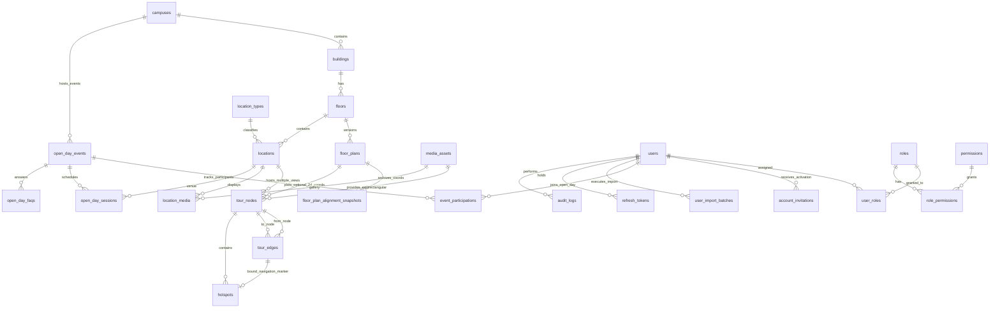

# THIẾT KẾ CƠ SỞ DỮ LIỆU PHASE 2A — FPT POLYTECHNIC VIRTUAL CAMPUS 360°

- **Phiên bản:** 2A.2 (Aligned with `OD-01` → `OD-10`)
- **Trạng thái triển khai (Post Phase 2A-1 Acceptance):** Lược đồ PostgreSQL 16 + Prisma 6 (`26` models, `17` enums) đã được triển khai thực tế tại [`prisma/schema.prisma`](../../prisma/schema.prisma), migration [`20261111175635_init`](../../prisma/migrations/20261111175635_init/migration.sql), [`prisma/seed.ts`](../../prisma/seed.ts) và [`prisma/verify-db-integrity.ts`](../../prisma/verify-db-integrity.ts), nghiệm thu **`ACCEPTED`** tại [`7e1753d`](../project-audit/PHASE_2A_1_FINAL_ACCEPTANCE_REPORT.md).
- **Hệ quản trị CSDL:** PostgreSQL 16 (Prisma ORM 6+)
**Database mặc định (tương thích `docker-compose.yml`):** `virtual_campus_360`  
**Nguyên tắc thiết kế:** Chuẩn hóa 3NF, tách bạch tuyệt đối 3 hệ tọa độ (`Leaflet WGS84 Campus GIS [lat, lng]`, `Floor Plan 2D [0..1]`, `Panorama Spherical (yaw, pitch, fov)`), tách `Location` (thực thể không gian) khỏi `TourNode` (điểm đứng chụp 360°), cho phép `TourNode` xuất bản độc lập khi tầng chưa có `FloorPlan` (`OD-10`), hỗ trợ soft-delete (`deleted_at`), phiên bản hóa mặt bằng tầng (`floor_plans.version`) và lưu trữ vết kiểm toán (`audit_logs`).

---

## 1. Sơ đồ quan hệ thực thể (ERD — Mermaid)



### 1.1. Quy tắc Thống nhất Tên Thực thể & Sửa Mâu thuẫn ERD Cũ

| Tài liệu cũ / Mock | Thiết kế Phase 2A chuẩn hóa | Lý do sửa |
| :--- | :--- | :--- |
| `tour_scenes` (`06-database-audit.md`) | **`tour_nodes`** (`TourNode`) | Thống nhất tên thực thể duy nhất giữa DB, API (`/api/v1/public/tour/nodes/:slug`), Shared DTO và Admin UI. |
| `locations \|\|--o\| tour_scenes` (`1–1`) | **`locations \|\|--o{ tour_nodes` (`1–N`)** | Một phòng thực tế (`Location` như Lab A302 hoặc Hành lang T3) có thể có **nhiều góc đứng chụp 360°** (cửa phòng, giữa phòng, góc máy). |
| `media_assets \|\|--o\| tour_nodes` | **`media_assets \|\|--o{ tour_nodes` (`1–N`)** | Cho phép quản lý tập trung vòng đời asset tách biệt với gắn/gỡ node an toàn (mỗi node trỏ tới `panorama_asset_id`). |
| `PARTICIPANT` / `registrations` (`06-database-audit.md`) | **Chuẩn hóa thành `users` thống nhất + `event_participations` + `account_invitations`** | Phản ánh đúng 3 nhóm: `ADMIN`/`STAFF`, người tham gia Open Day (`STUDENT`/`PARENT` — **không mặc định là sinh viên chính thức**; hỗ trợ nhiều kỳ Open Day qua `event_participations`), và Khách tham quan tự do (không cần tài khoản). Cấp phát kép `ADMIN_DIRECT` & `EMAIL_SMS_INVITATION`, Import Excel không lưu file/tên/path gốc. **Student/Parent Portal (`/portal`) vẫn chưa thuộc MVP.** |

---

## 2. Phân tách 3 khái niệm & 3 hệ tọa độ trong Database

Đây là quy tắc bất biến của Phase 2A để tránh mọi lỗi lệch vị trí khi Admin thay đổi ảnh mặt bằng hoặc khi trình duyệt co giãn màn hình:

1. **`Location` (`locations`) ≠ `TourNode` (`tour_nodes`) (`OD-02`, `OD-10`):**
   - `Location` đại diện cho **một thực thể không gian có tên/công năng**: Phòng Lab AI A302, Hành lang Tầng 3, Thang máy Tòa T, Cầu thang bộ Bắc, Thư viện, Khu Thể thao. Giữ nghiêm quan hệ **`Location (1) — (N) TourNode`**. Nếu một `Location` chưa có ảnh 360° riêng (VD: `loc-the-thao` / `khu-the-thao-qtsc`), đặt `locations.primary_node_id = NULL` — **không gắn chéo giả sang panorama của khu vực khác**.
   - `TourNode` đại diện cho **một vị trí đặt camera 360°**: Một phòng lớn (`Location`) có thể chứa **2–4 `TourNode`**; mỗi `TourNode` trỏ đến **01 `MediaAsset` loại `PANORAMA_2_1`** và có thể gắn với **0 hoặc 1 `FloorPlan`** (`floor_plan_id` `NULLABLE` theo `OD-10` khi tầng chưa kích hoạt mặt bằng `active_floor_plan_id`, không phải tạo mặt bằng giả để được `PUBLISH`).
2. **Hệ tọa độ GIS khuôn viên (`Leaflet + OpenStreetMap + WGS84` — `OD-01`):**
   - Chuẩn chính thức của Hệ tọa độ 1 là **tọa độ địa lý thực `WGS84 (lat, lng)` (`NOT NULL`)** kết xuất trên **Leaflet + OpenStreetMap (`CampusGISMap.tsx`)**, kèm tuyến đường đi bộ nội khu `route_waypoints_json` (`[lat, lng][]` tính từ `campuses.origin_point_json`) và `map_icon_key`.
   - Hai cột phần trăm `gis_x`, `gis_y` `[0.0, 100.0]` được giữ ở mức **`NULLABLE`** chỉ nhằm tương thích dự phòng.
3. **Hệ tọa độ Mặt bằng tầng 2D (`locations.floor_norm_x/y`, `tour_nodes.floor_norm_x/y`):**
   - Số thực chuẩn hóa `[0.000000, 1.000000]` tính theo `(pixelX / intrinsicWidth, pixelY / intrinsicHeight)` của `floor_plans.render_width × render_height`.
   - **Bất biến tuyệt đối** với zoom, pan, DPR Retina và màn hình Mobile/Tablet/Desktop.
4. **Hệ tọa độ Cầu 360° (`tour_nodes.initial_yaw/pitch/fov`, `hotspots.yaw/pitch`):**
   - Độ (`°`): `yaw ∈ [-180, 180]`, `pitch ∈ [-90, 90]`, `fov ∈ [30, 100]`, cộng thêm `heading_offset_deg` để quy chiếu hướng Bắc của panorama với la bàn trên `FloorPlan`.

---

## 3. Đặc tả chi tiết từng bảng (Tables, Keys, Constraints & Indexes)

### 3.1. Khối Khuôn viên, Tòa nhà, Tầng & Mặt bằng (`Campus & FloorPlan Domain`)

#### Bảng `campuses`
| Cột | Kiểu dữ liệu | Ràng buộc / Mặc định | Ý nghĩa |
| :--- | :--- | :--- | :--- |
| `id` | `UUID` | `PK, DEFAULT gen_random_uuid()` | Khóa chính |
| `code` | `VARCHAR(32)` | `NOT NULL` | VD: `'QTSC-Q12'` (Partial unique `WHERE deleted_at IS NULL`) |
| `name` | `VARCHAR(160)` | `NOT NULL` | VD: `'Trường Cao đẳng FPT Polytechnic — Cơ sở TP.HCM (CVPM Quang Trung)'` |
| `address` | `TEXT` | `NOT NULL` | Địa chỉ khuôn viên |
| `origin_point_json` | `JSONB` | `NOT NULL` | Điểm gốc `CampusGeoPoint`: `{ lat, lng, label, addressNote }` (`QTSC_ORIGIN_POINT` trên Leaflet) |
| `landmarks_json` | `JSONB` | `NOT NULL, DEFAULT '[]'` | Danh sách `CampusLandmarkItem[]`: `[{ id, label, sublabel, lat, lng }]` |
| `default_entry_node_id` | `UUID` | `NULLABLE, FK -> tour_nodes.id (ON DELETE SET NULL)` | Điểm xuất phát mặc định khi vào `/` và `/campus` |
| `status` | `PublishStatus` | `NOT NULL, DEFAULT 'PUBLISHED'` | `'DRAFT' | 'PUBLISHED' | 'ARCHIVED'` |
| `created_at` / `updated_at` | `TIMESTAMPTZ` | `NOT NULL` | Dấu thời gian |
| `deleted_at` | `TIMESTAMPTZ` | `NULLABLE` | Soft delete |

- **Unique Constraints:** `UNIQUE (code) WHERE deleted_at IS NULL`.
- *(Ghi chú phạm vi `OD-03`: Các liên kết tuyển sinh/trường học tĩnh như `officialSiteUrl`, `officialAdmissionsUrl`, `coordinatesLabel`, `supportHours` giữ ở cấu hình web tĩnh `OFFICIAL_CAMPUS_INFO` trong MVP.)*

#### Bảng `buildings` (Quan hệ `N-1` với `campuses` — Chuẩn Leaflet OSM WGS84 `OD-01`)
| Cột | Kiểu dữ liệu | Ràng buộc / Mặc định | Ý nghĩa |
| :--- | :--- | :--- | :--- |
| `id` | `UUID` | `PK` | Khóa chính |
| `campus_id` | `UUID` | `FK -> campuses.id, NOT NULL` | Khuôn viên chứa tòa nhà |
| `code` | `VARCHAR(32)` | `NOT NULL` | VD: `'INNOVATION'`, `'TOA-T'`, `'TOA-F'`, `'TOA-P'`, `'SPORTS'` |
| `slug` | `VARCHAR(100)` | `NOT NULL` | Slug URL SEO |
| `name` | `VARCHAR(160)` | `NOT NULL` | Tên đầy đủ tòa nhà |
| `short_name` | `VARCHAR(80)` | `NOT NULL` | Nhãn ngắn trên marker & badge Leaflet (VD: `'Tòa Innovation'`) |
| `category` | `BuildingCategory` | `NOT NULL` | `'ACADEMIC' | 'LAB' | 'FACILITY'` (JSON trả `'academic' | 'lab' | 'facility'`) |
| `category_label` | `VARCHAR(80)` | `NOT NULL` | Nhãn phân loại hiển thị UI (VD: `'Phòng Lab & Xưởng'`) |
| `floors_label` | `VARCHAR(80)` | `NOT NULL` | Mô tả số tầng (VD: `'Tầng Trệt – Tầng 4'`) |
| `summary` | `VARCHAR(280)` | `NOT NULL` | Tóm tắt hiển thị trong Leaflet popup & `BuildingDetailDrawer` |
| `description` | `TEXT` | `NOT NULL` | Mô tả chi tiết công năng tòa nhà |
| `highlights_json` | `JSONB` | `NOT NULL, DEFAULT '[]'` | Mảng `string[]` điểm nổi bật trên Drawer `/map` |
| `lat` | `DOUBLE PRECISION` | `NOT NULL` | Vĩ độ thực WGS84 trên OpenStreetMap (`[−90, 90]`) |
| `lng` | `DOUBLE PRECISION` | `NOT NULL` | Kinh độ thực WGS84 trên OpenStreetMap (`[−180, 180]`) |
| `address_note` | `TEXT` | `NOT NULL` | Ghi chú vị trí thực địa (VD: `'Lô 24, Đường Khu Trung tâm...'`) |
| `status_note` | `VARCHAR(160)` | `NOT NULL` | Trạng thái ngắn trên Drawer (VD: `'Điểm check-in Open Day chính'`) |
| `map_icon_key` | `MapBuildingIconKey` | `NOT NULL` | `'INNOVATION' | 'IT_BUILDING' | 'DESIGN_STUDIO' | 'ACADEMIC_HALL' | 'SPORTS'` (JSON: `'innovation' | 'it-building' | 'design-studio' | 'academic-hall' | 'sports'`) |
| `route_waypoints_json` | `JSONB` | `NOT NULL, DEFAULT '[]'` | Tuyến đường đi bộ nội khu `[[lat, lng], ...]` từ `campuses.origin_point_json` |
| `gis_x` | `DOUBLE PRECISION` | `NULLABLE, CHECK (gis_x IS NULL OR (gis_x >= 0 AND gis_x <= 100))` | Tọa độ % X dự phòng tương thích ngược |
| `gis_y` | `DOUBLE PRECISION` | `NULLABLE, CHECK (gis_y IS NULL OR (gis_y >= 0 AND gis_y <= 100))` | Tọa độ % Y dự phòng tương thích ngược |
| `cover_media_id` | `UUID` | `NULLABLE, FK -> media_assets.id` | Ảnh đại diện tòa nhà trên GIS card |
| `default_node_id` | `UUID` | `NULLABLE, FK -> tour_nodes.id (ON DELETE SET NULL)` | Điểm 360° mặc định khi bấm "Mở Tour 360° tòa này" (`NULL` nếu chưa gán) |
| `sort_order` | `INTEGER` | `NOT NULL, DEFAULT 0` | Thứ tự hiển thị |
| `status` | `PublishStatus` | `NOT NULL, DEFAULT 'DRAFT'` | Trạng thái công khai |
| `created_at` / `updated_at` / `deleted_at` | `TIMESTAMPTZ` | Soft delete hỗ trợ | |

- **Unique Constraints:** `UNIQUE (campus_id, code) WHERE deleted_at IS NULL`, `UNIQUE (campus_id, slug) WHERE deleted_at IS NULL`.
- **Indexes:** `idx_buildings_campus_status (campus_id, status) WHERE deleted_at IS NULL`.

#### Bảng `floors` (Quan hệ `N-1` với `buildings`)
| Cột | Kiểu dữ liệu | Ràng buộc / Mặc định | Ý nghĩa |
| :--- | :--- | :--- | :--- |
| `id` | `UUID` | `PK` | Khóa chính |
| `building_id` | `UUID` | `FK -> buildings.id, NOT NULL` | Thuộc tòa nhà |
| `code` | `VARCHAR(24)` | `NOT NULL` | VD: `'B1'`, `'G'`, `'F1'`, `'F2'`, `'F3'` |
| `name` | `VARCHAR(100)` | `NOT NULL` | VD: `'Tầng 3 — Khối Lab CNTT'` |
| `level_index` | `INTEGER` | `NOT NULL` | Số tầng chuẩn để sắp xếp (`-1`, `0`, `1`, `2`, `3`...) |
| `active_floor_plan_id` | `UUID` | `NULLABLE, FK -> floor_plans.id` | Phiên bản mặt bằng đang kích hoạt hiển thị (`NULL` nếu chưa upload mặt bằng) |
| `requires_floor_plan` | `BOOLEAN` | `NOT NULL, DEFAULT false` | Theo `OD-10`: `true` nếu tầng bắt buộc định vị `TourNode` trên `FloorPlan` trước khi publish (tự bật `true` khi gán mặt bằng active; giữ `false` để cho phép TourNode panorama thuần xuất bản trước) |
| `status` | `PublishStatus` | `NOT NULL, DEFAULT 'DRAFT'` | Trạng thái công khai của tầng |
| `created_at` / `updated_at` / `deleted_at` | `TIMESTAMPTZ` | | |

- **Unique Constraints:** `UNIQUE (building_id, code) WHERE deleted_at IS NULL`, `UNIQUE (building_id, level_index) WHERE deleted_at IS NULL`.

#### Bảng `floor_plans` (Quan hệ `N-1` với `floors` — lưu lịch sử phiên bản khi Admin thay mặt bằng)
| Cột | Kiểu dữ liệu | Ràng buộc / Mặc định | Ý nghĩa |
| :--- | :--- | :--- | :--- |
| `id` | `UUID` | `PK` | Khóa chính |
| `floor_id` | `UUID` | `FK -> floors.id, NOT NULL` | Tầng tương ứng |
| `version` | `INTEGER` | `NOT NULL, DEFAULT 1` | Phiên bản mặt bằng (tăng dần khi upload lại) |
| `source_format` | `FloorPlanFormat` | `NOT NULL` | `'PNG' | 'JPG' | 'SVG' | 'PDF'` |
| `source_object_key` | `TEXT` | `NOT NULL` | Key tệp gốc qua `StorageAdapter` (`LOCAL_FS` hoặc `S3/MinIO`) |
| `render_object_key` | `TEXT` | `NULLABLE` | Ảnh web sau xử lý (`WebP` nếu PDF, `SVG` đã sanitize, hoặc `PNG/JPG` chuẩn hóa) |
| `thumbnail_object_key` | `TEXT` | `NULLABLE` | Ảnh thu nhỏ selector tầng |
| `source_page_number` | `INTEGER` | `NOT NULL, DEFAULT 1` | Trang PDF được chọn nếu tệp gốc là PDF nhiều trang |
| `render_width` | `INTEGER` | `NULLABLE` | Chiều rộng pixel tham chiếu hệ `[0..1]` |
| `render_height` | `INTEGER` | `NULLABLE` | Chiều cao pixel tham chiếu hệ `[0..1]` |
| `aspect_ratio` | `DOUBLE PRECISION` | `NULLABLE` | `render_width / render_height` (dùng phát hiện lệch tỷ lệ khi thay mặt bằng) |
| `north_offset_deg` | `DOUBLE PRECISION` | `NOT NULL, DEFAULT 0` | Góc lệch la bàn giữa ảnh mặt bằng 2D và hướng Bắc |
| `processing_status` | `ProcessingStatus` | `NOT NULL, DEFAULT 'PENDING'` | `'PENDING' | 'PROCESSING' | 'READY' | 'FAILED'` |
| `processing_error` | `TEXT` | `NULLABLE` | Thông báo lỗi nếu convert PDF/SVG thất bại |
| `uploaded_by` | `UUID` | `FK -> users.id, NOT NULL` | Admin tải lên |
| `created_at` / `updated_at` | `TIMESTAMPTZ` | | |

- **Unique Constraints:** `UNIQUE (floor_id, version)`.

#### Bảng `floor_plan_alignment_snapshots` (Lưu nguyên bản vẽ cũ & tọa độ đã đặt khi thay thế mặt bằng)
| Cột | Kiểu dữ liệu | Ràng buộc / Mặc định | Ý nghĩa |
| :--- | :--- | :--- | :--- |
| `id` | `UUID` | `PK` | Khóa chính |
| `new_floor_plan_id` | `UUID` | `FK -> floor_plans.id, NOT NULL` | Phiên bản mặt bằng mới vừa tải lên |
| `previous_floor_plan_id` | `UUID` | `FK -> floor_plans.id, NULLABLE` | Phiên bản cũ dùng làm lớp **Ghost Overlay** |
| `node_coords_snapshot` | `JSONB` | `NOT NULL` | Danh sách `{ nodeId, locationId, oldNormX, oldNormY }` trước khi thay bản vẽ |
| `alignment_status` | `AlignmentStatus` | `NOT NULL, DEFAULT 'PENDING_REVIEW'` | `'PENDING_REVIEW' | 'CONFIRMED'` |
| `confirmed_by` | `UUID` | `FK -> users.id, NULLABLE` | Admin xác nhận căn chỉnh |
| `confirmed_at` | `TIMESTAMPTZ` | `NULLABLE` | Thời điểm Admin bấm xác nhận |
| `created_at` | `TIMESTAMPTZ` | `NOT NULL` | Dấu thời gian |

---

### 3.2. Khối Địa điểm & Phương tiện Media (`Location & Media Pipeline Domain`)

#### Bảng `location_types` (Danh mục chuẩn hóa loại khu vực trên tầng & bộ lọc Public)
| Cột | Kiểu dữ liệu | Ràng buộc / Mặc định | Ý nghĩa |
| :--- | :--- | :--- | :--- |
| `id` | `UUID` | `PK` | Khóa chính |
| `code` | `VARCHAR(40)` | `UNIQUE, NOT NULL` | `'CLASSROOM'`, `'LAB'`, `'STUDIO'`, `'HALLWAY'`, `'ELEVATOR'`, `'STAIRS'`, `'RESTROOM'`, `'LIBRARY'`, `'LOBBY'`, `'SPORTS'`, `'RESTRICTED_AREA'` |
| `filter_group` | `VARCHAR(24)` | `NOT NULL` | Nhóm lọc UI `/locations`: `'common' \| 'lab' \| 'studio'` |
| `label` | `VARCHAR(100)` | `NOT NULL` | Nhãn tiếng Việt hiển thị trên UI & Filter |
| `icon_name` | `VARCHAR(60)` | `NOT NULL` | Tên icon Material Symbols Outlined tương ứng |
| `is_inter_floor_connector` | `BOOLEAN` | `NOT NULL, DEFAULT false` | `true` cho `'ELEVATOR'` & `'STAIRS'` |

#### Bảng `locations` (Địa điểm / Khu vực vật lý — `OD-02`: `1 Location — N TourNode`)
| Cột | Kiểu dữ liệu | Ràng buộc / Mặc định | Ý nghĩa |
| :--- | :--- | :--- | :--- |
| `id` | `UUID` | `PK` | Khóa chính |
| `building_id` | `UUID` | `FK -> buildings.id, NOT NULL` | Tòa nhà (denormalized nhẹ giúp filter nhanh) |
| `floor_id` | `UUID` | `FK -> floors.id, NULLABLE` | `NULLABLE` đối với khu vực ngoài trời cấp Campus (VD: Khu Thể thao ngoài trời), `NOT NULL` đối với phòng trong tòa nhà |
| `location_type_id` | `UUID` | `FK -> location_types.id, NOT NULL` | Phân loại phòng/hành lang/thang máy/studio/thể thao |
| `category_label` | `VARCHAR(80)` | `NOT NULL` | Nhãn phân loại chi tiết hiển thị trên `LocationCard` & trang chi tiết (VD: `'Phòng Lab CNTT'`, `'Tiện ích & Thể thao'`) |
| `code` | `VARCHAR(48)` | `NOT NULL` | VD: `'INV-01'`, `'T-301'`, `'F-402'`, `'SPO-01'` |
| `slug` | `VARCHAR(120)` | `NOT NULL` | Khớp `/locations/[slug]` (Partial unique `WHERE deleted_at IS NULL`) |
| `name` | `VARCHAR(160)` | `NOT NULL` | Tên phòng/khu vực |
| `short_summary` | `VARCHAR(280)` | `NOT NULL` | Tóm tắt ngắn trên card `/locations` |
| `description` | `TEXT` | `NOT NULL` | Mô tả chi tiết trang `/locations/[slug]` |
| `highlights_json` | `JSONB` | `NOT NULL, DEFAULT '[]'` | Mảng `string[]` điểm nổi bật hiển thị trên `/locations/[slug]` |
| `floor_norm_x` | `DOUBLE PRECISION` | `NULLABLE, CHECK (floor_norm_x IS NULL OR (floor_norm_x >= 0 AND floor_norm_x <= 1))` | Tâm ghim vị trí phòng trên Floor Plan `[0..1]` |
| `floor_norm_y` | `DOUBLE PRECISION` | `NULLABLE, CHECK (floor_norm_y IS NULL OR (floor_norm_y >= 0 AND floor_norm_y <= 1))` | Tâm ghim vị trí phòng trên Floor Plan `[0..1]` |
| `floor_polygon_norm` | `JSONB` | `NULLABLE` | Đa giác chuẩn hóa `[{x, y}, ...]` để highlight vùng phòng trên Floor Plan |
| `is_public_accessible` | `BOOLEAN` | `NOT NULL, DEFAULT true` | `false` nếu là phòng kỹ thuật/hạn chế truy cập |
| `restriction_note` | `TEXT` | `NULLABLE` | Lý do hạn chế tiếp cận (nếu `is_public_accessible = false`) |
| `primary_node_id` | `UUID` | `NULLABLE, FK -> tour_nodes.id (ON DELETE SET NULL)` | Điểm 360° mặc định; **`NULL` nếu `Location` chưa có ảnh 360° riêng** (VD: `loc-the-thao` theo `OD-02`, tuyệt đối không gắn chéo giả sang tòa khác) |
| `status` | `PublishStatus` | `NOT NULL, DEFAULT 'DRAFT'` | `'DRAFT' | 'PUBLISHED' | 'ARCHIVED'` |
| `created_at` / `updated_at` / `deleted_at` | `TIMESTAMPTZ` | | |

- **Unique Constraints (`OD-06`):** `UNIQUE (slug) WHERE deleted_at IS NULL`, `UNIQUE (building_id, code) WHERE deleted_at IS NULL`.
- **Indexes:** `idx_locations_floor_type (floor_id, location_type_id) WHERE deleted_at IS NULL`, `idx_locations_building_status (building_id, status) WHERE deleted_at IS NULL`.

#### Bảng `media_assets` (Quản lý file gốc, file tối ưu, thumbnail & trạng thái xử lý)
| Cột | Kiểu dữ liệu | Ràng buộc / Mặc định | Ý nghĩa |
| :--- | :--- | :--- | :--- |
| `id` | `UUID` | `PK` | Khóa chính |
| `asset_kind` | `MediaKind` | `NOT NULL` | `'PANORAMA_2_1' | 'PHOTO_2D' | 'THUMBNAIL'` |
| `original_filename` | `VARCHAR(255)` | `NOT NULL` | Tên file gốc |
| `mime_type` | `VARCHAR(100)` | `NOT NULL` | MIME kiểm chứng từ Magic Bytes |
| `file_size_bytes` | `BIGINT` | `NOT NULL` | Dung lượng file gốc |
| `sha256_checksum` | `CHAR(64)` | `NOT NULL` | Chống upload trùng & kiểm toàn vẹn |
| `original_width` | `INTEGER` | `NOT NULL` | Độ rộng gốc (px) |
| `original_height` | `INTEGER` | `NOT NULL` | Độ cao gốc (px) |
| `is_valid_2_to_1` | `BOOLEAN` | `NOT NULL, DEFAULT false` | Đạt chuẩn `|w/h - 2.0| <= 0.06` (không chấp nhận ảnh cylinder bị cắt trên-dưới hoặc file chưa ghép) |
| `is_preview_approved` | `BOOLEAN` | `NOT NULL, DEFAULT false` | Cờ xác nhận Admin đã mở xem 360° Preview, kiểm đường ghép/nadir/chất lượng đạt chuẩn |
| `original_object_key` | `TEXT` | `NOT NULL` | Key/path tương đối qua `StorageAdapter` (`LOCAL_FS` hoặc `S3_MINIO`) |
| `optimized_desktop_key` | `TEXT` | `NULLABLE` | Panorama `4096×2048` WebP hoặc ảnh 2D `1920px` WebP (hoặc đường dẫn ảnh tĩnh đã seed ở Phase 2A-1) |
| `optimized_mobile_key` | `TEXT` | `NULLABLE` | Panorama `2048×1024` WebP (Mobile) |
| `thumbnail_key` | `TEXT` | `NULLABLE` | Thumbnail `512×256` WebP |
| `camera_metadata` | `JSONB` | `NULLABLE` | EXIF / XMP (`ProjectionType: equirectangular`, model camera, timestamp chụp) |
| `processing_status` | `ProcessingStatus` | `NOT NULL, DEFAULT 'PENDING'` | `'PENDING' | 'PROCESSING' | 'READY' | 'FAILED'` |
| `processing_error` | `TEXT` | `NULLABLE` | Lỗi pipeline Sharp nếu có |
| `uploaded_by` | `UUID` | `FK -> users.id, NOT NULL` | Admin upload |
| `created_at` / `updated_at` / `deleted_at` | `TIMESTAMPTZ` | | |

- **Indexes:** `idx_media_kind_status (asset_kind, processing_status) WHERE deleted_at IS NULL`, `idx_media_sha256 (sha256_checksum)`.

#### Bảng `location_media` (Quan hệ `N-N` giữa `locations` và `media_assets` cho thư viện ảnh 2D của phòng)
- `id (UUID PK)`, `location_id (FK -> locations.id)`, `media_asset_id (FK -> media_assets.id)`, `is_cover (BOOLEAN)`, `sort_order (INTEGER)`, `caption (VARCHAR(200))`.
- `UNIQUE (location_id, media_asset_id)`.

---

### 3.3. Khối Tour 360° & Đồ thị liên kết (`Tour Nodes, Edges & Hotspots Domain`)

#### Bảng `tour_nodes` (`PanoramaNode` — mỗi hàng là 1 điểm chụp 360° cụ thể)
| Cột | Kiểu dữ liệu | Ràng buộc / Mặc định | Ý nghĩa |
| :--- | :--- | :--- | :--- |
| `id` | `UUID` | `PK` | Khóa chính |
| `slug` | `VARCHAR(100)` | `NOT NULL` | VD: `'cong-chao-qtsc'`, `'sanh-innovation'`, `'thu-vien'`, `'lab-it'`, `'studio-imac'`, khớp `?scene=` (Partial unique `WHERE deleted_at IS NULL`) |
| `title` | `VARCHAR(160)` | `NOT NULL` | VD: `'Toàn cảnh Khuôn viên QTSC'` |
| `intro` | `TEXT` | `NOT NULL` | Đoạn giới thiệu cảnh 360° hiển thị trong `TourInfoDrawer` & thanh tiêu đề |
| `category` | `VARCHAR(24)` | `NOT NULL, DEFAULT 'study'` | Phân loại hiển thị Scene Selector: `'exterior' | 'study' | 'lab'` |
| `location_id` | `UUID` | `FK -> locations.id, NOT NULL` | **1 Location có N TourNode** (`OD-02`) |
| `floor_plan_id` | `UUID` | `FK -> floor_plans.id, NULLABLE` | Mặt bằng mà điểm chụp được ghim (`NULL` nếu ảnh ngoài trời hoặc tầng chưa upload `FloorPlan` theo `OD-10`) |
| `panorama_asset_id` | `UUID` | `FK -> media_assets.id, NOT NULL` | Tệp panorama 360° (bắt buộc loại `PANORAMA_2_1`) |
| `floor_norm_x` | `DOUBLE PRECISION` | `NULLABLE, CHECK (floor_norm_x IS NULL OR (floor_norm_x >= 0 AND floor_norm_x <= 1))` | Tọa độ X trên Floor Plan |
| `floor_norm_y` | `DOUBLE PRECISION` | `NULLABLE, CHECK (floor_norm_y IS NULL OR (floor_norm_y >= 0 AND floor_norm_y <= 1))` | Tọa độ Y trên Floor Plan |
| `needs_realignment` | `BOOLEAN` | `NOT NULL, DEFAULT false` | **Bắt buộc bật `true` cho toàn bộ node trên tầng mỗi khi thay thế `FloorPlan` phiên bản mới** |
| `heading_offset_deg` | `DOUBLE PRECISION` | `NOT NULL, DEFAULT 0` | Góc xoay đồng bộ hướng `yaw = 0` với hướng chuẩn trên Floor Plan |
| `initial_yaw` | `DOUBLE PRECISION` | `NOT NULL, DEFAULT 0` | Góc nhìn ngang mặc định khi bước vào node (`-180..180`) |
| `initial_pitch` | `DOUBLE PRECISION` | `NOT NULL, DEFAULT 0` | Góc nhìn dọc mặc định (`-90..90`) |
| `initial_fov` | `DOUBLE PRECISION` | `NOT NULL, DEFAULT 75` | Trường nhìn ban đầu (`30..100`, CHECK `30..100`) |
| `is_terminal_approved` | `BOOLEAN` | `NOT NULL, DEFAULT false` | Ngoại lệ phê duyệt điểm kết thúc hợp lệ (0 outbound edges nhưng không bị Validator chặn) |
| `terminal_approval_reason` | `VARCHAR(240)` | `NULLABLE` | Lý do phê duyệt ngoại lệ ngõ cụt (bắt buộc nếu `is_terminal_approved = true`) |
| `sort_order` | `INTEGER` | `NOT NULL, DEFAULT 0` | Thứ tự hiển thị trên Scene Selector |
| `status` | `PublishStatus` | `NOT NULL, DEFAULT 'DRAFT'` | `'DRAFT' | 'PUBLISHED' | 'ARCHIVED'` |
| `created_at` / `updated_at` / `deleted_at` | `TIMESTAMPTZ` | | |

- **Unique Constraints (`OD-06`):** `UNIQUE (slug) WHERE deleted_at IS NULL`.
- **Constraint logic:** `(floor_plan_id IS NULL AND floor_norm_x IS NULL AND floor_norm_y IS NULL) OR (floor_plan_id IS NOT NULL AND floor_norm_x IS NOT NULL AND floor_norm_y IS NOT NULL)` — đảm bảo không có tọa độ mồ côi.
- **Indexes:** `idx_tour_nodes_location (location_id) WHERE deleted_at IS NULL`, `idx_tour_nodes_floor_plan (floor_plan_id) WHERE deleted_at IS NULL`.

#### Bảng `tour_edges` (Đồ thị liên thông có hướng giữa các `TourNode` — cùng tầng & xuyên tầng)
| Cột | Kiểu dữ liệu | Ràng buộc / Mặc định | Ý nghĩa |
| :--- | :--- | :--- | :--- |
| `id` | `UUID` | `PK` | Khóa chính |
| `from_node_id` | `UUID` | `FK -> tour_nodes.id, NOT NULL` | Điểm xuất phát |
| `to_node_id` | `UUID` | `FK -> tour_nodes.id, NOT NULL` | Điểm đích |
| `edge_type` | `TourEdgeType` | `NOT NULL, DEFAULT 'WALKWAY'` | `'WALKWAY' | 'DOORWAY' | 'STAIRS' | 'ELEVATOR' | 'OUTDOOR_LINK'` |
| `label` | `VARCHAR(120)` | `NOT NULL` | VD: `'Đi sang Hành lang Tầng 3'`, `'Lên Tầng 4 (Thang máy)'` |
| `target_entry_yaw` | `DOUBLE PRECISION` | `NULLABLE` | Hướng camera tự động xoay tới sau khi bước sang node đích |
| `target_entry_pitch` | `DOUBLE PRECISION` | `NULLABLE` | Góc ngẩng/cúi khi bước sang node đích |
| `is_one_way_approved` | `BOOLEAN` | `NOT NULL, DEFAULT false` | Ngoại lệ phê duyệt lối đi 1 chiều hợp lệ |
| `one_way_approval_reason` | `VARCHAR(240)` | `NULLABLE` | Lý do phê duyệt (bắt buộc nếu `is_one_way_approved = true`) |
| `created_at` | `TIMESTAMPTZ` | `NOT NULL` | |

- **Constraints:** `CHECK (from_node_id <> to_node_id)`, `UNIQUE (from_node_id, to_node_id, edge_type)`.

#### Bảng `hotspots` (Điểm tương tác 3D hiển thị trên cầu Panorama `PanoramaStage.tsx`)
| Cột | Kiểu dữ liệu | Ràng buộc / Mặc định | Ý nghĩa |
| :--- | :--- | :--- | :--- |
| `id` | `UUID` | `PK` | Khóa chính |
| `node_id` | `UUID` | `FK -> tour_nodes.id, NOT NULL` | Node sở hữu hotspot |
| `hotspot_type` | `HotspotType` | `NOT NULL` | `'SCENE_LINK' | 'INFO' | 'QUIZ_TRIGGER'` |
| `edge_id` | `UUID` | `NULLABLE, UNIQUE, FK -> tour_edges.id (ON DELETE CASCADE)` | Nếu là `SCENE_LINK`, gắn chặt 1-1 với cạnh đồ thị `tour_edges` |
| `yaw` | `DOUBLE PRECISION` | `NOT NULL, CHECK (yaw >= -180 AND yaw <= 180)` | Tọa độ kinh độ cầu trong ảnh 360° |
| `pitch` | `DOUBLE PRECISION` | `NOT NULL, CHECK (pitch >= -90 AND pitch <= 90)` | Tọa độ vĩ độ cầu trong ảnh 360° |
| `title` | `VARCHAR(140)` | `NOT NULL` | Nhãn nổi trên hotspot |
| `body` | `TEXT` | `NULLABLE` | Nội dung giải thích khi `hotspot_type = 'INFO'` |
| `payload_json` | `JSONB` | `NULLABLE` | Cấu hình mở rộng (VD: `quizId` cho mini-game tích hợp trong tour) |
| `created_at` / `updated_at` | `TIMESTAMPTZ` | | |

- **Constraint logic (`OD-06`):**
  ```sql
  CHECK (
    (hotspot_type = 'SCENE_LINK' AND edge_id IS NOT NULL) OR
    (hotspot_type <> 'SCENE_LINK' AND edge_id IS NULL)
  )
  ```

---

### 3.4. Khối Tài khoản Thống nhất, Phân quyền, Kích hoạt Kép & Import (`Auth, RBAC, Provisioning & Compliance Domain`)

> [!IMPORTANT]
> Thiết kế tách bạch hoàn toàn **`user_type`** (`ADMIN | STAFF | STUDENT | PARENT`), **`roles/permissions`** (RBAC), **`account_status`**, **`activation_status`** và **`provisioning_method`** — tuyệt đối **không gộp chung mọi thuộc tính vào một cột `role`**. Không lưu file Excel gốc, tên file gốc hay đường dẫn file gốc; không dùng mật khẩu mặc định dùng chung hay mật khẩu plaintext.
>
> **Chuẩn định danh & Import (`OD-04`):** `users.phone` chuẩn hóa về định dạng `E.164 / VN (+84...)` trước khi lưu. Cho phép đăng nhập qua `username` (`ADMIN`/`STAFF`), `email` (lowercase) hoặc `phone` đã kích hoạt (hỗ trợ người tham gia Open Day mời qua SMS không có email). Khi Import Excel/CSV, chống trùng theo thứ tự ưu tiên: **`email` trước → fallback `phone` chuẩn hóa** (xung đột giữa `email` và `phone` thuộc 2 user khác nhau phải báo lỗi `IDENTITY_CONFLICT`; **tuyệt đối không deduplicate theo `(full_name, phone)` hay `full_name`**).

- **`users`**:
  - `id (UUID PK)`
  - `username (VARCHAR(64) NULLABLE)` — chỉ seed duy nhất tài khoản gốc `'admin'`; **Partial unique `UNIQUE (username) WHERE deleted_at IS NULL AND username IS NOT NULL`** (`OD-06`)
  - `full_name (VARCHAR(160) NOT NULL)`
  - `email (VARCHAR(160) NULLABLE)` — chuẩn hóa lowercase/trim; **Partial unique `UNIQUE (email) WHERE deleted_at IS NULL AND email IS NOT NULL`** (`OD-06`)
  - `phone (VARCHAR(32) NULLABLE)` — chuẩn hóa E.164/VN; **Partial unique `UNIQUE (phone) WHERE deleted_at IS NULL AND phone IS NOT NULL`** (`OD-04`, `OD-06`)
  - `user_type (UserType NOT NULL)`: `'ADMIN' | 'STAFF' | 'STUDENT' | 'PARENT'`
  - `account_status (AccountStatus NOT NULL DEFAULT 'ACTIVE')`: `'ACTIVE' | 'LOCKED' | 'SUSPENDED' | 'ARCHIVED'`
  - `activation_status (ActivationStatus NOT NULL DEFAULT 'PENDING_ACTIVATION')`: `'PENDING_ACTIVATION' | 'INVITATION_SENT' | 'ACTIVATED' | 'EXPIRED' | 'REVOKED'`
  - `provisioning_method (ProvisioningMethod NOT NULL)`: `'BOOTSTRAP' | 'ADMIN_DIRECT' | 'EMAIL_SMS_INVITATION'`
  - `password_hash (TEXT NULLABLE)` — Argon2id; bootstrap Admin đọc từ `ADMIN_BOOTSTRAP_PASSWORD`; tài khoản chờ kích hoạt để `NULL` cho tới khi user tự đặt mật khẩu riêng
  - `must_change_password (BOOLEAN NOT NULL DEFAULT false)`, `failed_login_attempts (INT NOT NULL DEFAULT 0)`, `locked_until (TIMESTAMPTZ NULLABLE)`, `last_login_at (TIMESTAMPTZ NULLABLE)`
  - `created_at`, `updated_at`, `deleted_at`
- **`roles`**: `id (UUID PK)`, `code (VARCHAR(48) UNIQUE)` (`SUPER_ADMIN`, `TOUR_EDITOR`, `EVENT_OPERATOR`), `name`, `description`. *(Nhóm `STUDENT` / `PARENT` không mặc định được gán role quản trị Admin.)*
- **`permissions`**: `id (UUID PK)`, `code (VARCHAR(80) UNIQUE)` (`campus:write`, `floorplan:write`, `location:write`, `media:upload`, `tour:write`, `tour:publish`, `users:manage`, `users:provision_openday`, `events:write`, `audit:read`).
- **`user_roles`** (`N-N`): `user_id (FK)`, `role_id (FK)`, `PK (user_id, role_id)`.
- **`role_permissions`** (`N-N`): `role_id (FK)`, `permission_id (FK)`, `PK (role_id, permission_id)`.
- **`account_invitations`** (Cấp phát kép không plaintext password): `id (UUID PK)`, `user_id (FK -> users.id NOT NULL)`, `channel (InvitationChannel NOT NULL: 'DIRECT_LINK' | 'EMAIL' | 'SMS')`, `token_hash (CHAR(64) UNIQUE NOT NULL — chỉ lưu SHA-256 hash của token/mã kích hoạt dùng 1 lần)`, `status (InvitationStatus NOT NULL: 'INVITATION_PENDING' | 'SENT' | 'EXPIRED' | 'ACTIVATED' | 'FAILED')`, `expires_at (TIMESTAMPTZ NOT NULL)`, `sent_at (TIMESTAMPTZ NULLABLE)`, `activated_at (TIMESTAMPTZ NULLABLE)`, `resend_count (INT NOT NULL DEFAULT 0)`, `failure_reason (TEXT NULLABLE)`, `created_by (UUID FK -> users.id NOT NULL)`, `created_at (TIMESTAMPTZ NOT NULL)`.
- **`event_participations`** (1 tài khoản Open Day tham gia nhiều sự kiện — **`OD-03`, `OD-05` Phương án A**):
  - `id (UUID PK)`, `user_id (FK -> users.id NOT NULL)`, `event_id (FK -> open_day_events.id NOT NULL)`, `participation_status (ParticipationStatus NOT NULL DEFAULT 'INVITED': 'INVITED' | 'CONFIRMED' | 'CANCELLED')`, `provisioned_by (UUID FK -> users.id NULLABLE)`, `created_at`, `updated_at`.
  - **Unique Constraint:** `UNIQUE (user_id, event_id)`.
  - **Ràng buộc phạm vi (`OD-05` Phương án A):** **Không thêm `CHECKED_IN`, `ticket_code` hay `checked_in_at` trong MVP** (chưa triển khai Check-in QR hay điểm danh thật ở giai đoạn này).
- **`user_import_batches`** (Nhật ký kết quả import hàng loạt — **KHÔNG lưu file gốc/tên file/đường dẫn file**): `id (UUID PK)`, `imported_by (UUID FK -> users.id NOT NULL)`, `default_user_type (UserType: 'STUDENT' | 'PARENT')`, `provisioning_method (ProvisioningMethod: 'ADMIN_DIRECT' | 'EMAIL_SMS_INVITATION')`, `total_rows (INT NOT NULL)`, `success_count (INT NOT NULL)`, `skipped_count (INT NOT NULL)`, `failed_count (INT NOT NULL)`, `row_results_summary_json (JSONB NOT NULL)` *(chỉ chứa STT dòng, kết quả và mã lý do lỗi, không chứa thông tin nhạy cảm hay tên file)*, `created_at (TIMESTAMPTZ NOT NULL)`.
- **`upload_tokens`** (Theo dõi token upload single-use nguyên tử `jti` cho `MediaAsset` / `FloorPlan` — `M1-C`, `D-2A3-03`):
  - `id (UUID PK)`, `jti (UUID UNIQUE NOT NULL)`, `subject_user_id (UUID FK -> users.id NOT NULL ON DELETE RESTRICT)`, `target_type (UploadTargetType NOT NULL: 'MEDIA_ASSET' | 'FLOOR_PLAN')`, `media_asset_id (UUID FK -> media_assets.id NULLABLE ON DELETE RESTRICT)`, `floor_plan_id (UUID FK -> floor_plans.id NULLABLE ON DELETE RESTRICT)`, `object_key (TEXT NOT NULL)`, `expected_mime_type (VARCHAR(120) NOT NULL)`, `max_size_bytes (BIGINT NOT NULL CHECK (max_size_bytes > 0))`, `expires_at (TIMESTAMPTZ NOT NULL)`, `used_at (TIMESTAMPTZ NULLABLE)`, `revoked_at (TIMESTAMPTZ NULLABLE)`, `created_at (TIMESTAMPTZ NOT NULL DEFAULT NOW())`.
  - **XOR & Indexes (`M1-C`):** `CHECK ((target_type = 'MEDIA_ASSET' AND media_asset_id IS NOT NULL AND floor_plan_id IS NULL) OR (target_type = 'FLOOR_PLAN' AND floor_plan_id IS NOT NULL AND media_asset_id IS NULL))`; indexes `idx_upload_tokens_media_asset_id`, `idx_upload_tokens_floor_plan_id`, `idx_upload_tokens_expires_at`, `idx_upload_tokens_subject_unused (subject_user_id, used_at)`. *(Không thêm `consumed_by_ip`; không tạo vòng đời endpoint/claim trước M3.)*
- **`refresh_tokens`**: `id (UUID PK)`, `user_id (FK)`, `token_hash (CHAR(64) UNIQUE)`, `family_id (UUID NOT NULL)` (phát hiện reuse attack), `expires_at`, `revoked_at`, `user_agent`, `ip_address`, `created_at`.
- **`audit_logs`** (Append-only — cấm ghi mật khẩu/raw token/tên file Excel gốc): `id (UUID PK)`, `actor_user_id (UUID FK NULLABLE)`, `actor_username (VARCHAR(64))`, `action (VARCHAR(80) NOT NULL)` (`LOGIN_SUCCESS`, `LOGIN_FAILED`, `PASSWORD_CHANGED`, `USER_CREATED`, `USER_IMPORTED_BATCH`, `INVITATION_SENT`, `INVITATION_RESENT`, `ACCOUNT_ACTIVATED`, `FLOOR_PLAN_REPLACED`, `ALIGNMENT_CONFIRMED`, `TOUR_NODE_DELETED`, `TOUR_PUBLISHED`, `EVENT_UPDATED`, ...), `resource_type (VARCHAR(64))`, `resource_id (UUID NULLABLE)`, `diff_json (JSONB NULLABLE)`, `ip_address (INET)`, `created_at (TIMESTAMPTZ NOT NULL)`.

### 3.5. Khối Sự kiện Open Day & Ranh giới CMS (`OD-03` Phương án B, `OD-08`)

> [!NOTE]
> **Ranh giới dữ liệu thật trong MVP (`OD-03` Phương án B & `OD-08`):**
> - **Lưu trong PostgreSQL:** `open_day_events` (sự kiện cha), `open_day_sessions` (lịch trình), `open_day_faqs` (FAQ), và `open_day_quiz_items` (câu hỏi Orientation Quiz công khai).
> - **Giữ cấu hình web tĩnh trong MVP (`apps/web`):** bài viết cẩm nang `/news` (`CAMPUS_GUIDE_ARTICLES`) và thông tin định danh trường tĩnh (`OFFICIAL_CAMPUS_INFO`: URLs tuyển sinh, tọa độ chuỗi, giờ tư vấn cố định).
> - **Chuyển sang `FUTURE` (`OD-08`):** Không tạo bảng `quiz_attempts`, không lưu XP/Leaderboard cá nhân.

- **`open_day_events`** (Thực thể cha — chuẩn hóa khỏi chuỗi lặp `event_key`):
  - `id (UUID PK)`, `campus_id (UUID FK -> campuses.id NOT NULL)`, `event_key (VARCHAR(80) NOT NULL)`, `title (VARCHAR(160) NOT NULL)`, `subtitle (TEXT NULLABLE)`, `date_label (VARCHAR(80) NOT NULL)`, `time_label (VARCHAR(80) NOT NULL)`, `event_date (DATE NULLABLE)`, `is_default (BOOLEAN NOT NULL DEFAULT false)`, `status (PublishStatus NOT NULL DEFAULT 'DRAFT')`, `created_at`, `updated_at`, `deleted_at`.
  - **Unique Constraints:** `UNIQUE (event_key) WHERE deleted_at IS NULL`.
- **`open_day_sessions`**:
  - `id (UUID PK)`, `event_id (UUID FK -> open_day_events.id NOT NULL)`, `campus_id (UUID FK -> campuses.id NOT NULL)`, `building_id (UUID FK -> buildings.id NULLABLE)`, `location_id (UUID FK -> locations.id NULLABLE)`, `tour_node_id (UUID FK -> tour_nodes.id NULLABLE)`, `title (VARCHAR(160) NOT NULL)`, `session_period (SessionPeriod NOT NULL: 'MORNING' | 'NOON' | 'AFTERNOON')`, `start_time_label (VARCHAR(24) NOT NULL)`, `end_time_label (VARCHAR(24) NOT NULL)`, `time_range_label (VARCHAR(48) NOT NULL)`, `custom_location_label (VARCHAR(160) NOT NULL)`, `host_unit (VARCHAR(120) NOT NULL)`, `is_public (BOOLEAN NOT NULL DEFAULT true)`, `description (TEXT NOT NULL)`, `sort_order (INT NOT NULL DEFAULT 0)`, `status (PublishStatus NOT NULL DEFAULT 'DRAFT')`, `created_at`, `updated_at`, `deleted_at`.
- **`open_day_faqs`**:
  - `id (UUID PK)`, `event_id (UUID FK -> open_day_events.id NULLABLE)`, `campus_id (UUID FK -> campuses.id NOT NULL)`, `question (VARCHAR(280) NOT NULL)`, `answer (TEXT NOT NULL)`, `sort_order (INT NOT NULL DEFAULT 0)`, `status (PublishStatus NOT NULL DEFAULT 'DRAFT')`, `created_at`, `updated_at`, `deleted_at`.
- **`open_day_quiz_items`** (Public Orientation Quiz — `OD-08`, `D-2A3-02` / `M1-A`):
  - `id (UUID PK)`, `event_id (UUID FK -> open_day_events.id NOT NULL ON DELETE RESTRICT, idx_open_day_quiz_items_event_id)`, `tour_node_id (UUID FK -> tour_nodes.id NULLABLE ON DELETE SET NULL)`, `question_text (VARCHAR(280) NOT NULL)`, `options_json (JSONB NOT NULL)`, `correct_index (INT NOT NULL CHECK (correct_index >= 0))`, `explanation (TEXT NOT NULL)`, `sort_order (INT NOT NULL DEFAULT 0)`, `status (PublishStatus NOT NULL DEFAULT 'DRAFT')`, `created_at`, `updated_at`, `deleted_at`.
  - *(Bảo mật `OD-08`: Endpoint `GET /api/v1/public/events` không trả `correct_index` và `explanation`; chấm đáp án stateless qua `POST /api/v1/public/quiz/verify` chỉ mở khóa sau M2.)*

---

## 4. Ràng buộc toàn vẹn & Đầy đủ Prisma Enums (`OD-06`)

```prisma
enum PublishStatus {
  DRAFT
  PUBLISHED
  ARCHIVED
}

enum ProcessingStatus {
  PENDING
  PROCESSING
  READY
  FAILED
}

enum FloorPlanFormat {
  PNG
  JPG
  SVG
  PDF
}

enum MediaKind {
  PANORAMA_2_1
  PHOTO_2D
  THUMBNAIL
}

enum BuildingCategory {
  ACADEMIC
  LAB
  FACILITY
}

enum MapBuildingIconKey {
  INNOVATION
  IT_BUILDING
  DESIGN_STUDIO
  ACADEMIC_HALL
  SPORTS
}

enum TourEdgeType {
  WALKWAY
  DOORWAY
  STAIRS
  ELEVATOR
  OUTDOOR_LINK
}

enum AlignmentStatus {
  PENDING_REVIEW
  CONFIRMED
}

enum HotspotType {
  SCENE_LINK
  INFO
  QUIZ_TRIGGER
}

enum UserType {
  ADMIN
  STAFF
  STUDENT
  PARENT
}

enum AccountStatus {
  ACTIVE
  LOCKED
  SUSPENDED
  ARCHIVED
}

enum ActivationStatus {
  PENDING_ACTIVATION
  INVITATION_SENT
  ACTIVATED
  EXPIRED
  REVOKED
}

enum ProvisioningMethod {
  BOOTSTRAP
  ADMIN_DIRECT
  EMAIL_SMS_INVITATION
}

enum InvitationChannel {
  DIRECT_LINK
  EMAIL
  SMS
}

enum InvitationStatus {
  INVITATION_PENDING
  SENT
  EXPIRED
  ACTIVATED
  FAILED
}

enum SessionPeriod {
  MORNING
  NOON
  AFTERNOON
}

enum ParticipationStatus {
  INVITED
  CONFIRMED
  CANCELLED
}

enum UploadTargetType {
  MEDIA_ASSET
  FLOOR_PLAN
}
```

### Quy tắc Cascade, Soft-Delete, Snapshot & Optional Floor Plan (`OD-06`, `OD-10`):
1. **Không xóa cứng (`ON DELETE CASCADE`) đối với `campuses`, `buildings`, `floors`, `locations`, `media_assets`, `users`, `open_day_events`:** Áp dụng `deleted_at` (Soft Delete) + `ON DELETE RESTRICT` ở tầng ứng dụng để ngăn mất dữ liệu liên kết ngoài ý muốn; toàn bộ unique index trên các bảng này bắt buộc dùng **partial unique `WHERE deleted_at IS NULL`** trong custom SQL migration.
2. **Xử lý vòng đời Soft-Delete cho `TourNode` (`OD-06`):**
   - Khi Admin xóa mềm `TourNode` (đặt `deleted_at = NOW()`, `status = 'ARCHIVED'`), trong **cùng một PostgreSQL transaction**:
     - Gỡ liên kết tham chiếu: `locations.primary_node_id = NULL`, `buildings.default_node_id = NULL`, `campuses.default_entry_node_id = NULL` nơi đang trỏ tới node bị xóa.
     - **Xóa cứng có kiểm soát** toàn bộ cạnh đồ thị `tour_edges` có `from_node_id = nodeId OR to_node_id = nodeId` (cascade xóa các hotspot `SCENE_LINK` trỏ từ node khác tới node bị xóa) và xóa toàn bộ `hotspots` thuộc `node_id = nodeId`.
     - Ghi `audit_logs` (`TOUR_NODE_DELETED`). Mọi Public query luôn lọc `deleted_at IS NULL AND status = 'PUBLISHED'`.
3. **Xóa cứng có kiểm soát cho `hotspots` & `tour_edges`:** Khi Admin xóa một hotspot trong Studio, nếu là `SCENE_LINK` thì xóa đồng thời `tour_edge` gắn liền (`ON DELETE CASCADE`); tuyệt đối giữ nguyên `TourNode` và `MediaAsset`.
4. **Thay thế `FloorPlan` luôn yêu cầu kiểm tra & xác nhận căn chỉnh (`Alignment Confirmation`):**
   - Mỗi lần upload mặt bằng mới tạo bản ghi `floor_plans` với `version = oldVersion + 1` và sao lưu `floor_plan_alignment_snapshots`. Hệ thống luôn bật `needs_realignment = true` cho các node thuộc tầng đó và `alignment_status = 'PENDING_REVIEW'` bất kể `aspect_ratio` có đổi hay không.
   - Khi Admin gọi `confirm-alignment`, Backend bắt buộc cập nhật đồng thời `tour_nodes.floor_plan_id = floorPlanId`, `(floor_norm_x, floor_norm_y)`, `needs_realignment = false`, bật `floors.active_floor_plan_id = floorPlanId` + `floors.requires_floor_plan = true`, đặt snapshot `CONFIRMED` và ghi `audit_logs`.
5. **`TourNode` xuất bản độc lập khi chưa có `FloorPlan` (`OD-10`):**
   - Khi `floors.active_floor_plan_id IS NULL` và `floors.requires_floor_plan = false`, các `TourNode` thuộc tầng đó giữ `floor_plan_id = NULL`, `floor_norm_x = NULL`, `floor_norm_y = NULL` hợp lệ và **vẫn được `PUBLISH`** bình thường nếu `media_assets` đạt chuẩn `2:1 READY + preview approved` và đồ thị `TourEdge` không vi phạm luật kết nối — **tuyệt đối không tạo `FloorPlan` giả**.

### Thứ tự Seed an toàn cho Khóa ngoại Hai chiều (`Phase 2A-1`):
Do tồn tại các vòng tham chiếu hợp lệ (`campuses.default_entry_node_id -> tour_nodes`, `buildings.default_node_id -> tour_nodes`, `locations.primary_node_id -> tour_nodes`, `floors.active_floor_plan_id -> floor_plans`), script `prisma/seed.ts` bắt buộc chèn theo thứ tự xác định trong transaction:
1. `users` (`admin` bootstrap với `password_hash = Argon2id(ADMIN_BOOTSTRAP_PASSWORD)`), `roles`, `permissions`, `role_permissions`, `user_roles`, `location_types`.
2. `campuses` (để `default_entry_node_id = NULL`), `buildings` (`default_node_id = NULL`), `floors` (`active_floor_plan_id = NULL`, `requires_floor_plan = false`).
3. `media_assets` (dữ liệu dev `Phase 2A-1` gồm **`11` asset cục bộ**: `5` `PANORAMA_2_1` `2048×1024` AI synthetic placeholder với `processing_status = 'READY'`, `is_valid_2_to_1 = true` theo tỷ lệ pixel **nhưng `is_preview_approved = false`** theo quyết định `D-02`/`R-03`, cộng `6` `PHOTO_2D` `1280×720` với `is_preview_approved = true`), `locations` (`primary_node_id = NULL`).
4. `tour_nodes` (`floor_plan_id = NULL` theo `OD-10`, cả 5 node placeholder khởi tạo ở trạng thái **`DRAFT`** theo `D-02` cho tới khi thay bằng ảnh 360° thật được duyệt), `tour_edges`, `hotspots`.
5. `UPDATE` ngược `locations.primary_node_id` (giữ `loc-the-thao.primary_node_id = NULL` theo `OD-02`), `buildings.default_node_id`, và `campuses.default_entry_node_id = 'cong-chao-qtsc'`.
6. `open_day_events`, `open_day_sessions`, `open_day_faqs`, `open_day_quiz_items`.

### Ràng buộc kiểm chứng SQL Migration & Bảo mật DB (`Phase 2A-1` → `Phase 2A-3`):
- **Partial Unique Indexes trong SQL Migration thực tế (`Phase 2A-1`):** Toàn bộ chỉ mục duy nhất có điều kiện (`WHERE deleted_at IS NULL`, gồm `campuses.code`, `buildings.code/slug`, `floors.(building_id, code)`, `locations.slug/code`, `tour_nodes.slug`, `open_day_events.event_key`, và `users.username`, `users.email`, `users.phone` khi `NOT NULL`) bắt buộc được viết trực tiếp trong file SQL migration, không chỉ mô tả trên `schema.prisma`.
- **`hotspots CHECK` constraint & Test vi phạm (`Phase 2A-1`):** Ràng buộc `CHECK ((hotspot_type = 'SCENE_LINK' AND edge_id IS NOT NULL) OR (hotspot_type <> 'SCENE_LINK' AND edge_id IS NULL))` phải có mặt trong SQL migration và được kiểm chứng bằng testcase cố ý vi phạm.
- **Seed Admin an toàn (`Phase 2A-1`):** `ADMIN_BOOTSTRAP_PASSWORD` đọc từ environment và hash bằng **Argon2id**; tuyệt đối không hardcode mật khẩu.
- **Không lưu ảnh panorama lớn trong PostgreSQL:** Cột `media_assets.*_key` chỉ lưu object key / đường dẫn tham chiếu.
- **Chuẩn hóa SĐT & Giao dịch (`Phase 2A-2` / `Phase 2A-3`):** Chuẩn hóa `users.phone` (`E.164/VN`) trước khi kiểm tra uniqueness và login (`Phase 2A-2`); xóa mềm `TourNode` xử lý `tour_edges`/`hotspots` trong cùng transaction và `confirm-alignment` cập nhật đúng `tour_nodes.floor_plan_id` (`Phase 2A-3`).

### Quy trình Preflight, Cutover & Khôi phục Lỗi Migration `M1` (`BLK-E1`, `P3018` / `P3009`):
1. **Preflight bắt buộc trước khi chạy migration trên DB đích (`prisma/preflight-m1-quiz-event.sql`):**
   - Trước khi chạy `prisma migrate deploy`, vận hành chạy truy vấn READ-ONLY `prisma/preflight-m1-quiz-event.sql` trên bản sao hoặc DB đích trước cửa sổ cutover.
   - Chỉ được phép triển khai khi **mọi** dòng `open_day_quiz_items` đều có `final_resolution_status = 'RESOLVED'` và `cross_campus_mismatch_cnt = 0`. Nếu tồn tại bất kỳ dòng `AMBIGUOUS` hoặc `UNRESOLVED` (ví dụ `NULL_TOUR_NODE_NO_LINEAGE`, `CROSS_CAMPUS_MISMATCH`, `SOFT_DELETED_LINEAGE`), dừng cutover ngay (`BLK-E1` Gate) và xử lý dữ liệu gốc trước khi chạy lại Preflight.
2. **Bảo đảm nguyên tử giao dịch (`C1-A`):**
   - Migration `20261112000001_m1_quiz_event_upload_tokens` chạy trong transaction duy nhất do Prisma `migrate deploy` quản lý: nếu bất kỳ bước backfill hay khối kiểm tra fail-closed (`MIGRATION_ABORT_*`) ném `RAISE EXCEPTION` (`P3018`), PostgreSQL rollback toàn bộ DDL (`ALTER TABLE`, `CREATE INDEX`, `CREATE TYPE`, `CREATE TABLE`) và DML trước đó, giữ DB sạch nguyên trạng.
3. **Khôi phục khi Prisma ghi nhận trạng thái `P3009` (failed migration record):**
   - Kiểm tra trạng thái bằng `pnpm exec prisma migrate status --schema=prisma/schema.prisma`.
   - Khi thấy `20261112000001_m1_quiz_event_upload_tokens` ở trạng thái failed (dù SQL bên trong đã rollback sạch):
     1. Khắc phục dữ liệu nguồn làm Preflight fail cho đến khi `prisma/preflight-m1-quiz-event.sql` trả 100% `RESOLVED` & `cross_campus_mismatch_cnt = 0`.
     2. Đánh dấu bản ghi lịch sử Prisma đã rollback:
        `pnpm exec prisma migrate resolve --rolled-back "20261112000001_m1_quiz_event_upload_tokens" --schema=prisma/schema.prisma`
     3. Chạy lại `pnpm exec prisma migrate deploy --schema=prisma/schema.prisma` và kiểm tra lại bằng `migrate status`.
