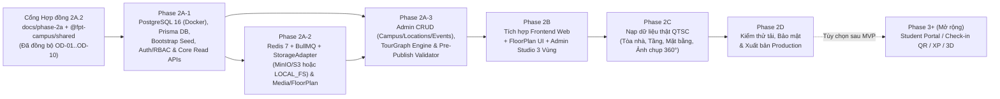

# LỘ TRÌNH TRIỂN KHAI PHASE 2A → 2E — FPT POLYTECHNIC VIRTUAL CAMPUS 360°

**Phiên bản:** 2A.2 (Aligned with `OD-01` → `OD-10`)  
**Điều kiện tiên quyết:** Bộ 5 tài liệu `docs/phase-2a/*` và hợp đồng `@fpt-campus/shared` (`packages/shared`) đã khóa đồng bộ theo `OD-01` → `OD-10` trước khi khởi tạo mã nguồn `apps/api` và `prisma/`.  
**Ràng buộc bảo toàn:** Giữ nguyên toàn bộ **19 route hiện tại** ở `apps/web`, bảo toàn trải nghiệm miễn phí không cần đăng nhập trên `/`, `/campus`, `/map`, `/locations`, `/events`, giữ `/games` & `/portal` tương thích (chưa xây Student/Parent Portal, chưa có Check-in QR hay XP/Leaderboard trong MVP), giữ `/news` & `OFFICIAL_CAMPUS_INFO` ở cấu hình web tĩnh (`OD-03` Phương án B), và giữ ẩn tab 3D WebGL khỏi MVP.

---

## 1. Biểu đồ phụ thuộc các Giai đoạn (Dependency Roadmap)

---

## 2. Chi tiết từng Giai đoạn & Tiêu chí nghiệm thu (Acceptance Criteria)

### Phase 2A — Nền tảng Backend, CSDL, Media & Tour Engine (`apps/api`)
*Không mở rộng sang 3D WebGL, Student/Parent Portal (`/portal`), Check-in QR (`OD-05`), hay XP/Leaderboard (`OD-08`) trong MVP; phần tài khoản hỗ trợ đầy đủ 3 nhóm người dùng (`ADMIN`/`STAFF`, `STUDENT`/`PARENT` Open Day — đăng nhập bằng `username | email | phone` theo `OD-04`, và Khách tham quan tự do không cần tài khoản).*

> [!IMPORTANT]
> **Nguyên tắc triển khai tuần tự theo `OD-07` & `OD-10`:**  
> - **Phase 2A-1 chỉ dựng PostgreSQL 16** (không ép Redis/MinIO ngay ở bước kiểm chứng Schema/Seed/Auth/Core Read).  
> - **`TourNode` độc lập có ảnh panorama 2:1 hợp lệ được `PUBLISH` ở Phase 2A-1/2A-3 ngay cả khi chưa có `FloorPlan`** (`floor_plan_id = NULL`, không tạo mặt bằng giả — `OD-10`).  
> - Luồng đầy đủ Floor Plan → Ghost Overlay → Validator → Publish được mở khóa sạch ở Phase 2A-2/2A-3.

1. **Bước 2A-1: Khung Backend, PostgreSQL 16, Prisma, Bootstrap Seed, Auth/RBAC & Core Public Read (`3–4 ngày`)**
   - Rà soát `docker-compose.yml` & `.env.example`: Phase 2A-1 chỉ chạy container **`postgres:16-alpine`** (DB `virtual_campus_360`, healthcheck dùng `${POSTGRES_USER}` & `${POSTGRES_DB}`), dùng `RATE_LIMIT_STORE=memory` & `STORAGE_DRIVER=local` ánh xạ 8 ảnh QTSC có sẵn.
   - Khởi tạo `apps/api` (NestJS Modular Monolith + Prisma Client + import trực tiếp `@fpt-campus/shared`), mọi endpoint dùng prefix `/api/v1`.
   - Áp dụng schema `prisma/schema.prisma` + custom SQL constraints theo đúng `PHASE_2A_DATABASE_DESIGN.md` v2A.2 (đủ **partial unique indexes `WHERE deleted_at IS NULL`** trên `campuses`, `buildings`, `floors`, `locations`, `tour_nodes`, `users(username/email/phone)`, `open_day_events`; đủ enum `BuildingCategory`, `MapBuildingIconKey`, `SessionPeriod`, `ParticipationStatus`, `PublishStatus`; đủ `hotspots CHECK` constraint).
   - Chạy idempotent `prisma/seed.ts`: tạo **01 tài khoản gốc duy nhất (`admin` · `userType = ADMIN` · `SUPER_ADMIN`)** từ `ADMIN_BOOTSTRAP_PASSWORD` (bắt buộc tồn tại, cấm fallback, cấm `Fpoly@2026`), đặt `must_change_password = true`; seed dữ liệu QTSC thực tế (`5` tòa nhà WGS84 Leaflet + `routeWaypoints`, `6` địa điểm với `loc-the-thao.primary_node_id = NULL` theo `OD-02`, `5` `TourNode` với `floor_plan_id = NULL` theo `OD-10`, `open_day_events`, `open_day_sessions`, `open_day_faqs`, `open_day_quiz_items`).
   - Triển khai `AuthModule` (`/api/v1/auth/login` hỗ trợ `username | email | phone`, `/refresh` HttpOnly rotation + reuse revocation, `/logout`, `/me`, `/me/password`, `/activate/validate`, `/activate/complete` — cấm `/register`), `UsersRbacModule`, `AuditLogModule`, và Public Read endpoints cốt lõi (`/api/v1/public/campus`, `/buildings/:slug`, `/locations`, `/locations/:slug`, `/tour/nodes`, `/tour/nodes/:slug`, `/events`, `POST /api/v1/public/quiz/verify` stateless) + Adapter `DATA_SOURCE=api|mock` trên `apps/web`.
   - **Tiêu chí nghiệm thu:** Khớp 100% Section 12 của [`PHASE_2A_READINESS_AND_DATA_CONTRACT_VERIFICATION.md`](../project-audit/PHASE_2A_READINESS_AND_DATA_CONTRACT_VERIFICATION.md).

2. **Bước 2A-2: Redis + BullMQ, `StorageAdapter` (MinIO/S3 hoặc `LOCAL_FS`), Media & Floor Plan Pipeline (`4–5 ngày`)**
   - Bổ sung `redis:7-alpine` (+ `minio/minio` khi dùng `STORAGE_DRIVER=s3`) vào stack Docker / worker; nâng `RATE_LIMIT_STORE=redis`.
   - Triển khai `MediaPipelineModule` & BullMQ Worker qua `StorageAdapter`:
     - Chặn file thô chưa ghép (`.insv`/`.insp`/dual-fisheye) hoặc ảnh cylinder (`5.77:1`) ngay ở `/api/v1/admin/media/presign`; chỉ nhận `JPG/PNG/WebP` `2:1` (`≤ 50MB`, `≥ 2048×1024`).
     - Giữ bản gốc, tự động xuất 3 biến thể WebP (`4096×2048`, `2048×1024`, `512×256`), hỗ trợ trạng thái `isPreviewApproved` sau khi Admin xem 360°.
   - Triển khai `FloorPlanModule`:
     - Nhận `PNG`, `JPG`, `SVG` (sanitize XSS), `PDF` (chọn trang render `WebP` 300 DPI ≤ 3200px).
     - Lưu phiên bản (`version`), tạo `floor_plan_alignment_snapshots`, bật `needsRealignment = true`, cung cấp `/alignment-overlay` & `/confirm-alignment` (bắt buộc cập nhật `tour_nodes.floor_plan_id = floorPlanId`, bật `floors.requires_floor_plan = true` và `active_floor_plan_id`).
   - **Tiêu chí nghiệm thu:** Upload thử cả 4 định dạng mặt bằng (SVG chứa `<script>` bị tước sạch, PDF nhiều trang render đúng trang chọn) + upload thử ảnh `5.77:1` bị chặn và ảnh `2:1` xuất đủ 3 biến thể WebP.

3. **Bước 2A-3: Full Admin CRUD (Campus/Locations/Events), Tour Engine & Validator API (`4–5 ngày`)**
   - Hoàn thiện toàn bộ endpoints `Admin CRUD`: `/api/v1/admin/campus`, `/buildings`, `/floors`, `/locations`, `/tour/nodes` (soft-delete kèm xóa transactional `tour_edges`/`hotspots`), `/hotspots` (`createReverseEdge`), `/events` & `sessions`/`faqs`/`quiz-items` (`OD-03`), `/users/import` 5 bước (`email -> phone` dedup, cấm lưu file/tên gốc), `/tour/validate`, và `/publish` (`NODE` / `FLOOR` / `BUILDING` scope).
   - Triển khai **Pre-Publish Graph Validator** kiểm tra đủ 7 luật (gồm `VAL_UNPLACED_NODE` theo `OD-10`: chỉ chặn khi `floor.activeFloorPlanId != null` hoặc `requiresFloorPlan === true`, và ngoại lệ `isTerminalApproved` / `isOneWayApproved` có lý do).
   - **Tiêu chí nghiệm thu:** E2E Vertical Slice thông suốt cho cả trường hợp `TourNode` không có `FloorPlan` (`OD-10`) lẫn trường hợp tầng đã gắn `FloorPlan` và thay thế bằng Ghost Overlay.

---

### Phase 2B — Tích hợp Frontend `apps/web` & Nâng cấp Admin Studio (`5–6 ngày`)
1. **Nối Auth `/login`, `/activate` & `/admin/*`:** Kết nối giao diện xác thực thực tế (sau khi `prototype-auth.ts` đã gỡ ở Phase 1) với HTTP client gọi `/api/v1/auth/*` (tự động refresh token ngầm trong RAM, bảo vệ route `/admin/*`, luồng kích hoạt 1 lần cho tài khoản Open Day và quy trình Admin Import Excel 5 bước không lưu file gốc). *(Student/Parent Portal `/portal` tiếp tục chưa mở trong MVP.)*
2. **Nâng cấp Public `/campus` & `/locations/[slug]`:**
   - Giữ nguyên trải nghiệm Three.js `PanoramaStage.tsx` (kéo xoay + tự xoay sau 3s).
   - Bổ sung **Floor Plan Interactive Drawer / Overlay** bên cạnh bản đồ GIS: cho phép chuyển tầng (`Tầng 1, 2, 3...`), xem chấm vị trí đang đứng trên mặt bằng 2D `[0..1]`, bấm vào phòng học (kể cả phòng `Cửa -> Trong phòng`) hoặc thang máy/cầu thang để nhảy thẳng sang panorama tương ứng.
3. **Nâng cấp `/admin/locations`, `/admin/media`, `/admin/virtual-tour`:**
   - Màn hình upload & chọn trang `Floor Plan` (`PNG/JPG/SVG/PDF`) + công cụ đặt tọa độ `Location`/`TourNode` chuẩn hóa `[0..1]` và chế độ **Ghost Overlay** khi thay thế mặt bằng.
   - Bố cục **Admin Studio 3 Vùng** + nút **"Kiểm duyệt & Xuất bản Tour"** gọi `/validate` & `/publish`.
   - Đọc dữ liệu công khai qua Adapter API (với fallback cache ISR của Next.js 16).

---

### Phase 2C — Thu thập & Nạp Dữ liệu Thực tế Khuôn viên QTSC (`Theo tiến độ chụp của Trường`)
1. Chụp thực địa theo SOP `PHASE_2A_PANORAMA_WORKFLOW.md` (hành lang, cửa phòng, bên trong Lab, thang máy, cầu thang).
2. Xử lý hậu kỳ xóa tripod nadir, làm mờ thông tin cá nhân/màn hình nhạy cảm.
3. Admin tạo tòa nhà/tầng thật, upload bản vẽ mặt bằng từng tầng, gắn tọa độ `TourNode`, nối hotspot hai chiều và chạy Validator kiểm duyệt trước khi xuất bản.

---

### Phase 2D — Kiểm thử Tải, Bảo mật & Go-Live (`3–4 ngày`)
- Chạy `owasp` security checklist (kiểm tra Upload XSS SVG, Path Traversal, Brute-Force Login Rate Limit, JWT Refresh Reuse, IDOR trên `/admin/*`).
- Kiểm tra hiệu năng tải Panorama `web_4k.webp` / `web_2k.webp` & Floor Plan qua CDN trên Desktop và Mobile.
- Thiết lập backup tự động PostgreSQL + Object Storage.

---

### Phase 2E (Tùy chọn sau MVP — Phase 3+)
- Đánh giá bổ sung **3D Dollhouse** (nếu trường thực hiện scan LiDAR/Matterport hoặc dựng `.glb` kiến trúc chuẩn), **Định vị đường đi ngắn nhất giữa 2 phòng xuyên tầng (BFS Pathfinding trên `TourGraph`)**, và xem xét mở **Student/Parent Portal (`/portal`)** sau khi hoàn tất nền tảng Auth & Open Day ở Phase 3.

---

## 3. Phân tích Rủi ro & Biện pháp giảm thiểu

| Rủi ro | Khả năng | Tác động | Biện pháp kiểm soát thiết kế sẵn |
| :--- | :--- | :--- | :--- |
| Ảnh chụp 360° thực tế quá nặng (20–40MB JPEG) làm chậm tải trình duyệt | Cao | Cao | Bắt buộc Worker nén ra 2 mức WebP (`web_4k` 1.5–3MB cho Desktop, `web_2k` 500–900KB cho Mobile) + prefetch node hàng xóm. |
| File PDF mặt bằng CAD có nhiều layer/vector phức tạp | Trung bình | Cao | Render PDF sang ảnh WebP 300 DPI trên Server Worker có timeout 15s & giới hạn pixel, không để trình duyệt client tự parse PDF. |
| Thay thế bản vẽ mặt bằng mới làm lệch toàn bộ điểm ghim cũ | Trung bình | Cao | Tọa độ chuẩn hóa `[0..1]` + lưu lịch sử `version` + snapshot tọa độ cũ + **luôn bật `needsRealignment = true` và Ghost Overlay bắt Admin xác nhận trước Publish** (không bỏ qua dù cùng tỷ lệ). |
| Nhân sự vận hành nối thiếu đường quay ra khỏi phòng trên Tour 360° | Cao | Trung bình | Graph Validator chặn node cô lập/ngõ cụt (`VAL_DEAD_END_NODE`), cung cấp nút **"Tạo liên kết 2 chiều tự động"**, đồng thời hỗ trợ ngoại lệ `isTerminalApproved` / `isOneWayApproved` cho lối đi một chiều hợp lệ. |
| Upload SVG mặt bằng chứa mã độc XSS | Thấp | Rất cao | Magic-byte check + SVG Sanitizer nghiêm ngặt + phục vụ qua domain/CDN tĩnh với CSP chặt chẽ. |

---

## 4. Bảng Đối chiếu Nhất quán Liên tài liệu (Consistency Matrix)

| Chủ đề | `DATABASE_DESIGN` | `API_CONTRACT` | `PANORAMA_WORKFLOW` | `SYSTEM_ARCH` & `ROADMAP` |
| :--- | :--- | :--- | :--- | :--- |
| **GIS Campus Map (`OD-01`)** | `campuses.origin_point_json`, `buildings.lat/lng NOT NULL`, `route_waypoints_json`, `map_icon_key`, `gis_x/y NULLABLE` | `GET /public/campus` trả full Leaflet WGS84 + `originPoint` | Tách biệt Hệ tọa độ 1 (WGS84 Leaflet) khỏi `[0..1]` | Chuẩn hóa Leaflet + OpenStreetMap (FixNear) |
| **Tên thực thể 360° & `OD-02`** | `tour_nodes` (`TourNode`); `Location (1) — (N) TourNode`; `loc-the-thao.primary_node_id = NULL` | `/api/v1/public/tour/nodes` & `/:slug` + `primaryNodeSlug: string \| null` | `TourNode` 2:1, không gắn chéo giả | Nhất quán tên `TourNode` trên cả Web & API |
| **Optional `FloorPlan` (`OD-10`)** | `floors.requires_floor_plan`, `tour_nodes.floor_plan_id NULLABLE` | `POST .../publish` hỗ trợ `NODE` scope độc lập; `confirm-alignment` set `floor_plan_id` | `VAL_UNPLACED_NODE` chỉ chặn khi Floor đã có `active_floor_plan_id` / `requires_floor_plan = true` | Cho phép seed QTSC & node 360° thuần xuất bản không cần mặt bằng giả |
| **Open Day & Static CMS (`OD-03`, `OD-05`, `OD-08`)** | `open_day_events`, `open_day_sessions`, `open_day_faqs`, `open_day_quiz_items` (không `CHECKED_IN`, không XP) | `GET /public/events` (ẩn `correctIndex`), `POST /public/quiz/verify`, Admin CRUD `/admin/events/*` | Không tạo bảng/API Check-in hay XP | `/news` & `OFFICIAL_CAMPUS_INFO` giữ static config; Quiz public không tài khoản |
| **Auth & Phone (`OD-04`)** | Partial unique `WHERE deleted_at IS NULL` trên `username`, `email`, `phone` (E.164/VN) | `POST /auth/login` hỗ trợ `username \| email \| phone`; Excel dedup `email -> phone` | Cấm dedup theo `(fullName, phone)` hay `fullName` | `ADMIN_BOOTSTRAP_PASSWORD`, Dual Provisioning, không `/register` |
| **Shared Contract (`OD-09`)** | `@fpt-campus/shared` khớp 100% Prisma schema v2A.2 | Typed Request/Response & `ApiEnvelope` | Dùng chung Validation Error Codes | `packages/shared` build `./dist/*` & tích hợp vào `apps/web` |
| **Infrastructure (`OD-07`)** | Schema áp dụng cho PostgreSQL 16 (`Phase 2A-1`) | `StorageAdapter` trừu tượng `LOCAL_FS` vs `S3_MINIO` | Xử lý Sharp/Poppler ở Worker Phase 2A-2 | Phase 2A-1 chỉ dựng PostgreSQL 16; Redis/MinIO mở ở Phase 2A-2 |

---

## 5. Checklist Nghiệm thu Kiến trúc Phase 2A (Sẵn sàng bước Phase 2A-1 Code)

- [x] Đồng bộ đầy đủ `OD-01` → `OD-10` trên cả 5 tài liệu `docs/phase-2a/*` (phiên bản `2A.2`).
- [x] Chuẩn hóa Hệ tọa độ 1 sang **Leaflet + OpenStreetMap + WGS84 (`lat, lng NOT NULL`)**, `origin_point_json`, `route_waypoints_json` (`OD-01`).
- [x] Khóa chặt `Location (1) — (N) TourNode`, đặt `loc-the-thao.primary_node_id = NULL` (`OD-02`), cho phép `TourNode` xuất bản không cần `FloorPlan` giả (`OD-10`).
- [x] Hoàn thiện lược đồ `open_day_events`, `open_day_sessions`, `open_day_faqs`, `open_day_quiz_items` (bỏ Check-in QR `OD-05` & XP/Leaderboard `OD-08`; phân ranh tĩnh `/news` & `OFFICIAL_CAMPUS_INFO` theo `OD-03`).
- [x] Bổ sung toàn bộ bản vá toàn vẹn SQL (`partial unique WHERE deleted_at IS NULL` kể cả `phone`, `CHECK hotspots`, soft-delete cleanup, đầy đủ enums — `OD-04`, `OD-06`).
- [x] Viết lại `@fpt-campus/shared` sạch, build `dist/` và tích hợp `apps/web` (`OD-09`), giữ nguyên toàn bộ 19 route và tách rõ Phase 2A-1 chỉ chạy PostgreSQL 16 (`OD-07`).
