# LỘ TRÌNH TRIỂN KHAI PHASE 2A → 2E — FPT POLYTECHNIC VIRTUAL CAMPUS 360°

**Phiên bản:** 2A.2 (Aligned with `OD-01` → `OD-10`)  
**Điều kiện tiên quyết:** Bộ 5 tài liệu `docs/phase-2a/*` và hợp đồng `@fpt-campus/shared` (`packages/shared`) đã khóa đồng bộ theo `OD-01` → `OD-10` trước khi khởi tạo mã nguồn `apps/api` và `prisma/`.  
**Ràng buộc bảo toàn:** Giữ nguyên toàn bộ **19 route hiện tại** ở `apps/web`, bảo toàn trải nghiệm miễn phí không cần đăng nhập trên `/`, `/campus`, `/map`, `/locations`, `/events`, giữ `/games` & `/portal` tương thích (chưa xây Student/Parent Portal, chưa có Check-in QR hay XP/Leaderboard trong MVP), giữ `/news` & `OFFICIAL_CAMPUS_INFO` ở cấu hình web tĩnh (`OD-03` Phương án B), và giữ ẩn tab 3D WebGL khỏi MVP.

---

## 1. Biểu đồ phụ thuộc các Giai đoạn (Dependency Roadmap)

```mermaid
flowchart LR
    G0["Cổng Hợp đồng 2A.2\ndocs/phase-2a + @fpt-campus/shared\n(Đã đồng bộ OD-01..OD-10)"] --> P2A1["Phase 2A-1 — Database Bootstrap\nPostgreSQL 16 (Docker), Env Config,\nPrisma schema, Migrations & Seed QTSC"]
    P2A1 --> P2A2["Phase 2A-2 — Core Backend & Auth\nNestJS Modular Monolith, Prisma + Shared,\nAuth/RBAC, StorageAdapter (local) & Public Read"]
    P2A2 --> P2A3["Phase 2A-3 — Business Modules\nAdmin CRUD (Campus/Locations/Events),\nFloorPlan, Panorama/TourGraph & Nối Frontend"]
    P2A3 --> P2B["Phase 2B — Nâng cấp Studio UI\nFloorPlan Interactive Drawer\n& Admin Studio 3 Vùng"]
    P2B --> P2C["Phase 2C\nNạp dữ liệu thật QTSC\n(Tòa nhà, Tầng, Mặt bằng, Ảnh chụp 360°)"]
    P2C --> P2D["Phase 2D\nKiểm thử tải, Bảo mật\n& Xuất bản Production"]
    P2D -. "Tùy chọn sau MVP" .-> P2E["Phase 3+ (Mở rộng)\nStudent Portal / Check-in QR / XP / 3D"]
```

---

## 2. Chi tiết từng Giai đoạn & Tiêu chí nghiệm thu (Acceptance Criteria)

### Phase 2A — Nền tảng Backend, CSDL, Media & Tour Engine (`apps/api`)
*Không mở rộng sang 3D WebGL, Student/Parent Portal (`/portal`), Check-in QR (`OD-05`), hay XP/Leaderboard (`OD-08`) trong MVP; phần tài khoản hỗ trợ đầy đủ 3 nhóm người dùng (`ADMIN`/`STAFF`, `STUDENT`/`PARENT` Open Day — đăng nhập bằng `username | email | phone` theo `OD-04`, và Khách tham quan tự do không cần tài khoản).*

> [!IMPORTANT]
> **Nguyên tắc phân kỳ triển khai chuẩn (Kiểm soát rủi ro Data -> Core -> Business, `OD-07` & `OD-10`):**  
> - **Phase 2A-1 chỉ dựng Database Bootstrap (PostgreSQL 16 + Prisma + Migrations + Seed):** Chưa khởi tạo `apps/api/`, chưa triển khai NestJS, Auth hay API handlers để tách bạch và xác minh toàn vẹn data model trước.  
> - **`TourNode` độc lập có ảnh panorama 2:1 hợp lệ được `PUBLISH` ở Phase 2A-2/2A-3 ngay cả khi chưa có `FloorPlan`** (`floor_plan_id = NULL`, không tạo mặt bằng giả — `OD-10`).  
> - **Không lưu ảnh panorama lớn trực tiếp vào PostgreSQL:** DB chỉ lưu object key / đường dẫn tham chiếu trong `media_assets` ở mọi phase.

1. **Phase 2A-1 — Database Bootstrap (`2–3 ngày`)**
   - **Phạm vi:**
     - Chạy local **PostgreSQL 16** bằng Docker Compose (`postgres:16-alpine`, database `virtual_campus_360`, healthcheck dùng `${POSTGRES_USER}` & `${POSTGRES_DB}`).
     - Hoàn thiện environment configuration (`.env.example` và `.env` cục bộ không commit: `DATABASE_URL`, `POSTGRES_*`, `ADMIN_BOOTSTRAP_PASSWORD`, `STORAGE_DRIVER=local`, `WEB_ORIGIN`, `DATA_SOURCE`).
     - Khởi tạo Prisma và `prisma/schema.prisma` khớp 100% `PHASE_2A_DATABASE_DESIGN.md` v2A.2.
     - Tạo SQL migrations với đầy đủ **17 Prisma enums**, indexes, **partial unique indexes (`WHERE deleted_at IS NULL`) hiện diện thực sự trong file SQL migration** (trên `campuses`, `buildings`, `floors`, `locations`, `tour_nodes`, `users(username/email/phone)`, `open_day_events`), và **`hotspots` `CHECK` constraint (`SCENE_LINK <-> edge_id`) trong file SQL migration**.
     - Viết `prisma/seed.ts` idempotent theo đúng thứ tự khóa ngoại (tạo **01 tài khoản gốc duy nhất `admin`** đọc `ADMIN_BOOTSTRAP_PASSWORD` từ environment và băm bằng **Argon2id**, tuyệt đối không hardcode mật khẩu; seed QTSC gồm `5` tòa nhà Leaflet WGS84 + `routeWaypoints`, `6` địa điểm với `loc-the-thao.primary_node_id = NULL` theo `OD-02`, `5` `TourNode` với `floor_plan_id = NULL` theo `OD-10`, `8` metadata ảnh cục bộ trong `media_assets`, và dữ liệu `open_day_*`).
     - Kiểm tra migration, seed, reset/re-initialize (`prisma migrate reset`) và database integrity (bao gồm test vi phạm `hotspots CHECK` constraint).
     - **Chưa khởi tạo `apps/api/`, chưa triển khai NestJS, Auth, `StorageAdapter` hoặc API handlers.**
   - **Đầu ra:** `docker-compose.yml` chuẩn `postgres:16`, `.env.example`, `prisma/schema.prisma`, `prisma/migrations/*` (có custom SQL cho partial unique & CHECK), `prisma/seed.ts`, nhật ký kiểm chứng DB reset/seed/constraint.
   - **Tiêu chí nghiệm thu (Phase 2A-1):**
     1. Container `postgres:16` đạt `healthy` khi dùng biến môi trường trong `.env`.
     2. `prisma migrate deploy` và chu kỳ `prisma migrate reset --force` (reset & tái khởi tạo DB sạch) chạy thành công.
     3. Truy vấn `pg_indexes` / `pg_constraint` và đối chiếu file `.sql` trong `prisma/migrations/` xác nhận **partial unique indexes (`WHERE deleted_at IS NULL`)** và **`hotspots` `CHECK` constraint** thực sự tồn tại trong SQL migration, kèm test cố tình chèn bản ghi vi phạm `hotspots` `CHECK` bị PostgreSQL từ chối.
     4. `prisma/seed.ts` chạy lặp lại (idempotent) không lỗi/nhân bản; thiếu `ADMIN_BOOTSTRAP_PASSWORD` bị từ chối; tài khoản `admin` duy nhất có `password_hash` chuẩn `$argon2id$` và `must_change_password = true`; `media_assets` chỉ chứa key/path (không lưu ảnh nhị phân lớn trong PostgreSQL).
     5. Xác nhận **chưa có `apps/api/`**, chưa có NestJS/Auth/API handler, và `apps/web` vẫn build/typecheck/lint `exit 0`.

2. **Phase 2A-2 — Core Backend & Authentication (`3–4 ngày`)**
   - **Phạm vi:**
     - Khởi tạo **NestJS Modular Monolith (`apps/api/`, prefix `/api/v1`)**.
     - Tích hợp Prisma Client và dùng chung types/DTO từ `@fpt-campus/shared`.
     - Triển khai **`AuthModule`**, **`UsersRbacModule`**, **`AuditLogModule`**:
       - `POST /api/v1/auth/login` hỗ trợ `username | email | normalized phone` (**chuẩn hóa `users.phone` theo `E.164/VN` trước khi kiểm tra uniqueness và đăng nhập**), verify **Argon2id**.
       - Session/token lifecycle: Access JWT ngắn hạn (chỉ giữ RAM ở client), Refresh Token 64-byte quay vòng trong cookie `HttpOnly` (thu hồi toàn bộ `family_id` khi reuse attack), ép `403 PASSWORD_CHANGE_REQUIRED` khi `mustChangePassword === true`, hỗ trợ `/refresh`, `/logout`, `/me`, `/me/password`, `/activate/validate`, `/activate/complete` (**cấm `/register`**).
       - RBAC Guards & ghi `audit_logs` cho mọi thao tác xác thực/quản trị.
     - Triển khai **`StorageAdapter` local (`STORAGE_DRIVER=local`)** ánh xạ bộ ảnh QTSC cục bộ đã seed và `RATE_LIMIT_STORE=memory`.
     - Triển khai toàn bộ **Public Read APIs** theo contract đã khóa: `/api/v1/public/campus`, `/buildings/:slug`, `/buildings/:slug/floors`, `/locations`, `/locations/:slug`, `/tour/nodes`, `/tour/nodes/:slug`, `/events` (ẩn đáp án quiz), và `POST /api/v1/public/quiz/verify` (stateless).
   - **Đầu ra:** Ứng dụng `apps/api/` chạy ổn định với `PostgreSQL 16`, Auth/RBAC, `StorageAdapter` local và toàn bộ Public Read endpoints.
   - **Tiêu chí nghiệm thu (Phase 2A-2):**
     1. `apps/api` build/typecheck sạch, nhập trực tiếp `@fpt-campus/shared`, kết nối PostgreSQL qua Prisma.
     2. Auth hoạt động chuẩn bảo mật: login qua `username`/`email`/`phone` (đã chuẩn hóa `phone`), bắt buộc đổi bootstrap password lần đầu, refresh rotation + reuse detection, không có `/auth/register`.
     3. Toàn bộ Public Read APIs trả đúng dữ liệu QTSC `PUBLISHED & deleted_at IS NULL` từ PostgreSQL (`loc-the-thao.primaryNodeSlug = null`, `quizItems` không lộ `correctIndex`/`explanation`, `0` rò rỉ `password_hash`/`token_hash`/`DRAFT`).
     4. `StorageAdapter` local phục vụ đúng đường dẫn media hạt giống mà chưa cần MinIO/Redis.

3. **Phase 2A-3 — Business Modules (`5–6 ngày`)**
   - **Phạm vi:**
     - **CRUD Campus, Building, Floor, Location:** `/api/v1/admin/campus`, `/buildings`, `/floors`, `/locations` (hỗ trợ đầy đủ Leaflet WGS84 + metadata `OD-01`, `primaryNodeId NULLABLE` theo `OD-02`).
     - **Floor Plan, Panorama, TourNode, TourEdge, Hotspot & Media Pipeline:**
       - Tích hợp hàng đợi **Redis 7 + BullMQ** và mở rộng **`StorageAdapter`** sang tùy chọn **`S3/MinIO` (`STORAGE_DRIVER=s3`)** khi xử lý upload thực tế.
       - `MediaPipelineModule`: chặn ảnh chưa ghép/cylinder `5.77:1`, kiểm magic bytes, xuất 3 biến thể WebP (`4K/2K/Thumb 512`), duyệt preview 360°.
       - `FloorPlanModule`: hỗ trợ `PNG/JPG/SVG/PDF` (SVG sanitizer chống XSS, PDF 300 DPI sandbox), lưu version & snapshot, Ghost Overlay, và **`confirm-alignment` bắt buộc cập nhật đúng `tour_nodes.floor_plan_id = floorPlanId`**, `floor_norm_x/y`, `floors.active_floor_plan_id`, `floors.requires_floor_plan = true`.
       - `TourGraphModule`: tạo/sửa `TourNode`, **xóa mềm `TourNode` phải xử lý dọn `tour_edges` và `hotspots` trong cùng PostgreSQL transaction**, tạo hotspot hai chiều, Graph Validator 7 luật (gồm `VAL_UNPLACED_NODE` có điều kiện theo `OD-10`) và Publish (`NODE`/`FLOOR`/`BUILDING`).
     - **Open Day CMS & Admin Workflows:** CRUD `/api/v1/admin/events/*` (`events`, `sessions`, `faqs`, `quiz-items` theo `OD-03`, `OD-05`, `OD-08`), quản lý user & quy trình Import Excel/CSV 5 bước (chuẩn hóa `phone` trước check uniqueness, dedup `email -> phone`, báo `IDENTITY_CONFLICT`, cấm lưu file/tên gốc) và phát hành lời mời.
     - **Kết nối Frontend với API thật theo từng module (`apps/web`):** Chuyển dần từ fallback mock sang gọi NestJS API qua Adapter (`DATA_SOURCE=api`) cho từng nhóm (`/map`, `/locations`, `/campus`, `/events`, `/games`, `/login`, `/activate`, `/admin/*`) mà vẫn giữ nguyên 19 routes & ranh giới MVP.
   - **Đầu ra:** Hệ thống Business APIs đầy đủ, Media/FloorPlan workers, Pre-Publish Validator, và `apps/web` kết nối trực tiếp Backend API theo từng module.
   - **Tiêu chí nghiệm thu (Phase 2A-3):**
     1. Xóa mềm `TourNode` dọn sạch `tour_edges` & `hotspots` trong cùng transaction; `confirm-alignment` cập nhật đúng `tour_nodes.floor_plan_id`; `VAL_UNPLACED_NODE` tuân thủ `OD-10` (không bắt `FloorPlan` giả).
     2. Upload thử `SVG` chứa `<script>` bị tước sạch, `PDF` nhiều trang render đúng trang, ảnh `5.77:1` bị chặn và ảnh `2:1` tạo đủ 3 bản WebP không lưu nhị phân vào PostgreSQL.
     3. Chuẩn hóa `phone` khi check uniqueness/import Excel (`IDENTITY_CONFLICT` khi lệch user), Open Day CMS CRUD & stateless quiz đồng bộ DB.
     4. Frontend (`apps/web`) bật `DATA_SOURCE=api` hoạt động thông suốt từng module đã nối; `pnpm build`, `typecheck`, `lint` PASS (`exit 0`), 19 routes trả HTTP `200`.

---

### Phase 2B — Nâng cấp UI Chuyên sâu (`Admin Studio 3 Vùng` & `Floor Plan Interactive Drawer`, `3–4 ngày`)
*(Sau khi `Phase 2A-3` đã nối xong API thật theo từng module cho các màn hiện hữu, `Phase 2B` tập trung hoàn thiện phần giao diện nâng cấp mới:)*
1. **Nâng cấp Public `/campus` & `/locations/[slug]` (Floor Plan Drawer):**
   - Giữ nguyên trải nghiệm Three.js `PanoramaStage.tsx` (kéo xoay + tự xoay sau 3s).
   - Bổ sung **Floor Plan Interactive Drawer / Overlay** bên cạnh bản đồ GIS: chuyển tầng (`Tầng 1, 2, 3...`), xem chấm vị trí đang đứng `[0..1]`, bấm vào phòng hoặc thang máy/cầu thang để nhảy thẳng sang panorama tương ứng.
2. **Nâng cấp UI `/admin/locations`, `/admin/media`, `/admin/virtual-tour`:**
   - Giao diện chọn trang `Floor Plan` (`PNG/JPG/SVG/PDF`) + đặt tọa độ `[0..1]` và **Ghost Overlay** trực quan khi thay mặt bằng.
   - Bố cục **Admin Studio 3 Vùng** hoàn chỉnh + thao tác kiểm duyệt & xuất bản trực quan.

---

### Phase 2C — Thu thập & Nạp Dữ liệu Thực tế Khuôn viên QTSC (`Theo tiến độ chụp của Trường`)
1. Chụp thực địa theo SOP `PHASE_2A_PANORAMA_WORKFLOW.md` (hành lang, cửa phòng, bên trong Lab, thang máy, cầu thang).
2. Xử lý hậu kỳ xóa tripod nadir, làm mờ thông tin cá nhân/màn hình nhạy cảm.
3. Admin tạo tòa nhà/tầng thật, upload bản vẽ mặt bằng từng tầng, gắn tọa độ `TourNode`, nối hotspot hai chiều và chạy Validator kiểm duyệt trước khi xuất bản.

---

### Phase 2D — Kiểm thử Tải, Bảo mật & Go-Live (`3–4 ngày`)
- Chạy `owasp` security checklist (kiểm tra Upload XSS SVG, Path Traversal, Brute-Force Login Rate Limit, JWT Refresh Reuse, IDOR trên `/admin/*`).
- Kiểm tra hiệu năng tải Panorama `web_4k.webp` / `web_2k.webp` & Floor Plan qua CDN trên Desktop và Mobile.
- Thiết lập backup tự động PostgreSQL + Object Storage.

---

### Phase 2E (Tùy chọn sau MVP — Phase 3+)
- Đánh giá bổ sung **3D Dollhouse** (nếu trường thực hiện scan LiDAR/Matterport hoặc dựng `.glb` kiến trúc chuẩn), **Định vị đường đi ngắn nhất giữa 2 phòng xuyên tầng (BFS Pathfinding trên `TourGraph`)**, và xem xét mở **Student/Parent Portal (`/portal`)** sau khi hoàn tất nền tảng Auth & Open Day ở Phase 3.

---

## 3. Phân tích Rủi ro & Biện pháp giảm thiểu

| Rủi ro | Khả năng | Tác động | Biện pháp kiểm soát thiết kế sẵn |
| :--- | :--- | :--- | :--- |
| Ảnh chụp 360° thực tế quá nặng (20–40MB JPEG) làm chậm tải trình duyệt | Cao | Cao | Bắt buộc Worker nén ra 2 mức WebP (`web_4k` 1.5–3MB cho Desktop, `web_2k` 500–900KB cho Mobile) + prefetch node hàng xóm. |
| File PDF mặt bằng CAD có nhiều layer/vector phức tạp | Trung bình | Cao | Render PDF sang ảnh WebP 300 DPI trên Server Worker có timeout 15s & giới hạn pixel, không để trình duyệt client tự parse PDF. |
| Thay thế bản vẽ mặt bằng mới làm lệch toàn bộ điểm ghim cũ | Trung bình | Cao | Tọa độ chuẩn hóa `[0..1]` + lưu lịch sử `version` + snapshot tọa độ cũ + **luôn bật `needsRealignment = true` và Ghost Overlay bắt Admin xác nhận trước Publish** (không bỏ qua dù cùng tỷ lệ). |
| Nhân sự vận hành nối thiếu đường quay ra khỏi phòng trên Tour 360° | Cao | Trung bình | Graph Validator chặn node cô lập/ngõ cụt (`VAL_DEAD_END_NODE`), cung cấp nút **"Tạo liên kết 2 chiều tự động"**, đồng thời hỗ trợ ngoại lệ `isTerminalApproved` / `isOneWayApproved` cho lối đi một chiều hợp lệ. |
| Upload SVG mặt bằng chứa mã độc XSS | Thấp | Rất cao | Magic-byte check + SVG Sanitizer nghiêm ngặt + phục vụ qua domain/CDN tĩnh với CSP chặt chẽ. |

---

## 4. Bảng Đối chiếu Nhất quán Liên tài liệu (Consistency Matrix)

| Chủ đề | `DATABASE_DESIGN` | `API_CONTRACT` | `PANORAMA_WORKFLOW` | `SYSTEM_ARCH` & `ROADMAP` |
| :--- | :--- | :--- | :--- | :--- |
| **GIS Campus Map (`OD-01`)** | `campuses.origin_point_json`, `buildings.lat/lng NOT NULL`, `route_waypoints_json`, `map_icon_key`, `gis_x/y NULLABLE` | `GET /public/campus` trả full Leaflet WGS84 + `originPoint` | Tách biệt Hệ tọa độ 1 (WGS84 Leaflet) khỏi `[0..1]` | Chuẩn hóa Leaflet + OpenStreetMap (FixNear) |
| **Tên thực thể 360° & `OD-02`** | `tour_nodes` (`TourNode`); `Location (1) — (N) TourNode`; `loc-the-thao.primary_node_id = NULL` | `/api/v1/public/tour/nodes` & `/:slug` + `primaryNodeSlug: string \| null` | `TourNode` 2:1, không gắn chéo giả | Nhất quán tên `TourNode` trên cả Web & API |
| **Optional `FloorPlan` (`OD-10`)** | `floors.requires_floor_plan`, `tour_nodes.floor_plan_id NULLABLE` | `POST .../publish` hỗ trợ `NODE` scope độc lập; `confirm-alignment` set `floor_plan_id` | `VAL_UNPLACED_NODE` chỉ chặn khi Floor đã có `active_floor_plan_id` / `requires_floor_plan = true` | Cho phép seed QTSC & node 360° thuần xuất bản không cần mặt bằng giả |
| **Open Day & Static CMS (`OD-03`, `OD-05`, `OD-08`)** | `open_day_events`, `open_day_sessions`, `open_day_faqs`, `open_day_quiz_items` (không `CHECKED_IN`, không XP) | `GET /public/events` (ẩn `correctIndex`), `POST /public/quiz/verify`, Admin CRUD `/admin/events/*` | Không tạo bảng/API Check-in hay XP | `/news` & `OFFICIAL_CAMPUS_INFO` giữ static config; Quiz public không tài khoản |
| **Auth & Phone (`OD-04`)** | Partial unique `WHERE deleted_at IS NULL` trên `username`, `email`, `phone` (E.164/VN) | `POST /auth/login` hỗ trợ `username \| email \| phone`; Excel dedup `email -> phone` | Cấm dedup theo `(fullName, phone)` hay `fullName` | `ADMIN_BOOTSTRAP_PASSWORD`, Dual Provisioning, không `/register` |
| **Shared Contract (`OD-09`)** | `@fpt-campus/shared` khớp 100% Prisma schema v2A.2 | Typed Request/Response & `ApiEnvelope` | Dùng chung Validation Error Codes | `packages/shared` build `./dist/*` & tích hợp vào `apps/web` |
| **Infrastructure (`OD-07`)** | Schema, partial unique & CHECK migration cho PostgreSQL 16 (`Phase 2A-1`) | `StorageAdapter` local ở `2A-2`, nâng lên upload/`S3_MINIO` ở `2A-3` | Xử lý Sharp/Poppler ở Worker Phase `2A-3` | `2A-1` chỉ DB Bootstrap; `2A-2` NestJS + Auth + Public Read; `2A-3` Business Modules + Redis/MinIO + Nối Web |

---

## 5. Checklist Nghiệm thu Kiến trúc & Phân kỳ Phase 2A (Sẵn sàng bước Phase 2A-1 Database Bootstrap)

- [x] Đồng bộ đầy đủ `OD-01` → `OD-10` trên cả 5 tài liệu `docs/phase-2a/*` (phiên bản `2A.2`).
- [x] Chuẩn hóa Hệ tọa độ 1 sang **Leaflet + OpenStreetMap + WGS84 (`lat, lng NOT NULL`)**, `origin_point_json`, `route_waypoints_json` (`OD-01`).
- [x] Khóa chặt `Location (1) — (N) TourNode`, đặt `loc-the-thao.primary_node_id = NULL` (`OD-02`), cho phép `TourNode` xuất bản không cần `FloorPlan` giả (`OD-10`).
- [x] Hoàn thiện lược đồ `open_day_events`, `open_day_sessions`, `open_day_faqs`, `open_day_quiz_items` (bỏ Check-in QR `OD-05` & XP/Leaderboard `OD-08`; phân ranh tĩnh `/news` & `OFFICIAL_CAMPUS_INFO` theo `OD-03`).
- [x] Bổ sung toàn bộ bản vá toàn vẹn SQL (`partial unique WHERE deleted_at IS NULL` kể cả `phone`, `CHECK hotspots`, soft-delete cleanup, đầy đủ enums — `OD-04`, `OD-06`).
- [x] Viết lại `@fpt-campus/shared` sạch, build `dist/` và tích hợp `apps/web` (`OD-09`), giữ nguyên toàn bộ 19 route.
- [x] Chốt ranh giới phân kỳ **2A-1 (Database Bootstrap)** → **2A-2 (Core Backend, Auth, StorageAdapter local & Public Read)** → **2A-3 (Business Modules, Media/FloorPlan Pipeline & Frontend API Cutover)** (`OD-07`).
