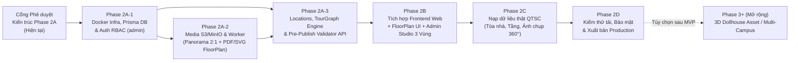

# LỘ TRÌNH TRIỂN KHAI PHASE 2A → 2E — FPT POLYTECHNIC VIRTUAL CAMPUS 360°

**Phiên bản:** 2A.1  
**Điều kiện tiên quyết:** Chủ dự án phê duyệt bộ 5 tài liệu kiến trúc `docs/phase-2a/*` trước khi khởi tạo mã nguồn `apps/api` và `prisma/`.  
**Ràng buộc bảo toàn:** Giữ nguyên toàn bộ **19 route hiện tại** ở `apps/web`, bảo toàn trải nghiệm miễn phí không cần đăng nhập trên `/`, `/campus`, `/map`, `/locations`, `/events`, giữ `/games` & `/portal` tương thích, và giữ ẩn tab 3D WebGL khỏi MVP.

---

## 1. Biểu đồ phụ thuộc các Giai đoạn (Dependency Roadmap)

---

## 2. Chi tiết từng Giai đoạn & Tiêu chí nghiệm thu (Acceptance Criteria)

### Phase 2A — Nền tảng Backend, CSDL, Media & Tour Engine (`apps/api`)
*Không sửa phá vỡ UI `apps/web` và không mở rộng sang 3D WebGL hay tài khoản sinh viên trong giai đoạn này.*

> [!IMPORTANT]
> **Nguyên tắc triển khai ưu tiên luồng xuyên suốt (Vertical Slice First):**  
> Đừng xây dàn trải nhiều màn hình Admin CRUD trước khi luồng cốt lõi chạy thông. Phải ưu tiên nối thông mạch nghiệp vụ:  
> **Tạo tòa nhà → Tạo tầng → Upload bản vẽ mặt bằng → Đặt phòng (`Location`) & điểm chụp (`TourNode`) → Upload panorama 2:1 & duyệt Preview → Nối hotspot (`TourEdge`) → Validate đồ thị → Publish → Khách mở `/campus` đi lại được xuyên tầng.**

1. **Bước 2A-1: Khung Backend, PostgreSQL, Prisma & Auth/RBAC (`3–4 ngày`)**
   - Mở rộng `docker-compose.yml`: `postgres:16-alpine`, `redis:7-alpine`, `minio/minio` (+ `minio-init`).
   - Khởi tạo `apps/api` (NestJS + Prisma Client + Shared DTO chuẩn tên `TourNode` ở `packages/shared`, mọi endpoint dùng prefix `/api/v1`).
   - Áp dụng schema `prisma/schema.prisma` theo đúng `PHASE_2A_DATABASE_DESIGN.md` và chạy bootstrap seed tạo **01 tài khoản gốc duy nhất (`admin` · `SUPER_ADMIN`)** lấy secret từ biến môi trường (`ADMIN_BOOTSTRAP_PASSWORD`, tuyệt đối không đặt mật khẩu mặc định trong source code), bắt buộc `must_change_password = true` ở lần đăng nhập đầu tiên.
   - Triển khai `AuthModule` (`/api/v1/auth/login`, `/refresh` HttpOnly cookie, `/logout`, `/me`, `/me/password`) + `AuditLogModule` + `RateLimitGuard`. Access Token chỉ giữ trong RAM/React state. Không xây tài khoản `PARTICIPANT`/khách.
   - **Tiêu chí nghiệm thu:** Chạy `docker compose up` sạch; `POST /api/v1/auth/login` sai trả 401 chung, đúng trả Access Token + `mustChangePassword=true` yêu cầu đổi pass lần đầu; kiểm tra refresh rotation & reuse detection thu hồi `family_id`.

2. **Bước 2A-2: MinIO/S3, Media Pipeline Panorama & Floor Plan Pipeline (`4–5 ngày`)**
   - Triển khai `MediaPipelineModule` & BullMQ Worker:
     - Chặn file thô chưa ghép (`.insv`/`.insp`/dual-fisheye) hoặc ảnh cylinder cắt dọc (`5.77:1`) ngay ở `/api/v1/admin/media/presign`; chỉ nhận `JPG/PNG/WebP` đã ghép `2:1` (`≤ 50MB`, `≥ 2048×1024`).
     - Giữ bản gốc, tự động xuất 3 biến thể WebP (`4096×2048`, `2048×1024`, `512×256`), hỗ trợ trạng thái `isPreviewApproved` sau khi Admin xem 360°.
   - Triển khai `FloorPlanModule`:
     - Nhận `PNG`, `JPG`, `SVG` (sanitize XSS), `PDF` (chọn trang render `WebP` 300 DPI ≤ 3200px).
     - Lưu phiên bản (`version`), tạo `floor_plan_alignment_snapshots` & **luôn bật `needsRealignment = true`** mỗi khi thay bản vẽ mới (không dựa vào aspect ratio để tự pass), cung cấp API overlay & confirm alignment.
   - **Tiêu chí nghiệm thu:** Upload thử cả 4 định dạng mặt bằng (SVG chứa `<script>` bị tước sạch, PDF nhiều trang render đúng trang chọn) + upload thử ảnh `5.77:1` bị chặn và ảnh `2:1` xuất đủ 3 biến thể WebP.

3. **Bước 2A-3: Tour Engine — Campus, Location, TourNode, Hotspot & Validator API (`4–5 ngày`)**
   - Hoàn thiện toàn bộ endpoints `Admin CRUD` (`/api/v1/admin/buildings`, `/floors`, `/locations`, `/tour/nodes`, `/hotspots` hỗ trợ `createReverseEdge`, `/tour/validate`, `/publish`) và `Public APIs` (`/api/v1/public/campus`, `/buildings/:slug/floors`, `/tour/nodes/:slug`, `/locations`, `/events`).
   - Triển khai **Pre-Publish Graph Validator** kiểm tra đủ 7 luật kèm **ngoại lệ được Admin phê duyệt (`isTerminalApproved`, `isOneWayApproved` + lý do)**.
   - **Tiêu chí nghiệm thu:** Chạy thông E2E Vertical Slice từ Tạo tòa nhà → Upload Floor Plan → Đặt Location & N `TourNode` → Upload Panorama → Nối `TourEdge` → Validate (có test ngoại lệ 1 chiều hợp lệ vẫn pass & node cô lập bị chặn HTTP `422`) → Publish → Public API đọc tour xuyên tầng.

---

### Phase 2B — Tích hợp Frontend `apps/web` & Nâng cấp Admin Studio (`5–6 ngày`)
1. **Nối Auth `/login` & `/admin/*`:** Thay thế `prototype-auth.ts` bằng HTTP client gọi `/api/v1/auth/*` (tự động refresh token ngầm, bảo vệ route `/admin/*`).
2. **Nâng cấp Public `/campus` & `/locations/[slug]`:**
   - Giữ nguyên trải nghiệm Three.js `PanoramaStage.tsx` (kéo xoay + tự xoay sau 3s).
   - Bổ sung **Floor Plan Interactive Drawer / Overlay** bên cạnh bản đồ GIS: cho phép chuyển tầng (`Tầng 1, 2, 3...`), xem chấm vị trí đang đứng trên mặt bằng 2D `[0..1]`, bấm vào phòng học (kể cả phòng `Cửa -> Trong phòng`) hoặc thang máy/cầu thang để nhảy thẳng sang panorama tương ứng.
3. **Nâng cấp `/admin/locations`, `/admin/media`, `/admin/virtual-tour`:**
   - Màn hình upload & chọn trang `Floor Plan` (`PNG/JPG/SVG/PDF`) + công cụ đặt tọa độ `Location`/`TourNode` chuẩn hóa `[0..1]` và chế độ **Ghost Overlay** khi thay thế mặt bằng.
   - Bố cục **Admin Studio 3 Vùng** + nút **"Kiểm duyệt & Xuất bản Tour"** gọi `/validate` & `/publish`.
   - Đọc dữ liệu công khai qua Adapter API (với fallback cache ISR của Next.js 16).

---

### Phase 2C — Thu thập & Nạp Dữ liệu Thực tế Khuôn viên QTSC (`Theo tiến độ chụp của Trường`)
1. Chụp thực địa theo SOP `PHASE_2A_PANORAMA_WORKFLOW.md` (hành lang, cửa phòng, bên trong Lab, thang máy, cầu thang).
2. Xử lý hậu kỳ xóa tripod nadir, làm mờ thông tin cá nhân/màn hình nhạy cảm.
3. Admin tạo tòa nhà/tầng thật, upload bản vẽ mặt bằng từng tầng, gắn tọa độ `TourNode`, nối hotspot hai chiều và chạy Validator kiểm duyệt trước khi xuất bản.

---

### Phase 2D — Kiểm thử Tải, Bảo mật & Go-Live (`3–4 ngày`)
- Chạy `owasp` security checklist (kiểm tra Upload XSS SVG, Path Traversal, Brute-Force Login Rate Limit, JWT Refresh Reuse, IDOR trên `/admin/*`).
- Kiểm tra hiệu năng tải Panorama `web_4k.webp` / `web_2k.webp` & Floor Plan qua CDN trên Desktop và Mobile.
- Thiết lập backup tự động PostgreSQL + Object Storage.

---

### Phase 2E (Tùy chọn sau MVP — Phase 3+)
- Đánh giá bổ sung **3D Dollhouse** (nếu trường thực hiện scan LiDAR/Matterport hoặc dựng `.glb` kiến trúc chuẩn), **Định vị đường đi ngắn nhất giữa 2 phòng xuyên tầng (BFS Pathfinding trên `TourGraph`)**, và quản lý tài khoản khách mời Open Day theo đợt.

---

## 3. Phân tích Rủi ro & Biện pháp giảm thiểu

| Rủi ro | Khả năng | Tác động | Biện pháp kiểm soát thiết kế sẵn |
| :--- | :--- | :--- | :--- |
| Ảnh chụp 360° thực tế quá nặng (20–40MB JPEG) làm chậm tải trình duyệt | Cao | Cao | Bắt buộc Worker nén ra 2 mức WebP (`web_4k` 1.5–3MB cho Desktop, `web_2k` 500–900KB cho Mobile) + prefetch node hàng xóm. |
| File PDF mặt bằng CAD có nhiều layer/vector phức tạp | Trung bình | Cao | Render PDF sang ảnh WebP 300 DPI trên Server Worker có timeout 15s & giới hạn pixel, không để trình duyệt client tự parse PDF. |
| Thay thế bản vẽ mặt bằng mới làm lệch toàn bộ điểm ghim cũ | Trung bình | Cao | Tọa độ chuẩn hóa `[0..1]` + lưu lịch sử `version` + snapshot tọa độ cũ + **luôn bật `needsRealignment = true` và Ghost Overlay bắt Admin xác nhận trước Publish** (không bỏ qua dù cùng tỷ lệ). |
| Nhân sự vận hành nối thiếu đường quay ra khỏi phòng trên Tour 360° | Cao | Trung bình | Graph Validator chặn node cô lập/ngõ cụt (`VAL_DEAD_END_NODE`), cung cấp nút **"Tạo liên kết 2 chiều tự động"**, đồng thời hỗ trợ ngoại lệ `isTerminalApproved` / `isOneWayApproved` cho lối đi một chiều hợp lệ. |
| Upload SVG mặt bằng chứa mã độc XSS | Thấp | Rất cao | Magic-byte check + SVG Sanitizer nghiêm ngặt + phục vụ qua domain/CDN tĩnh với CSP chặt chẽ. |

---

## 4. Bảng Đối chiếu Nhất quán Liên tài liệu (Consistency Matrix)

| Chủ đề | `DATABASE_DESIGN` | `API_CONTRACT` | `PANORAMA_WORKFLOW` | `SYSTEM_ARCH` & `ROADMAP` |
| :--- | :--- | :--- | :--- | :--- |
| **Tên thực thể 360° chuẩn** | `tour_nodes` (`TourNode`) | `/api/v1/.../tour/nodes` | `TourNode` (gắn từ asset `2:1`) | Thống nhất thay `tour_scenes` cũ |
| **Quan hệ `Location`–`TourNode`** | `locations (1) — (N) tour_nodes` | `siblingNodes[]` + `locationId` | 1 phòng lớn có `2–4 TourNode` | Đã sửa khỏi quan hệ `1–1` |
| **API Base Prefix** | Khớp Prisma models | Toàn bộ dùng `/api/v1/*` | Calls `/api/v1/admin/*` | Khớp `.env.example` & Nginx |
| **Floor Plan Replacement** | `floor_plans.version` + `snapshots` + `needs_realignment` | `/alignment-overlay` & `/confirm-alignment` | Ghost Overlay + Zoom/Pan + Realign | Chốt **DEC-01** |
| **Panorama Input & Duyệt** | `is_valid_2_to_1` + `is_preview_approved` | Chặn `400` file chưa ghép + `/approve-preview` | Phân biệt Stitched `2:1` vs RAW/Cylinder | Chốt **DEC-02** |
| **Graph Validator & Ngoại lệ** | `is_terminal_approved`, `is_one_way_approved` | `POST /api/v1/admin/tour/validate` | 7 mã luật + cơ chế phê duyệt ngoại lệ | Chốt **DEC-05** |
| **Auth / RBAC MVP** | Chỉ seed `admin` (`must_change_password=true`), không `PARTICIPANT` | JWT RAM + `HttpOnly` Cookie, không `/register` | Admin Studio phân quyền RBAC nội bộ | Chốt **DEC-04**, không Portal auth |

---

## 5. Checklist Nghiệm thu Kiến trúc Phase 2A (Sẵn sàng chuyển Code Backend)

- [x] Thống nhất chuẩn tên **`TourNode`** (`tour_nodes`) và quan hệ **`Location (1) — (N) TourNode`** trên cả 5 tài liệu.
- [x] Phân tách rạch ròi 3 lớp không gian (`GIS Campus` ↔ `Floor Plan [0..1]` ↔ `Panorama Spherical (yaw, pitch, fov)`).
- [x] Bổ sung quy trình Panorama phân biệt file chưa ghép vs `2:1` đã ghép, bước Preview duyệt ảnh, SOP chụp 6 loại không gian và quy tắc không bịa không gian bằng AI.
- [x] Sửa lỗ hổng Floor Plan Versioning (luôn giữ snapshot + bật Ghost Overlay + bắt xác nhận khi thay thế bản vẽ mới).
- [x] Siết bảo mật Bootstrap Admin (`ADMIN_BOOTSTRAP_PASSWORD` từ môi trường, ép đổi pass lần đầu, JWT trong RAM, không tài khoản khách trong MVP).
- [x] Giữ nguyên 19 route hiện tại của `apps/web`, giữ `/games` & `/portal` tương thích, và ẩn 3D WebGL khỏi MVP.
