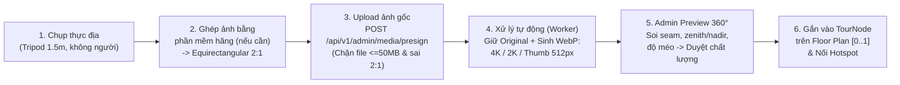

# QUY TRÌNH CHỤP, XỬ LÝ PANORAMA 360°, MẶT BẰNG TẦNG & BIÊN TẬP TOUR (PHASE 2A)

**Phiên bản:** 2A.1  
**Mục tiêu:** Chuẩn hóa toàn bộ quy trình vận hành thực tế từ lúc vác máy ảnh 360° đi chụp tại các tòa nhà CVPM Quang Trung cho đến khi xuất bản thành công Tour 360° liên kết Mặt bằng tầng lên hệ thống Web.

---

## 1. Phân biệt rõ 5 thao tác cốt lõi (Không đánh đồng khái niệm)

Để đội ngũ chụp ảnh, Admin và lập trình viên nói chung một ngôn ngữ, quy trình chia làm 5 bước tách biệt:

| Bước | Tên kỹ thuật | Ai thực hiện / Công cụ | Kết quả đầu ra | Hệ quy chiếu |
| :--- | :--- | :--- | :--- | :--- |
| **1** | **Ghép ảnh (Image Stitching)** | Phần mềm của camera 360° (Insta360 Studio, Ricoh Theta, PTGui...) | Ảnh đơn **Equirectangular tỷ lệ 2:1** (`JPG/PNG`) | Không gian ống kính camera |
| **2** | **Hậu kỳ & Che mờ (Panorama Editing)** | Nhiếp ảnh viên / Hậu kỳ | Xóa chân tripod/nadir, cân sáng, làm mờ khuôn mặt/biển số/màn hình nhạy cảm | Ảnh 2:1 hoàn chỉnh |
| **3** | **Nạp & Chuẩn hóa Mặt bằng (Floor Plan Upload)** | Admin tải `PNG/JPG/SVG/PDF` lên `/admin/locations` | Ảnh mặt bằng chuẩn Web kèm kích thước gốc `(W, H)` | Hệ tọa độ 2D `[0..1] × [0..1]` |
| **4** | **Định vị Node & Địa điểm (Node Placement)** | Admin ghim `Location` và `TourNode` lên mặt bằng tầng | Cặp tọa độ `(floorNormX, floorNormY)` + góc nhìn ban đầu `(initialYaw, pitch, fov)` | Mặt bằng 2D + Hướng nhìn 3D |
| **5** | **Nối Hotspot & Kiểm duyệt đồ thị (Tour Linking)** | Admin trong Studio 3 vùng → Validator → Publish | `Hotspot` định hướng `(yaw, pitch)`, cạnh liên tầng (thang máy/cầu thang) | Hệ cầu `(yaw, pitch)` + Graph |

> [!CAUTION]
> **Không ghép toàn bộ một tầng thành một ảnh panorama khổng lồ.** Mỗi vị trí đặt tripod là một `TourNode` với một ảnh `2:1` độc lập; hành lang, cửa phòng, giữa phòng, thang máy và cầu thang bộ là các node riêng biệt nối với nhau bằng hotspot hai chiều.

---

## 2. Quy trình thực địa chụp ảnh 360° theo từng loại không gian (Standard Capture SOP)

> [!IMPORTANT]
> **Không được mặc định mọi camera 360° hoặc app điện thoại đều xuất ra ảnh cầu `2:1` dùng được ngay.** Cần phân biệt rõ:
> - **Ảnh thô chưa ghép / định dạng riêng (`.insv`, `.insp`, `.dng` RAW, hoặc dual-fisheye 2 hình tròn):** Bắt buộc đưa qua phần mềm của hãng (Insta360 Studio, Ricoh Theta, PTGui...) để ghép thành **Full Spherical Equirectangular `2:1`** trước khi upload.
> - **Ảnh quét ngang hình trụ bằng điện thoại (`cylinder` panorama, VD tỷ lệ `5.77:1` thiếu trần-sàn):** **Không đạt chuẩn Tour 360°**, gây méo dọc và dính lỗi nhân đôi bóng ma nặng khi xoay người cầm máy trong phòng hẹp. **Hệ thống sẽ từ chối upload dạng ảnh này.**

### 2.1. Hướng dẫn chụp chi tiết cho 6 loại khu vực (Ví dụ: Tầng 3 Tòa Innovation)
1. **Phòng học (`CLASSROOM`):**
   - Dùng camera 360° đặt trên tripod cao `1.5m–1.6m` ngay chính giữa phòng (nếu phòng `< 50m²`) hoặc chia 2 điểm (trước bảng + giữa lớp) nếu phòng rộng.
   - Bật hẹn giờ/chụp từ xa để người chụp đứng ngoài hành lang, bật đủ đèn trần và mở màn hình trình chiếu sạch sẽ.
2. **Cửa ra vào phòng (`DOORWAY`):**
   - Đặt 1 `TourNode` **ngay tại hành lang phía trước cửa mở (hoặc chính giữa khung cửa mở hoàn toàn)** để người xem có điểm nhìn chuyển tiếp tự nhiên từ ngoài hành lang bước vào trong phòng mà không bị "nhảy cóc xuyên tường".
3. **Hành lang (`HALLWAY`):**
   - Đặt tripod chính giữa chiều ngang hành lang, khoảng cách giữa các điểm **`3m – 5m`** (tránh đặt quá sát tường gây biến dạng). Luôn đảm bảo từ điểm hiện tại nhìn thấy được vị trí đặt điểm kế tiếp.
4. **Cầu thang bộ (`STAIRS`):**
   - Chụp 1 điểm ở **hành lang trước cửa cầu thang / chiếu nghỉ đầu mỗi tầng** (`Location` loại `STAIRS`), đặt ống kính hướng rõ biển số tầng và bậc đi lên/xuống để gắn edge `STAIRS` liên tầng chuẩn xác.
5. **Thang máy (`ELEVATOR`):**
   - Chụp 1 điểm ở **sảnh chờ ngay trước cửa thang máy của mỗi tầng**, đặt bảng tên tầng trong tầm nhìn rõ để khi tạo liên kết `ELEVATOR` nhảy từ Tầng 1 ↔ Tầng 3 người dùng biết ngay mình đang ở sảnh thang máy tầng nào.
6. **Khu vực giao nhau / Sảnh (`LOBBY` / `JUNCTION`):**
   - Ngay tại ngã ba, ngã tư hành lang hoặc sảnh lớn nhiều lối rẽ: **bắt buộc đặt 1 `TourNode` tại đúng tâm giao lộ** để làm nút điều hướng rẽ nhiều nhánh sang các hành lang phụ và phòng chức năng xung quanh.
7. **Quy ước hướng đặt máy & đặt tên tệp:** Đặt ống kính chính hướng về phía Bắc mặt bằng (hoặc dọc trục hành lang) và đặt tên tệp theo quy tắc:  
   `{BUILDING}_{FLOOR}_{LOCATION_CODE}_{NODE_SEQ}.jpg` (VD: `TOA-T_F3_A302_01.jpg`).

### 2.2. Chính sách xử lý vật cản, người chụp & góc khuất (Cấm dùng AI bịa không gian)
Panorama chỉ ghi nhận đúng ánh sáng camera thu được tại vị trí đặt tripod; **không thuật toán nào khôi phục được căn phòng hay lối đi nằm khuất sau tường/tủ**:
1. **Khu vực bị vật cản lớn che khuất có ý nghĩa tham quan:** Di chuyển tripod sang vị trí khác quan sát được phần bị khuất, tạo thêm `TourNode` mới trong cùng `Location` và nối bằng hotspot.
2. **Phòng riêng / Phòng kín phía sau cửa:** Tạo một `TourNode` bên trong phòng và nối qua `TourNode` trung chuyển đặt ngay tại cửa phòng (`DOORWAY`).
3. **Vị trí không được phép tiếp cận (phòng kỹ thuật, khu riêng tư):** **Không cố chụp** — đánh dấu khu vực trên Floor Plan ở trạng thái `is_public_accessible = false` kèm `restriction_note` (hiển thị thông báo hạn chế truy cập thay vì mở 360°).
4. **Dính chân tripod, người chụp hoặc thông tin nhạy cảm:**
   - Chân tripod / góc cực Nam (`nadir`) → xử lý xóa chân hoặc gắn tem tròn logo trường trước khi upload; nếu lỡ dính người cử động hay bóng mờ do đứng sai tâm xoay → **chụp lại**.
   - Khuôn mặt sinh viên, bảng thông tin cá nhân, màn hình nội bộ → **làm mờ (privacy blur)** trước khi đưa vào bước duyệt.
5. **Tuyệt đối không dùng Generative AI tạo thêm cửa, hành lang, cầu thang hay nội thất bị che khuất rồi coi đó là không gian thật.**

---

## 3. Quy trình 6 bước Upload & Xử lý Panorama tự chụp (MVP Media Pipeline)

Vì trường tự chụp bằng thiết bị 360° riêng (không đồng bộ SDK phần cứng trực tiếp vào Backend), quy trình MVP thực hiện chuẩn theo 6 bước sau:

- **Định dạng & Giới hạn MVP hỗ trợ:** Chấp nhận **`.jpg`, `.png`, `.webp`** đã ghép **Equirectangular `2:1`** (`|w/h - 2.0| ≤ 0.06`, tức sai số tối đa ±3%), độ phân giải `2048×1024` đến `8192×4096` px (khuyến nghị `4096×2048` trở lên), dung lượng tối đa **`50 MB/file`**.
- **Xử lý file không tương thích:** Nếu người dùng upload nhầm file chưa ghép (`.insv`/`.insp`/`.dng`), ảnh 2:1 bị crop ngang kiểu cylinder điện thoại (`5.77:1`), hoặc file `< 2048×1024`: API/Client **chặn ngay ở bước upload** kèm mã lỗi `ASPECT_RATIO_NOT_2_TO_1` / `UNSTITCHED_PANORAMA_UNSUPPORTED` và hướng dẫn xuất lại đúng `2:1` trong phần mềm camera.
- **Bắt buộc Admin kiểm tra Preview 360° (`is_preview_approved = true`):** Sau khi Worker xử lý xong (`READY`), Admin xoay kiểm tra toàn bộ vòng 360°, đỉnh trần, đáy sàn và các vệt ghép trên trình preview trước khi gán `TourNode` vào tour chính thức.

---

## 4. Quy trình Upload, Tọa độ chuẩn hóa & Thay thế Mặt bằng tầng (Floor Plan Lifecycle)

### 4.1. Luồng xử lý 4 định dạng đầu vào (`PNG`, `JPG`, `SVG`, `PDF`)
Admin có thể tải lên bản vẽ mặt bằng ở một trong 4 định dạng sau:
1. **`PNG` / `JPG`:** Kiểm tra magic bytes, strip EXIF nhạy cảm, chuyển chuẩn sRGB WebP tối đa cạnh dài `3200px` (giữ nguyên tỷ lệ khung hình), lưu `render_width` và `render_height`.
2. **`SVG`:** Chạy bộ lọc làm sạch **SVG Sanitizer** loại bỏ `<script>`, event handlers, `<foreignObject>`, đo `viewBox` / kích thước chuẩn, lưu thẳng SVG sạch làm `render_object_key` để giữ nét vector sắc cạnh khi zoom.
3. **`PDF` (Bản vẽ kiến trúc CAD xuất từ AutoCAD/Revit):**
   - Khi Admin chọn file `.pdf`, API kiểm tra số trang (`pdf-lib`/`pdfinfo`). Nếu PDF có nhiều trang (tầng 1, 2, 3 trong cùng 1 tệp), Admin chọn `sourcePageNumber` trên modal xem trước trước khi xác nhận.
   - Worker dùng `pdftoppm`/`mupdf` render trang PDF đã chọn ở `300 DPI` (giới hạn cạnh dài tối đa `3200px`) sang **`v{ver}_render.webp`** + `v{ver}_thumb.webp`.
   - **Ưu điểm:** Trình duyệt Desktop & Mobile load ảnh WebP tức thì và tương tác mượt mà với hệ tọa độ canvas/SVG, không phụ thuộc trình đọc PDF tích hợp của từng OS.

### 4.2. Công thức Tọa độ Chuẩn hóa `[0.0, 1.0]` (Bất biến mọi kích thước)
- Khi Admin click lên ảnh mặt bằng trong trình biên tập ở khung xem đang hiển thị kích thước `(boxWidth, boxHeight)` tại vị trí chuột `(offsetX, offsetY)` (đã loại bỏ transform `zoom` & `pan`):
  $$\text{normX} = \text{clamp}\left(\frac{\text{imageLocalX}}{\text{renderWidth}}, 0, 1\right), \quad \text{normY} = \text{clamp}\left(\frac{\text{imageLocalY}}{\text{renderHeight}}, 0, 1\right)$$
- Khi hiển thị trên `/campus` (mini-map nổi gọn góc dưới hoặc modal Floor Plan toàn màn hình), Frontend áp dụng CSS `left: ${normX * 100}%`, `top: ${normY * 100}%` bên trong container khóa đúng tỷ lệ `aspect-ratio: renderWidth / renderHeight`. Nhờ vậy chấm `TourNode` và icon phòng **không bao giờ trôi lệch** khi co giãn cửa sổ hay zoom in/out.

### 4.3. Quy trình Thay thế Mặt bằng Tầng (`Replace Floor Plan`) — Cấm tự coi tọa độ cũ là đúng

> [!CAUTION]
> **Không được chỉ dựa vào việc tỷ lệ khung hình (`aspect_ratio`) không đổi để tự coi tọa độ cũ còn chính xác.** Ví dụ: bản vẽ cũ và bản vẽ mới đều có tỷ lệ `16:9`, nhưng bản mới cắt bớt lề trái hoặc thu phóng nội dung lệch đi — toàn bộ ghim `[0..1]` cũ tuy vẫn nằm trong ảnh nhưng sẽ chỉ sai phòng học!

Quy trình bắt buộc khi thay thế bản vẽ của một tầng:
1. **Tạo phiên bản mới (`version = oldVersion + 1`), không ghi đè bản cũ:** Bản vẽ cũ giữ nguyên trong bảng `floor_plans`.
2. **Lưu snapshot toàn bộ tọa độ cũ:** Trước khi kích hoạt bản mới, hệ thống ghi một bản ghi `floor_plan_alignment_snapshots` giữ toàn bộ `{ locationId, nodeId, oldNormX, oldNormY }` ứng với bản vẽ cũ.
3. **Luôn bật cờ `needs_realignment = true` cho toàn bộ node trên tầng đó** và trạng thái `alignment_status = 'PENDING_REVIEW'`.
4. **Công cụ Ghost Overlay & Căn chỉnh tương tác trên Admin UI:**
   - Hiển thị lớp phủ bản vẽ cũ bán trong suốt (**Ghost Overlay** điều chỉnh độ mờ 0–80%) chồng lên bản vẽ mới cùng với các điểm ghim cũ.
   - Hỗ trợ Admin **phóng to/thu nhỏ (`zoom/pan`), dịch chuyển/kéo đồng loạt toàn bộ nhóm điểm (`shift/scale` khớp khung)** và **kéo tinh chỉnh từng ghim riêng lẻ**.
5. **Yêu cầu xác nhận tường minh trước Publish:** Admin bấm *"Xác nhận vị trí trên bản vẽ mới"* (`confirm-alignment`) → chuyển `alignment_status = 'CONFIRMED'` và xóa cờ `needs_realignment = false`. Trước khi hoàn tất bước này, Tour Graph Validator sẽ chặn xuất bản tầng.

---

## 5. Bộ kiểm duyệt Đồ thị Tour trước khi Xuất bản (Pre-Publish Graph Validator)

Trước khi chuyển `Building` hoặc `Floor` từ `DRAFT` sang `PUBLISHED`, Backend chạy thuật toán BFS/DFS trên đồ thị `(TourNode, TourEdge)` và phân loại rõ **ERRORS (Chặn Publish)** vs **WARNINGS (Cảnh báo nhẹ)** — đồng thời **hỗ trợ cơ chế ngoại lệ có Admin phê duyệt** để không chặn cứng các trường hợp thực tế hợp lệ:

| Mã luật | Mức độ | Điều kiện kiểm tra | Ngoại lệ hợp lệ & Hành động Admin |
| :--- | :--- | :--- | :--- |
| **`VAL_UNPLACED_NODE`** | **ERROR** (Chặn) | `TourNode` thuộc phòng trong tòa nhà (`floorId != null`) nhưng chưa có `(floorPlanId, floorNormX, floorNormY)`. | Đặt tọa độ node lên mặt bằng tầng tương ứng. |
| **`VAL_MEDIA_NOT_READY`** | **ERROR** (Chặn) | `panoramaAsset.processingStatus !== 'READY'`, `isValid2To1 === false` hoặc **`isPreviewApproved === false`**. | Đợi xử lý xong, thay ảnh `2:1` hợp lệ, hoặc mở Preview 360° xác nhận đạt chuẩn. |
| **`VAL_NODE_REALLIGN_PENDING`** | **ERROR** (Chặn) | `needsRealignment === true` (hoặc tầng có `alignment_status = 'PENDING_REVIEW'`) sau khi thay thế mặt bằng mới. | Mở Ghost Overlay căn chỉnh và bấm xác nhận vị trí. |
| **`VAL_DEAD_END_NODE`** | **ERROR** (Chặn) | `TourNode` có `outboundEdges = 0` **VÀ** `isTerminalApproved === false` (dễ khiến khách tham quan bị kẹt). | Nối hotspot quay lại hành lang/node trước, **hoặc đánh dấu ngoại lệ `isTerminalApproved = true` kèm lý do** (VD: góc ngắm cảnh ban công, điểm kết thúc tour). |
| **`VAL_ISOLATED_COMPONENT`** | **ERROR** (Chặn) | Thành phần liên thông không thể đi tới được từ điểm vào chính của tầng/tòa nhà (`inboundEdges = 0` không có lý do). | Nối cạnh `WALKWAY` / `DOORWAY` / `STAIRS` / `ELEVATOR` từ hành lang chính. |
| **`VAL_ONE_WAY_LINK`** | **WARNING** (Cảnh báo) | Có cạnh `A -> B` chưa có cạnh ngược `B -> A` **VÀ** `edge.isOneWayApproved === false`. | Gợi ý bấm **"Tạo liên kết 2 chiều tự động"**, **hoặc phê duyệt `isOneWayApproved = true` + lý do** (VD: lối vào cổng kiểm soát một chiều / tour dẫn hướng cố định) → chuyển thành **PASS**. |
| **`VAL_CROSS_FLOOR_INVALID`** | **ERROR** (Chặn) | `edgeType IN ('STAIRS', 'ELEVATOR')` nhưng 2 đầu node nằm trên cùng `floorId` hoặc khác `buildingId`. | Sửa node đích sang đúng tầng, hoặc đổi `edgeType` sang `WALKWAY`. |

---

## 6. Đặc tả giao diện Admin Studio 3 Vùng (`/admin/virtual-tour` — Sẽ xây ở Phase 2B)

Dựa trên thực tế đã kiểm chứng ở màn hình `/admin/virtual-tour` hiện tại (mới có danh sách scene + preview 3D đơn giản), khi nối Backend ở Phase 2B, màn hình biên tập sẽ nâng cấp thành bố cục **3 vùng đồng bộ**:

1. **Cột trái (`280px`) — Cây Cấu trúc Tòa nhà → Tầng → Phòng → Node:**
   - Chọn nhanh Tòa nhà → Tầng 1/2/3...
   - Hiển thị danh sách `Location` (phòng/hành lang/thang máy) và các `TourNode` con bên dưới kèm badge trạng thái (`Chưa đặt tọa độ`, `Chưa nối hotspot`, `Sẵn sàng`).
2. **Vùng trung tâm (`Flexible`) — Chia 2 chế độ hoặc Split View `[Bản đồ Mặt bằng 2D | Khung nhìn 360°]`:**
   - **Trên Mặt bằng 2D:** Kéo thả ghim `TourNode` vào đúng vị trí chụp trên tầng, xoay mũi tên la bàn chỉ `initialYaw` và kéo tia nối điểm giữa các node.
   - **Trên Khung nhìn 360° (`PanoramaStage.tsx`):** Xoay chọn góc mặc định (`Lưu làm hướng nhìn ban đầu`), click lên khung cảnh để đặt Hotspot cầu `(yaw, pitch)`, gắn đích là node cùng tầng hoặc chuyển tầng (thang máy/cầu thang).
3. **Cột phải (`320px`) — Bảng Thuộc tính (Inspector) & Kiểm duyệt đồ thị:**
   - Chỉnh tiêu đề node, thuộc tính `Location`, kiểm tra tỷ lệ ảnh `2:1`, nút **"Tạo chiều về tự động"** khi nối A → B, và bảng kết quả **Kiểm duyệt Graph Validator** trước khi bấm **"Xuất bản Tầng / Tour"**.
