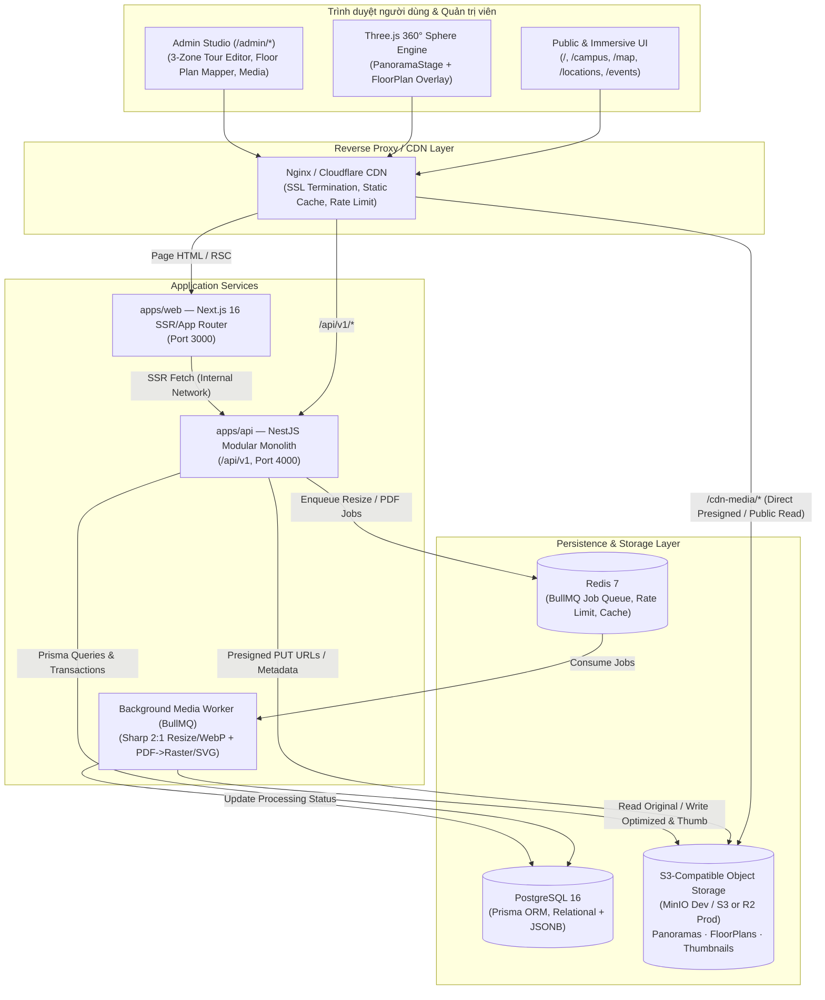

# KIẾN TRÚC HỆ THỐNG PHASE 2A — FPT POLYTECHNIC VIRTUAL CAMPUS 360°

**Phiên bản:** 2A.2 (Aligned Architecture Blueprint — Chưa triển khai mã nguồn Backend)  
**Đối tượng:** Chủ dự án, Technical Lead, Backend/Frontend/DevOps Engineers  
**Phạm vi tài liệu:** Chuẩn hóa hiện trạng mã nguồn thực tế, thiết kế kiến trúc hệ thống mục tiêu theo lộ trình tuần tự (`Phase 2A-1`: Database Bootstrap với PostgreSQL 16 + Prisma + Migrations + Seed QTSC → `Phase 2A-2`: NestJS Modular Monolith + Auth/RBAC + `StorageAdapter` local + Public Read APIs → `Phase 2A-3`: Business Modules + Redis/BullMQ & tùy chọn S3/MinIO + kết nối Frontend từng module), tích hợp `Leaflet WGS84`, `FloorPlan`, `TourGraph`, `Auth/RBAC` (`username/email/phone`), bảo mật và phân tách ranh giới tĩnh/DB (`OD-01` → `OD-10`).

---

## 1. Tóm tắt điều hành & Đối chiếu hiện trạng thực tế (Source-Truth Audit)

> [!IMPORTANT]
> Trước khi thiết kế Phase 2A, kiến trúc sư hệ thống đã kiểm tra trực tiếp cây mã nguồn đang chạy tại `apps/web` thay vì phụ thuộc vào các tài liệu kiểm toán cũ (`PROJECT_STATUS.md` và `docs/project-audit/*`, vốn được lập trước các đợt nâng cấp `UI-01` → `UI-04`).

### 1.1. Sự thật kỹ thuật đã xác minh trong Workspace

| Hạng mục | Ghi nhận trong tài liệu cũ (`PROJECT_STATUS.md`) | Hiện trạng thực tế đã xác minh | Tác động lên Phase 2A |
| :--- | :--- | :--- | :--- |
| **App Router Routes** | Khẳng định `11/12` route lỗi 404 | **19 route thật** đang build và chạy clean (`next build` PASS): 9 route `(public)`, 2 route `(immersive)`, 1 `(auth)`, 1 `(portal)`, 6 `/admin/*`. | **Bắt buộc giữ nguyên toàn bộ 19 route** để tương thích liên kết (`/games` giữ tương thích, ẩn khỏi nav chính; `/portal` giữ tương thích). |
| **Tài nguyên ảnh & Media** | Phụ thuộc URL Google tạm thời | **100% ảnh cục bộ** trong `apps/web/public/images/` (5 ảnh panorama `2048×1024` tỷ lệ 2:1 + ảnh địa điểm `1280×720` + logo). | `Phase 2A-1` chỉ lưu object/path metadata của 8 ảnh QTSC vào PostgreSQL seed (**không lưu ảnh nhị phân lớn trong DB**); `Phase 2A-2` khởi tạo **`StorageAdapter` (`LOCAL_FS`)** cho Public Read; `Phase 2A-3` mở upload mới & `Redis/BullMQ` / tùy chọn `MinIO/S3` (`OD-07`). |
| **Trình xem 360° & GIS** | Thiếu tương tác / còn thô | `PanoramaStage.tsx` (Three.js `0.187.0` equirectangular, kéo/xoay + tự xoay lại sau 3000ms nhàn rỗi, pick tọa độ `(yaw, pitch)`); `CampusGISMap.tsx` (nâng cấp sang **Leaflet + OpenStreetMap + WGS84 (FixNear)** kèm `routeWaypoints`, `mapIconKey`, `QTSC_ORIGIN_POINT`, drawer chi tiết & đo khoảng cách). Tab 3D WebGL đã ẩn đúng quyết định MVP. | Chuẩn hóa Hệ tọa độ 1 dùng **Leaflet WGS84 (`lat, lng NOT NULL`)** (`OD-01`), bổ sung **Floor Plan Interactive Layer** tùy chọn (`OD-10`) kết nối chặt với `TourNode`. |
| **Desktop Animations** | Chưa chuẩn hóa | Animation React Bits + `motion@14.12.0` chỉ kích hoạt trên desktop (`>= 1024px`), đảm bảo hiệu năng mobile/tablet. | Giữ nguyên ngưỡng responsiveness và giảm chuyển động trên thiết bị yếu. |
| **Backend & Database** | Mức `S0` (chưa có `apps/api`) | **Chính xác `S0`:** Chưa có thư mục `apps/api`, chưa có `prisma/`, `0` lệnh `fetch()`, `0` Next.js Route Handlers. Dữ liệu đang nằm cứng trong `apps/web/src/data/campus-data.ts` và state React trong bộ nhớ trình duyệt. | `Phase 2A-1` chỉ dựng **Database Bootstrap** (`PostgreSQL 16` + `.env` + Prisma `schema.prisma` + SQL migrations + Seed QTSC, chưa tạo `apps/api`); `Phase 2A-2` dựng NestJS + Auth/RBAC + `StorageAdapter` local + Public Read APIs; `Phase 2A-3` dựng Business Modules & nối frontend từng module. |
| **Auth, Open Day & Scope** | Dùng nhiều tài khoản mẫu `OD-2026-*` | Trong **Phase 1**, đã xóa `prototype-auth.ts`, `Fpoly@2026` và giả lập `sessionStorage`; `/login` và `/admin/*` hiển thị trạng thái chờ Auth Backend. **Chốt thêm (`OD-03..08`):** đăng nhập bằng `username \| email \| phone`; không có Check-in QR (`OD-05`), không XP/Leaderboard (`OD-08`); `/news` & `OFFICIAL_CAMPUS_INFO` giữ cấu hình tĩnh (`OD-03`). | `Phase 2A-2` dựng JWT RAM + HttpOnly Refresh Token + Argon2id + Dual Auth (`username/email/phone`); `Phase 2A-3` dựng Admin CRUD, Open Day CMS (`events`, `sessions`, `faqs`, `quiz`), 5-step Excel Import (`email -> phone` dedup) & nối frontend, Student/Parent Portal vẫn ngoài MVP. |
| **Workspace Monorepo & Infra** | Khung khởi tạo | `pnpm-workspace.yaml` (`apps/*`, `packages/*`); `packages/shared/src/index.ts` có draft TS types (chưa được `apps/web` import); `docker-compose.yml` mới có `postgres:16-alpine` (DB `virtual_campus_360`, user `fpt_admin`); `.env.example` đã khai báo `API_PORT=4000`, `NEXT_PUBLIC_API_URL`, `S3_*`. | Tận dụng `packages/shared` làm Single Source of Truth cho DTO & TypeScript Contracts giữa Web và API. |

### 1.2. Chuẩn hóa Tên thực thể & Giải quyết mâu thuẫn với Hồ sơ kiểm toán cũ

Hồ sơ kiểm toán trước đây ([06-database-audit.md](../_archive/project-audit/06-database-audit.md)) và bản mock tạm thời trên Frontend từng dùng tên `tour_scenes` / `TourSceneItem` với quan hệ `1–1` hoặc `1–0` (`locations ||--o| tour_scenes`). Mô hình đó không phản ánh được trường hợp một phòng Lab/hội trường lớn cần nhiều góc đứng chụp 360° hoặc hành lang cần nhiều điểm đi tiếp.

Từ Phase 2A trở đi, toàn bộ hệ thống **chốt chuẩn một tên thực thể duy nhất** xuyên suốt CSDL, NestJS, Shared DTO và Frontend:

| Thuật ngữ cũ (Đã thay thế) | Thực thể chuẩn Phase 2A | Quan hệ & Vai trò chuẩn hóa | Tương thích URL hiện tại |
| :--- | :--- | :--- | :--- |
| `tour_scenes` / `TourScene` | **`TourNode`** (`tour_nodes`) | Điểm đứng đặt camera 360°. Quan hệ bắt buộc **`Location (1) — (N) TourNode`**. | Param `/campus?scene={slug}` tiếp tục nhận trực tiếp `TourNode.slug` để không gãy liên kết. |
| `scene_connections` | **`TourEdge`** (`tour_edges`) | Cạnh điều hướng có hướng giữa 2 `TourNode` (cùng tầng hoặc xuyên tầng qua thang máy/cầu thang). | Gắn 1–1 với `Hotspot` loại `SCENE_LINK`. |
| `TOUR_SCENES` (mock) | **`TourNodeDTO` / `TourEdgeDTO`** | Hợp đồng dữ liệu thống nhất trong `packages/shared`. | Adapter UI ánh xạ sạch từ API `/api/v1`. |

---

## 2. Định hướng sản phẩm & Phân tách 3 lớp không gian cốt lõi

Trải nghiệm Virtual Campus hoàn chỉnh **không trộn lẫn** 3 loại tài sản không gian sau, mà liên kết chúng qua khóa định danh chuẩn hóa:

1. **GIS Campus Map (Cấp Khuôn viên QTSC Quận 12 — `OD-01`):** Bản đồ **Leaflet + OpenStreetMap (FixNear style)** định vị các tòa nhà (`INNOVATION`, `TOA-T`, `TOA-F`, `TOA-P`, `SPORTS`) bằng tọa độ địa lý thực **`WGS84 (lat, lng)` (`NOT NULL`)**, kèm tuyến đường đi bộ `routeWaypoints` tính từ `originPoint` (`QTSC_ORIGIN_POINT`), icon riêng `mapIconKey`, drawer chi tiết và tính khoảng cách (`gisX`/`gisY` giữ `NULLABLE` dự phòng).
2. **Floor Plan — Bản đồ mặt bằng tầng (2D Floor Space — Tùy chọn theo `OD-10`):** Sơ đồ kiến trúc từng tầng (`PNG`, `JPG`, `SVG`, `PDF`). Chứa các `Location` và `TourNode` với tọa độ chuẩn hóa `(normX, normY) ∈ [0.0, 1.0]`. Khi tầng chưa kích hoạt mặt bằng (`active_floor_plan_id = NULL` & `requires_floor_plan = false`), `TourNode` vẫn tồn tại và được xuất bản độc lập (`floor_plan_id = NULL`) mà **không cần tạo mặt bằng giả**.
3. **Panorama 360° & Spherical Hotspots (3D View Space):** Ảnh toàn cảnh equirectangular tỷ lệ `2:1` tại một `TourNode` cụ thể, kết xuất bằng Three.js trong `PanoramaStage.tsx`. Dùng hệ tọa độ cầu `(yaw, pitch, fov)` độc lập hoàn toàn với WGS84 và `(normX, normY)`.

> [!NOTE]
> **Ranh giới Phạm vi MVP (`MVP Scope`, `OD-03`, `OD-05`, `OD-08`):**
> - **3D Dollhouse / WebGL, Student/Parent Portal (`/portal`), Check-in QR (`OD-05`), và XP/Leaderboard (`OD-08`)** không nằm trong phạm vi MVP.
> - **CMS Database (`OD-03` Phương án B):** Các phần tử động `open_day_events`, `open_day_sessions`, `open_day_faqs`, `open_day_quiz_items` lưu trong PostgreSQL; bài viết cẩm nang `/news` (`CAMPUS_GUIDE_ARTICLES`) và thông tin trường tĩnh (`OFFICIAL_CAMPUS_INFO`) giữ ở cấu hình web tĩnh trong MVP.

---

## 3. Kiến trúc hệ thống mục tiêu (Target System Architecture)

Hệ thống áp dụng mô hình **Modular Monolith Backend (NestJS)** kết hợp **Next.js 16 App Router Frontend** và **PostgreSQL 16**, triển khai tuần tự 3 bước: **Phase 2A-1 (Database Bootstrap: PostgreSQL 16 + Prisma + Migrations + Seed QTSC)** → **Phase 2A-2 (Core Backend & Auth: NestJS Modular Monolith + `@fpt-campus/shared` + Auth/RBAC + `StorageAdapter` `LOCAL_FS` + Public Read APIs)** → **Phase 2A-3 (Business Modules: Campus/Location/FloorPlan/Panorama/TourGraph/OpenDay CRUD, Redis + BullMQ & tùy chọn `MinIO/S3`, và kết nối Frontend với API thật theo từng module)** (**`OD-07`**).

Lý do chọn **NestJS Modular Monolith** thay vì Microservices hay chỉ dùng Next.js Route Handlers:
- **Kiểm soát luồng upload & xử lý file nặng (`Sharp`, `Poppler/MuPDF`):** Next.js Serverless/Edge Route Handlers có giới hạn RAM, timeout và không phù hợp chạy worker xử lý ảnh panorama độ phân giải cao (4K–8K) hoặc convert PDF mặt bằng.
- **Tách ranh giới rõ ràng:** Các domain (`Auth`, `Campus/Building/Floor`, `FloorPlan`, `Location`, `MediaPipeline`, `TourGraph`, `OpenDayEvents`, `AuditLog`) tách module độc lập trong 1 service duy nhất → dễ phát triển, deploy đơn giản qua Docker Compose, và sẵn sàng tách worker riêng khi lưu lượng tăng.

### 3.1. Sơ đồ kiến trúc tổng quan



---

## 4. Phân rã Module Backend (`apps/api`)

| Module | Trách nhiệm cốt lõi | Phụ thuộc chính |
| :--- | :--- | :--- |
| **`AuthModule`** | Đăng nhập (`/api/v1/auth/login`) hỗ trợ `username` (`ADMIN`/`STAFF`), `email`, hoặc **`phone` đã kích hoạt (`E.164/VN`, `OD-04` — chuẩn hóa `users.phone` trước khi kiểm tra uniqueness & đăng nhập)**, xác thực Argon2id, cấp Access JWT ngắn hạn (**chỉ lưu RAM/React state**) + Refresh Token quay vòng (`HttpOnly; SameSite=Lax; Secure`), ép đổi mật khẩu ban đầu (`must_change_password = true`). Rate limit hỗ trợ `memory` (Phase 2A-2) hoặc `Redis` (Phase 2A-3+). | `UsersRbacModule`, `AuditLogModule`, `RateLimitStore` |
| **`UsersRbacModule`** | Quản lý mô hình tài khoản `users` thống nhất tách riêng `UserType`, `RBAC`, `AccountStatus`, `ActivationStatus`, `ProvisioningMethod`, chuẩn hóa `phone` (`E.164/VN`), và đa sự kiện `EventParticipation` (`INVITED \| CONFIRMED \| CANCELLED` — **không có Check-in QR ở MVP**, `OD-05`). Hỗ trợ tạo thủ công & Import Excel/CSV 5 bước ở `Phase 2A-3` (dedup ưu tiên **`email` → `phone`**, cấm dedup theo tên, **cấm lưu file/tên/đường dẫn Excel gốc**), cùng cấp phát kép (`ADMIN_DIRECT` & `EMAIL_SMS_INVITATION` + `Resend`). Student/Parent Portal vẫn ngoài MVP. | `AuthModule`, `AuditLogModule`, `OpenDayModule` |
| **`CampusGeoModule`** | Quản lý `Campus` (`originPoint`, `landmarks`, `defaultEntryNodeId`), `Building` (**Leaflet WGS84 `lat`, `lng`**, `routeWaypoints`, `mapIconKey`, `highlights`, optional `gisX/gisY` — `OD-01`), `Floor` (gồm `requiresFloorPlan` — `OD-10`), và `LocationType`. | `MediaPipelineModule` |
| **`FloorPlanModule`** | Quản lý upload mặt bằng tầng (`PNG`, `JPG`, `SVG`, `PDF`), chuyển đổi bất đồng bộ ở `Phase 2A-3`, lưu `version`, snapshot tọa độ cũ, bật **Ghost Overlay & `needsRealignment`**, và cập nhật `tour_nodes.floor_plan_id` khi `confirm-alignment` (`OD-06`). **Tầng chưa có mặt bằng vẫn cho phép `TourNode` hợp lệ xuất bản (`OD-10`).** | `MediaPipelineModule`, `TourGraphModule`, `StorageAdapter` |
| **`LocationsModule`** | Quản lý thực thể vật lý (`Location`), giữ chuẩn **`Location (1) — (N) TourNode`**, `highlights`, `primary_node_id NULLABLE` (`loc-the-thao = NULL`, không gắn chéo giả — `OD-02`), slug SEO, tọa độ `[0..1]` tùy chọn, `isPublicAccessible`. | `FloorPlanModule`, `CampusGeoModule` |
| **`MediaPipelineModule`** | Trừu tượng qua **`StorageAdapter`** (`LOCAL_FS` từ `Phase 2A-2` cho Public Read & dev cục bộ / mở rộng upload & `S3_MINIO` + BullMQ ở `Phase 2A-3` — `OD-07`), chặn ảnh thô chưa ghép & cylinder `5.77:1`, giữ bản gốc, sinh WebP `4K / 2K / Thumb 512` và duyệt Preview 360°. | `StorageAdapter`, `(BullMQ Phase 2A-3)` |
| **`TourGraphModule`** | Quản lý `TourNode` (hỗ trợ `floor_plan_id = NULL` khi tầng chưa có mặt bằng — `OD-10`, soft-delete dọn `tour_edges`/`hotspots` — `OD-06`), `Hotspot` (`CHECK` khớp `hotspot_type ↔ edge_id`), `TourEdge` cùng tầng & xuyên tầng, và **Tour Graph Validator** (`VAL_UNPLACED_NODE` áp dụng có điều kiện, ngoại lệ `isTerminalApproved` / `isOneWayApproved`). | `LocationsModule`, `MediaPipelineModule`, `FloorPlanModule` |
| **`OpenDayModule`** | Quản lý DB Open Day CMS (`open_day_events`, `open_day_sessions`, `open_day_faqs`, `open_day_quiz_items`) và endpoint **`POST /api/v1/public/quiz/verify` stateless** (`GET /public/events` **không trả `correctIndex`**, không lưu lịch sử/XP/Leaderboard — `OD-03`, `OD-08`). `/news` & `OFFICIAL_CAMPUS_INFO` giữ cấu hình web tĩnh. | `LocationsModule`, `UsersRbacModule` |
| **`AuditLogModule`** | Ghi nhận bất biến (append-only) các thao tác nhạy cảm: login, đổi mật khẩu, khóa/mở tài khoản, tạo/sửa/xóa tòa nhà/node, thay thế mặt bằng tầng, publish tour 360°, cập nhật Open Day CMS. | `PostgreSQL` |

---

## 5. Chiến lược lưu trữ Media & `StorageAdapter` (`OD-07`)

### 5.1. Tại sao không lưu ảnh mới trong Git hay Public Folder của `apps/web` — và không lưu ảnh panorama vào PostgreSQL?
Hiện tại `apps/web/public/images/` phục vụ bộ dữ liệu tĩnh ban đầu gồm 5 panorama `2048×1024` và ảnh địa điểm QTSC: trong **`Phase 2A-1`**, PostgreSQL seed chỉ lưu object key / đường dẫn tham chiếu trong bảng `media_assets` (**tuyệt đối không lưu ảnh panorama nhị phân lớn trực tiếp vào PostgreSQL**). Đến **`Phase 2A-2`**, Backend khởi tạo **`LocalStorageAdapter`** (`STORAGE_DRIVER=local`) phục vụ đọc media cục bộ cho Public Read APIs; khi mở nghiệp vụ upload & xử lý thực tế ở **`Phase 2A-3+`**:
- Tổng dung lượng nhanh chóng vượt `2–10 GB`, cần tách biệt **`original`**, **`optimized`** (`4K/2K`) và **`thumbnail`** ngoài PostgreSQL và ngoài Git.

### 5.2. Kiến trúc `StorageAdapter` (`STORAGE_DRIVER=local|s3` — `OD-07`)
Mọi module (`MediaPipelineModule`, `FloorPlanModule`) phụ thuộc interface trừu tượng **`StorageAdapter`**, không gọi cứng SDK MinIO ở tầng nghiệp vụ:
- **`LocalStorageAdapter` (`STORAGE_DRIVER=local` — triển khai từ `Phase 2A-2` cho Public Read/local dev, hỗ trợ upload cục bộ ở `Phase 2A-3`):** Ánh xạ key media tới thư mục cục bộ / static path sẵn có (như `/images/...` cho 8 ảnh seed QTSC và `UPLOAD_LOCAL_ROOT` + endpoint `POST /api/v1/admin/storage/local-upload/:token` có kiểm tra token & magic bytes).
- **`S3StorageAdapter` (`STORAGE_DRIVER=s3` — bật từ `Phase 2A-3+` / Production):** Kết nối MinIO Dev hoặc Cloudflare R2 / AWS S3 với Presigned PUT URLs.

### 5.3. Cấu trúc Object Key chuẩn (dùng chung cho cả Local & S3/MinIO)

```text
virtual-campus-media/
├── panoramas/
│   └── {assetId}/
│       ├── original.{ext}        # File gốc từ camera 360° (lưu kho, chỉ Admin/Worker đọc)
│       ├── web_4k.webp           # Ảnh equirectangular 4096×2048 WebP (Desktop 360° viewer)
│       ├── web_2k.webp           # Ảnh equirectangular 2048×1024 WebP (Mobile / Fast first paint)
│       └── thumb_512.webp        # Ảnh 512×256 cho danh sách scene & hotspot preview
├── floor-plans/
│   └── {floorPlanId}/
│       ├── v{ver}_source.{ext}   # File gốc Admin tải lên (PNG/JPG/SVG/PDF)
│       ├── v{ver}_render.webp    # Ảnh web chuẩn (rasterized 2400px–3200px nếu là PDF, hoặc nguyên SVG sanitized)
│       └── v{ver}_thumb.webp     # Ảnh thu nhỏ cho trình chọn tầng
└── locations/
    └── {locationId}/
        ├── gallery_{assetId}_lg.webp
        └── gallery_{assetId}_sm.webp
```

---

## 6. Bảo mật hệ thống (Security Architecture)

1. **Xác thực & Phiên đăng nhập (`/login`, API `/api/v1/auth/*`):**
   - Chỉ seed **01 tài khoản quản trị duy nhất (`admin` · `SUPER_ADMIN`)** từ **secret môi trường (`ADMIN_BOOTSTRAP_PASSWORD`)** — **tuyệt đối không gán cứng mật khẩu mặc định trong mã nguồn hay file migration**.
   - **Bắt buộc đổi mật khẩu ở lần đăng nhập đầu tiên (`must_change_password = true`)** trước khi sử dụng bất kỳ tính năng Admin nào (`403 PASSWORD_CHANGE_REQUIRED`).
   - Toàn bộ password hash bằng **Argon2id**. Access Token JWT (thời hạn **15 phút**) **chỉ giữ trong bộ nhớ (RAM / React Context)**; Refresh Token quay vòng 64-byte lưu **hash SHA-256** trong PostgreSQL (`HttpOnly; SameSite=Lax; Secure; Path=/api/v1/auth`).
   - `/login` và API `/api/v1/auth/*` **tuyệt đối không có `/auth/register`**, hỗ trợ `identifier` dạng `username`, `email`, hoặc **`phone` đã kích hoạt (`E.164/VN`, `OD-04`)**. Khóa tạm 15 phút sau 5 lần sai liên tiếp; cấm mật khẩu chung/plaintext; cấm lưu file/tên/đường dẫn Excel gốc; dedup Excel chỉ theo `email -> phone`.
2. **Bảo mật Upload & Xử lý tệp (Đặc biệt với `SVG` và `PDF`):**
   - **Magic-Byte Inspection:** Kiểm tra header nhị phân thực sự (`FF D8 FF`, `89 50 4E 47`, `%PDF-`, XML `<svg>`).
   - **SVG Sanitization:** Bắt buộc sanitizer loại bỏ `<script>`, inline handlers, `<foreignObject>`, `javascript:` URLs.
   - **PDF Conversion Sandbox:** Chạy trong worker giới hạn CPU/RAM & timeout (`15s/trang`, `<= 64MP`).
3. **CORS, Rate Limiting & Quiz Security:**
   - CORS whitelist chặt theo `WEB_ORIGIN`.
   - Rate limit phân tầng (`RATE_LIMIT_STORE=memory` ở Phase 2A-2; `redis` ở Phase 2A-3+): `5 req/phút` cho `/auth/login`; `30 req/phút` cho presign; `300 req/phút` cho `/public/*` (bao gồm `POST /public/quiz/verify`).
   - `GET /api/v1/public/events` không bao giờ trả `correctIndex`/`explanation` trước khi kiểm tra qua `POST /public/quiz/verify` (`OD-08`).
4. **Phân quyền RBAC chặt chẽ:**
   - Public endpoints (`/api/v1/public/*`) chỉ trả `status = 'PUBLISHED' AND deleted_at IS NULL`, ẩn mọi bản nháp, tài khoản nội bộ, và tệp `original`.

---

## 7. Triển khai Docker, Phân kỳ Hạ tầng (`OD-07`) & Chiến lược Migrate Dữ liệu

### 7.1. Hạ tầng Docker Compose theo 3 Giai đoạn (`OD-07`)
- **Giai đoạn Phase 2A-1 (Database Bootstrap — Chỉ PostgreSQL 16 + Prisma + Seed):**
  - Docker Compose chỉ chạy container **`postgres:16-alpine`** (DB `virtual_campus_360`, healthcheck dùng `${POSTGRES_USER}` & `${POSTGRES_DB}`).
  - Hoàn thiện `.env.example` / `.env` cục bộ, `prisma/schema.prisma`, SQL migrations (18 enums, partial unique indexes `WHERE deleted_at IS NULL`, `hotspots CHECK` constraint), `prisma/seed.ts` (bootstrap Admin dùng `ADMIN_BOOTSTRAP_PASSWORD` + Argon2id), kiểm tra reset/re-initialize. **Chưa khởi tạo NestJS (`apps/api/`), Auth, `StorageAdapter` hay API handlers.**
- **Giai đoạn Phase 2A-2 (Core Backend, Auth & Local StorageAdapter):**
  - Tiếp tục chạy **`postgres:16-alpine`** kết hợp dịch vụ **`apps/api`** (NestJS Modular Monolith + Prisma + `@fpt-campus/shared`), triển khai Auth/RBAC (login `username | email | normalized phone`, token lifecycle), `StorageAdapter` (`STORAGE_DRIVER=local` ánh xạ ảnh seed QTSC), `RATE_LIMIT_STORE=memory`, và Public Read APIs.
- **Giai đoạn Phase 2A-3+ (Business Modules, Media/FloorPlan Pipeline & Frontend API Integration):**
  - Bổ sung **`redis:7-alpine`** (BullMQ queue + distributed rate limit) và tùy chọn **`minio/minio`** (khi bật `STORAGE_DRIVER=s3`; hoặc tiếp tục dùng `LOCAL_FS`), cùng Worker xử lý Media/FloorPlan, Admin CRUD (Campus/Buildings/Floors/Locations/TourGraph/Open Day CMS), và kết nối **`apps/web`** (`DATA_SOURCE=api`) theo từng module.

### 7.2. Chiến lược Backup & Khôi phục
- **PostgreSQL:** `pg_dump` nén `.dump` hàng ngày lúc 02:00 sáng + giữ 14 bản gần nhất.
- **Media Storage:** Đồng bộ tệp `original` và `v*_source` sang vùng lưu trữ dự phòng; biến thể tối ưu tái sinh được qua job `MEDIA_REPROCESS`.

### 7.3. Chuyển đổi dữ liệu từ Frontend Mock sang Database thật (Zero-Downtime Cutover)
1. **Ở Phase 2A-1:** Viết script khởi tạo idempotent (`prisma/seed.ts`) đọc dữ liệu tham chiếu QTSC (`5` tòa nhà Leaflet WGS84 kèm `routeWaypoints` + `QTSC_ORIGIN_POINT`, `6` địa điểm với **`loc-the-thao.primary_node_id = NULL`** theo `OD-02`, `5` `TourNode` với **`floor_plan_id = NULL`** theo `OD-10`, `8` metadata path QTSC `READY` trong `media_assets` — **không lưu binary panorama vào PostgreSQL**, `open_day_events`, `open_day_sessions`, `open_day_faqs`, `open_day_quiz_items`) + **01 tài khoản `admin` duy nhất (`ADMIN` / `SUPER_ADMIN`)** dùng `ADMIN_BOOTSTRAP_PASSWORD` băm **Argon2id** (`must_change_password = true`).
2. **Ở Phase 2A-2 → Phase 2A-3:** `apps/web` và `apps/api` dùng chung kiểu dữ liệu từ **`@fpt-campus/shared`** (`OD-09`); `Phase 2A-2` khóa Core Backend + Auth + Public Read APIs, và `Phase 2A-3` chuyển đổi Frontend sang `DATA_SOURCE=api` theo từng module mà không thay đổi UI/UX hay 19 routes.

---

## 8. Chốt các Quyết định Kiến trúc (`DEC-01` → `DEC-05`, Synchronized v2A.2)

| Mã | Quyết định kiến trúc | Phương án chốt chính thức | Trạng thái |
| :--- | :--- | :--- | :--- |
| **DEC-01** | **PDF Floor Plan, Versioning & Optionality (`OD-10`)** | Hỗ trợ `PNG/JPG/SVG/PDF (WebP 300 DPI ≤ 3200px)`, versioning + snapshot + Ghost Overlay (`confirm-alignment` bắt buộc cập nhật `tour_nodes.floor_plan_id`). Cho phép `TourNode` xuất bản độc lập khi `Floor` chưa có mặt bằng (`active_floor_plan_id = NULL`, `requires_floor_plan = false`), không tạo mặt bằng giả. | **Đã cập nhật (`OD-06`, `OD-10`)** |
| **DEC-02** | **Panorama Input, Giới hạn & Preview** | Chấp nhận ảnh **Equirectangular `2:1` đã ghép** (`JPG/PNG/WebP`, sai số `≤ 3%`, `≤ 50 MB`, `≥ 2048×1024`). **Chặn file thô chưa ghép / cylinder (`> 2.1:1`)**; giữ gốc + sinh WebP `4K / 2K / Thumb 512`; **Admin bắt buộc duyệt Preview 360°** (`is_preview_approved = true`). | **Đã chốt** |
| **DEC-03** | **Storage & Hạ tầng phân kỳ (`OD-07`)** | `Phase 2A-1` chỉ dựng **Database Bootstrap (`PostgreSQL 16` + Prisma + Migrations + Seed)**; `Phase 2A-2` dựng **NestJS + Auth/RBAC + `StorageAdapter` (`LOCAL_FS`) + Public Read APIs**; `Phase 2A-3+` mở **Business Modules + Redis/BullMQ + tùy chọn `S3_MINIO` + kết nối Frontend theo module**. Không lưu panorama lớn vào PostgreSQL. | **Đã cập nhật (`OD-07`)** |
| **DEC-04** | **User Categories, Phone Login, Dual Provisioning & Scope (`OD-03..08`)** | Mô hình `users` thống nhất tách riêng `UserType`/`RBAC`/`AccountStatus`/`ActivationStatus`/`ProvisioningMethod`; đăng nhập bằng **`username \| email \| phone`**; Excel dedup **`email -> phone`**; cấm `/register`, cấm lưu Excel gốc, **không Check-in QR (`OD-05`)**, **không XP/Leaderboard (`OD-08`)**, `/news` & `OFFICIAL_CAMPUS_INFO` giữ cấu hình tĩnh (`OD-03`). | **Đã cập nhật (`OD-03..08`)** |
| **DEC-05** | **GIS WGS84 & Tour Graph Validator (`OD-01`, `OD-06`, `OD-10`)** | Chuẩn GIS là **Leaflet OSM WGS84 (`lat, lng NOT NULL`)** + `originPoint` + `routeWaypoints`; Validator 7 luật có ngoại lệ phê duyệt (`isTerminalApproved`, `isOneWayApproved`) và điều kiện `VAL_UNPLACED_NODE` chỉ kích hoạt khi Floor yêu cầu/đã gắn mặt bằng (`OD-10`). | **Đã cập nhật (`OD-01`, `OD-10`)** |
