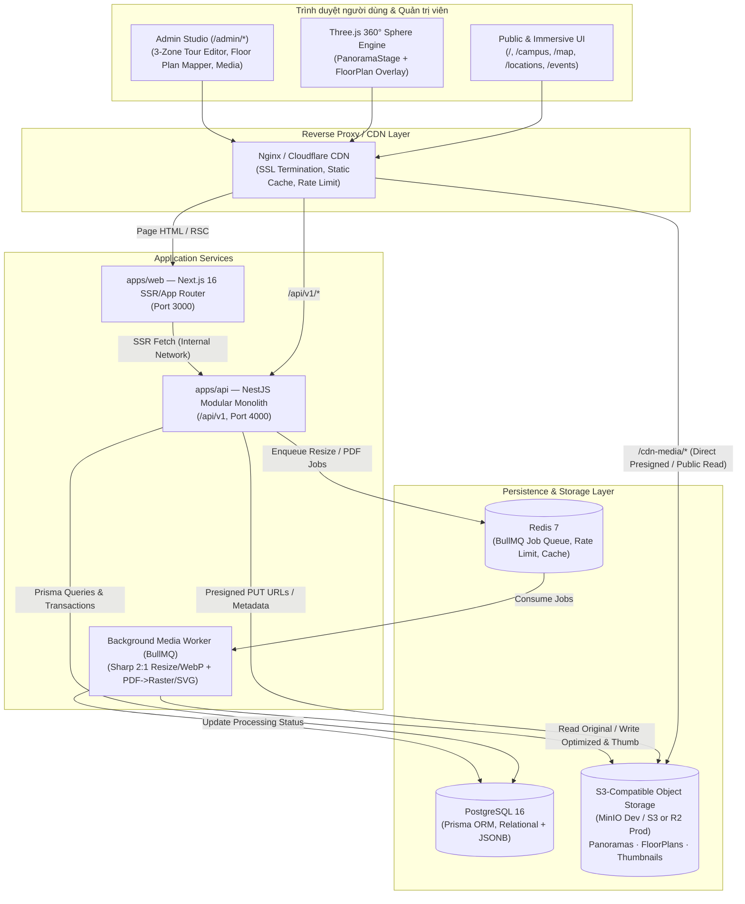

# KIẾN TRÚC HỆ THỐNG PHASE 2A — FPT POLYTECHNIC VIRTUAL CAMPUS 360°

**Phiên bản:** 2A.1 (Architecture Blueprint — Chưa triển khai mã nguồn Backend)  
**Đối tượng:** Chủ dự án, Technical Lead, Backend/Frontend/DevOps Engineers  
**Phạm vi tài liệu:** Chuẩn hóa hiện trạng mã nguồn thực tế, thiết kế kiến trúc hệ thống mục tiêu (Backend + Storage + Database + Auth/RBAC + Floor Plan & Tour Graph Engine), bảo mật, triển khai Docker/CDN và các quyết định cần phê duyệt trước khi khởi tạo `apps/api`.

---

## 1. Tóm tắt điều hành & Đối chiếu hiện trạng thực tế (Source-Truth Audit)

> [!IMPORTANT]
> Trước khi thiết kế Phase 2A, kiến trúc sư hệ thống đã kiểm tra trực tiếp cây mã nguồn đang chạy tại `apps/web` thay vì phụ thuộc vào các tài liệu kiểm toán cũ (`PROJECT_STATUS.md` và `docs/project-audit/*`, vốn được lập trước các đợt nâng cấp `UI-01` → `UI-04`).

### 1.1. Sự thật kỹ thuật đã xác minh trong Workspace

| Hạng mục | Ghi nhận trong tài liệu cũ (`PROJECT_STATUS.md`) | Hiện trạng thực tế đã xác minh | Tác động lên Phase 2A |
| :--- | :--- | :--- | :--- |
| **App Router Routes** | Khẳng định `11/12` route lỗi 404 | **19 route thật** đang build và chạy clean (`next build` PASS): 9 route `(public)`, 2 route `(immersive)`, 1 `(auth)`, 1 `(portal)`, 6 `/admin/*`. | **Bắt buộc giữ nguyên toàn bộ 19 route** để tương thích liên kết (`/games` giữ tương thích, ẩn khỏi nav chính; `/portal` giữ tương thích). |
| **Tài nguyên ảnh & Media** | Phụ thuộc URL Google tạm thời | **100% ảnh cục bộ** trong `apps/web/public/images/` (5 ảnh panorama `2048×1024` tỷ lệ 2:1 + ảnh địa điểm `1280×720` + logo). | Phase 2A sẽ chuyển dần việc đọc media từ tĩnh sang Object Storage (MinIO/S3) có fallback tương thích. |
| **Trình xem 360° & GIS** | Thiếu tương tác / còn thô | `PanoramaStage.tsx` (Three.js `0.187.0` equirectangular, kéo/xoay + tự xoay lại sau 3000ms nhàn rỗi, pick tọa độ `(yaw, pitch)`); `CampusGISMap.tsx` (SVG QTSC zoom/pan, filter, card preview). Tab 3D WebGL đã ẩn đúng quyết định MVP. | Giữ nguyên engine Three.js & SVG GIS ở Frontend, bổ sung **Floor Plan Interactive Layer** kết nối chặt với `TourNode`. |
| **Desktop Animations** | Chưa chuẩn hóa | Animation React Bits + `motion@14.12.0` chỉ kích hoạt trên desktop (`>= 1024px`), đảm bảo hiệu năng mobile/tablet. | Giữ nguyên ngưỡng responsiveness và giảm chuyển động trên thiết bị yếu. |
| **Backend & Database** | Mức `S0` (chưa có `apps/api`) | **Chính xác `S0`:** Chưa có thư mục `apps/api`, chưa có `prisma/`, `0` lệnh `fetch()`, `0` Next.js Route Handlers. Dữ liệu đang nằm cứng trong `apps/web/src/data/campus-data.ts` và state React trong bộ nhớ trình duyệt. | Đây là lý do duy nhất cần triển khai **Phase 2A (Backend Foundation, PostgreSQL, Media Pipeline & Tour Engine)**. |
| **Auth & Admin** | Dùng nhiều tài khoản mẫu `OD-2026-*` | Hiện đã dọn sạch tài khoản thử nghiệm; `prototype-auth.ts` và `/admin/users` chỉ giữ **1 tài khoản Admin duy nhất** (`admin`), header `(auth)/layout.tsx` dùng chung `<PublicHeader />`. | Phase 2A thay thế `prototype-auth.ts` bằng JWT + HttpOnly Refresh Token + Argon2id + Audit Log thật trên Server. |
| **Workspace Monorepo & Infra** | Khung khởi tạo | `pnpm-workspace.yaml` (`apps/*`, `packages/*`); `packages/shared/src/index.ts` có draft TS types (chưa được `apps/web` import); `docker-compose.yml` mới có `postgres:16-alpine` (DB `virtual_campus_360`, user `fpt_admin`); `.env.example` đã khai báo `API_PORT=4000`, `NEXT_PUBLIC_API_URL`, `S3_*`. | Tận dụng `packages/shared` làm Single Source of Truth cho DTO & TypeScript Contracts giữa Web và API. |

### 1.2. Chuẩn hóa Tên thực thể & Giải quyết mâu thuẫn với Hồ sơ kiểm toán cũ

Hồ sơ kiểm toán trước đây ([06-database-audit.md](file:///e:/Virtual%20Campus%20FPT%20Poly/docs/project-audit/06-database-audit.md)) và bản mock tạm thời trên Frontend từng dùng tên `tour_scenes` / `TourSceneItem` với quan hệ `1–1` hoặc `1–0` (`locations ||--o| tour_scenes`). Mô hình đó không phản ánh được trường hợp một phòng Lab/hội trường lớn cần nhiều góc đứng chụp 360° hoặc hành lang cần nhiều điểm đi tiếp.

Từ Phase 2A trở đi, toàn bộ hệ thống **chốt chuẩn một tên thực thể duy nhất** xuyên suốt CSDL, NestJS, Shared DTO và Frontend:

| Thuật ngữ cũ (Đã thay thế) | Thực thể chuẩn Phase 2A | Quan hệ & Vai trò chuẩn hóa | Tương thích URL hiện tại |
| :--- | :--- | :--- | :--- |
| `tour_scenes` / `TourScene` | **`TourNode`** (`tour_nodes`) | Điểm đứng đặt camera 360°. Quan hệ bắt buộc **`Location (1) — (N) TourNode`**. | Param `/campus?scene={slug}` tiếp tục nhận trực tiếp `TourNode.slug` để không gãy liên kết. |
| `scene_connections` | **`TourEdge`** (`tour_edges`) | Cạnh điều hướng có hướng giữa 2 `TourNode` (cùng tầng hoặc xuyên tầng qua thang máy/cầu thang). | Gắn 1–1 với `Hotspot` loại `SCENE_LINK`. |
| `TOUR_SCENES` (mock) | **`TourNodeDTO` / `TourEdgeDTO`** | Hợp đồng dữ liệu thống nhất trong `packages/shared`. | Adapter UI ánh xạ sạch từ API `/api/v1`. |

---

## 2. Định hướng sản phẩm & Phân tách 3 lớp không gian cốt lõi

Trải nghiệm Virtual Campus hoàn chỉnh **không trộn lẫn** 3 loại tài sản không gian sau, mà liên kết chúng qua khóa định danh chuẩn hóa:

1. **GIS Campus Map (Cấp Khuôn viên QTSC Quận 12):** Bản đồ SVG/GIS tổng thể vị trí các tòa nhà (`Innovation`, `Tòa T`, `Tòa F`, `Tòa P`, `Khu thể thao`) bằng tọa độ chuẩn hóa `(gisX, gisY)` theo phần trăm `[0..100]`.
2. **Floor Plan — Bản đồ mặt bằng tầng (2D Floor Space):** Sơ đồ kiến trúc từng tầng (Tầng 1, Tầng 2, Tầng 3...) dưới dạng ảnh web (`PNG`, `JPG`, `SVG`) hoặc `PDF` (được hệ thống chuyển đổi thành ảnh vector/raster chuẩn web khi upload). Chứa:
   - Các **Location (Địa điểm vật lý)**: phòng học, phòng Lab, hành lang, cầu thang bộ, thang máy, WC, khu vực đón tiếp.
   - Các **TourNode (Điểm đặt máy ảnh 360°)**: có tọa độ chuẩn hóa `(normX, normY) ∈ [0.0, 1.0]`.
3. **Panorama 360° & Spherical Hotspots (3D View Space):** Ảnh toàn cảnh equirectangular tỷ lệ `2:1` tại một `TourNode` cụ thể, kết xuất bằng Three.js trong `PanoramaStage.tsx`. Dùng hệ tọa độ cầu `(yaw, pitch, fov)` độc lập hoàn toàn với `(normX, normY)` trên mặt bằng tầng.

> [!NOTE]
> **Quyết định MVP về 3D Dollhouse / WebGL:** Mô hình 3D Dollhouse (cắt lớp kiến trúc) là một loại tài sản 3D riêng biệt (`.glb`/`.gltf`/Matterport mesh), **không tự động sinh ra được từ tập ảnh Panorama 360°**. Theo quyết định đã chốt, **3D Dollhouse / WebGL không nằm trong phạm vi Phase 2A MVP**; kiến trúc Database chỉ giữ trường mở rộng tùy chọn cho giai đoạn sau (`Phase 3+`).

---

## 3. Kiến trúc hệ thống mục tiêu (Target System Architecture)

Hệ thống áp dụng mô hình **Modular Monolith Backend (NestJS)** kết hợp **Next.js 16 App Router Frontend**, **PostgreSQL 16**, **Redis + BullMQ** (xử lý chuyển đổi ảnh 360° & PDF mặt bằng bất đồng bộ), và **S3-Compatible Object Storage (MinIO ở môi trường Dev / Cloudflare R2 hoặc AWS S3 ở Production)**.

Lý do chọn **NestJS Modular Monolith** thay vì Microservices hay chỉ dùng Next.js Route Handlers:
- **Kiểm soát luồng upload & xử lý file nặng (`Sharp`, `Poppler/MuPDF`):** Next.js Serverless/Edge Route Handlers có giới hạn RAM, timeout và không phù hợp chạy worker xử lý ảnh panorama độ phân giải cao (4K–8K) hoặc convert PDF mặt bằng.
- **Tách ranh giới rõ ràng:** Các domain (`Auth`, `Campus/Building/Floor`, `FloorPlan`, `Location`, `MediaPipeline`, `TourGraph`, `OpenDayEvents`, `AuditLog`) tách module độc lập trong 1 service duy nhất → dễ phát triển, deploy đơn giản qua Docker Compose, và sẵn sàng tách worker riêng khi lưu lượng tăng.

### 3.1. Sơ đồ kiến trúc tổng quan



---

## 4. Phân rã Module Backend (`apps/api`)

| Module | Trách nhiệm cốt lõi | Phụ thuộc chính |
| :--- | :--- | :--- |
| **`AuthModule`** | Đăng nhập quản trị viên (`/api/v1/auth/login`), xác thực Argon2id, cấp Access JWT ngắn hạn (lưu **chỉ trong RAM/React state**, không lưu `localStorage`/`sessionStorage`) + Refresh Token quay vòng lưu trong cookie `HttpOnly; SameSite=Lax; Secure`, ép đổi mật khẩu lần đầu nếu `must_change_password = true`. | `UsersModule`, `AuditModule`, `Redis` |
| **`UsersRbacModule`** | Quản lý tài khoản quản trị/vận hành nội bộ (`users`), gán vai trò (`roles`: `SUPER_ADMIN`, và dự phòng cho `TOUR_EDITOR`, `EVENT_OPERATOR` khi phân quyền nhân sự sau này). **Không triển khai tài khoản khách/sinh viên/phụ huynh (`PARTICIPANT`) hay `/portal` auth trong MVP.** | `AuthModule`, `AuditModule` |
| **`CampusGeoModule`** | Quản lý `Campus`, `Building` (kèm tọa độ GIS phần trăm `gisX`, `gisY`), `Floor` (tầng lầu sắp theo `sortOrder`), và `LocationType`. | `MediaModule` |
| **`FloorPlanModule`** | Quản lý upload bản đồ mặt bằng tầng (`PNG`, `JPG`, `SVG`, `PDF` kèm chọn trang PDF), chuyển đổi bất đồng bộ sang ảnh web chuẩn, lưu phiên bản (`version`), snapshot tọa độ cũ, **luôn kích hoạt Ghost Overlay & `needsRealignment` khi thay bản vẽ mới** để Admin căn chỉnh xác nhận trước Publish. | `MediaModule`, `TourGraphModule` |
| **`LocationsModule`** | Quản lý thực thể vật lý (`Location`: phòng học, lab, hành lang, thang máy, cầu thang bộ, WC), slug SEO, vị trí chuẩn hóa `[0..1]` trên `FloorPlan`, trạng thái công khai hoặc hạn chế truy cập (`isPublicAccessible = false`). | `FloorPlanModule`, `CampusGeoModule` |
| **`MediaPipelineModule`** | Cấp Presigned Upload URL `/api/v1/admin/media/presign`, phân biệt ảnh **Equirectangular `2:1` đã ghép** vs ảnh camera thô chưa ghép/sai tỷ lệ (chặn upload kèm hướng dẫn ghép), giữ bản gốc, sinh `WebP` (Desktop 4K / Mobile 2K / Thumbnail 512px) và hỗ trợ bước **Admin Preview duyệt chất lượng**. | `S3StorageService`, `BullMQ` |
| **`TourGraphModule`** | Quản lý `TourNode` (quan hệ `1 Location — N TourNode`), tọa độ `(floorNormX, floorNormY)` trên mặt bằng tầng, hướng nhìn ban đầu `(initialYaw, initialPitch, initialFov)`, `Hotspot`, `TourEdge` cùng tầng & xuyên tầng (thang máy/cầu thang). Chứa **Tour Graph Validator** hỗ trợ ngoại lệ có phê duyệt (`isTerminalApproved`, `isOneWayApproved`). | `LocationsModule`, `MediaModule`, `FloorPlanModule` |
| **`OpenDayModule`** | Quản lý nội dung CMS công khai của Open Day (`open_day_sessions`, FAQ, câu hỏi mini-game tích hợp trong tour) hiển thị cho khách công khai mà **không yêu cầu tài khoản hay đăng nhập**. | `LocationsModule` |
| **`AuditLogModule`** | Ghi nhận bất biến (append-only) các thao tác nhạy cảm: login, đổi mật khẩu, khóa/mở tài khoản, tạo/sửa/xóa tòa nhà, thay thế mặt bằng tầng, publish tour 360°. | `PostgreSQL` |

---

## 5. Chiến lược lưu trữ Media & Xử lý tệp bất đồng bộ (Media Storage Strategy)

### 5.1. Tại sao không lưu ảnh trong Git hay Public Folder của `apps/web`?
Hiện tại `apps/web/public/images/` chỉ phù hợp với bộ dữ liệu mẫu cố định gồm 5 panorama `2048×1024`. Khi trường tự chụp thực tế nhiều tòa nhà (mỗi tòa 5–8 tầng, mỗi tầng 15–30 điểm panorama độ phân giải `4096×2048` hoặc `6096×3048` + bản vẽ mặt bằng PDF/SVG):
- Tổng dung lượng nhanh chóng vượt `2–10 GB`, không thể đóng gói vào Docker image của Next.js hay commit vào Git.
- Cần tách biệt **tệp gốc lưu trữ (`original`)**, **tệp tối ưu phát trực tuyến (`optimized`)** và **ảnh xem trước (`thumbnail`)**.

### 5.2. Cấu trúc Object Key chuẩn trong Bucket S3 / MinIO

```text
virtual-campus-media/
├── panoramas/
│   └── {assetId}/
│       ├── original.{ext}        # File gốc từ camera 360° (lưu kho, chỉ Admin/Worker đọc)
│       ├── web_4k.webp           # Ảnh equirectangular 4096×2048 WebP (Desktop 360° viewer)
│       ├── web_2k.webp           # Ảnh equirectangular 2048×1024 WebP (Mobile / Fast first paint)
│       └── thumb_512.webp        # Ảnh 512×256 cho danh sách scene & hotspot preview
├── floor-plans/
│   └── {floorPlanId}/
│       ├── v{ver}_source.{ext}   # File gốc Admin tải lên (PNG/JPG/SVG/PDF)
│       ├── v{ver}_render.webp    # Ảnh web chuẩn (rasterized 2400px–3200px nếu là PDF, hoặc nguyên SVG sanitized)
│       └── v{ver}_thumb.webp     # Ảnh thu nhỏ cho trình chọn tầng
└── locations/
    └── {locationId}/
        ├── gallery_{assetId}_lg.webp
        └── gallery_{assetId}_sm.webp
```

---

## 6. Bảo mật hệ thống (Security Architecture)

1. **Xác thực & Phiên đăng nhập (`/login`, API `/api/v1/auth/*`):**
   - Chỉ seed **01 tài khoản quản trị duy nhất (`admin` · `SUPER_ADMIN`)** từ **secret môi trường (`ADMIN_BOOTSTRAP_PASSWORD` / CLI bootstrap)** — **tuyệt đối không gán cứng mật khẩu mặc định trong mã nguồn hay file migration**.
   - **Bắt buộc đổi mật khẩu ở lần đăng nhập đầu tiên (`must_change_password = true`)** trước khi sử dụng bất kỳ tính năng Admin nào. *(Lưu ý bảo mật bắt buộc: mật khẩu thử nghiệm tạm thời từng trao đổi cho bản prototype UI tuyệt đối không được tái sử dụng làm secret/seed cho Backend thật.)*
   - Toàn bộ password hash bằng **Argon2id**. Access Token JWT (thời hạn **15 phút**) **chỉ giữ trong bộ nhớ (RAM / React Context)** — **cấm lưu trong `localStorage` hoặc `sessionStorage`** ở bản thật; Refresh Token quay vòng 64-byte lưu **hash SHA-256** trong PostgreSQL, truyền qua cookie `HttpOnly`, `SameSite=Lax`, `Secure`, `Path=/api/v1/auth`.
   - Giao diện `/login` và API `/api/v1/auth/*` **tuyệt đối không có tính năng tự đăng ký, không có tài khoản khách/sinh viên (`PARTICIPANT`) trong MVP**, và không hiển thị tài khoản mẫu. Khi sai mật khẩu luôn trả thông báo chung chung + tạm khóa 15 phút sau 5 lần sai liên tiếp (Redis).
2. **Bảo mật Upload & Xử lý tệp (Đặc biệt với `SVG` và `PDF`):**
   - **Magic-Byte Inspection:** Kiểm tra header nhị phân thực sự (`FF D8 FF` cho JPEG, `89 50 4E 47` cho PNG, `%PDF-` cho PDF, XML root `<svg>` cho SVG), không dựa vào `Content-Type` hay đuôi file.
   - **SVG Sanitization (Chống Stored XSS):** Nếu Admin tải lên bản vẽ mặt bằng `.svg`, **bắt buộc chạy sanitizer (DOMPurify / svgo strict whitelist)** loại bỏ toàn bộ `<script>`, `onload=`, `onclick=`, `<foreignObject>`, liên kết `javascript:` và external `<use>` trước khi lưu lên S3; phục vụ qua domain/CDN tĩnh với `Content-Security-Policy: sandbox`.
   - **PDF Conversion Sandbox:** Tiến trình render `PDF → WebP` chạy trong worker giới hạn CPU/RAM & timeout (`15s/trang`), chỉ xử lý trang Admin đã chỉ định (`sourcePageNumber`), chống decompression bomb (`max pixels <= 64MP`).
3. **CORS, Rate Limiting & CSRF:**
   - CORS whitelist chặt theo `WEB_ORIGIN`.
   - Rate limit phân tầng trên Redis: `5 req/phút` cho `POST /api/v1/auth/login`; `30 req/phút` cho upload presign; `300 req/phút` cho Public API `/api/v1/public/*`.
   - Kiểm tra `Origin`/`Referer` + SameSite cookie cho endpoint `/api/v1/auth/refresh` và `/api/v1/auth/logout`.
4. **Phân quyền RBAC chặt chẽ:**
   - Public endpoints (`GET /api/v1/public/*`) chỉ trả dữ liệu `status = 'PUBLISHED'`, ẩn toàn bộ ghi chú nháp, tài khoản quản trị, tệp `original` và tài liệu nội bộ.

---

## 7. Triển khai Docker, Backup & Chiến lược Migrate dữ liệu từ Seed hiện tại

### 7.1. Hạ tầng Docker Compose (Dev & Staging/On-Premise)
Mở rộng `docker-compose.yml` hiện tại (đang chỉ có `postgres:16-alpine`) thành stack các container kết nối mạng nội bộ `vc_internal`:
- `postgres` (`postgres:16-alpine`, giữ nguyên DB `virtual_campus_360` để tương thích cấu hình sẵn có)
- `redis` (`redis:7-alpine`, AOF persistence bật cho BullMQ)
- `minio` (`minio/minio`, tạo bucket `virtual-campus-media` + CORS tự động qua `minio-init`)
- `api` (NestJS API chạy tại `/api/v1`, port `4000`)
- `worker` (BullMQ consumer chung image với `api`, chứa `sharp`, `poppler-utils`/`mupdf` cho chuyển PDF/SVG/Panorama)
- `web` (Next.js 16 standalone output, port `3000`)

### 7.2. Chiến lược Backup & Khôi phục
- **PostgreSQL:** `pg_dump` nén `.dump` hàng ngày lúc 02:00 sáng + giữ 14 bản gần nhất trên volume tách biệt hoặc S3 bucket riêng.
- **Object Storage:** Đồng bộ bucket `panoramas/*/original.*` và `floor-plans/*/v*_source.*` sang vùng lưu trữ dự phòng; tệp `optimized`/`thumbnail` có thể tái sinh hoàn toàn từ tệp gốc thông qua job `MEDIA_REPROCESS`.

### 7.3. Chuyển đổi dữ liệu từ Frontend Mock sang Database thật (Zero-Downtime Cutover)
1. Viết script khởi tạo dữ liệu seed (`prisma/seed.ts`) đọc dữ liệu tham chiếu hiện đang nằm trong `apps/web/src/data/campus-data.ts` (5 tòa nhà QTSC, 6 địa điểm, 5 `TourNode` cùng 8 tệp trong `public/images/`, lịch Open Day công khai, câu hỏi quiz) + **01 tài khoản `admin` duy nhất** lấy mật khẩu khởi tạo từ biến môi trường **`ADMIN_BOOTSTRAP_PASSWORD` (bắt buộc tồn tại khi chạy, tuyệt đối không fallback chuỗi cố định trong code)** và đặt **`must_change_password = true`**.
2. Upload 8 ảnh mẫu ban đầu vào MinIO/S3 theo cấu trúc `Asset` chuẩn.
3. Giai đoạn chuyển tiếp: `apps/web` dùng Repository adapter cho phép chuyển đổi qua biến môi trường (`DATA_SOURCE=api|mock`) từng luồng một theo lộ trình từ trên xuống.

---

## 8. Chốt các Quyết định Kiến trúc (`DEC-01` → `DEC-05`)

| Mã | Quyết định kiến trúc | Phương án chốt chính thức | Trạng thái |
| :--- | :--- | :--- | :--- |
| **DEC-01** | **PDF Floor Plan & Versioning** | Chuyển trang PDF được Admin chọn thành **WebP độ phân giải cao (cạnh dài tối đa 3200px)** + giữ file gốc; mọi lần thay thế bản vẽ đều tạo `version` mới + giữ snapshot tọa độ cũ + bật **Ghost Overlay** để Admin xác nhận vị trí. | **Đã chốt** |
| **DEC-02** | **Panorama Input, Giới hạn & Preview** | Chấp nhận ảnh **Equirectangular `2:1` đã ghép** (`JPG/PNG/WebP`, độ lệch tỷ lệ `≤ 3%`, tối đa `50 MB/file`, khuyến nghị `4096×2048` trở lên). **Chặn file thô chưa ghép / dual-fisheye / cylinder điện thoại (`> 2.1:1`)** kèm hướng dẫn xuất `2:1`; giữ gốc + sinh WebP `4K` / `2K` / `Thumb 512`; **Admin bắt buộc kiểm tra Preview 360°** trước khi gắn vào `TourNode`. | **Đã chốt & Bổ sung** |
| **DEC-03** | **Object Storage** | **MinIO** trong Docker Dev; giao diện S3-compatible chuẩn để chuyển sang **Cloudflare R2 / AWS S3** khi Production. | **Đã chốt** |
| **DEC-04** | **Admin Bootstrap & RBAC Scope** | Seed duy nhất tài khoản **`admin` (`SUPER_ADMIN`)** đọc secret từ môi trường, **ép đổi mật khẩu lần đầu**; Access Token chỉ lưu RAM + `HttpOnly` Refresh Cookie; **không xây hệ thống tài khoản khách/sinh viên/phụ huynh trong MVP**. | **Đã chốt** |
| **DEC-05** | **Tour Graph Publish Validator** | Kiểm duyệt chặt `Media READY`, vị trí node & xác nhận alignment sau thay mặt bằng, đồ thị cô lập, liên kết xuyên tầng (`STAIRS`/`ELEVATOR`) và liên kết một chiều — **có cơ chế ngoại lệ được Admin phê duyệt (`isTerminalApproved`, `isOneWayApproved` + lý do)** để không chặn sai lối đi một chiều hoặc điểm tham quan cuối hợp lệ. | **Đã chốt & Bổ sung** |
