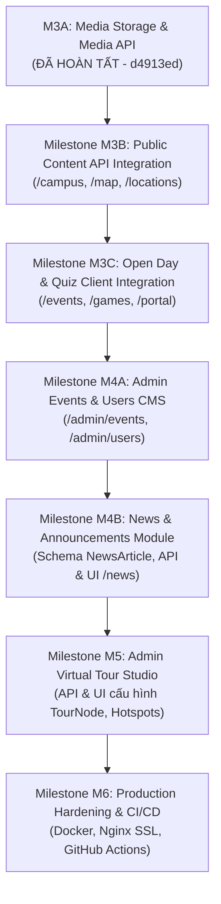

# FULL IMPLEMENTATION ROADMAP & REPOSITORY CLEANUP PLAN
**Dự án:** FPT Polytechnic Virtual Campus 360° (CVPM Quang Trung - QTSC, Quận 12)  
**Tài liệu:** `docs/project-audit/FULL_IMPLEMENTATION_ROADMAP.md`  
**Ngày lập kế hoạch:** 13/11/2026 (Local Time)  
**Vai trò:** Principal Technical Lead & Senior Full-Stack Software Architect  
**Trạng thái:** Master Architecture Plan (Read-Only Planning, Zero Code Mutation)

---

## 1. REPOSITORY STRUCTURE THỰC TẾ (CODEBASE MAP)

Hệ thống được tổ chức theo mô hình **pnpm monorepo** phân tầng rõ rệt:

```text
E:\Virtual Campus FPT Poly\
├── apps/
│   ├── api/                      # Backend API (NestJS 11 Monolith, 70 files, 12,484 LOC)
│   │   ├── src/
│   │   │   ├── app.module.ts     # Root module đăng ký 8 domain modules + 2 infra modules
│   │   │   ├── common/           # Guards (JWT, RBAC, ForcePW, CSRF), Filters, Interceptors
│   │   │   ├── config/           # AppConfigModule & Zod env validation
│   │   │   └── modules/          # audit-log, auth, health, media, open-day, public, storage, users-rbac
│   │   └── test/                 # 14 test suites kiểm thử tích hợp (47 tests passed)
│   │
│   └── web/                      # Frontend (Next.js 16 Turbopack, 103 files, 14,884 LOC)
│       ├── e2e/                  # Playwright E2E suite (auth-integration.spec.ts, run-e2e.mjs)
│       ├── public/images/        # 11 ảnh local chuẩn hóa (6 ảnh 2D, 5 ảnh 360° 2:1)
│       ├── src/app/              # 20 routes App Router (Auth, Immersive, Portal, Public, Admin)
│       ├── src/components/       # UI Design System, Tour 360° Three.js, GIS Map Leaflet
│       ├── src/data/             # campus-data.ts (Mock data trung tâm cần loại bỏ theo lộ trình)
│       └── src/lib/              # api-client.ts (Token store, Mutex, Auth & Media APIs)
│
├── packages/
│   └── shared/                   # Gói hợp đồng dùng chung @fpt-campus/shared (10 files, 1,456 LOC)
│       └── src/                  # DTOs, Enums, APIEnvelopes, Tour/Campus/Event contracts
│
├── prisma/                       # Database Layer (6 files, 5,291 LOC)
│   ├── schema.prisma             # 27 models, 18 enums, quan hệ 3NF chuẩn mực
│   ├── migrations/               # 2 migrations chính thức (20261111175635_init, 20261112000001)
│   ├── seed.ts                   # Nạp dữ liệu mẫu khởi tạo chuẩn hóa (Idempotent seed)
│   └── verify-db-integrity.ts    # Bộ kiểm toán 14 bài kiểm tra toàn vẹn DB
│
└── docs/                         # Kho tài liệu kỹ thuật & kiểm toán (57 files, 8,567 LOC)
```

---

## 2. TRẠNG THÁI TỪNG PHÂN HỆ VÀ CHỨC NĂNG

| Phân hệ nghiệp vụ | UI Giao diện | Backend API | Database Model | Trạng thái tích hợp |
|---|---|---|---|---|
| **1. Authentication & Session** | Hoàn tất (`/login`) | Hoàn tất (`AuthModule`) | `User`, `RefreshToken` | **100% Real API (VERIFIED)** |
| **2. Bắt buộc đổi mật khẩu** | Hoàn tất (`/change-password`)| Hoàn tất (`ForcePasswordGuard`)| `mustChangePassword` | **100% Real API (VERIFIED)** |
| **3. Media Storage & Upload** | Hoàn tất (`/admin/media`)| Hoàn tất (`MediaModule`)| `MediaAsset`, `UploadToken` | **100% Real API (VERIFIED)** |
| **4. Tour 360° WebGL** | Hoàn tất (`/campus`)| Hoàn tất (`PublicModule`)| `TourNode`, `Hotspot`, `TourEdge`| **Mock Data (Chờ M3B)** |
| **5. Bản đồ GIS Khuôn viên** | Hoàn tất (`/map`)| Hoàn tất (`PublicModule`)| `Campus`, `Building` | **Mock Data (Chờ M3B)** |
| **6. Danh mục Địa điểm** | Hoàn tất (`/locations`)| Hoàn tất (`PublicModule`)| `Location`, `LocationMedia` | **Mock Data (Chờ M3B)** |
| **7. Chi tiết Địa điểm** | Hoàn tất (`/locations/[slug]`)| Hoàn tất (`PublicModule`)| `Location`, `MediaAsset` | **Mock Data (Chờ M3B)** |
| **8. Cổng Sự kiện Open Day** | Hoàn tất (`/events`)| Hoàn tất (`OpenDayModule` M2)| `OpenDayEvent`, `Session`, `Faq` | **Mock Data (Chờ M3C)** |
| **9. Mini-game Quiz** | Hoàn tất (`/games`)| Hoàn tất (`OpenDayModule` M2)| `OpenDayQuizItem` | **Mock State (Chờ M3C)** |
| **10. Quản trị Sự kiện (CMS)** | Hoàn tất (`/admin/events`)| Hoàn tất (`OpenDayModule` M2)| Toàn bộ bảng Open Day | **Mock State (Chờ M4)** |
| **11. Quản trị Người dùng** | Hoàn tất (`/admin/users`)| Hoàn tất (`UsersRbacModule`)| `User`, `Role`, `Permission` | **Mock State (Chờ M4)** |
| **12. Quản trị Tour & Hotspots**| Giao diện khung (`/admin/virtual-tour`)| Chưa có CRUD API | `TourNode`, `Hotspot` | **Chưa triển khai (Chờ M5)** |
| **13. Tin tức & Thông báo** | Giao diện (`/news`, `[slug]`)| Chưa có module API | Chưa có bảng NewsArticle | **Hardcoded (Chờ M4B)** |
| **14. Cổng thông tin Sinh viên**| Giao diện (`/portal`)| Dữ liệu phiên Auth | Bảng EventParticipation | **Mock Tabs (Chờ M3C)** |
| **15. 3D Campus Explorer** | Chưa triển khai | Chưa có module | Chưa có schema | **LOCKED (Tạm hoãn theo MVP)** |

---

## 3. DANH SÁCH MOCK DATA CẦN LOẠI BỎ THEO LỘ TRÌNH

1. **`apps/web/src/data/campus-data.ts` (1,152 LOC):**
   - Mảng `CAMPUS_BUILDINGS`: Loại bỏ trong **M3B** khi nối `GET /api/v1/public/campus` & `GET /api/v1/public/buildings/:slug`.
   - Mảng `CAMPUS_LOCATIONS`: Loại bỏ trong **M3B** khi nối `GET /api/v1/public/locations` & `GET /api/v1/public/locations/:slug`.
   - Mảng `TOUR_SCENES`: Loại bỏ trong **M3B** khi nối `GET /api/v1/public/tour/nodes` & `GET /api/v1/public/tour/nodes/:slug`.
   - Mảng `OPEN_DAY_SCHEDULE`, `OPEN_DAY_SESSIONS`, `OPEN_DAY_FAQS`: Loại bỏ trong **M3C** khi nối `GET /api/v1/public/events`.
   - Mảng `CAMPUS_QUIZ_QUESTIONS`: Loại bỏ trong **M3C** khi nạp câu hỏi từ `GET /api/v1/public/events` và chấm điểm qua `POST /api/v1/public/quiz/verify`.
2. **`apps/web/src/components/news/news-items.ts` (200 LOC):**
   - Loại bỏ khi triển khai bảng `NewsArticle` và `NewsModule` trong **M4B**.
3. **Hardcoded Stats trong Admin & Portal:**
   - Số liệu lượt truy cập, tân sinh viên trong `AdminDashboardMetrics.tsx`: Chuyển sang đọc API thống kê từ `AuditLogModule` trong **M4**.
   - Thẻ lịch trình cố định trong `PersonalItineraryTimeline.tsx`: Chuyển sang đọc từ `EventParticipation` trong **M3C**.

---

## 4. REPOSITORY CLEANUP PLAN (KEEP, REFACTOR, REPLACE, DELETE)

Mọi đánh giá đều có bằng chứng mã nguồn rõ ràng, tuân thủ nguyên tắc **không xóa nhầm tệp đang được tham chiếu**:

| Thành phần / Tệp tin | Hành động | Bằng chứng kỹ thuật | Lý do & Hướng xử lý |
|---|---|---|---|
| `apps/web/src/lib/shared-contracts.ts` (317 LOC) | **DELETE** | Grep toàn repo không có file nào import | Tệp cầu nối mock tạm thời viết từ Phase 2A, hiện tại gói chuẩn `@fpt-campus/shared` đã thay thế hoàn toàn. An toàn để xóa. |
| `apps/web/src/data/campus-data.ts` | **REFACTOR** | Được import bởi `CampusGISMap`, `LocationsExplorer`, `VirtualTourViewer` | Không xóa đột ngột. Rút gọn dần từng phần qua các milestone M3B và M3C, chỉ giữ lại các hằng số địa lý không đổi (`QTSC_ORIGIN_POINT`, `QTSC_LANDMARKS`). |
| `apps/web/src/components/news/news-items.ts` | **REPLACE** | Được import bởi `/news/page.tsx` và `/news/[slug]/page.tsx` | Giữ nguyên tạm thời cho đến khi xây dựng bảng `NewsArticle` trong DB (Milestone M4B). |
| `apps/web/public/images/` (11 tệp) | **KEEP** | 100% được liên kết trong DB seed và kiểm định checksum SHA-256 | Tài sản hình ảnh cục bộ chuẩn hóa cho 5 panorama 2:1 và 6 địa điểm QTSC. Tuyệt đối giữ nguyên. |
| `prisma/preflight-m1-quiz-event.sql` | **KEEP** | Script SQL kiểm tra preflight cho migration M1 | Giữ làm tài liệu đối soát kiểm toán database migration. |
| `apps/web/src/components/animations/ReactBits.tsx` | **KEEP** | Được dùng trong Homepage và Location detail | Hiệu ứng UI nhẹ nhàng cho Desktop (`>= 1024px`), tôn trọng `prefers-reduced-motion`. |
| `apps/web/src/app/admin/media/page.tsx` | **KEEP** | Đã kết nối 100% API thật trong M3A | Mẫu hình chuẩn (Golden Standard) cho việc kết nối API thật trong khu vực Admin. |
| `apps/web/src/components/ui/` (13 components) | **KEEP** | Dùng xuyên suốt 20 routes | Hệ thống UI Design System chuẩn QTSC (Button, Modal, Drawer, FileDropzone, v.v.). |

---

## 5. CÁC CHỨC NĂNG CÒN THIẾU CẦN HOÀN THIỆN ĐỂ PRODUCTION READY

1. **API Client & Public Integration:** Chưa có module client gọi các endpoint `GET /public/*` trên Frontend.
2. **Trạng thái DRAFT của TourNodes:** 5 điểm chụp trong DB đang có `status = DRAFT` và `isPreviewApproved = false`, khiến API công khai lọc bỏ và trả về rỗng. Cần cập nhật sang `PUBLISHED`.
3. **Module Tin tức Tuyển sinh (News CMS):** Chưa có schema DB `NewsArticle` và API CRUD tương ứng.
4. **Admin Tour Studio (M5):** Chưa có API và giao diện tương tác cho Admin cấu hình điểm chụp, tạo hotspot trực quan và nối cạnh đồ thị tour.
5. **Cơ chế Quên mật khẩu (Forgot Password / Password Reset):** Chưa có luồng gửi mã OTP/link reset mật khẩu qua email.
6. **Hạ tầng Production (DevOps):** Chưa có `Dockerfile` đa tầng (Multi-stage) cho Web và API, chưa có cấu hình Nginx Reverse Proxy với HTTPS SSL, và chưa có pipeline GitHub Actions CI/CD.

---

## 6. FULL IMPLEMENTATION ROADMAP (THỨ TỰ CÁC MILESTONE)



### Chi tiết lộ trình:

### 📍 MILESTONE M3B: Public Content API Integration (Ưu tiên P0 - Bắt đầu ngay)
- **Phạm vi:** Nối 4 routes `/campus`, `/map`, `/locations`, `/locations/[slug]` vào API máy chủ thật của `PublicModule`.
- **Backend:** Duyệt xuất bản 5 TourNode seed (`status = PUBLISHED`, `isPreviewApproved = true`).
- **Frontend:** Xây dựng `public-api.ts`, thay thế mock data trong `VirtualTourViewer`, `CampusGISMap`, `LocationsExplorer`.

### 📍 MILESTONE M3C: Open Day & Gamification Client Integration (Ưu tiên P1)
- **Phạm vi:** Nối 3 routes `/events`, `/games`, `/portal` vào API thật.
- **Backend:** Tận dụng `OpenDayModule` (M2) đã có sẵn.
- **Frontend:** Nạp danh sách sự kiện và phiên làm việc thật; gửi bài làm trắc nghiệm lên `POST /api/v1/public/quiz/verify` để chấm điểm bảo mật trên server; đồng bộ thông tin sinh viên trên `/portal`.

### 📍 MILESTONE M4A: Admin Events & Users CMS Integration (Ưu tiên P1)
- **Phạm vi:** Nối giao diện `/admin/events` và `/admin/users` vào API CRUD Backend.
- **Frontend:** Thêm form tạo/sửa/xóa sự kiện, phiên làm việc, câu hỏi FAQ và Quiz; thêm form cấp phát tài khoản và gửi lại mã mời kích hoạt.

### 📍 MILESTONE M4B: News & Announcements Module (Ưu tiên P2)
- **Phạm vi:** Xây dựng tính năng tin tức hoàn chỉnh từ Database đến UI.
- **Database:** Tạo migration bổ sung bảng `news_articles` (tiêu đề, slug, tóm tắt, nội dung markdown, ảnh bìa, ngày xuất bản).
- **Backend:** Xây dựng `NewsModule` (Public Read + Admin Write với `@RequirePermissions("news:write")`).
- **Frontend:** Nối `/news` và `/news/[slug]` vào API thật, xóa bỏ file tĩnh `news-items.ts`.

### 📍 MILESTONE M5: Admin Virtual Tour Studio (Ưu tiên P2)
- **Phạm vi:** Cung cấp công cụ quản trị tour 360° trực quan cho Admin.
- **Backend:** Xây dựng trọn bộ API CRUD cho `TourNode`, `Hotspot`, `TourEdge` với kiểm tra chu trình và tính liên thông đồ thị.
- **Frontend:** Giao diện `/admin/virtual-tour` cho phép click trên ảnh 360° để lấy tọa độ Yaw/Pitch và gắn liên kết chuyển phòng.

### 📍 MILESTONE M6: Production Hardening & DevOps (Ưu tiên P3)
- **Phạm vi:** Đóng gói và thiết lập môi trường sẵn sàng triển khai Staging/Production.
- **DevOps:**
  - Viết `Dockerfile` đa tầng (Multi-stage build) tối ưu dung lượng cho Web (Next.js standalone) và API (NestJS dist).
  - Cấu hình file `docker-compose.prod.yml` chạy Web, API, PostgreSQL và Nginx.
  - Thiết lập Nginx reverse proxy với HTTPS SSL Let's Encrypt và cấu hình HTTP headers bảo mật (CSP, HSTS).
  - Thiết lập GitHub Actions tự động kiểm thử lint, typecheck, unit test và Playwright E2E khi push code.

---

## 7. DEFINITION OF DONE (TIÊU CHUẨN HOÀN THÀNH TOÀN DỰ ÁN)

Một chức năng hoặc milestone chỉ được nghiệm thu chính thức khi thỏa mãn đồng thời **9 điều kiện bắt buộc**:

1. **UI Fidelity:** Giao diện hiển thị đúng thiết kế, tương thích đầy đủ Desktop, Tablet và Mobile.
2. **Real API Call:** Frontend gọi dữ liệu trực tiếp từ Backend API thông qua giao thức chuẩn RESTful.
3. **Backend Logic:** Backend xử lý nghiệp vụ chính xác, kiểm tra DTO validation, phân quyền RBAC và mã hóa dữ liệu.
4. **Database State:** Dữ liệu được đọc/ghi trực tiếp trên PostgreSQL thật; bảo đảm toàn vẹn ràng buộc khóa ngoại và CHECK constraints.
5. **Session & Security Guard:** Kiểm tra token hợp lệ, cờ đổi mật khẩu bắt buộc và không rò rỉ credential trên client.
6. **Graceful States:** Xử lý mượt mà cả 4 trạng thái: Loading (Skeleton/Spinner), Success, Empty (chưa có dữ liệu) và Error (báo lỗi thân thiện, có nút thử lại).
7. **Zero Mock in Production Flow:** Không còn bất kỳ dữ liệu giả, file hardcode hay cờ bypass nào trong luồng nghiệp vụ được nghiệm thu.
8. **Automated Testing:** Vượt qua 100% bài kiểm thử liên quan (`typecheck`, `lint`, `unit test`, `integration test`, `Playwright E2E`).
9. **Empirical Evidence:** Có commit SHA rõ ràng, Git working tree sạch sẽ, push thành công lên remote `main`, và ghi nhận trong nhật ký kiểm toán.

---

## 8. BLOCKERS & DEPENDENCIES

- **Blocker duy nhất hiện tại:** Trạng thái `DRAFT` và `isPreviewApproved = false` của 5 điểm chụp TourNode trong database cần được cập nhật sang `PUBLISHED` để API công khai không trả về mảng rỗng.
- **Dependencies giữa các milestone:**
  - `M3B` độc lập, có thể bắt đầu ngay.
  - `M3C` phụ thuộc vào `M2` (Backend đã hoàn thành) và `M3B` (cấu trúc API client chung).
  - `M4A` phụ thuộc vào `M2` và `Phase 2B`.
  - `M4B` yêu cầu migration database mới.
  - `M5` phụ thuộc vào `M3A` (Media upload) và `M3B` (Viewer component).
  - `M6` triển khai cuối cùng để đóng gói toàn bộ hệ thống.

---

## 9. ĐỀ XUẤT MILESTONE ĐẦU TIÊN NÊN TRIỂN KHAI

> [!IMPORTANT]
> **Đề xuất: Kích hoạt triển khai ngay MILESTONE M3B: Public Content API Integration**
> - **Lý do:** Đây là bước chuyển hóa có giá trị cao nhất cho người dùng với rủi ro thấp nhất:
>   - Toàn bộ Backend API (`PublicModule`) và Database PostgreSQL đã sẵn sàng 100%.
>   - Không cần thay đổi schema hay viết lại logic backend.
>   - Chỉ cần xây dựng client API và nối vào 4 route cốt lõi (`/campus`, `/map`, `/locations`, `/locations/[slug]`), toàn bộ trải nghiệm tham quan công khai sẽ chính thức chạy trên dữ liệu thật của FPT Polytechnic QTSC!
