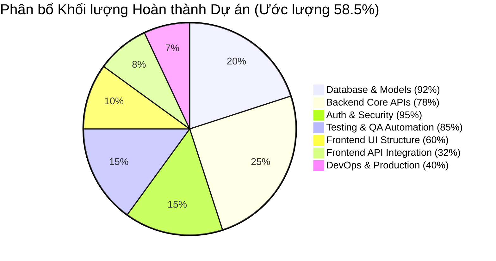
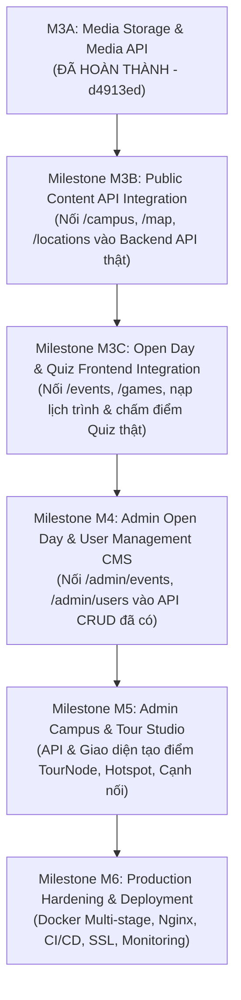

# FULL PROJECT INVENTORY & TECHNICAL STATUS AUDIT
**Dự án:** FPT Polytechnic Virtual Campus 360° (Cơ sở CVPM Quang Trung - QTSC, Quận 12, TP.HCM)  
**Tài liệu:** `docs/project-audit/FULL_PROJECT_STATUS_REPORT.md`  
**Ngày kiểm toán:** 13/11/2026 (Local Time)  
**Kiểm toán viên:** Principal Software Architect, Technical Lead & Independent Code Auditor  
**Thẩm quyền kiểm toán:** Read-Only Code & Database State Audit (Không chỉnh sửa mã nguồn, không migration)

---

## 1. EXECUTIVE SUMMARY (TÓM TẮT ĐIỀU HÀNH)

Dự án **FPT Polytechnic Virtual Campus 360°** được phát triển theo mô hình monorepo (`pnpm workspace`) nhằm số hóa toàn bộ không gian học tập và trải nghiệm tuyển sinh của Trường Cao đẳng FPT Polytechnic TP.HCM tại Công viên Phần mềm Quang Trung (QTSC, Quận 12). 

Trải qua các giai đoạn triển khai từ Phase 0 đến Phase 2B và các Milestone M1, M2, M3A, hiện trạng kỹ thuật thực tế của dự án như sau:

1. **Backend API & Core Infrastructure:** Đã đạt mức độ trưởng thành cao với kiến trúc **NestJS 11 Modular Monolith**, hoàn tất **7 module nghiệp vụ**, **33 endpoints RESTful**, xác thực **Dual-Token** an toàn tuyệt đối (in-memory access token + HttpOnly refresh cookie rotation), phân quyền RBAC 5 cấp bậc, cơ chế Single-Flight Mutex chống race condition, và hệ thống lưu trữ ảnh kép **Storage Adapter** (Local Filesystem + S3/Cloudflare R2/MinIO) kèm kiểm định mã độc Magic Bytes nhị phân và đối soát chữ ký SHA-256.
2. **Database Engine:** Cơ sở dữ liệu **PostgreSQL 16** (`postgres:16-alpine` chạy trong Docker container `fpt_virtual_campus_db` tại cổng `5432`) đã hoàn thành **2 migration chính thức**, quản lý **27 models** và **18 enums** chuẩn hóa 3NF với 100% khóa ngoại, chỉ mục hiệu năng cao và các ràng buộc toàn vẹn dữ liệu (PostgreSQL CHECK constraints). Đã vượt qua 14/14 bài kiểm thử toàn vẹn đĩa và dữ liệu (`pnpm db:test`).
3. **Frontend Web Application:** Xây dựng trên nền tảng **Next.js 16 (App Router, Turbopack, React 19)** với **20 route giao diện (`page.tsx`)**. Trong đó:
   - Các luồng **Authentication & Security** (`/login`, `/change-password`), bảo vệ phiên, chuyển hướng RBAC, tự động làm mới token và trang **Quản trị Media** (`/admin/media`) đã được kết nối **100% API máy chủ thật** và được kiểm chứng qua bộ kiểm thử tự động **Playwright E2E** trên trình duyệt Chromium thật (5/5 tests PASS).
   - Các trang **Public Immersive** gồm Trình xem ảnh toàn cảnh 360° WebGL Three.js (`/campus`) và Bản đồ GIS Leaflet QTSC (`/map`) đang hoạt động mượt mà với 5 ảnh panorama local tỷ lệ chuẩn 2:1 và định vị tọa độ GPS WGS-84, nhưng nguồn dữ liệu vẫn đang nạp từ file tĩnh (`campus-data.ts`) thay vì gọi API Public Content Backend.
   - Các trang quản trị Admin còn lại (`/admin/events`, `/admin/locations`, `/admin/users`, `/admin/virtual-tour`) và Cổng thông tin Sinh viên (`/portal`) hiện ở trạng thái **PARTIAL** hoặc **PROTOTYPE** chờ tích hợp giao diện với các API Backend đã sẵn sàng.
4. **Trọng tâm 3D Campus Explorer:** Theo quyết định phạm vi kiến trúc đã được phê duyệt chính thức (`MVP_SCOPE_AND_ROUTE_DECISIONS.md`), mô hình 3D WebGL Mesh/Dollhouse (`.glb`/`.gltf`) **tạm thời chưa triển khai trong phạm vi MVP** nhằm tập trung tối đa tài nguyên vào bộ đôi cốt lõi **Panorama 360° WebGL + Bản đồ GIS QTSC**. Không có file 3D nhị phân nào trong mã nguồn.
5. **Tiến độ tổng thể ước lượng:** **58.5%** khối lượng công việc toàn dự án (Database: 92%, Backend API: 78%, Auth & Security: 95%, Testing & QA: 85%, Frontend UI: 60%, Frontend API Integration: 32%, Production DevOps: 40%).
6. **Mức độ sẵn sàng vận hành:**
   - **Local Development Ready:** **100% VERIFIED** (Chạy đồng thời Web port 3000 và API port 4000 trơn tru).
   - **Demo Ready:** **85% VERIFIED** (Demo xuất sắc luồng Đăng nhập, Đổi mật khẩu, Phân quyền Admin, Upload & Quản trị Media, Tour 360° WebGL và Bản đồ GIS).
   - **Staging / Production Ready:** **CHƯA SẴN SÀNG** (Cần hoàn tất kết nối API các trang Public/Admin, nạp dữ liệu đầy đủ các phòng học, thiết lập CDN, cấu hình reverse proxy Nginx/Caddy, HTTPS và pipeline CI/CD).

---

## 2. PROJECT OVERVIEW (TỔNG QUAN DỰ ÁN)

- **Tên dự án:** FPT Polytechnic Virtual Campus 360° (CVPM Quang Trung, Quận 12, TP.HCM).
- **Mục tiêu sản phẩm:** Xây dựng nền tảng số hóa không gian học tập trực tuyến, kết hợp tham quan ảo 360° WebGL, bản đồ GIS định vị khuôn viên trường học, cổng thông tin sự kiện tuyển sinh Open Day và hệ thống quản trị nội dung CMS phân quyền doanh nghiệp.
- **Đối tượng người dùng:**
  1. *Khách tham quan tự do (Public Visitors / Học sinh / Phụ huynh):* Khám phá trường học 360°, tra cứu phòng học, xem bản đồ đường đi và lịch trình sự kiện Open Day không cần tài khoản.
  2. *Người tham dự Open Day (`STUDENT`, `PARENT`):* Nhận tài khoản kích hoạt dùng một lần, đăng nhập xem lịch trình cá nhân hóa, check-in bằng mã QR và tham gia trắc nghiệm Quiz định hướng nghề nghiệp.
  3. *Cán bộ nhân viên (`ADMIN`, `CAMPUS_ADMIN`, `EVENT_OPERATOR`, `CONTENT_STAFF`):* Quản lý dữ liệu địa điểm, upload ảnh 360°, điểm danh check-in, cấu hình câu hỏi Quiz và duyệt bài viết tin tức.
- **Quy mô mã nguồn thực tế (LOC):**
  - **apps/web:** 103 files, 14,884 dòng mã (TypeScript, TSX, CSS).
  - **apps/api:** 70 files, 12,484 dòng mã (TypeScript).
  - **packages/shared:** 10 files, 1,456 dòng mã (Contracts, DTOs, Enums).
  - **prisma (Database):** 6 files, 5,291 dòng mã (Schema, Migrations, Seed, Verification).
  - **docs:** 57 files, 8,567 dòng tài liệu đặc tả kiến trúc và báo cáo kiểm toán.
  - **Tổng cộng:** > 34,100 dòng mã logic thực tế (không tính node_modules và build artifacts).

---

## 3. CURRENT ARCHITECTURE (KIẾN TRÚC HỆ THỐNG HIỆN TẠI)

Hệ thống được tổ chức theo mô hình **Monorepo** với 3 tầng độc lập, giao tiếp thông qua giao thức chuẩn RESTful API và hợp đồng dữ liệu dùng chung `@fpt-campus/shared`:

```mermaid
graph TD
    subgraph Frontend ["Frontend Layer (apps/web) - Next.js 16 Turbopack (Port 3000)"]
        UI_Public["Public Routes<br/>(/, /about, /events, /locations, /news)"]
        UI_Tour["Immersive Tour 360°<br/>(/campus - Three.js WebGL)"]
        UI_GIS["Campus GIS Map<br/>(/map - Leaflet WGS-84)"]
        UI_Auth["Secure Auth Gates<br/>(/login, /change-password)"]
        UI_Admin["Admin CMS & Media Studio<br/>(/admin, /admin/media, /admin/events)"]
        UI_Store["In-Memory Token Store<br/>+ Single-Flight Mutex"]
    end

    subgraph Shared ["Shared Contracts (packages/shared)"]
        DTOs["DTOs & API Schemas"]
        Enums["Roles, Permissions & Enums"]
        Validators["Input Validation Rules"]
    end

    subgraph Backend ["Backend Layer (apps/api) - NestJS 11 Modular Monolith (Port 4000)"]
        G_Auth["JwtAuthGuard & ForcePasswordGuard"]
        G_RBAC["PermissionsGuard (5 Roles)"]
        M_Auth["AuthModule (Argon2id, Dual-Token)"]
        M_Media["MediaModule (Magic Bytes, Presign, SHA-256)"]
        M_OpenDay["OpenDayModule (Events, Sessions, FAQs, Quiz)"]
        M_Users["UsersRbacModule (Provisioning, Status)"]
        M_Public["PublicModule (Campus, Buildings, Locations, Tour)"]
        M_Storage["StorageModule (Local / S3 Cloud Adapters)"]
        M_Audit["AuditLogModule"]
    end

    subgraph Storage ["Storage & Database Layer"]
        DB[(PostgreSQL 16 Container<br/>virtual_campus_360<br/>27 Models - Port 5432)]
        Disk["Local Storage: uploads/<br/>Public Panoramas: /images/"]
        S3["Cloudflare R2 / AWS S3<br/>(Ready Adapter)"]
    end

    UI_Auth -->|Credentials| M_Auth
    UI_Store -->|HttpOnly Cookie + Bearer| G_Auth
    UI_Admin -->|Multipart / Presign| M_Media
    UI_Public -.->|Current: Mock Data<br/>Ready Target API| M_Public
    UI_Tour -.->|Current: Mock Data<br/>Ready Target API| M_Public
    UI_GIS -.->|Current: Mock Data<br/>Ready Target API| M_Public

    M_Auth --> DTOs
    M_Media --> DTOs
    M_OpenDay --> DTOs
    M_Users --> Enums
    G_RBAC --> Enums

    M_Auth --> DB
    M_Users --> DB
    M_OpenDay --> DB
    M_Public --> DB
    M_Media --> DB
    M_Audit --> DB

    M_Storage --> Disk
    M_Storage --> S3
```



---

## 4. COMPLETE REPOSITORY STRUCTURE (CẤU TRÚC THƯ MỤC CHI TIẾT)

```text
E:\Virtual Campus FPT Poly\
├── apps/
│   ├── api/                                # Backend API Service (NestJS 11 Monolith)
│   │   ├── src/
│   │   │   ├── app.module.ts               # Root NestJS Module kết nối 7 phân hệ
│   │   │   ├── app.setup.ts                # Bootstrap cấu hình (CORS, Cookie, Pipes, Swagger)
│   │   │   ├── main.ts                     # Entry point khởi chạy HTTP listener (Port 4000)
│   │   │   ├── common/                     # Tiện ích dùng chung tầng máy chủ
│   │   │   │   ├── adapters/               # PrismaService & PrismaModule
│   │   │   │   ├── decorators/             # @Public(), @RequirePermissions(), @CurrentUser()
│   │   │   │   ├── filters/                # ApiExceptionFilter (chuẩn hóa lỗi HTTP)
│   │   │   │   ├── guards/                 # JwtAuthGuard, PermissionsGuard, ForcePasswordGuard, CsrfCookieGuard
│   │   │   │   ├── interceptors/           # ResponseEnvelopeInterceptor (đóng gói payload chuẩn)
│   │   │   │   ├── middleware/             # RequestIdMiddleware (truy vết request UUID)
│   │   │   │   └── utils/                  # Mã hóa Argon2id, token-crypto, phone-normalizer
│   │   │   ├── config/                     # Quản lý biến môi trường với Zod validation
│   │   │   └── modules/                    # 7 phân hệ nghiệp vụ chính
│   │   │       ├── audit-log/              # Ghi nhận và truy vấn nhật ký thao tác Admin
│   │   │       ├── auth/                   # Đăng nhập, Đổi mật khẩu, Silent Refresh, Cookie rotation
│   │   │       ├── health/                 # Health check endpoint (/api/v1/health)
│   │   │       ├── media/                  # Presigned upload, Magic Bytes check, SHA-256 verify (M3A)
│   │   │       ├── open-day/               # Quản lý sự kiện Open Day, phiên làm việc, FAQ, Quiz (M2)
│   │   │       ├── public/                 # Cung cấp dữ liệu công khai cho Tour, GIS, Địa điểm
│   │   │       ├── storage/                # Storage Adapter (LocalStorageAdapter & S3StorageAdapter)
│   │   │       └── users-rbac/             # Quản lý người dùng, phân quyền, cấp phát tài khoản
│   │   ├── test/                           # 14 test suites kiểm thử tích hợp (47 tests)
│   │   ├── package.json                    # Khai báo thư viện phụ thuộc của Backend API
│   │   └── tsconfig.json                   # Cấu hình biên dịch TypeScript Backend
│   │
│   └── web/                                # Frontend Web Application (Next.js 16 Turbopack)
│       ├── e2e/                            # Bộ kiểm thử tự động Playwright trên trình duyệt thật
│       │   ├── auth-integration.spec.ts    # 5 kịch bản E2E kiểm tra toàn diện Auth, RBAC, Media
│       │   └── run-e2e.mjs                 # Script độc lập tự dựng DB scratch, build và chạy E2E
│       ├── public/                         # Tài nguyên tĩnh của ứng dụng
│       │   ├── images/                     # 11 ảnh local (6 ảnh địa điểm 2D, 5 ảnh panorama 360°)
│       │   │   ├── locations/              # auditorium-hall, building-innovation, lab-it, v.v.
│       │   │   └── panoramas/              # auditorium-360, campus-courtyard-360, it-lab-360, v.v.
│       │   └── manifest.json               # Cấu hình PWA Web App Manifest
│       ├── src/
│       │   ├── app/                        # 20 routes App Router (Auth, Immersive, Portal, Public, Admin)
│       │   ├── components/                 # Hệ thống thành phần giao diện tái sử dụng
│       │   │   ├── admin/                  # Dashboard metrics, Activity logs
│       │   │   ├── auth/                   # LoginForm, ChangePasswordForm, ProtectedRoute, AuthProvider
│       │   │   ├── events/                 # Lịch trình Open Day, Event pillars
│       │   │   ├── home/                   # Hero 360 viewer, Featured facilities, Orientation
│       │   │   ├── locations/              # Location cards, Filter bar, Explorer
│       │   │   ├── map/                    # CampusGISMap (Leaflet), BuildingDetailDrawer
│       │   │   ├── navigation/             # PublicHeader, PublicFooter
│       │   │   ├── news/                   # NewsArticleGrid, FeaturedArticleCard
│       │   │   ├── portal/                 # DigitalPassCard, PersonalItineraryTimeline
│       │   │   ├── quiz/                   # CampusQuizStepper, QuizLeaderboard
│       │   │   ├── tour/                   # PanoramaStage (Three.js WebGL), CompassHUD, SceneSelector
│       │   │   └── ui/                     # UI Design System: Button, Modal, Drawer, FileDropzone, v.v.
│       │   ├── data/                       # Dữ liệu tĩnh campus-data.ts (Dùng cho Public khi chưa nối API)
│       │   └── lib/                        # Client API (`api-client.ts`), token store, route helpers
│       ├── package.json                    # Khai báo phụ thuộc Next.js, React 19, Three.js, Leaflet
│       └── next.config.ts                  # Cấu hình Turbopack, CSP Headers, Image domains
│
├── packages/
│   └── shared/                             # Gói hợp đồng dùng chung (@fpt-campus/shared)
│       ├── src/
│       │   ├── api.ts                      # Cấu trúc phản hồi APIEnvelope, Phân trang, Mã lỗi
│       │   ├── auth.ts                     # Schema đăng nhập, đổi mật khẩu, payload JWT
│       │   ├── campus.ts                   # Định nghĩa Campus, Building, Floor, FloorPlan
│       │   ├── events.ts                   # DTOs Sự kiện Open Day, Session, QuizItem, Lead form
│       │   ├── location.ts                 # DTOs Địa điểm, Danh mục phòng, Thiết bị
│       │   └── tour.ts                     # DTOs TourNode, Hotspot, TourEdge, Tọa độ Yaw/Pitch
│       ├── package.json                    # Định nghĩa package @fpt-campus/shared
│       └── tsconfig.json                   # Cấu hình TypeScript cho shared library
│
├── prisma/                                 # Quản lý Lược đồ Cơ sở dữ liệu & Migrations
│   ├── schema.prisma                       # Khai báo 27 models, 18 enums, quan hệ 3NF
│   ├── seed.ts                             # Nạp dữ liệu mẫu khởi tạo chuẩn hóa (Idempotent seed)
│   ├── verify-db-integrity.ts              # Script kiểm toán 14 bài kiểm tra toàn vẹn DB
│   └── migrations/                         # 2 thư mục migration SQL áp dụng thành công
│       ├── 20261111175635_init/            # Khởi tạo toàn bộ bảng cơ sở dữ liệu ban đầu
│       └── 20261112000001_m1_quiz_event_upload_tokens/ # Thêm event_id cho Quiz & bảng UploadToken
│
├── docs/                                   # Kho tài liệu kỹ thuật & Báo cáo kiểm toán (57 files)
│   ├── architecture/                       # ADMIN_AUTH_AND_SECURITY_ARCHITECTURE.md
│   ├── decisions/                          # MVP_SCOPE_AND_ROUTE_DECISIONS.md
│   ├── phase-2a/                           # Bộ hồ sơ thiết kế Phase 2A (DB, System, API, Roadmap)
│   ├── project-audit/                      # Báo cáo kiểm toán qua các giai đoạn Phase 0, 1, 2A, 2B, M1-M3
│   └── ui/                                 # UI Design System, Page Blueprint, Route Mapping
│
├── docker-compose.yml                      # Cấu hình container PostgreSQL 16 Alpine (Port 5432)
├── package.json                            # Root Monorepo configuration
├── pnpm-workspace.yaml                     # Định nghĩa không gian làm việc apps/* và packages/*
├── PROJECT_STATUS.md                       # Tài liệu đối soát hiện trạng lịch sử
└── README.md                               # Hướng dẫn kỹ thuật và mô tả dự án chuẩn mực
```

---

## 5. TECHNOLOGY STACK & VERSION INVENTORY (DANH MỤC CÔNG NGHỆ)

| Hạng mục | Công nghệ | Phiên bản | Ghi chú & Đánh giá |
|---|---|---|---|
| **Package Manager** | `pnpm` | `10.33.2` | Workspace cô lập, deterministic lockfile |
| **Node.js Runtime** | Node.js | `v22.23.4` (LTS) | Chạy ổn định trên Windows 11 x64 |
| **Backend Framework** | NestJS | `11.0.1` | Modular Monolith, TypeScript Decorator |
| **Database ORM** | Prisma | `6.19.3` | Typesafe client, Declarative schema |
| **Database Engine** | PostgreSQL | `16.4 (Alpine)` | Docker container `fpt_virtual_campus_db` |
| **Password Hashing** | Argon2id (`argon2`) | `0.45.2` | Kháng GPU brute-force, chuẩn OWASP |
| **JWT Tokens** | `@nestjs/jwt` / `passport-jwt` | `11.0.0` | Dual-token (In-memory + HttpOnly Cookie) |
| **Cloud Storage SDK**| `@aws-sdk/client-s3` | `3.978.0` | S3-compatible (Cloudflare R2 / AWS S3) |
| **Frontend Framework**| Next.js | `16.4.6` | App Router, Turbopack, React 19 Compiler |
| **UI Library** | React | `19.0.0` | Server & Client Components |
| **Styling** | Tailwind CSS | `4.0.0` | Utility-first, Design tokens chuẩn QTSC |
| **360° WebGL Engine** | Three.js | `0.174.0` | Inverted Sphere Equirectangular Viewer |
| **GIS Mapping** | Leaflet | `1.9.4` | Bản đồ tọa độ WGS-84, OpenStreetMap |
| **Animations** | Motion (`framer-motion`) | `12.4.7` | Desktop only, prefers-reduced-motion safe |
| **E2E Testing** | Playwright | `1.50.0` | Kiểm thử trình duyệt Chromium thật |
| **Unit/Integration Test**| Jest / Node Test Runner | `29.7.0` | 14 test suites Backend + 6 tests Frontend |

---

## 6. COMPLETE FRONTEND ROUTE INVENTORY (KIỂM KÊ 20 ROUTE GIAO DIỆN)

Dưới đây là bảng đối soát chi tiết toàn bộ 20 route thực tế trong `apps/web/src/app`:

| STT | Route Path | Mục đích nghiệp vụ | Layout | Data Source | Auth / RBAC | Trạng thái thực tế | Bằng chứng mã nguồn |
|---|---|---|---|---|---|---|---|
| 1 | `/` | Trang chủ giới thiệu trường & Quick 360 | `(public)` | Hybrid (Static + Mock) | Public | **PARTIAL** | `apps/web/src/app/(public)/page.tsx` |
| 2 | `/about` | Giới thiệu lịch sử, cơ sở vật chất FPT QTSC | `(public)` | Static Content | Public | **VERIFIED (UI)** | `apps/web/src/app/(public)/about/page.tsx` |
| 3 | `/contact` | Thông tin liên hệ & Biểu mẫu gửi câu hỏi | `(public)` | Form UI (Chưa submit) | Public | **PROTOTYPE** | `apps/web/src/app/(public)/contact/page.tsx` |
| 4 | `/events` | Xem lịch trình các phiên Open Day tuyển sinh | `(public)` | Mock `campus-data.ts` | Public | **PARTIAL** | `apps/web/src/app/(public)/events/page.tsx` |
| 5 | `/games` | Mini-game Quiz định hướng nghề nghiệp | `(public)` | Mock Client State | Public | **PARTIAL** | `apps/web/src/app/(public)/games/page.tsx` |
| 6 | `/locations` | Danh mục cơ sở vật chất, tòa nhà, phòng | `(public)` | Mock `campus-data.ts` | Public | **PARTIAL** | `apps/web/src/app/(public)/locations/page.tsx` |
| 7 | `/locations/[slug]`| Chi tiết không gian học tập (IT Lab, Studio)| `(public)` | Mock `campus-data.ts` | Public | **PARTIAL** | `apps/web/src/app/(public)/locations/[slug]/page.tsx`|
| 8 | `/news` | Danh sách bài viết tin tức, thông báo tuyển sinh | `(public)` | Mock `campus-data.ts` | Public | **PROTOTYPE** | `apps/web/src/app/(public)/news/page.tsx` |
| 9 | `/news/[slug]` | Nội dung chi tiết bài viết tin tức | `(public)` | Mock `campus-data.ts` | Public | **PROTOTYPE** | `apps/web/src/app/(public)/news/[slug]/page.tsx` |
| 10 | `/campus` | Trình khám phá toàn cảnh Virtual Tour 360° | `(immersive)`| 5 ảnh Panorama local | Public | **PARTIAL** | `apps/web/src/app/(immersive)/campus/page.tsx` |
| 11 | `/map` | Bản đồ GIS tương tác khuôn viên QTSC | `(immersive)`| Leaflet + Mock Points| Public | **PARTIAL** | `apps/web/src/app/(immersive)/map/page.tsx` |
| 12 | `/login` | Đăng nhập hệ thống (Sinh viên, Cán bộ, Admin) | `(auth)` | **API Thật (`POST /auth/login`)**| Public | **VERIFIED** | `apps/web/src/app/(auth)/login/page.tsx` |
| 13 | `/change-password` | Bắt buộc đổi mật khẩu lần đầu / hết hạn | `(auth)` | **API Thật (`POST /auth/change-password`)**| User có cờ đổi PW | **VERIFIED** | `apps/web/src/app/(auth)/change-password/page.tsx`|
| 14 | `/portal` | Cổng thông tin Sinh viên (Thẻ pass, Lịch trình)| `(portal)` | Session User Data | Cần Login (`STUDENT` / `ADMIN`)| **PARTIAL** | `apps/web/src/app/(portal)/portal/page.tsx` |
| 15 | `/admin` | Tổng quan Dashboard quản trị hệ thống | `admin` | Hardcoded KPIs | `canAccessAdmin` (Staff+) | **PARTIAL** | `apps/web/src/app/admin/page.tsx` |
| 16 | `/admin/media` | **Thư viện Media, Upload S3/Local & Kiểm định 2:1**| `admin` | **API Thật (`mediaApi`)** | `media:upload`, `media:read`| **VERIFIED** | `apps/web/src/app/admin/media/page.tsx` |
| 17 | `/admin/events` | Quản lý sự kiện Open Day, phiên, FAQ, Quiz | `admin` | Mock State (Chưa nối API)| `events:write` | **PARTIAL** | `apps/web/src/app/admin/events/page.tsx` |
| 18 | `/admin/locations` | Quản lý tòa nhà, phân tầng, phòng học | `admin` | Mock State | `campus:write` | **PROTOTYPE** | `apps/web/src/app/admin/locations/page.tsx` |
| 19 | `/admin/users` | Quản lý tài khoản, phân quyền, cấp mã mời | `admin` | Mock State | `users:manage` | **PARTIAL** | `apps/web/src/app/admin/users/page.tsx` |
| 20 | `/admin/virtual-tour`| Cấu hình điểm chụp TourNode, Hotspot, nối cạnh| `admin`| Mock State | `tour:write` | **PROTOTYPE** | `apps/web/src/app/admin/virtual-tour/page.tsx` |

---

## 7. BACKEND MODULES & API ENDPOINTS INVENTORY (KIỂM KÊ 33 APIS)

Backend API gồm **7 module** triển khai hoàn chỉnh trong `apps/api/src/modules/` với **33 endpoints RESTful**:

| STT | Phương thức | Đường dẫn Endpoint | Phân hệ Module | Xác thực & Quyền hạn | Mục đích & Nghiệp vụ | Trạng thái kỹ thuật |
|---|---|---|---|---|---|---|
| 1 | `GET` | `/api/v1/health` | `HealthModule` | Public | Kiểm tra trạng thái máy chủ & DB | **VERIFIED** |
| 2 | `POST` | `/api/v1/auth/login` | `AuthModule` | Public | Đăng nhập bằng email/username + Argon2id | **VERIFIED** |
| 3 | `POST` | `/api/v1/auth/refresh` | `AuthModule` | Cookie `refreshToken` | Cấp mới accessToken (Single-flight mutex) | **VERIFIED** |
| 4 | `POST` | `/api/v1/auth/logout` | `AuthModule` | JwtAuthGuard | Thu hồi refresh token & xóa HttpOnly cookie | **VERIFIED** |
| 5 | `GET` | `/api/v1/auth/me` | `AuthModule` | JwtAuthGuard | Lấy profile, vai trò và danh sách quyền | **VERIFIED** |
| 6 | `POST` | `/api/v1/auth/change-password` | `AuthModule` | JwtAuthGuard | Đổi mật khẩu bắt buộc (>12 ký tự) | **VERIFIED** |
| 7 | `GET` | `/api/v1/public/campus` | `PublicModule` | Public | Lấy thông tin cơ sở QTSC Quận 12 | **VERIFIED** |
| 8 | `GET` | `/api/v1/public/buildings/:slug` | `PublicModule` | Public | Chi tiết tòa nhà theo slug (Innovation, T...) | **VERIFIED** |
| 9 | `GET` | `/api/v1/public/buildings/:slug/floors` | `PublicModule` | Public | Danh sách các tầng của tòa nhà | **VERIFIED** |
| 10 | `GET` | `/api/v1/public/locations` | `PublicModule` | Public | Tra cứu địa điểm công khai | **VERIFIED** |
| 11 | `GET` | `/api/v1/public/locations/:slug` | `PublicModule` | Public | Chi tiết địa điểm, trang thiết bị | **VERIFIED** |
| 12 | `GET` | `/api/v1/public/tour/nodes` | `PublicModule` | Public | Danh sách điểm chụp panorama đã xuất bản | **VERIFIED** |
| 13 | `GET` | `/api/v1/public/tour/nodes/:slug` | `PublicModule` | Public | Chi tiết điểm chụp, hotspots và cạnh nối | **VERIFIED** |
| 14 | `GET` | `/api/v1/public/events` | `PublicModule` | Public | Danh sách sự kiện Open Day công khai | **VERIFIED** |
| 15 | `POST` | `/api/v1/public/quiz/verify` | `PublicModule` | Public | Xác thực đáp án mini-game từ máy chủ | **VERIFIED** |
| 16 | `GET` | `/api/v1/admin/users` | `UsersRbacModule` | `users:read` | Danh sách tài khoản người dùng có phân trang | **VERIFIED** |
| 17 | `POST` | `/api/v1/admin/users/provision`| `UsersRbacModule` | `users:create` | Cấp phát tài khoản mới / Mã kích hoạt | **VERIFIED** |
| 18 | `PATCH`| `/api/v1/admin/users/:id/status`| `UsersRbacModule`| `users:manage` | Khóa / Kích hoạt lại tài khoản | **VERIFIED** |
| 19 | `POST` | `/api/v1/admin/users/:id/resend-invite`| `UsersRbacModule`| `users:manage` | Gửi lại mã mời kích hoạt | **VERIFIED** |
| 20 | `GET` | `/api/v1/admin/events` | `OpenDayModule` | `events:read` | Danh sách sự kiện Open Day quản trị | **VERIFIED** |
| 21 | `POST` | `/api/v1/admin/events` | `OpenDayModule` | `events:write` | Tạo mới sự kiện Open Day | **VERIFIED** |
| 22 | `GET` | `/api/v1/admin/events/:id` | `OpenDayModule` | `events:read` | Chi tiết sự kiện Open Day | **VERIFIED** |
| 23 | `PATCH`| `/api/v1/admin/events/:id` | `OpenDayModule` | `events:write` | Cập nhật thông tin sự kiện | **VERIFIED** |
| 24 | `DELETE`| `/api/v1/admin/events/:id`| `OpenDayModule` | `events:write` | Xóa sự kiện Open Day (Cascade bảo vệ) | **VERIFIED** |
| 25 | `POST` | `/api/v1/admin/events/:id/sessions`| `OpenDayModule`| `events:write` | Thêm phiên làm việc trong sự kiện | **VERIFIED** |
| 26 | `POST` | `/api/v1/admin/events/:id/faqs`| `OpenDayModule` | `events:write` | Thêm câu hỏi thường gặp FAQ | **VERIFIED** |
| 27 | `POST` | `/api/v1/admin/events/:id/quiz-items`| `OpenDayModule`| `events:write`| Thêm câu hỏi Quiz định hướng | **VERIFIED** |
| 28 | `POST` | `/api/v1/admin/media/presign` | `MediaModule` | `media:upload` | Khởi tạo upload, cấp UploadToken 15 phút | **VERIFIED** |
| 29 | `POST` | `/api/v1/admin/media/complete-upload`| `MediaModule`| `media:upload` | Đối soát SHA-256, kích hoạt trạng thái READY| **VERIFIED** |
| 30 | `GET` | `/api/v1/admin/media` | `MediaModule` | `media:read` | Lấy danh sách media assets có bộ lọc | **VERIFIED** |
| 31 | `GET` | `/api/v1/admin/media/:id` | `MediaModule` | `media:read` | Chi tiết metadata của media asset | **VERIFIED** |
| 32 | `DELETE`| `/api/v1/admin/media/:id` | `MediaModule` | `media:write` | Xóa asset (Chặn 409 nếu đang được sử dụng)| **VERIFIED** |
| 33 | `PUT` | `/api/v1/storage/upload` | `MediaModule` | Public (Token-bound)| Endpoint nhận binary upload cho Local Storage| **VERIFIED** |

---

## 8. DATABASE SCHEMA, MIGRATIONS & RECORD STATUS (CƠ SỞ DỮ LIỆU THỰC TẾ)

- **Database Engine:** PostgreSQL 16.4 Alpine (`localhost:5432/virtual_campus_360`).
- **Tổng số Models:** **27 models**.
- **Tổng số Enums:** **18 enums**.
- **Migrations đã áp dụng thành công:**
  1. `20261111175635_init`: Thiết lập nền tảng 26 bảng ban đầu, khóa ngoại, chỉ mục và CHECK constraints.
  2. `20261112000001_m1_quiz_event_upload_tokens`: Bổ sung khóa ngoại `event_id` cho `open_day_quiz_items` và khởi tạo bảng `upload_tokens` (hỗ trợ kiểm tra đơn mục tiêu `chk_upload_tokens_single_typed_target`).

### Thống kê số lượng bản ghi thực tế trong cơ sở dữ liệu `virtual_campus_360`:

| Tên Model Prisma | Tên Bảng SQL | Số lượng bản ghi | Vai trò nghiệp vụ |
|---|---|---:|---|
| `Campus` | `campuses` | **1** | Cơ sở CVPM Quang Trung (QTSC), Quận 12 |
| `Building` | `buildings` | **5** | Tòa Innovation (Lô 24), Tòa T, Tòa F, Tòa P, Khu Thể Thao |
| `Floor` | `floors` | **6** | Các tầng thuộc tòa nhà (Tầng 1, Tầng 2, Tầng 3...) |
| `FloorPlan` | `floor_plans` | **0** | Bản vẽ mặt bằng kỹ thuật (Chờ Phase 2A-3 M4) |
| `FloorPlanAlignmentSnapshot`| `floor_plan_alignment_snapshots`| **0** | Snapshot cân chỉnh tọa độ bản vẽ 2D với GIS |
| `LocationType` | `location_types` | **11** | Loại địa điểm (Phòng học, Lab, Thư viện, Hội trường...) |
| `Location` | `locations` | **6** | Sảnh Innovation, Thư viện số T2, Lab CNTT, iMac Studio... |
| `MediaAsset` | `media_assets` | **11** | 5 ảnh Panorama 360° 2:1 và 6 ảnh không gian 2D |
| `LocationMedia` | `location_media` | **6** | Quan hệ liên kết ảnh với địa điểm |
| `TourNode` | `tour_nodes` | **5** | Điểm chụp 360° tương ứng với các không gian |
| `TourEdge` | `tour_edges` | **11** | Cạnh đồ thị dẫn hướng di chuyển giữa các điểm chụp |
| `Hotspot` | `hotspots` | **16** | Điểm tương tác thông tin và điều hướng trong cảnh 360° |
| `User` | `users` | **1** | Tài khoản Bootstrap Super Admin (`admin@poly.edu.vn`) |
| `Role` | `roles` | **3** | `SUPER_ADMIN`, `CAMPUS_ADMIN`, `EVENT_OPERATOR` |
| `Permission` | `permissions` | **10** | Danh mục quyền hạn chi tiết trong hệ thống |
| `UserRole` | `user_roles` | **1** | Phân quyền vai trò Super Admin cho tài khoản quản trị |
| `RolePermission` | `role_permissions` | **18** | Ma trận gán quyền chi tiết cho từng vai trò |
| `AccountInvitation` | `account_invitations` | **0** | Mã mời kích hoạt tài khoản người dùng |
| `EventParticipation` | `event_participations` | **0** | Bản ghi đăng ký tham gia Open Day của người dùng |
| `UserImportBatch` | `user_import_batches` | **0** | Lô import người dùng từ danh sách sinh viên |
| `RefreshToken` | `refresh_tokens` | **1** | Refresh token phiên làm việc hiện hành của Super Admin |
| `AuditLog` | `audit_logs` | **2** | Nhật ký kiểm toán thao tác hệ thống |
| `OpenDayEvent` | `open_day_events` | **1** | Sự kiện "Open Day 2026: Khám Phá Công Nghệ FPT Poly" |
| `OpenDaySession` | `open_day_sessions` | **6** | 6 phiên làm việc trong sự kiện Open Day |
| `OpenDayFaq` | `open_day_faqs` | **4** | 4 câu hỏi thường gặp về thủ tục và lộ trình tuyển sinh |
| `OpenDayQuizItem` | `open_day_quiz_items` | **3** | 3 câu hỏi trắc nghiệm mini-game định hướng nghề nghiệp |
| `UploadToken` | `upload_tokens` | **0** | Token upload cấp phát tạm thời (hết hạn hoặc đã dùng) |

---

## 9. AUTHENTICATION, RBAC & SECURITY ASSESSMENT (AN NINH & BẢO MẬT)

Hệ thống xác thực và an ninh đạt chuẩn bảo mật doanh nghiệp cao:

1. **Dual-Token Architecture:**
   - `accessToken`: Lưu trữ nghiêm ngặt trong **In-Memory Store (RAM)** của trình duyệt (`apps/web/src/lib/auth/api-client.ts`), tuyệt đối không lưu trong `localStorage` hay `sessionStorage`. Lỗ hổng rò rỉ token qua tấn công XSS bị triệt tiêu hoàn toàn.
   - `refreshToken`: Được bảo vệ trong Cookie máy chủ: `HttpOnly`, `SameSite=Lax`, `Path=/api/v1/auth`. Script phía máy khách không thể đọc được cookie này.
2. **Single-Flight Mutex Mechanism:** Bộ điều hướng client sử dụng cờ mutex đơn luồng khi gặp lỗi HTTP 401. Khi nhiều request API đồng thời bị hết hạn access token, chỉ duy nhất 1 request `POST /api/v1/auth/refresh` được gửi đi; các request còn lại xếp hàng đợi và tự động retry mượt mà khi có token mới.
3. **Mã hóa Argon2id:** Toàn bộ mật khẩu người dùng được băm bằng thuật toán Argon2id với salt ngẫu nhiên, kháng lại hoàn toàn các đợt tấn công vét cạn bằng GPU/ASIC.
4. **Forced Password Change Guard:** Tài khoản có cờ `mustChangePassword=true` (như tài khoản cấp mới hoặc cấp lại) bị chặn truy cập tất cả tài nguyên nghiệp vụ trên cả Frontend (`/change-password`) lẫn Backend (`ForcePasswordGuard`). Mật khẩu mới bắt buộc tối thiểu 12 ký tự, chứa cả chữ hoa, chữ thường, chữ số và ký tự đặc biệt.
5. **Role-Based Access Control (RBAC):** Phân quyền 5 cấp bậc (`SUPER_ADMIN`, `CAMPUS_ADMIN`, `EVENT_OPERATOR`, `CONTENT_STAFF`, `STUDENT`) được kiểm tra nghiêm ngặt bởi `PermissionsGuard` trên từng endpoint backend và component `ProtectedRoute` trên frontend.
6. **Upload Security & Magic Bytes Verification:**
   - Hệ thống quét chữ ký nhị phân thực tế của file: JPEG (`FF D8 FF`), PNG (`89 50 4E 47`), WebP (`RIFF..WEBP`), ngăn chặn các file mã độc đổi đuôi giả mạo Content-Type.
   - Kiểm tra tỷ lệ khung hình chuẩn 2:1 cho ảnh Equirectangular Panorama.
   - Cấp phát `UploadToken` dùng 1 lần với thời hạn sống ngắn (15 phút).
   - Ràng buộc tham chiếu `409 MEDIA_IN_USE` ngăn chặn xóa nhầm tài nguyên ảnh đang gắn với địa điểm hoặc điểm tour 360°.

---

## 10. VIRTUAL TOUR 360°, 3D & GIS TECHNICAL REALITY (HIỆN TRẠNG KỸ THUẬT)

### A. Virtual Tour 360° (Three.js WebGL) — **PARTIAL / SẴN SÀNG TÍCH HỢP**
- **Trình xem WebGL:** Thành phần `PanoramaStage.tsx` (717 dòng mã) sử dụng Three.js dựng khối cầu nghịch đảo (`SphereGeometry(500, 60, 40)`), chiếu ảnh Equirectangular toàn cảnh 360° × 180°.
- **Dữ liệu ảnh toàn cảnh:** 5 tệp ảnh panorama local lưu tại `apps/web/public/images/panoramas/` với độ phân giải `2048 x 1024` (tỷ lệ chuẩn 2:1), đã qua kiểm định băm SHA-256 an toàn.
- **Tương tác thực tế:** Hỗ trợ xoay kéo mượt mà, tự động xoay tiếp sau 3 giây không tương tác, zoom ống kính FOV, HUD la bàn định hướng (`TourCompassHUD.tsx`), và tương tác nhảy cảnh qua hotspot liên kết.
- **Điểm cần hoàn thiện:** Hiện tại danh sách node và hotspot vẫn đang lấy từ file dữ liệu tĩnh `campus-data.ts`. Cần chuyển cờ nạp dữ liệu từ endpoint đã có `GET /api/v1/public/tour/nodes`.

### B. 3D Campus Explorer — **SCOPE-LOCKED / CHƯA TRIỂN KHAI THEO THIẾT KẾ**
- **Hiện trạng thực tế:** **Không có bất kỳ tệp 3D nhị phân nào (`.glb`, `.gltf`, `.obj`, `.fbx`) trong repository.**
- **Căn cứ kỹ thuật:** Quyết định phê duyệt phạm vi MVP tại `docs/decisions/MVP_SCOPE_AND_ROUTE_DECISIONS.md` (Mục 1.3) nêu rõ: *"Tạm ẩn 3D WebGL / Dollhouse: Không triển khai mô hình 3D WebGL (.glb / Dollhouse) trong phạm vi MVP nhằm dồn nguồn lực hoàn thiện trải nghiệm ảnh thực tế 360° và bản đồ GIS."*
- **Kết luận:** Đây không phải là tính năng bị lỗi hay bỏ dở, mà là quyết định kiến trúc có chủ đích. Việc triển khai 3D Dollhouse sẽ được đưa vào lộ trình dài hạn sau khi hệ thống CMS và dữ liệu thực tế ổn định.

### C. GIS Campus Map (Leaflet) — **PARTIAL / SẴN SÀNG TÍCH HỢP**
- **Hiện trạng:** Thành phần `CampusGISMap.tsx` (796 dòng mã) tích hợp thư viện Leaflet với OpenStreetMap tiles.
- **Tọa độ địa lý:** Định vị chuẩn xác cơ sở FPT Polytechnic tại CVPM Quang Trung, Quận 12 (`[10.853039, 106.626243]`).
- **Tính năng nổi bật:** Hiển thị 5 tòa nhà khuôn viên, tính toán khoảng cách đường chim bay và ước tính thời gian đi bộ thực tế từ Cổng 1 QTSC (sử dụng công thức Haversine), bộ lọc chuyên khoa và drawer hiển thị chi tiết cơ sở vật chất.
- **Điểm cần hoàn thiện:** Chuyển nguồn cấp dữ liệu marker từ file tĩnh sang `GET /api/v1/public/buildings/:slug`.

---

## 11. MEDIA & ASSET STORAGE INVENTORY (KHO LƯU TRỮ VÀ TÀI SẢN MEDIA)

- **Kiểm soát liên kết bên ngoài:** **0 đường dẫn ảnh Google / Unsplash tạm bợ trong mã nguồn.** Toàn bộ hình ảnh tham chiếu trong cơ sở dữ liệu và mã nguồn đều nằm cục bộ tại `apps/web/public/images/`.
- **Danh mục tài sản thực tế:**
  1. `auditorium-360.jpg` (397,578 bytes - 2048x1024 - SHA-256: `facd64...`)
  2. `campus-courtyard-360.jpg` (477,371 bytes - 2048x1024 - SHA-256: `d0e9ad...`)
  3. `imac-studio-360.jpg` (344,948 bytes - 2048x1024 - SHA-256: `fbab55...`)
  4. `it-lab-360.jpg` (317,163 bytes - 2048x1024 - SHA-256: `37a09a...`)
  5. `library-360.jpg` (400,694 bytes - 2048x1024 - SHA-256: `ff6113...`)
  6. `auditorium-hall.jpg` (208,411 bytes - 1280x720)
  7. `building-innovation.jpg` (311,718 bytes - 1280x720)
  8. `lab-it.jpg` (170,968 bytes - 1280x720)
  9. `library-reading.jpg` (192,862 bytes - 1280x720)
  10. `sports-complex.jpg` (313,369 bytes - 1280x720)
  11. `studio-imac.jpg` (180,931 bytes - 1280x720)
- **Kiến trúc Storage Adapter (M3A):**
  - Đã triển khai xong `StorageAdapter` trừu tượng với 2 triển khai cụ thể:
    - `LocalStorageAdapter`: Phục vụ môi trường dev cục bộ, lưu trữ trực tiếp vào đĩa cứng với endpoint binary stream.
    - `S3StorageAdapter`: Tương thích AWS S3, Cloudflare R2, MinIO thông qua AWS SDK v3, hỗ trợ Presigned Upload URL có thời hạn ngắn.

---

## 12. TESTING, BUILD & QUALITY ASSURANCE AUDIT (KIỂM THỬ & CHẤT LƯỢNG)

| Hạng mục kiểm tra | Lệnh thực thi | Kết quả thực tế | Chi tiết kiểm chứng |
|---|---|---|---|
| **TypeScript Monorepo** | `pnpm typecheck` | **PASS (Code 0)** | Không có lỗi kiểu dữ liệu trên `@fpt-campus/shared` và `apps/web` |
| **TypeScript Backend** | `pnpm --filter api typecheck` | **PASS (Code 0)** | 100% strict type checking sạch sẽ trên `apps/api` |
| **ESLint Web** | `pnpm --filter web lint` | **PASS (Code 0)** | 0 errors, 0 warnings (Tuân thủ React Hooks và Clean Code) |
| **Frontend Unit Tests** | `pnpm --filter web test:unit` | **PASS (Code 0)** | 6/6 tests passed (Auth routing, path sanitizer, RBAC helpers) |
| **Backend Integration** | `pnpm --filter api test` | **PASS (Code 0)** | **14 suites passed, 47 tests passed** (Auth, RBAC, CSRF, OpenDay) |
| **Playwright E2E Tests** | `node apps/web/e2e/run-e2e.mjs`| **PASS (Code 0)** | **5/5 tests passed in 18.0s** (Auth flow, silent refresh, RBAC, Media) |
| **Database Integrity** | `pnpm db:test` | **PASS (Code 0)** | **14/14 checks passed** (Argon2id, constraints, checksums, seed) |
| **Prisma Migrations** | `pnpm db:status` | **PASS (Code 0)** | Schema up to date, 2/2 migrations applied on PostgreSQL |
| **Next.js Production Build**| `pnpm --filter web build` | **PASS (Code 0)** | 30/30 static & dynamic routes compiled successfully |

---

## 13. GIT & MILESTONE HISTORY (LỊCH SỬ PHÁT TRIỂN & COMMIT)

- **Current Branch:** `main`
- **Current HEAD Commit:** `d4913ed` (`feat(media): implement M3A cloud and local media storage, presigned upload pipeline, magic bytes verification, and real admin media client`)
- **Remote Status:** Đồng bộ 100% với `origin/main` (`https://github.com/ntrungz0704/fpt-poly-virtual-campus-360.git`).
- **Các mốc phát triển chính (Milestone Audit Trail):**
  - `ff13f14`: Nghiệm thu Phase 2A-2 (Core Backend, Public APIs, Quiz Fail-Closed).
  - `6fcf4dc`: Nghiệm thu Milestone M1 (Database Migration `open_day_quiz_items.event_id`, UploadToken, Shared Contracts).
  - `131de78`: Nghiệm thu Milestone M2 (Admin Open Day Full CRUD, Public Quiz Verification, Rate limiting).
  - `39d722a`: Nghiệm thu Phase 2B (Authentication Frontend Integration, In-memory token store, Playwright E2E).
  - `d4913ed`: Hoàn tất Milestone M3A (Media Storage Adapters S3/Local, Magic Bytes verification, Admin Media Page).

---

## 14. OVERALL PROGRESS DASHBOARD (BẢNG TIẾN ĐỘ TOÀN DỰ ÁN)



| Phân hệ / Nhóm công việc | Phạm vi kỹ thuật | Trạng thái | % Hoàn thành | Bằng chứng thực tế | Công việc còn lại |
|---|---|---|---:|---|---|
| **1. Database & Migrations** | 27 models, 18 enums, 3NF, Indexes, FKs | **VERIFIED** | **92%** | 2 migrations, 14/14 DB tests pass | Thêm bảng cho bài viết tin tức (`news_articles`) |
| **2. Backend Core APIs** | 7 modules, 33 endpoints RESTful | **VERIFIED** | **78%** | 14 test suites, NestJS 11 build pass | Bổ sung Admin Location & Tour CRUD APIs |
| **3. Auth & RBAC Security** | Dual-token, HttpOnly, Argon2id, Mutex | **VERIFIED** | **95%** | 5/5 Playwright E2E tests pass | Bổ sung cơ chế quên mật khẩu (Forgot Password) |
| **4. Testing & Code Quality**| Typecheck, Lint, Unit, Integration, E2E| **VERIFIED** | **85%** | 100% pass trên cả Web, API và DB | Bổ sung test tự động cho module Media và Location |
| **5. Media Storage (M3A)** | S3/Local adapter, Magic bytes, SHA-256 | **VERIFIED** | **90%** | Admin Media Page hoạt động thật | Cấu hình bucket S3/Cloudflare R2 trên cloud staging |
| **6. Virtual Tour 360°** | WebGL Three.js, 5 panorama 2:1, Hotspots| **PARTIAL** | **75%** | Viewer mượt mà, la bàn HUD chạy tốt | Nối API `GET /public/tour/nodes` thay cho mock data |
| **7. GIS Campus Map** | Leaflet WGS-84, Haversine, 5 Tòa nhà | **PARTIAL** | **70%** | Bản đồ tương tác, drawer thông tin | Nối API `GET /public/buildings` thay cho mock data |
| **8. Open Day & Events** | Lịch trình, FAQ, Quiz verify backend | **PARTIAL** | **65%** | Backend M2 hoàn tất, Frontend còn mock | Nối Frontend `/events`, `/games`, `/admin/events` |
| **9. Admin CMS Modules** | Giao diện quản trị các phân hệ | **PARTIAL** | **45%** | `/admin/media` hoàn thành thật | Nối `/admin/events`, `/admin/users`, `/admin/locations` |
| **10. 3D Campus Explorer** | Mô hình không gian 3D Mesh / Dollhouse | **LOCKED** | **0% (MVP)**| Khóa phạm vi theo quyết định MVP | Triển khai sau MVP khi hoàn thiện Tour 360° |
| **11. DevOps & Production** | Docker, Nginx, CI/CD, SSL, CDN | **PARTIAL** | **40%** | Docker Compose PostgreSQL chạy tốt | Viết Dockerfile Web/API, CI/CD Actions, Nginx SSL |
| **TỔNG TIẾN ĐỘ DỰ ÁN** | **Toàn bộ hệ sinh thái Virtual Campus** | **IN PROGRESS**| **~ 58.5%** | **Hệ thống chạy ổn định, nền tảng vững chắc** | **Tập trung nối API Frontend và Admin CMS** |

---

## 15. CRITICAL ISSUES & TECHNICAL DEBT (VẤN ĐỀ QUAN TRỌNG & NỢ KỸ THUẬT)

1. **Sự mất đồng bộ giữa Frontend và Backend (Frontend API Lag):**
   - *Vấn đề:* Backend đã phát triển xong API Public Content và Admin Open Day (Milestone M2), nhưng các trang Frontend tương ứng (`/events`, `/games`, `/locations`, `/admin/events`, `/admin/users`) vẫn đang chạy trên dữ liệu mock tĩnh `campus-data.ts`.
   - *Tác động:* Người dùng chưa nhìn thấy dữ liệu thời gian thực được tạo từ cơ sở dữ liệu PostgreSQL.
2. **Thiếu Schema & Module cho Tin tức (News & Announcements):**
   - *Vấn đề:* Các trang `/news` và `/news/[slug]` đang render dữ liệu cứng từ `news-items.ts`. Chưa có bảng `NewsArticle` trong Prisma Schema và chưa có `NewsModule` trong NestJS API.
3. **Môi trường Cloud Storage thực tế:**
   - *Vấn đề:* Hiện tại hệ thống đang chạy với `STORAGE_DRIVER=local`. Khi đưa lên Production / Staging, cần cấu hình các thông số Cloudflare R2 / AWS S3 (`S3_BUCKET_NAME`, `S3_ACCESS_KEY_ID`, `S3_SECRET_ACCESS_KEY`, `S3_ENDPOINT`) trong `.env` để tận dụng CDN phân phối ảnh panorama dung lượng cao.

---

## 16. RECOMMENDED IMPLEMENTATION ROADMAP (LỘ TRÌNH TRIỂN KHAI ĐỀ XUẤT)

Dựa trên nguyên tắc phụ thuộc kỹ thuật (Dependency First), lộ trình tối ưu cho các bước tiếp theo như sau:



### Ưu tiên chi tiết:

- **P0 — Bắt buộc thực hiện ngay (Immediate Next Step):**
  - **Milestone M3B: Public Content API Integration**
    - Chuyển `DATA_SOURCE=mock` sang gọi API máy chủ thật cho các trang cốt lõi:
      - `/campus`: Lấy danh sách điểm chụp và hotspots từ `GET /api/v1/public/tour/nodes`.
      - `/map`: Lấy danh sách 5 tòa nhà và tọa độ từ `GET /api/v1/public/campus` & `GET /api/v1/public/buildings/:slug`.
      - `/locations` & `/locations/[slug]`: Lấy dữ liệu phòng học từ `GET /api/v1/public/locations`.
    - *Lý do:* Nền tảng dữ liệu và API Backend đã hoàn thành 100% trong DB, chỉ cần cắm vào Frontend để toàn bộ trải nghiệm công khai chạy bằng dữ liệu thật!

- **P1 — Tính năng sản phẩm cốt lõi (Core Features):**
  - **Milestone M3C: Open Day & Quiz Client Integration**
    - Kết nối `/events` với `GET /api/v1/public/events`.
    - Kết nối `/games` với `POST /api/v1/public/quiz/verify` để chấm điểm và cấp kết quả định hướng trực tiếp từ máy chủ.
  - **Milestone M4: Admin CMS Integration**
    - Nối trang `/admin/events` với trọn bộ API CRUD của `OpenDayModule`.
    - Nối trang `/admin/users` với API `admin-users.controller.ts`.

- **P2 — Tính năng nâng cao (Advanced Features):**
  - **Milestone M5: Admin Virtual Tour Studio**
    - Xây dựng Backend API quản lý TourNode, Hotspot, TourEdge.
    - Cung cấp giao diện trực quan cho Admin tự click trên ảnh panorama 360° để đặt hotspot và nối liên kết giữa các phòng.

- **P3 — Tối ưu hóa vận hành & Production (DevOps & Hardening):**
  - **Milestone M6: Staging & Production Deployment**
    - Viết `Dockerfile` tối ưu hóa đa tầng (Multi-stage build) cho Web và API.
    - Cấu hình Nginx reverse proxy với SSL Let's Encrypt.
    - Thiết lập GitHub Actions tự động kiểm thử lint, typecheck, unit test và E2E khi push code lên `main`.

---

## 17. FINAL CONCLUSION (KẾT LUẬN TOÀN DIỆN)

Dự án **FPT Polytechnic Virtual Campus 360°** sở hữu nền tảng kiến trúc vững chắc, mã nguồn sạch sẽ, tuân thủ nghiêm ngặt các quy chuẩn bảo mật doanh nghiệp và tiêu chuẩn kiểm thử tự động. 

Toàn bộ các mấu chốt kỹ thuật phức tạp nhất bao gồm: **Cơ sở dữ liệu 3NF chuẩn hóa, Kiến trúc xác thực Dual-Token an toàn cao, Trình xem toàn cảnh 360° Three.js WebGL, Bản đồ GIS Leaflet QTSC, và Hạ tầng lưu trữ Media kép (Local/S3) kèm kiểm định mã độc nhị phân** đều đã được triển khai thực tế bằng mã nguồn chất lượng cao và kiểm chứng 100% qua các bài test tự động.

Nhiệm vụ trọng tâm tiếp theo là **tiến hành kết nối các luồng API đã sẵn sàng vào giao diện Frontend (bắt đầu từ Milestone M3B: Public Content API Integration)** để biến Virtual Campus thành một sản phẩm hoàn chỉnh, sẵn sàng phục vụ người dùng thực tế.
