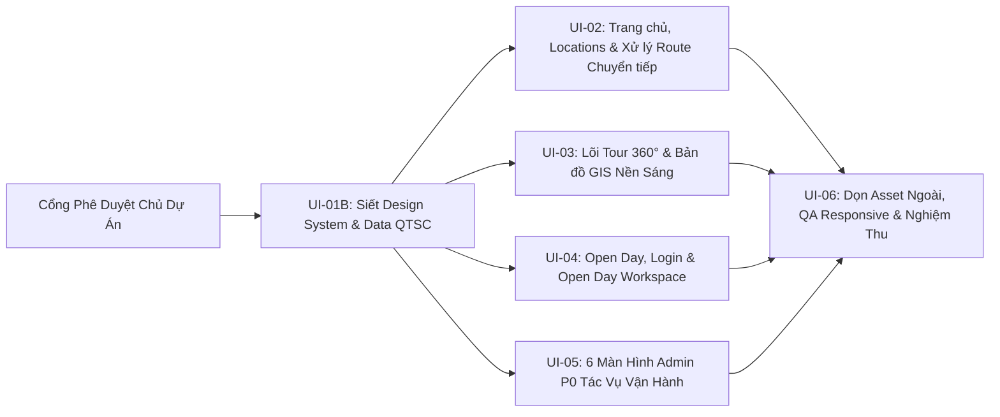

# UI_IMPLEMENTATION_ROADMAP — Lộ Trình Thực Thi Tái Thiết Kế UI (Phụ Thuộc & Nghiệm Thu)

> **Cổng Phê Duyệt Hiện Tại (`HOLD GATE`):** **CHƯA BẮT ĐẦU CODE.** Bộ 6 tài liệu Blueprint (`UI_FULL_INVENTORY.md` → `UI_IMPLEMENTATION_ROADMAP.md`) phải được Chủ dự án xem xét và duyệt các quyết định đầu vào trước khi mở khóa triển khai từ `UI-01B` trở đi.  
> **Phạm vi:** Hoàn thiện Frontend UI cho toàn bộ **19 màn hình P0** (14 route hiện có + 5 route Admin P0 mới). Các phần phụ thuộc NestJS/PostgreSQL/R2 thật và `.glb` 3D model được tách minh bạch ở Mục 4.

---

## 1. Các Quyết Định Đầu Vào Cần Chủ Dự Án Chốt Trước Khi Mở Khóa Code

| STT | Hạng mục cần chốt | Lý do bắt buộc | Tác động nếu chưa chốt |
|---|---|---|---|
| **1** | Phê duyệt bộ 6 tài liệu Blueprint này (`UI_DESIGN_SYSTEM.md`, `UI_PAGE_BLUEPRINT.md`, `UI_ROUTE_MIGRATION_MAPPING.md`) | Là chuẩn nghiệm thu duy nhất cho toàn bộ UI P0 | Rủi ro lệch định hướng khi refactor |
| **2** | Chốt **1 tên phường duy nhất** cho địa chỉ CVPM Quang Trung Lô 24, Q.12 (`P. Tân Chánh Hiệp` hay `P. Trung Mỹ Tây`) | Hiện mã nguồn dùng lẫn cả 2 tên trên Footer, Map, Contact, Games | Sai lệch thông tin hành chính trên toàn site |
| **3** | Chọn **Phương án A (Giữ thu gọn / Notice bridge)** hay **Phương án B (Redirect)** cho 5 route chuyển tiếp (`/about`, `/contact`, `/news`, `/news/[slug]`, `/games`) | Đảm bảo không xóa/redirect route ngoài phê duyệt | Không thể dọn menu và trạng thái route sạch |
| **4** | Nguồn ảnh thay thế **23 URL `lh3.googleusercontent.com`** và bộ ảnh **Equirectangular 2:1** cho Tour 360° | URL Google ngoài không bền vững và ảnh 16:9 hiện đang gây rách đường dọc giữa panorama | Giao diện `/` và `/campus` vẫn bị đường ghép dọc & nguy cơ vỡ ảnh |

---

## 2. Lộ Trình Triển Khai Theo Pha (Sau UI-01 Baseline Hiện Tại)

---

### Phase UI-01B — Siết Design System, Mở Rộng UI Kit & Dữ Liệu Chuẩn QTSC
- **Phụ thuộc:** Phê duyệt cổng Gate (ít nhất Hạng mục 1 & 2).
- **Files / Modules tác động:**
  - `apps/web/src/app/globals.css` (bổ sung `.type-*`, `tabular-nums`, tiết chế `.shadow-cta-glow`, cập nhật `.glass-hud-dark` gọn nhẹ).
  - `apps/web/src/components/ui/`: cập nhật `Button.tsx` (link support, bỏ glow nặng), `Modal.tsx` (Focus Trap), `Drawer.tsx` (responsive bottom sheet `< 45vh` trên mobile), `StateFeedback.tsx` (thêm `NotFoundState`, `AuthGateState`); thêm mới `SearchInput.tsx`, `FileDropzone.tsx`, `DataTable.tsx`, `StatusToast.tsx`.
  - `apps/web/src/data/` *(mới)* hoặc đồng bộ qua `packages/shared/src/index.ts`: Khai báo nguồn dữ liệu duy nhất chuẩn QTSC Q.12 (`OFFICIAL_CAMPUS_INFO`, `BUILDINGS`, `LOCATIONS`, `TOUR_SCENES`, `OPEN_DAY_SCHEDULE`, `ROUTE_REGISTRY`) để `Hero360Viewer`, `/campus`, `/map`, `/locations`, `/locations/[slug]`, `/events` đọc cùng 1 nguồn sự thật.
  - `apps/web/src/components/navigation/PublicHeader.tsx`, `PublicFooter.tsx`, `(portal)/layout.tsx`: Đồng bộ điều hướng công khai & thêm nút Đăng xuất/trạng thái ở Portal.
- **Tiêu chí nghiệm thu:**
  - `tsc --noEmit`, `npm run lint`, `npm run build` đạt `exit 0`.
  - `DataTable`, `SearchInput`, `StatusToast`, `NotFoundState`, `AuthGateState` render đúng trên desktop & mobile.

---

### Phase UI-02 — Trang Chủ Khám Phá Ngay & Hệ Thống Địa Điểm (`/`, `/locations`, `/locations/[slug]` + Transitional Routes)
- **Phụ thuộc:** Phase `UI-01B`.
- **Files / Modules tác động:**
  - `apps/web/src/app/(public)/page.tsx` + `src/components/home/*`: Tái cấu trúc `/` theo Blueprint (Hero panorama thoáng ≤ 3 điểm neo + 2 CTA chuẩn `Bắt đầu tham quan tự do` & `Khám phá Open Day`, giới thiệu ngắn QTSC, 4 thẻ điểm đến khớp scene ID thật, thẻ lịch Open Day gọn; **xóa `QuickAdmissionForm`**, `CampusMetricsBar` 97.7%, `VirtualTourShowcase` "Marzipano/Leaflet").
  - `apps/web/src/app/(public)/locations/page.tsx` + `src/components/locations/*`: Tối giản `LocationCard` theo ngân sách 4 phần tử; đổi nút sang `"Xem Bản đồ GIS"`; sửa bug lọc `?building=<buildingCode>`; thêm `EmptyState` & nút Reset.
  - `apps/web/src/app/(public)/locations/[slug]/page.tsx`: Đọc động theo `slug`, render `NotFoundState` khi sai slug, bỏ dữ liệu cứng `95 m² / 45 chỗ / 1 Gbps`, chuyển `` sang `next/image`, sửa CTA về `/campus?scene=<valid>` & `/map?building=<code >`.
  - Xử lý `/about`, `/contact`, `/news`, `/news/[slug]`, `/games` theo đúng Phương án A hoặc B đã được Chủ dự án duyệt tại Gate.
- **Tiêu chí nghiệm thu:**
  - `0` link `?scene=` hoặc `?building=` bị gãy hoặc lọc nhầm tòa nhà.
  - Gõ `/locations/slug-khong-ton-tai` hiển thị `NotFoundState` chuẩn.
  - Trên `/` hoàn toàn không có form tuyển sinh hay bảng tin tức.

---

### Phase UI-03 — Tái Thiết Kế Hai Lõi Immersive (`/campus` & `/map`)
- **Phụ thuộc:** Phase `UI-01B` (+ nguồn ảnh panorama equirectangular 2:1 ở Mục 1).
- **Files / Modules tác động:**
  - `apps/web/src/components/tour/` (`VirtualTourViewer.tsx`, `TourCompassHUD.tsx`, `TourSceneSelector.tsx`, `TourInfoDrawer.tsx`) & `(immersive)/campus/page.tsx`:
    - Hợp nhất hook/lõi Three.js sạch giữa Hero và Tour để không trùng 70% logic; giữ nguyên **1 `WebGLRenderer`**, đổi texture sạch kèm `dispose()`.
    - Xóa toàn bộ `setState` bên trong `requestAnimationFrame` (dùng DOM refs trực tiếp).
    - Thực thi HUD tiết chế (≥ 90% panorama không bị che), nút **`Hide UI`**, `ErrorState` tải ảnh 360°, Drawer đóng mặc định, hotspot gọn chỉ mở card khi chọn/hover.
  - `apps/web/src/components/map/` (`CampusGISMap.tsx`, `BuildingDetailDrawer.tsx`) & `(immersive)/map/page.tsx`:
    - Chuyển mặc định `/map` sang **Light Cartographic GIS Campus Map**, gỡ thanh sub-bar trùng dưới Header 56px, **ẩn tab 3D WebGL** khỏi UI công khai.
    - Sửa `BuildingDetailDrawer` đóng mặc định khi mở trang; desktop trượt phải `<= 360px`, mobile `< 45vh` bottom sheet.
    - Xóa chồng lấn HUD ở đáy bản đồ.
- **Tiêu chí nghiệm thu:**
  - Mobile `390px` vào `/map` nhìn thấy bản đồ GIS ngay (không bị Drawer che màn hình).
  - `/campus` chuyển 20 lần giữa các cảnh không sinh thêm WebGL context và không báo lỗi React re-render/leak.
  - `Hide UI` hoạt động hoàn chỉnh ở mọi độ rộng màn hình.

---

### Phase UI-04 — Open Day, Đăng Nhập Trung Thực & Không Gian Tham Dự (`/events`, `/login`, `/portal`)
- **Phụ thuộc:** Phase `UI-01B`.
- **Files / Modules tác động:**
  - `apps/web/src/app/(public)/events/page.tsx` + `src/components/events/*`: Tái thiết kế `/events` tách rõ **Lịch trình công khai** vs **Khối hoạt động giới hạn cần tài khoản BTC cấp** (`/login?next=/portal`); gỡ `TicketRegistrationModal` phát mã VIP giả và gỡ vòng quay `OpenDayMiniGame` khỏi trang công khai.
  - `apps/web/src/app/(auth)/login/page.tsx`: Bỏ prefill `PS24180`, bỏ nhãn giả `"EduID 2.0 SSO"` / `"ISO 27001"` / `"TLS 1.3 & BCRYPT"`; triển khai đủ **6 trạng thái UI** (Default, Field Error, Invalid Login, Account Locked/Inactive, **First-Login Forced Password Change**, **Inline Forgot Password Guidance**).
  - `apps/web/src/app/(portal)/portal/page.tsx` + `src/components/portal/*`: Chuyển thành **Không gian Tham dự Open Day** (bổ sung `AuthGateState` khi chưa có phiên thử nghiệm, Vé QR độ tương phản cao không dùng `alert()`, Chương trình cá nhân *Lịch của tôi / Toàn ngày*, Hoạt động tương tác Open Day được kiểm soát, và form Đổi mật khẩu).
- **Tiêu chí nghiệm thu:**
  - `0` lệnh `alert()`, `0` chứng nhận an ninh giả trên `/login`, `0` thẻ `"450 XP / học bổng"` trên `/portal`.
  - Mọi trạng thái khóa tài khoản, đổi mật khẩu lần đầu và quên mật khẩu xem được đầy đủ trên UI.

---

### Phase UI-05 — Hệ Thống Admin P0 Tác Vụ Vận Hành (`6` Màn Hình: `/admin` + `5` Subroutes)
- **Phụ thuộc:** Phase `UI-01B`.
- **Files / Modules tác động:**
  - `apps/web/src/app/admin/page.tsx` + `src/components/admin/*`: Thay 4 KPI trang trí (`142.850`) và 6 link sai bằng **Action Queue Vận Hành**, tóm tắt sức khỏe dữ liệu thật, nút hành động nội bộ và nhật ký thao tác thật.
  - Tạo mới **5 trang `page.tsx` P0** (đã có link trong `admin/layout.tsx`):
    1. `apps/web/src/app/admin/locations/page.tsx`
    2. `apps/web/src/app/admin/virtual-tour/page.tsx` (tích hợp Preview 360° click chọn `yaw`/`pitch` đặt Hotspot)
    3. `apps/web/src/app/admin/events/page.tsx` (quản lý phiên Public vs Gated + Attendance QR queue)
    4. `apps/web/src/app/admin/media/page.tsx` (upload + kiểm định tỷ lệ `2:1` + khóa xóa ảnh đang dùng)
    5. `apps/web/src/app/admin/users/page.tsx` (danh sách tài khoản + **Import CSV/Excel 3 bước** + khóa/reset MK tạm)
- **Tiêu chí nghiệm thu:**
  - Bấm vào 6/6 mục trên Sidebar `/admin` đều mở màn hình tác vụ thật (`0` lỗi 404).
  - Mọi màn hình Admin dùng chung `DataTable`, Drawer chỉnh sửa, `EmptyState`, và Modal xác nhận cho thao tác xóa/khóa.
  - Không còn số liệu giả `142.850`, `18 Scene` hay mô tả *"tiếp nhận hồ sơ tuyển sinh tự động"*.

---

### Phase UI-06 — Làm Sạch Asset, Tối Ưu Server/Client & Kiểm Định Regression Toàn Hệ Thống
- **Phụ thuộc:** Phases `UI-02` đến `UI-05`.
- **Công việc cụ thể:**
  1. Thay thế sạch **23/23 URL `lh3.googleusercontent.com`** bằng ảnh nội bộ tối ưu hoặc đường dẫn CDN được phê duyệt; gộp/xóa 1 trong 2 bản ảnh trùng SHA256 (`campus-aerial-real.jpg` vs `fpoly-campus-aerial.jpg`).
  2. Dọn mã thừa đã kiểm kê: gỡ package `lucide-react` không dùng (`0` import), xử lý dứt điểm component mồ côi (`CampusSelectorModal.tsx`, `TourHotspotMarker.tsx`).
  3. Chuyển các trang đọc thuần túy không cần `"use client"` ở cấp page sang **Next.js Server Components** (chỉ gắn `"use client"` ở các đảo tương tác con), thêm `loading.tsx`, `error.tsx`, `not-found.tsx` chuẩn App Router.
  4. Chạy kiểm thử toàn diện: `npx tsc --noEmit`, `npm run lint` (0 errors, 0 warnings), `npm run build` (`exit 0`), và chạy lại Playwright/headless capture trên toàn bộ **19 route P0** tại **5 viewport (`360px`, `390px`, `768px`, `1280px`, `1440px`)**.

---

## 3. Checklist Kiểm Tra Hồi Quy (Regression Checklist Cho Mọi PR / Pha UI)

- [ ] **Build & Static Checks:** `tsc --noEmit`, `npm run lint`, `npm run build` chạy xanh với `0` error và `0` warning.
- [ ] **Zero Broken Links:** Kiểm tra tự động toàn bộ `<Link href=...>` và `router.push(...)` — không còn `/admin/*` 404 trong P0, không còn `?scene=` lệch ID, không còn `?building=` lọc nhầm tòa nhà.
- [ ] **Zero Horizontal Overflow:** Trên tất cả `19` màn hình tại `360px` và `390px`, `document.documentElement.scrollWidth <= window.innerWidth`.
- [ ] **Touch & Accessibility:** Nút bấm và pin tương tác đạt tối thiểu `44×44px`; điều hướng bàn phím `Tab` + `Escape` đóng Drawer/Modal hoạt động ổn định; không có `alert()` hoặc `onClick` trên thẻ `
` trơ.
- [ ] **Truthfulness & Boundary Check:** Không xuất hiện form tuyển sinh trên `/`, không xuất hiện tab 3D khối hộp trên `/map`, không còn nhãn `"4K"`, `"Marzipano"`, `"Leaflet GIS"`, `"EduID 2.0"`, `"ISO/IEC 27001"`, và không còn `lh3.googleusercontent.com`.

---

## 4. Ranh Giới Chuyển Giao Sang Backend & P1/P2 (Honest Technical Handoff)

Sau khi hoàn tất `UI-06`, toàn bộ giao diện Frontend UI đạt **100% thiết kế chuẩn xác và tương tác đầy đủ ở tầng trình duyệt (Client Prototype / Mock State)**, sẵn sàng nối ngay vào `apps/api` (NestJS + Prisma + PostgreSQL + Cloudflare R2/S3) ở các hạng mục cần lưu trữ & bảo mật thực tế:

| Tính năng | Trạng thái sau `UI-06` | Yêu cầu bổ sung khi nối Backend (`apps/api`) |
|---|---|---|
| **Auth & Route Protection (`/login`, `/portal`, `/admin`)** | Giao diện đủ 6 trạng thái + `AuthGateState` trên UI | JWT `HttpOnly` Cookie + `bcrypt`/`argon2` + Next.js Middleware & NestJS `JwtAuthGuard`/`RolesGuard` + ép đổi MK lần đầu từ DB |
| **Media Library & Panorama 2:1 (`/admin/media`, `/campus`)** | UI kiểm tra tỷ lệ & upload preview | Presigned URL Cloudflare R2/S3 + kiểm tra magic-bytes + lưu bảng `media_assets` & xóa an toàn |
| **Open Day & QR Check-in (`/events`, `/portal`, `/admin/events`)** | Tách rạch ròi quyền & giao diện lịch/QR | Sinh mã QR ký số duy nhất trong PostgreSQL, quét check-in thực tế & giới hạn sức chứa |
| **Account Import (`/admin/users`)** | UI 3 bước upload & bảng báo lỗi từng dòng | Worker/Service parse `.xlsx`/`.csv`, sinh mật khẩu ngẫu nhiên, hash trước khi lưu DB |
| **3D Campus Explorer (`/admin/3d-models` & tab 3D `/map`)** | **Tạm ẩn ở P0** vì 0 `.glb` | Khi trường cung cấp file `.glb/.gltf` đo đạc QTSC thật mới bật ở **P2** cùng R3F/Drei |
